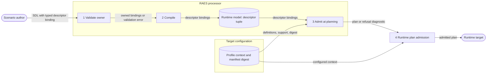

# ADR-120: Owned and Admitted Typed Descriptor Profiles

## Status

accepted

## Date

2026-10-31

## Classification

Classification: FM2
Required artifacts: invariant list (Decision §5), typed IR (`RuntimeModel.descriptor_profile_bindings`), unit tests (`implementations/python/tests/test_issue_298_descriptor_profiles.py`)
Waivers: none

The rule must stay the same in validation, compiled form, planning and runtime plan admission.
It adds no state machine.

## Context

Issue #1208 extended five SDL descriptor fields with the shared `DomainProfileBindingModel`:

| Host field | Built-in values |
| --- | --- |
| `identity_facades.<facade>.protocol` | `oidc` |
| `relationships.<relationship>.forest_trust.trust_type` | `forest` |
| `relationships.<relationship>.identity_federation.protocol` | `ldap_tls`, `scim` |
| `relationships.<relationship>.identity_federation.mapping_intent` | `groups_to_roles` |
| `agents.<participant>.interactive_access.<id>.channel` | `ssh`, `rdp` |

The [typed selection contract](../../../specs/sdl/profile-selections.md) gives provisioning selections an exact owner and planning admission.
The descriptor fields received neither.
Validation and compilation accepted a typed descriptor binding with any owner, context and value.
No component resolved or admitted it.
An interactive-access binding with a host, port and password value compiled into the participant runtime model unchanged.

The [domain-profile contract](../../explain/reference/domain-profiles.md) requires an explicit owner for each binding.
It also requires that missing required meaning fails before mutation.
SEM-218 requires that RAES rejects an unsupported exact requirement and does not approximate it.

## Decision

### 1. One host table

`raes_contracts.descriptor_profiles.DESCRIPTOR_PROFILE_HOSTS` names the five host fields.
Each entry has the field path, the concept family and the binding context:

| Host field | Concept family | Context |
| --- | --- | --- |
| facade `protocol` | `identities` | `identity-facade-protocol` |
| forest trust `trust_type` | `relationships` | `forest-trust-type` |
| federation `protocol` | `relationships` | `identity-federation-protocol` |
| federation `mapping_intent` | `relationships` | `identity-federation-mapping-intent` |
| interactive-access `channel` | `relationships` | `participant-interactive-access-channel` |

Composition, semantic validation and compilation read this table.

### 2. The SDL field owns the binding

A typed binding at a host field has this owner:

- `owning_contract_id`: `sdl-authoring-input-v1`.
- `canonical_address`: the RFC 6901 JSON Pointer of the host field, for example `#/agents/red/interactive_access/shell/channel`.
- `concept_family` and `context`: the values of its host entry.
- `lifecycle_phase`: `authoring`.
- `use`: `constraint`.

The binding provenance basis is `author-supplied`.
Each nested binding has the same owner.
Semantic validation rejects any other owner.
Composition renames the declaration token of the pointer with the declaration, so an imported binding keeps a valid owner.

### 3. Compiled carriage

The compiler copies each typed descriptor binding into `RuntimeModel.descriptor_profile_bindings`.
The order is host-table order, then declaration order.
The participant interactive-access record keeps its typed channel.
The model refuses construction when a compiled typed channel is absent from the tuple.

### 4. Admission or refusal

Planning admits each binding against the profile context of the target:

1. A context is present.
2. Its digest equals the manifest `domain_profile_context_digest`.
3. `admit_domain_profile_bindings` admits the binding with the constraint operations: structural validation and semantic validation.

A failure gives one error diagnostic, `realization.descriptor-profile-unsupported`, before mutation.
Runtime plan admission applies the same check against the configured context of the target.
The checks admit each host binding separately, so binding ids need not be unique across hosts.

### 5. Invariants

- D1: The host table is the only list of descriptor hosts.
- D2: After validation, each typed descriptor binding has the owner of §2.
- D3: The compiled tuple holds exactly the typed descriptor bindings of the scenario, unchanged.
- D4: A plan without an admitted context for every compiled binding has an error diagnostic.
- D5: Runtime plan admission refuses the same plan for its target.
- D6: Admission grants no access, login, trust operation, credential, endpoint or provisioning operation.
- D7: Built-in string values keep their meaning and need no profile context.
- D8: Diagnostics have fixed text and do not show a profile value.

### 6. Data flow

The author document is untrusted input.
The target profile context is trusted local configuration.
Only an admitted plan crosses into the target.

## Consequences

- A typed descriptor binding needs the exact owner of §2. A binding that copied another host owner fails validation. The [issue #298 decision](../issue-298-tool-authoring.md) gives the migration.
- A target that installs no semantics for a descriptor profile refuses the plan. The reference target installs none.
- A typed descriptor value is public profile data. The pinned definition schema checks it at admission. Credentials stay with the [account credential contract](../../../specs/sdl/account-credential-bindings.md).
- The published schemas do not change.
- Later realization of a descriptor can require more operations, such as execution, at its own consuming boundary.

## Alternatives considered

- Reject typed descriptor bindings. This removes the #1208 extension and gives no path for installed semantics.
- Check only the owner. Unadmitted opaque values then still enter the plan.
- Admit during semantic validation. SDL validation has no target, and an abstract model must stay valid without one.
