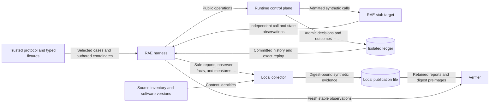

# Harness evaluation publication

Date: 2026-10-29.

## Decision

RAE evaluates its contracts and runtime through its own harness.
A concrete backend is not a prerequisite.
Concrete backend claims require separate realization evidence from their owner.
This distinction amends ASR-536 and the affected ADR-101 and ADR-108 delivery guidance.

Reuse the issue #1007 protocol, typed cases, runtime runner, report validator, and safe evidence projection.
Add a local test collector and verifier beside that harness.
Keep this projection as test evidence, not a new portable experiment contract.
Reuse the local collection pattern in `mixed_control_demonstration.py`.
Use canonical JSON digests and the existing runtime-mapping source inventory.

The collector retains each validated conformance report and the digest preimages required to inspect it.
It binds the protocol, authored configuration, observed report, derived measures, source content, and allowlisted software versions.
It checks source identity before and after collection.
The publication references the shared content-addressed runtime-mapping source inventory.
It does not copy that inventory into each evaluation.
Verification checks the current source digest before checking report joins.
The trajectory binds a safe observer projection as well as the validated runtime report.
The projection retains operation identities, evaluation origins, admitted action identifiers, feedback, monitor observations, and controller state.
The verifier checks observation-to-measure consistency and the fixed case expectations.
Fresh comparison rejects reused operation identities even when report annotations change.
It then compares stable observations with a fresh harness execution.
Fresh execution identifiers can differ.
Exact ledger replay remains a separate check within the adaptive case.
The temporary runtime store is removed after execution.
Publication therefore supports fresh recollection, not restoration of that store.

Publication files use content-addressed names and exclusive local creation.
They contain only synthetic fixture data, safe reports, counts, and digests.
The collector neither reads credentials nor transfers data to another service.

## Architecture and data flows

Fixtures and installed harness code are trusted.
Provider results cross the runtime validation boundary.
The collector cannot grant runtime authority.
Monitor advice remains non-authorizing.
The publication file is untrusted input to verification.
Digest checks establish internal consistency, not authorship or independent replication.

The existing #1007 sequence diagram defines the operation, commit, target, and readback order.
No new deployment or runtime component is required.

## Security and evidence

| Threat and boundary | Control | Verification |
| --- | --- | --- |
| A declaration becomes a result | Retain executed reports and compare fresh observations | Reject incomplete cases and inconsistent report joins. |
| Results drift from their inputs | Bind source, protocol, authored inputs, and report | Reject altered source identity, coordinates, reports, and measures. |
| Denial permits an effect | Reuse final-sink enforcement and independent observations | Denied cases retain zero prohibited effects. |
| Apparatus failure becomes safety success | Retain observed failure diagnostics and invalidation | Invalidated evidence has unknown safety and no attack success. |
| Permitted influence becomes a violation claim | Keep policy disposition separate from attack success | Injection can pass its policy check and achieve its side objective. |
| Private content enters publication | Synthetic fixtures and existing safe report projection | Check that hidden objectives and raw provider failures are absent. |
| Harness evidence becomes backend or mathematical assurance | Fixed claim scope and explicit unsupported dimensions | Reject native execution claims and preserve separate assurance status. |

The host remains trusted.
Finite deterministic cases provide no statistical confidence or universal robustness.
Declared collusion, correlation, memory, and intervention fields do not prove exercised coverage.
The public guide identifies each unsupported condition.
Usefulness and costs retain their measured proxy meanings.

## Authority and supporting artifacts

Amend ASR-536 to require exact RAE harness compositions for RAE results.
Preserve exact realization requirements for concrete backend claims.
Record ADR-101 and ADR-108 amendments with their matching manifest pins.
Remove backend prerequisites from the RAE evaluation and publication graph nodes.
Keep conditional backend gates for backend consumer guidance.
Update the dependency checker against the corrected graph.
Preserve historical observations and numbered research captures.

Update assurance fulfillment links, scientific-completeness guidance, lineage, and the public participant-control guide.
Do not promote mathematical assurance or whole-scenario completeness.
The harness collector, verifier, and dependency checker provide architecture-as-code.
Existing runtime policies remain policy-as-code; their authority and behavior do not change.
The requirement-order policy maps ASR-536 to harness publication paths and the RAE conformance predecessor.
Its ownership check rejects production runtime edits.
No published schema, package version, or changelog change is required.

## Reference and document review

Python 3.14 `hashlib` documentation defines SHA-256 byte identities.
Pytest 9 fixture guidance supports isolated test state.
NIST SP 800-160 Vol. 1 Rev. 1 supplies the security boundary and evidence discipline.
The #1007 design and ADR-115 define existing RAE ownership boundaries.

Reviewed against ASD-STE100 Issue 9, rules 1.2–1.11, 5.1–5.2, and descriptive-text rules.
The locally available official standard supplies the writing rules and technical-noun guidance.
Sentences state one fact and use consistent project technical names.
Implementation tasks remain in the issue plan.
