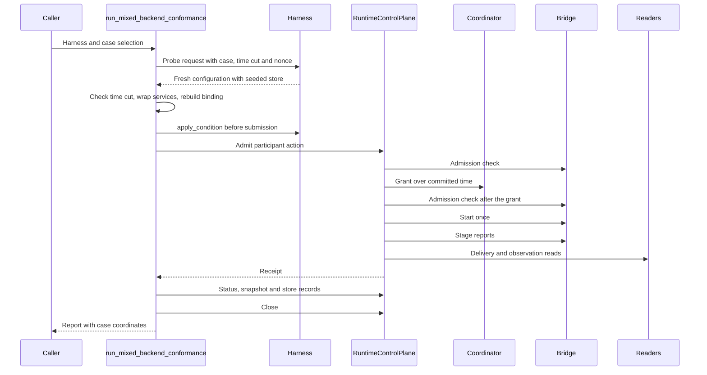
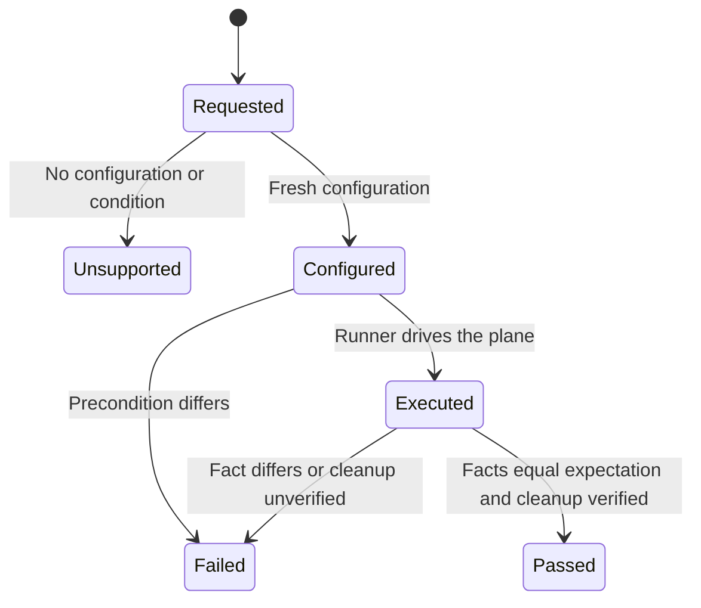
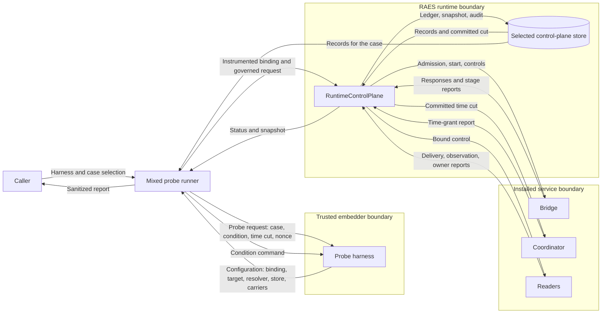

# Executable mixed-backend conformance

Issue: #1017. The issue has no requirement UID. The issue title, body and
acceptance criteria are the contract. The binding guardrails are in
[the preflight note](issue-1017-executable-mixed-conformance-preflight.md).
This design adds a probe family to the backend conformance verifier. It does
not change runtime admission, execution, settlement or recovery.

## Existing owners

Package paths below start at `implementations/python/packages/`.

| Path | Use |
| --- | --- |
| `raes_runtime/control_plane.py` | `RuntimeControlPlane` is the only executor of a probe. |
| `raes_runtime/mixed_runtime.py` | `MixedRuntimeBinding` joins the admitted plan, profile, components and installations. |
| `raes_runtime/mixed_backend_installation.py` | `MixedBackendInstallation` validates role pins, call shapes and independent implementations. |
| `raes_runtime/mixed_backend_invocation.py` | Admits, grants, admits again, starts once, reads stages and settles. |
| `raes_runtime/control_plane_configuration.py` | Refuses reusable control with a mixed runtime. Refuses a distributed dispatcher with portable services. |
| `raes_runtime/participant_control_runtime.py` | `MixedControlRuntimeBinding` runs reusable control cycles on one target. |
| `raes_contracts/contracts/mixed_backend_transcript.py` | Validates stage reports and computes the established state. |
| `raes_conformance/conformance/report.py` | Case and report family, payload projection and honesty validation. |
| `raes_conformance/conformance/participant_policy_execution.py` | `_CallCounter` counts real participant-runtime calls. |
| `raes_conformance/conformance/participant_opacity_execution.py` | Runner-owned control planes and executed configuration digests. |

## Architecture

### Components

| Module | Responsibility |
| --- | --- |
| `raes_conformance/conformance/mixed_backend_types.py` | Harness protocol, probe request, configurations, conditions and report coordinates. |
| `raes_conformance/conformance/mixed_backend_cases.py` | Runner-owned case catalog, selection, probe digests and requested time cuts. |
| `raes_conformance/conformance/mixed_backend_execution.py` | Recording service wrappers, control-plane construction, execution and fact collection. |
| `raes_conformance/conformance/mixed_backend_judging.py` | Composition verdicts and case results. |
| `raes_conformance/conformance/mixed_control_probes.py` | Reusable control cycles, dispatch refusal and combination probes. |
| `raes_conformance/conformance/mixed_backend_probes.py` | Public `run_mixed_backend_conformance()` and report assembly. |
| `raes_conformance/conformance/report.py` | Optional `mixed_binding` coordinates and the added honesty rules. |
| `raes_contracts/contracts/mixed_backend_transcript.py` | Public `mixed_backend_time_comparison()`. The stage validator and the runner use it. |

### Responsibility split

The harness is a typed, in-process option of the trusted embedder. It is never
a module path, URL, command or credential source. For each probe request, the
harness realizes the requested backend condition and time cut. It then returns
a fresh configuration: the mixed runtime binding with installed services, the
primary target, the crossing policy resolver, a seeded control-plane store, the
identity and the governed carriers. The harness supplies no expected outcome,
stage fact, digest or verdict.

The runner owns the catalog, the expectations, the precondition checks, the
service wrappers, the execution and the verdicts. It reads facts only from the
runtime: operation status, the invocation ledger in the supplied store, the
composition history and the participant histories. The expected time
comparison comes from the admitted time model, not from a backend answer.

The store comes from the embedder, so the runner creates no database. A restart
probe asks for a second configuration over the same durable store. A harness
that cannot reopen its store returns no configuration, and the case is
unsupported.

### Instrumentation

The runner wraps each installed role implementation in a recording wrapper. The
wrapper keeps the signature of the wrapped method, so the installation shape
check stays in force. The runner then rebuilds the installation and the binding
with `dataclasses.replace()`, so their own validators run again. Each wrapper
records the role and method of every call. A hook after `grant` applies the
condition for the after-grant refusal case. The runner also wraps each
component participant runtime in `_CallCounter`. A portable edge must not call
a component runtime directly.

### Case catalog

| Case | Subject | Condition or variant | Passing result |
| --- | --- | --- | --- |
| `edge-executes` | Edge | Nominal | Succeeded. Ordered grant equals the time-model comparison. One start. Execution, delivery and declared observation from their pinned producers. Admitted allocation and declared loss in history. Replay starts nothing. |
| `edge-time-mapped-incomparable` | Edge | Source clock advanced past the mapped destination | Failed. Incomparable grant. No start. |
| `edge-time-segment-incomparable` | Edge | Destination clock in a new segment | Failed. Incomparable grant. No start. |
| `edge-unbound-refused` | Edge | Installation removed | Refused before any service or provider call. |
| `edge-missing-mapping-refused` | Edge | Binding names an absent mapping | Binding refused. No service call. |
| `edge-reversed-mapping-refused` | Edge | Binding reverses the clocks | Binding refused. No service call. |
| `edge-undeclared-loss-refused` | Edge | Binding declares another loss | Binding refused. No service call. |
| `edge-refused-before-claim` | Edge | Willingness withdrawn before submission | Rejected receipt. No grant. No start. |
| `edge-refused-after-time-grant` | Edge | Willingness withdrawn after the grant | Cancelled. Grant retained. No start. |
| `edge-start-refused` | Edge | Start acknowledgement refused | Indeterminate. Reservation retained. No execution, delivery or observation. |
| `edge-partial-execution` | Edge | Partial native execution | Indeterminate. Partial or unknown execution and residual state retained. |
| `edge-missing-delivery` | Edge | Destination receipt unavailable | Indeterminate. Execution retained. No delivery or observation. |
| `edge-restart-no-reissue` | Edge | Store reopened with fresh services | Same operation. Retained stages unchanged. No new call. |
| `handoff-commits` | Handoff | Nominal | Succeeded. Transfer fenced on the committed head and revision. Destination owner at the next revision. |
| `handoff-stale-transfer` | Handoff | Stale native owner | Failed. Source owner retained. Phase unchanged. |
| `handoff-repeated-transition` | Handoff | Stale, then nominal, then again | Failed, then succeeded with a new invocation, then refused with no transfer. Replay returns the original. |
| `control-repeated-cycles` | Control | Four handoff cycles | Each cycle advances one revision. Retry adds nothing. Stale proposal rejected. Next action dispatches once and succeeds. |
| `control-dispatch-refused` | Control | Backend refuses the action | Failed with the backend diagnostic. One dispatch. Control history unchanged. |
| `combination-reusable-control-with-mixed-runtime` | Combination | Joint configuration | Always unsupported. |
| `combination-distributed-portable-mixed` | Combination | Distributed dispatcher | Always unsupported. |

A negative case passes only when the correct rejection occurs. An unsupported
case never passes. The report passes only when every selected case passes. An
empty or unknown selection fails before execution.

### Refusal attribution

The runner first checks that the configuration supplies every baseline input.
A missing input fails the case before execution. Each negative case then
requires evidence of the intended refusal:

| Case | Required refusal evidence |
| --- | --- |
| `edge-refused-before-claim` | The `runtime.control-plane.backend-admission-refused` code after a bridge admission check. |
| Binding variants with other installations | `validate_mixed_backend_bindings()` refuses the variant set, and the rebuild refuses it. The unmodified set passes the same rebuild first. |
| `edge-unbound-refused` for the only edge | The unmodified configuration executes first. Dispatch then refuses with a validation error, with no attempt and no call. |
| Moved-phase attempt in `handoff-repeated-transition` | `NewClaimRejected` from the current-state claim boundary, after the phase moved. |

### Failure behavior

| Event | Case outcome |
| --- | --- |
| The harness returns no configuration. | `unsupported` |
| `apply_condition()` returns `False`. | `unsupported` |
| The harness raises, or a precondition differs from the request. | `failed` |
| The runtime raises where the case expects execution. | `failed` with a sanitized diagnostic |
| The runtime refuses where the case expects refusal. | Judged as evidence |
| A control plane does not close. | `failed`, `cleanup_verified=False` |

An observed failure takes precedence over `unsupported`. Cleanup status
survives every outcome.

### Sequence for one edge case

### Case outcome states

### Evidence and provenance

Each composition case carries `MixedBackendCaseBinding` in `ConformanceCaseResult.mixed_binding`:

- profile identity, plan identity, plan entry and run identity;
- obligation identity, binding identity and the binding reference digest;
- time model reference and digest, clocks, mapping, ordering basis and coupling;
- declared loss reference;
- for each component: target name, backend name and version, manifest digest,
  envelope identity and digest, and realizer configuration digest;
- for each role: service reference, version and digest;
- for each retained stage report: sequence, stage, producer, status, report digest and evidence references.

Control cases record the target coordinates, each control policy identity, and
each control occurrence with its disposition and digest. The case also records
the expected and accounted calls, residual state, cleanup, limitations and
explicit nonclaims. For composition cases, the configuration digest covers the
executed runtime, binding, components, services and supervision bounds. For
control cases, it covers the runtime, the target and the content of each
compiled behavior specification and policy. The tool digest covers the probe
revision and the RAES distribution. The environment digest comes from the harness.

Every case uses the `hermetic-live` execution basis and the
`installed-service` realization owner. The evidence origin is
`observed-execution`. The runner never sets `native_conformance`. An in-process
service, a reference service or a test service is not concrete backend
realization. ADR-115 keeps native evidence with the backend distribution.

### Report honesty rules

`validate_backend_conformance_report()` gains these rules:

- A case is `passed` only when its outcome is `passed`.
- A passing report has at least one case.
- A native report requires a native basis for every case with mixed coordinates.
- A passing case with mixed coordinates carries component coordinates, the configuration digest, the tool digest and the environment digest.

### Execution cost

`MixedRuntimeBinding` validation resolves evidence output contracts through
`raes_contracts/evidence_output_validation.py`. That resolver checked the same
published schema again on every call, and each binding construction paid for
many checks. The resolver now keeps the checked validator for each exact schema
content. A changed schema file has new content, so the resolver checks it again.
A refusal is never kept.

## Systems security engineering

| Asset | Protection need |
| --- | --- |
| Runtime authority and committed state | Integrity. The runner uses only the public runtime entry points. |
| Installed service pins and binding | Integrity. Rebuilt values pass the incumbent validators again. |
| Stage reports and evidence references | Integrity and correct attribution to the pinned producer. |
| Conformance report | Honesty. No secrets, host paths, native payloads or exception input. |

| Threat | Boundary | Control | Verification |
| --- | --- | --- | --- |
| A service claims an order that the mapping does not prove (spoofing). | Service to runtime | Stage validator refuses it. The case requires a retained incomparable grant. | Constant-order coordinator test. |
| A declaration or method shape stands in for execution. | Harness to runner | Only executed stage facts pass a case. A missing installation is unsupported. | Interface-only service test. |
| A harness supplies a verdict or a stage fact. | Harness to runner | The protocol has no field for either. The runner reads the runtime. | Protocol shape and runner tests. |
| A harness misstates the time cut. | Harness to runner | The runner compares the committed cut with the request before execution. | Wrong-cut harness test. |
| A wrapper weakens the shape check. | Runner to installation | The wrapper keeps the wrapped signature. The installation validator runs again. | Shape test on wrapped services. |
| A refusal hides an effect. | Runtime to service | Each negative case requires zero starts. | Call-count assertions. |
| An unrelated failure passes as the intended refusal. | Runner to report | Baseline input check and the refusal evidence in "Refusal attribution". | Missing-input, owner-admits and moved-phase regressions. |
| An unsupported outcome hides an observed failure. | Runner to report | Failures and cleanup take precedence over `unsupported`. | Failed-close and control-failure regressions. |
| A reference service passes as native. | Runner to report | Basis and owner are fixed. The validator refuses native mixed reports without native cases. | Report honesty tests. |
| Exception text leaks into the report. | Runner to caller | `sanitized_failure_message()` and stable diagnostic codes. | Leak test with a secret-bearing exception. |
| A blocked service holds the runner. | Runtime to service | The runtime applies its finite supervision budgets. | Existing runtime supervision tests. |
| Joint support follows from two separate passes. | Runner to report | Combination cases are always unsupported. | Combination tests. |

Residual risks:

- The embedder authenticates the services. Distinct pins do not prove independent deployments.
- A harness can realize a condition incorrectly. The case then fails or stays unsupported. It cannot pass with the wrong facts.
- A failed close can leave backend resources. Cleanup of native resources stays with the embedder.
- The probes are finite. They do not prove behavior for unexecuted cuts, conditions or configurations.

## Data flow

Service output is untrusted until the runtime validates it. The runner trusts
only facts that the runtime retained. The report is the only output, and the
caller selects any durable copy.

## Supporting artifacts

- Policy as code: `tools/policy/adr_policy.yaml` lets `raes_conformance` import
  `raes_runtime.control_plane_store`. The runner uses only its
  `NewClaimRejected` signal to identify a moved-phase refusal. Other runtime
  imports stay `raes_runtime.control_plane` and `raes_runtime.registry`. The
  runner reads the supplied store through the store protocol.
- Architecture as code: the six new modules stay under the 500-line cap of
  ADR-015. The conformance facade and its parity test add the public names.
- ADR changes: none. ADR-102 sections 12 and 13 assign this verifier to #1017.
  ADR-113 owns the shared execution machinery. ADR-115 keeps native evidence
  outside RAES. This design follows those decisions and adds none.
- Reference documents: `docs/explain/reference/backend-conformance.md` and
  `docs/migration/mixed-backend-execution.md` describe the probe family.
