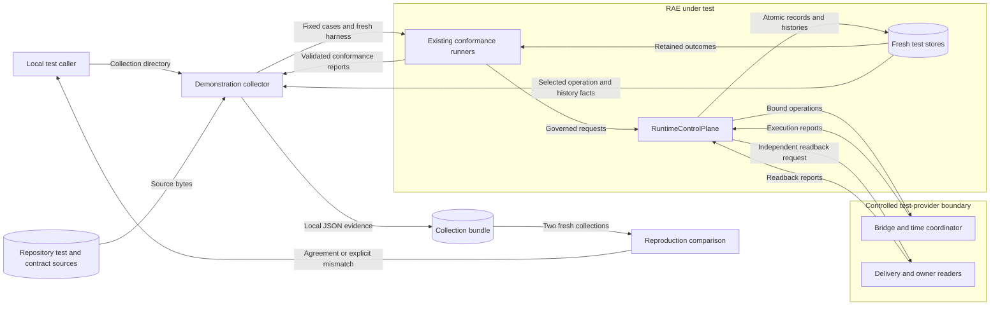

# Mixed-control runtime demonstration

Issue: #1018.

## Boundary and existing owners

This test uses controlled backend harnesses to check RAE.
It needs no downstream backend, daemon, credentials, or external service.
The user confirmed this upstream boundary on 2026-10-29.
ADR-115 assigns native qualification to backend distributions.

The test reuses these owners:

- `mixed_conformance_harness.py` installs fresh test services and stores.
- `mixed_execution_fixtures.py` supplies separate bridge, coordinator, and reader implementations.
- `run_mixed_backend_conformance()` drives the actual `RuntimeControlPlane` and judges retained facts.
- `run_modular_control_conformance()` judges control decisions and governed effects.
- `BackendConformanceReport` and its existing validator own the conformance results.
- The canonical JSON digest helper owns evidence digests.

All Python paths above are in `implementations/python/tests/` or the installed conformance package.

## Architecture

A test command writes the evidence to a new local directory.
It runs the existing mixed probe catalog with an affine clock mapping.
The source tick maps to twice its value on the destination clock.
The catalog includes simultaneous mixed execution and staged responsibility transfer.
It also tests repeated control changes on one target.
Two refused joint configurations remain explicit unsupported rows.
Separate supported rows do not establish support for their combination.

The command also tests strict denial and a governed handoff effect.
The existing owner observer checks the committed controller history independently of the effect proposal.
The denial requires zero participant action calls.

The harness retains operation identifiers, stage reports, composition histories, and control histories from its selected stores.
It records test-provider call counts beside the runtime results.
These records let us compare runtime claims with actual test calls.
The existing report projection preserves policy, mapping, timing, component, and configuration identities.

The bundle adds collection identity, source digest, interpreter identity, and the fixed capability matrix.
It holds the existing reports. It adds no public report contract.
The source digest covers repository code, test apparatus, and portable contract fixtures.
Evidence output stays outside those source roots to prevent a circular digest.
The retained test record holds stable facts, operation IDs, and both full-bundle digests.
Full reports and histories are generated in the caller's local output directories.

A second process collects evidence with fresh stores and a new collection identity.
The check compares source, host facts, case coverage, setup, results, and measured facts.
Each bundle keeps its own operation IDs and timestamps.
The check permits fresh IDs. It keeps their evidence.
It rejects a reused collection, incomplete results, changed configuration, or changed measured behavior.
This is a fresh run in a second process. It is not a study by a second party.

## Capability matrix

| Selection | Expected disposition | Evidence |
| --- | --- | --- |
| Simultaneous mixed edge | Supported in the test apparatus | Two active components, mapped grant, bridge execution, delivery, and observation |
| Staged handoff | Supported in the test apparatus | Transfer and separate owner readback; one phase revision |
| Repeated reusable control | Supported on one target | Four accepted changes, exact retry, and stale rejection |
| Governed handoff effect | Supported on one target | Owner operation and independent controller-state observation |
| Strict denial | Supported rejection | Denied composition and zero participant action calls |
| Reusable control with mixed runtime | Unsupported | Configuration refusal |
| Distributed dispatcher with portable mixed services | Unsupported | Configuration refusal |

Missing mappings, incomparable clocks, withdrawn willingness, start refusal, partial execution, missing delivery, and stale transfer retain separate outcomes.
No result establishes native backend qualification, universal equivalence, physical timing, or simulation-to-operation transfer.

## Systems security

| Asset | Threat and boundary | Control | Verification |
| --- | --- | --- | --- |
| Runtime authority | A harness supplies a verdict across the provider boundary. | Existing runners own expectations and judge actual runtime facts. | Mutated provider and false-report regression cases fail. |
| Prohibited effects | A denial or failed order still dispatches an action. | Count actual starts and participant action calls. | Denial and incomparable-order cases require zero effects. |
| Evidence integrity | Missing cases or unsupported combinations appear successful. | The fixed matrix checks every selected result. | Missing, duplicate, changed, and falsely passing rows fail. |
| Reproduction | Prior output is passed off as a fresh execution. | Fresh stores and collection identifiers; source and configuration comparison. | Reused collection and configuration drift fail. |
| Local files | Output overwrites another collection. | Exclusive creation of the caller-selected collection directory. | A repeated output destination is refused. |
| Sensitive host state | The collector reads credentials or publishes native payloads. | Only repository test inputs and selected portable store fields enter the bundle. | Inspect serialized evidence; no environment dump or external resource discovery. |

Test doubles are trusted test apparatus.
Their observations establish bounded RAE behavior rather than independent native truth.
Finite tests cannot prove all schedules or effects.

## Data flow

## Supporting artifacts and review

Policy as code needs no change.
The existing module boundaries and report validators apply without an exception.
Architecture as code stays in repository test modules under the existing source-size limit.
The demonstration adds no installed runtime module, public schema, or backend discovery path.
ADR-102, ADR-108, ADR-110, and ADR-115 already define the applicable boundaries.
No ADR amendment is required.

The reference guide documents collection, comparison, evidence fields, and claim limits.
The writing review applies ASD-STE100 Issue 9 rules for words, sentences, procedures, descriptions, and consistent terminology.
Technical names retain their repository meanings.
Design statements describe the apparatus; runnable procedures stay in the reference guide.

## References

- Python 3.14, `unittest.mock`: test substitutes and observations across a specified interface.
  <https://docs.python.org/3.14/library/unittest.mock.html>
- pytest 9, temporary directories: fresh local state for each test.
  <https://docs.pytest.org/en/stable/how-to/tmp_path.html>
- NIST SP 800-160 Volume 1 Revision 1, verification and validation: protection needs, boundaries, controls, and evidence.
  <https://csrc.nist.gov/pubs/sp/800/160/v1/r1/final>
- ASD-STE100 Issue 9, sections 1, 4, 5, 6, and 9: writing and terminology review.
  <https://www.asd-ste100.org/assets/files/ASD-STE100_ISSUE9.pdf>
