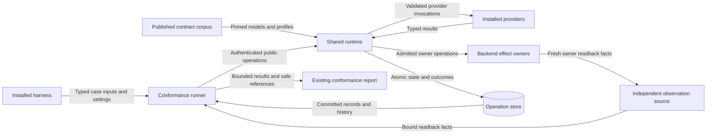
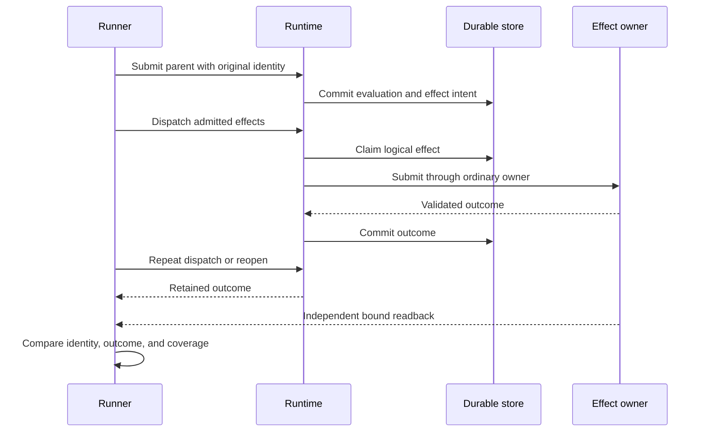

# Modular control conformance design

This design serves ASR-538.
Each backend owns its native proof.
The [preflight](issue-1071-modular-control-conformance-preflight.md) sets the binding rules.

## Components and contracts

The installed `raes_conformance.conformance` package owns the runner and its case list.
An installed harness supplies typed inputs, runtime settings, and separate owner readback.
The runner creates `RuntimeControlPlane` with the supplied `RuntimeTarget`.
The runner calls the public API.
It reads the stored state.
The harness cannot supply a verdict.

Each case names a catalog obligation and a declared effect subset.
The runner requires every selected obligation and every claimed effect kind.
An omitted case fails coverage.
A rejected positive case fails.
A negative case passes only when its expected refusal prevents prohibited execution.
The recorded cause must match that case's own obligation.
An unrelated refusal earns no coverage.
Unrequested effects remain visible as exclusions.

Cases have finite steps and fixed expected results.
Steps cover episode start, action admission, control admission, effect dispatch, and durable reopen.
Typed initial snapshots supply admitted clock state before runtime ownership.
Plan registration, provisioning, projection, and v2 selection use their public runtime operations.
An input factory can derive the next step's exact inputs.
These factories are trusted installed code.
They have no authority beyond the configured runtime owner.
They are not a portable execution language or a sandbox.

The runner counts actual calls.
It keeps reads apart from effects.
It compares the stored status, history, claims, receipts, and separate readback.
Exact retry and reopen must keep the same claims and budgets.
Compare resolved inputs, full receipts, stored records, and the snapshot content pin.
Require an exact replay after reopen before granting restart coverage.
An applied effect requires an observed owner outcome.
Missing or conflicting facts fail the case.
Uncertain effects cannot become applied through report construction.

The existing report family carries all results.
A typed binding names the case, subset, and exact artifacts.
Each profile, mechanism, owner, policy, cut, and memory scope has a content pin.
The stored records supply its exact runtime facts.
Reports contain safe references and content digests.
They do not contain private provider inputs or raw backend exceptions.

## Coverage and failure behavior

| Obligation | Required observation |
| --- | --- |
| Subset | Keep the full apparatus. Prove coverage for the active subset. |
| Inputs | Keep exact prior inputs. Block a dependent call when needed input fails. |
| Optional failure | Lost advice with no veto, payload, state, or executable effects. |
| Support | Exact and admitted bounded support remain distinct from weakened or unsupported coverage. |
| Decisions | Deny and withhold block the parent in each effect phase. |
| Conflicts | Conflicting results cannot resolve through callback or list order. |
| Non-IFC | A decision or score needs no fake IFC fact. |
| Effects | Use stored intent, the actual owner, and separate readback. |
| Authority and stale state | Wrong rights or stale inputs block dispatch. |
| Retry and recovery | Keep the same outcome, key, and spent budget. |
| Authored policy | Keep the authored policy in the public plan. |
| Final release | Keep a failed outcome. Release or deliver no refused value. |
| Integrity | Bad apparatus facts invalidate the proof. They are not in-world attacks. |

The published corpus includes positive and negative expectations.
Existing tests also cover call races and interrupted writes.
Those tests add detail to the finite cases.
They prove no native backend effect.

General native resume remains unsupported.
Authored recovery checks use the existing parser, compiler, planner, and policy capability admission.
The runner does not resolve recovery policy or implement retries.
Effect continuation and general native resume remain separate claims.

## Data flow and trust boundaries

The runner accepts trusted installed code and bounded inputs.
Provider results are untrusted.
Only runtime admission authorizes owner dispatch.
The observer supplies bound facts.
Those facts grant no right to act.
The report contains only safe evidence pins.
No new network service or remote fixture loader is introduced.

## System security

Protect private values, call rights, stored claims, provider state, and sound evidence.
The runner preserves the existing tenant, actor, target, run, audience, and policy bindings.

| Threat and boundary | Control | Check |
| --- | --- | --- |
| Provider grants itself authority | Existing contextual API-424 validation and exact installed bindings | Revoked authority and forged or stale input cases. |
| Refusal still invokes an owner | Runtime admission and final-sink enforcement | Count prohibited calls and inspect durable outcomes and disclosure facts. |
| Duplicate or uncertain work repeats | Existing one-use invocation ledger, logical claims, and recovery barrier | Exact retry, changed content, close/reopen, and separate readback. |
| Optional advice acquires veto | Required dependency closure and lost-advice records | Positive parent admission after optional failures. |
| Synthetic evidence becomes native certification | Existing report validator and separate execution basis | Missing coverage, absent readback, and overstated claim tests. |
| Error or artifact exposes private input | Existing sanitized diagnostics and safe evidence references | Secret sentinels in provider, observation, and cleanup failures. |
| Fixture takes resources without ownership | Caller-provided resource scope and ordinary close/reopen | Cleanup failures remain visible in results. |

Installed harnesses and observation owners remain trusted.
A compromised host can forge both readback facts and reports.
Finite probes do not establish universal noninterference, backend equivalence, exactly-once remote execution, or undeclared-channel protection.
Native evidence requires the backend's independent installation and containment checks.

## Existing owners and artifact decisions

Reuse `ControlPlaneOptions`, `ParticipantControlRuntimeBinding`, and `ParticipantControlStageBinding` for settings.
Reuse `LocalControlPlaneStore` for runner-owned durable cases.
Reuse `ContractModel`, contextual validators, corpus resources, diagnostics, and report validation.
The existing wheel package selection already includes `raes_conformance`.
The new modules require no concrete backend, pytest runtime dependency, credential loader, or executable discovery.

ADR-108, ADR-111, ADR-112, ADR-113, ADR-114, and ADR-115 already decide the affected ownership boundaries.
No new architecture decision or wire schema is required.
No policy-as-code rule changes because runtime protection remains in its existing owners.
Typed settings and the existing runtime composition supply architecture-as-code.
Published schemas, release versions, and research publication histories remain with their existing owners.

Source changes require fresh bounded research observations and a fresh runtime mapping bundle.
Use the existing capture recorder and mapping exporter.
Each new capture keeps its source identity, limits, and separate observations.
Retain historical bytes and publication records.
These offline checks add no native backend conformance claim.

## Reference evidence and document review

| Source | Version and section | Application |
| --- | --- | --- |
| [Python types](https://docs.python.org/3.14/library/typing.html) | Python 3.14; protocols and runtime annotation limits | Harness protocols describe installation boundaries; runtime checks still validate inputs. |
| [pytest plugins](https://docs.pytest.org/en/stable/how-to/writing_plugins.html) | pytest 9; installed modules and fixture discovery | Downstream consumers import installed runner modules without checkout fixture discovery. |
| [NIST system security](https://csrc.nist.gov/pubs/sp/800/160/v1/r1/final) | SP 800-160 Vol. 1 Rev. 1; security principles and verification | Explicit trust boundaries, protection needs, evidence, and residual risks. |
| [ASD-STE100](https://www.asd-ste100.org/assets/files/ASD-STE100_ISSUE9.pdf) | Issue 9; writing rules, sections 1, 5, 6, and 9 | Short sentences, consistent technical names, one topic, and document purpose. |

The prose review uses the official standard's indexed writing rules.
Technical names retain their repository meanings.
Descriptions target a maximum of 25 words per sentence.
This architecture document contains system behavior and decisions.
Work steps and validation commands belong in the issue plan and consumer guide.
