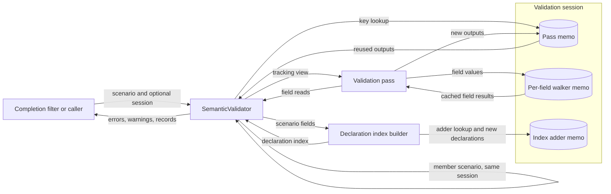

# Incremental semantic validation

Issue #1374 widened its scope to fix a recurring CI timeout in the SDL editor tests.
This document describes the validator change that fixes the cause.
The [observed-evidence design](issue-1374-observed-opacity-evidence-design.md) covers the rest of the issue.

## Problem

`SemanticValidator.validate()` runs about forty passes over the whole scenario.
Variation member admission validates the scenario again once for each member.
Relationship completion validates the scenario once for each candidate.
One completion request on the declaration-kinds fixture therefore ran about 560 full validations.
It took about 6.5 seconds on a developer host.
Every new declaration kind enlarges the scenario and adds candidates, so the cost grows quadratically.

Member admission also ran on scenarios that had already failed an earlier pass.
Each member then inherited the unrelated failure.
The validator reported it as "candidate is invalid for target slot".

## Architecture

### Member admission gate

Member admission runs only when the earlier passes produced no errors.
Family satisfiability uses the same gate.
A failed base scenario does not report its variation members.
The members are checked after the author fixes the earlier errors.

### Validation session

A validation session holds reusable results for one validation tree.
The tree contains a validation, its nested member admissions, and the candidates of one completion request.
A `SemanticValidator` without a caller session creates a new session for each `validate()` call.
A caller can therefore mutate a scenario and validate it again with the same validator.
The relationship completion filter passes one session to its baseline and all candidates.
A session holds strong references to the objects it keys on.
It ends when its caller releases it.

### Pass memoization

During each pass, a tracking view of the scenario records the top-level fields that the pass reads.
The view records every field when a pass serializes, copies, compares, or iterates the scenario.
It also records reads of private scenario attributes.
The session stores the pass outputs under a key with these parts:

- the pass name and the scenario type;
- the identity of each recorded field value and private attribute value;
- the declaration-index fingerprint, when the pass consults the index; and
- the errors accumulated before the pass.

A tracking view of the declaration index records when a pass consults it.

A later scenario reuses the outputs when every key part is equal.
Outputs are the errors, the warnings, and the private-attribute writes of the pass.
Reuse replays the private-attribute writes on the later scenario.

The key is exact under four preconditions.
Passes are deterministic functions of what they read.
Passes do not assign scenario fields.
Callers do not mutate a scenario object that a session holds.
The declaration index carries values only and holds no model references.

The runtime-reference cache records the fields that built it.
Each pass that uses the cache adds those fields to its own reads.

### Per-field walkers

The explicitness and variable-reference passes read every field.
Their results compose from independent top-level fields.
The session caches each field's records and errors under the field-value identity.
The key also includes the identity of the scenario's variables.
The combined result keeps the original field order.

### Declaration index

The index builder runs a fixed sequence of adders.
Each adder records the declarations it adds and the fields it reads.
A later index replays the recorded declarations when the adder read identical objects.
Replay keeps the adder order, so collision detection is unchanged.

### Member admission scenario

Semantic validation requires a structurally valid scenario.
Member admission therefore validates only the changed owner entry.
It validates that entry through the owner section's field type.
An authored scenario also applies its private-reference rule to that entry.
A structural failure rejects the member.
Semantic validation then uses the authored scenario with the validated owner entry spliced in and no variation points.
The other fields keep their identity and their authored field sets, so nested passes reuse the session.
The former implementation validated a dumped copy of the whole scenario for each member.
That copy also marked every default as authored.

### Completion filter

The relationship completion filter validates its baseline and every candidate in one session.
Each candidate shares every field except `relationships` with the baseline.
Passes that do not read relationships reuse the baseline outputs.

The filter applies a candidate to a copy of the edited relationship.
It then validates that relationship structurally through the relationships field type.
A structurally invalid edit is rejected.
Before this change, only a member admission round trip rejected such an edit.
A scenario without variation points accepted it.

## Data flow

| Threat | Control | Verification |
| --- | --- | --- |
| Stale reuse after a field change | Identity key over every recorded field | Differential tests against unmemoized validation |
| Untracked read through serialization or copying | Bypass methods record every field | Tracking view test |
| Untracked change to the authored field set | Field-set reads join the key | Authored field-set test |
| Stale reuse after a declaration change | Index fingerprint for index readers | Declaration-index dependency test |
| Stale reuse through a lazy cache | Cache reads join the reading pass | Runtime-reference cache test |
| Order-dependent pass | Prior errors in the key | Fixed earlier errors test |
| Lost scenario side effect | Private-write replay | Side-effect replay test |
| Misattributed member failure | Admission gate on a clean base | Unrelated-failure regression test |
| Malformed completion edit | Relationship structural validation | Structurally invalid edit test |
| Revalidation after mutation | Session per `validate()` call by default | Mutated scenario revalidation test |

The change adds no input surface, store, process, or network access.
Diagnostics keep their existing text.

## Supporting artifacts

No published schema, contract, or SDL syntax changes.
No ADR changes; this is an implementation strategy for the existing validator.
Tests compare memoized and unmemoized results across scenario mutations.
They also lock pass reuse during completion.

## References and document review

- [Python data model](https://docs.python.org/3.12/reference/datamodel.html), Python 3.12, customizing attribute access: tracking reads with `__getattribute__`.
- [Pydantic models](https://docs.pydantic.dev/2.12/concepts/models/), version 2.12, model copy and private attributes: field sharing and private state.
- [Memoization patterns](https://docs.python.org/3.12/library/functools.html), Python 3.12, caching function results: result reuse under exact keys.
- [ASD-STE100](https://www.asd-ste100.org/assets/files/ASD-STE100_ISSUE9.pdf), Issue 9, sections 1, 4, and 6: terminology, sentence structure, and descriptive writing.

The prose review uses one term for each concept and short descriptive sentences.
The diagram names the processes, the stores, and the data flows.
This document describes system behavior.
The issue plan holds implementation tasks and verification commands.
