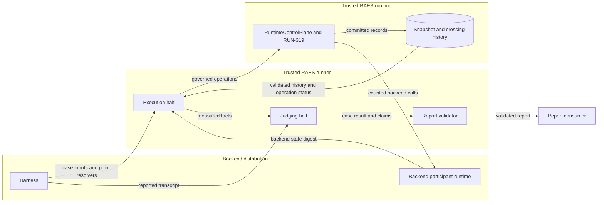
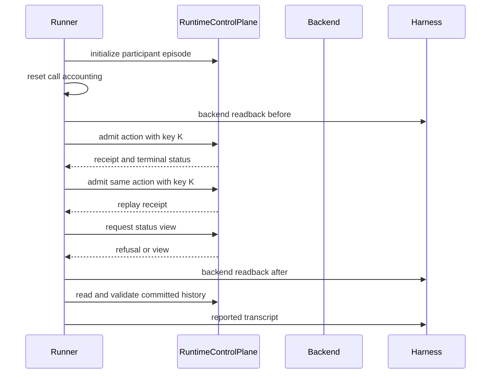

# Observed participant-opacity evidence

Issue #1374 corrects the evidence basis of the participant-opacity backend probe.
The [preflight note](issue-1374-observed-opacity-evidence-preflight.md) records the guardrails.
This document describes the resulting system behavior.

## Problem

The previous runner accepted a transcript from the harness.
It compared that transcript with a harness-supplied expected value.
One counted backend call and a harness-declared owner then produced backend-native claims.
A constant function therefore passed as backend realization.
The runner did not observe crossing, denial, retry, delivery, or scheduling.

## Architecture

The probe family has four parts:

| Part | Owner | Responsibility |
| --- | --- | --- |
| Harness | Backend distribution | Supplies case inputs, the reported transcript, and backend readback. |
| Execution half | RAES conformance runner | Drives the runtime and measures committed facts. |
| Judging half | RAES conformance runner | Projects, compares, derives ownership, and issues the verdict. |
| Report validator | RAES conformance runner | Refuses claims that the case evidence does not support. |

### Harness boundary

The harness supplies inputs only.
Each case names the exact profile coordinates and two possible points.
Each point binds a point reference to one exact-cut crossing policy resolver.
The resolver materializes the point in the runtime.
The case also supplies the participant, episode, behavior, action request, identity, and crossing evidence.
The case can disable final-sink flow control explicitly; the default enables it.
A disabled selection appears in the configuration digest and in the case limitations.

The harness supplies two observation adapters.
`reported_observation()` returns the transcript that the backend reports for one point.
`backend_readback()` answers one runner-issued collection request.
Each request carries a fresh runner nonce, the case name, the point reference, and the phase.
The response returns that request, a backend state source label, and a digest of backend-owned state.

The harness does not supply an expected transcript, a realization owner, or an execution basis.
It does not supply manifest, configuration, or tool digests.
The runner derives those values.

### Execution half

The runner executes each point in a separate control plane.
This isolation prevents retained state from one point from affecting the other point.

For each point, the runner does these steps:

1. Build `RuntimeControlPlane` on the target with the point resolver.
2. Wrap the participant runtime in the incumbent call counter.
3. Initialize the participant episode, then reset the call accounting.
4. Read the backend state digest.
5. Admit the participant action with the case idempotency key.
6. Admit the same request with the same key.
7. Request the participant status view at a governed delivery opportunity.
8. Read the backend state digest again with a new collection request.
9. Validate the committed history against the published model, the context joins, and the trusted opacity support.

The runner reads the operation receipt and the terminal operation status for each action.
An accepted receipt can belong to a failed operation.
A `PermissionError` from the status view is a governed refusal only when a withheld delivery attempt was committed.
A readback that does not return its exact collection request stays unobserved.
The runner compares the two readbacks of a point only when they name the same state source.
Any other exception is a measurement failure, not a refusal.

### Transcript projection

The runner projects the measured facts into the closed transcript vocabulary.
A field that has no measured basis stays unobserved.

| Field | Measured basis |
| --- | --- |
| `decision` | Terminal status of the admitted action. |
| `failure` | Failed terminal status of the admitted action. |
| `action_availability` | Terminal status of the admitted action. |
| `delivery` | Status-view result joined to the committed delivery attempt. |
| `omission` | Withheld delivery attempt committed at the governed opportunity. |
| `retry` | Replay operation identity, appended records, and backend calls. |
| `logical_timing` | Logical steps committed by each governed operation. |
| `logical_order` | Effective order and predecessor chain of the committed records. |
| `policy_release_effect` | Appended stages and policy coordinates of the committed records. |
| `external_effect` | Backend state digests before and after the governed operations. |
| `payload_released` | Status-view result. |

The runner also keeps a participant-visible projection of each point.
This projection keeps receipt acceptance, terminal states, ordered diagnostic codes, and record stages.
It also keeps record dispositions, reason codes, and gate dispositions.
It excludes runtime identifiers, timestamps, and runtime-enforcement binding contents.

### Comparison and verdict

The runner compares three independent values:

- the measured transcripts of the two points;
- the measured transcript and the profile normal form; and
- the measured transcript and the reported transcript of the same point.

The runner owns the normal form for each admitted profile revision.
The participant-visible projections of the two points must also be equal.
A difference in any comparison fails the case.
An unobserved field fails the case.

### Realization ownership

The runner derives ownership from the committed records.
The owner is `runtime-mediated` when every decided record carries the admitted runtime-enforcement binding.
That binding must match the case profile and rejoin to the trusted support of the point resolver.
The support must name the case points as its positive and negative cases.
Otherwise, the owner is `declaration-only`.

The published `participant-opacity-runtime-reference-v1` profile has one normal form.
RUN-319 produces that normal form before any protected backend effect occurs.
The runtime therefore shields any backend mechanism from observation.
The runner does not derive `backend-native` ownership for this profile.
A future profile that exposes a backend-owned mechanism requires its own derivation.

### Claims and evidence origin

Every case keeps the backend-declaration claim.
A passing case has `runtime-mediated` ownership and complete, agreeing evidence.
The runner issues no backend-realization or backend-conformance claim.
The effective support level equals the declared level only for a passing case.

Each case records one evidence origin:

| Origin | Meaning |
| --- | --- |
| `observed-execution` | The runner measured every transcript field at both points. |
| `synthetic-model` | Execution was incomplete; only reported or finite-model transcripts are complete. |
| `declaration` | The runner executed no probe. |

The case also records the actual execution basis from the run options.

### Evidence identity

The runner computes the configuration digest from the actual configuration.
It includes the runtime implementation and RAES version.
It includes the backend manifest digest and the participant runtime implementation.
It includes the profile coordinates, the resolver implementations, and the support digests of each point.
It includes the final-sink flow-control selection.
It includes a content digest of each installed behavior specification.
The runner computes the tool digest from its own probe-family revision and the RAES version.
The environment digest stays a harness declaration over an explicit nonsecret allowlist.

### Report validation

`validate_backend_conformance_report()` refuses a backend-realization claim without `backend-native` ownership.
It refuses that claim without `observed-execution` evidence.
The same rules apply to a backend-conformance claim.
Manually constructed reports therefore cannot carry claims that the runner cannot issue.

## Security and data flows

The protected assets are the secret predicate and the integrity of the conformance verdict.
The participant observation transcript and the backend state commitment are also protected.
The harness and the backend are outside the runner trust boundary.
The runtime and the runner are inside it.

| Threat | Control | Verification |
| --- | --- | --- |
| Constant or fabricated transcript | Runner derives the transcript and compares it with the report | Fabricated report and constant backend cases |
| Harness-declared ownership | Runner derives ownership from committed bindings | Missing-binding and wrong-profile cases |
| Missing observation passes | Unobserved fields fail and mark synthetic evidence | Missing readback and refused-before-opportunity cases |
| Runtime mediation masks the backend | No backend-native derivation under the published profile | Positive case keeps declaration claim only |
| Secret-dependent observation | Cross-point comparison of transcript and visible projection | Leaking resolver case |
| Hidden backend effect | Before and after backend readback | Changed readback case |
| Cached or misdirected readback | Runner-issued collection request with a fresh nonce | Cached, wrong-point, and changed-source cases |
| Unexpected error counted as denial | Only committed withheld attempts make refusals | Raising backend case |
| Secret text in reports | Sanitized failure messages and safe labels | Secret-bearing exception case |
| Forged report claims | Validator checks owner and evidence origin | Forged realization claim case |

The runner adds no process, socket, environment lookup, credential, or store.
Reports carry safe labels, bounded counts, and digests of nonsecret material.
The secret predicate, possible worlds, and raw backend state never enter a report.

## Supporting artifacts

The behavioral catalog advances to `rev13`.
That revision withdraws the participant-opacity backend declaration, realization, and conformance statuses.
Their only evidence was the removed reference backend and its fixed transcript.
ADR-115 places concrete backend evidence outside RAES.
Definition, checker, bounded-test, model-check, proof, and runtime-enforcement statuses do not change.
The SEM-231 assurance table and the shared semantic integrity index follow the catalog.

The runtime profile does not change.
Its uniform-denial limits and its nonclaims stay in force.
The [backend conformance reference](../explain/reference/backend-conformance.md) describes the probe boundary.

The report validator and `RelationAssuranceModel` are the executable policy for these claims.
No new policy tool is needed.
The repository declares no architecture-as-code model for this boundary.
No new ADR is needed: ADR-081, ADR-099, ADR-104, and ADR-115 own these decisions.
No published schema changes.
The harness protocol changes; downstream harnesses must supply reported transcripts and bound readback.

## References and document review

- [Python typing](https://docs.python.org/3.12/library/typing.html), Python 3.12, Protocols: structural harness boundary.
- [Python dataclasses](https://docs.python.org/3.12/library/dataclasses.html), Python 3.12, frozen instances: immutable case inputs and observations.
- [NIST SP 800-160 Volume 1 Revision 1](https://csrc.nist.gov/pubs/sp/800/160/v1/r1/final), November 2022, verification and assurance processes: evidence that supports a claim.
- [SLSA provenance](https://slsa.dev/spec/v1.0/provenance), version 1.0, build definition and run details: configuration and tool identity in evidence.
- [ASD-STE100](https://www.asd-ste100.org/assets/files/ASD-STE100_ISSUE9.pdf), Issue 9, sections 1, 4, and 6: terminology, sentence structure, and descriptive writing.

The prose review uses one term for each concept and short descriptive sentences.
The data flow diagram names processes, flows, the store, and the trust boundaries.
This document describes system behavior.
The issue plan holds implementation tasks and verification commands.
