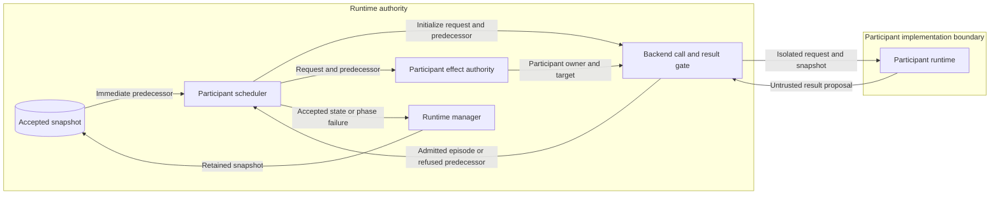

# Autonomous participant initialization admission

This design closes the invocation gap described in issue #1439.
The [preflight](issue-1439-participant-initialization-preflight.md) records the repository assessment and extension boundaries.

## Architecture

The scheduler creates one `ParticipantEpisodeInitializeRequest` for the named participant.
It calls the participant runtime through `_call_backend_apply`.
The gate derives effect authority through `participant_effect_authority` from the same request and predecessor.
The gate isolates the arguments and validates the returned proposal.
Only the named participant's permitted effects can enter accepted state.

The scheduler adds autonomous state after admission.
The manager retains the immediate predecessor when admission fails.
Resources accepted by earlier apply phases remain present.
An existing participant episode keeps the current initialization short circuit.
The default backend call context is sufficient for episode initialization.
New information-state records still require their existing contextual validation.

The control plane uses the same gate and effect authority.
Input copying alone cannot reject a returned proposal that erases resources.
A gate around the complete scheduler result would also reject legitimate scheduler-owned changes.
Leaving the direct call would permit unauthorized state changes.

## Security and data flows

Accepted resources, runtime metadata, provenance, and participant history require integrity protection.
The participant runtime is outside the portable-state authority boundary.
Its result is a proposal, even when the call reports success.

| Threat | Existing control | Verification |
| --- | --- | --- |
| Argument mutation reaches accepted metadata | Gate argument isolation and effect validation | Metadata mutation regression |
| Proposal erases provisioned resources | Participant effect authority permits no resource changes | Resource deletion regression |
| Refusal replaces earlier accepted state | Gate returns the immediate predecessor | Compare result and manager state with the recorded predecessor |
| Honest initialization is rejected | Existing episode and history validators | Honest runtime and autonomous compatibility tests |

The existing gate returns `runtime.backend-contract-invalid` for an invalid proposal.
Rejected candidate details and changed addresses do not pass the call boundary.
Earlier accepted manager changes can remain in the enclosing apply result.
No new authentication, logging, network, or persistence surface is needed.
Rejection does not undo backend caches or native infrastructure effects.
The gate does not contain hostile code or authorize an automatic retry.

## Existing authority

[ADR-105](adrs/adr-105-recursive-partial-description-semantics.md) already establishes runtime result admission.
[ADR-092](adrs/adr-092-autonomous-benign-participants-under-shared-time.md) retains scheduler and shared-clock ownership.
The [result admission contract](../../specs/formal/runtime-contracts/backend-result-admission.md) already requires this protection.
No ADR decision, published schema, protocol, or policy definition changes.
The existing gate and effect helper supply executable architecture and policy enforcement.
The regression tests exercise the missing call boundary without duplicating those validators.

## Reference basis

- [Python copy documentation](https://docs.python.org/3.14/library/copy.html), Python 3.14, shallow and deep copy operations: nested mutable values require isolation.
- [NIST SP 800-207](https://nvlpubs.nist.gov/nistpubs/SpecialPublications/NIST.SP.800-207.pdf), August 2020, sections 2 and 3: enforce authority for each request at the resource boundary.
  This design applies that pattern to portable state; it does not claim deployment of the complete reference architecture.
- [ASD-STE100 overview](https://www.asd-ste100.org/about_STE.html), Issue 9, January 2025, writing rules and terminology: use consistent technical terms and simple sentences.
  The prose review checks one fact per sentence, active verbs, document purpose, and a 25-word description limit.
