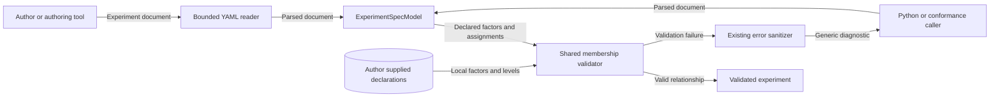

# Experiment factor and level integrity

## Decision

The maintainer selected rejection in every binding posture for issue #1520.
Each experiment author declares the factors and levels for that experiment.
Every condition assignment must use those declarations.
The declarations need not describe every possible value in a domain.
RAE supplies no catalog of red tactics.
External authoring tools can prepare declarations from domain knowledge.
This validation does not resolve an ontology or grant configuration authority.
Descriptive parameters retain their current meaning under ADR-094.

## Architecture

`ExperimentSpecModel` validates membership after factorial expansion and nested validation.
A shared function in `contracts/experiment_study.py` accepts factor declarations and condition assignments.
Both the authoring model and the archival study model use this function.
The archival model retains its current error messages.
Membership uses exact map keys and level strings.
Assignments can omit unused factors.
Plans without allocations need no membership validation.
Binding descriptors and selection rules retain their additional validation.

The published authoring schema records the rule through `x-raes-invariants`.
The reference implementation produces the same schema.
The draft publication entry records the content hash and change summary.
Standard JSON Schema cannot compare these instance values across fields.
The existing conformance registry supplies semantic validation.

## Data flow and security

Untrusted document data crosses the contract boundary at model validation.
The document contains both declarations and assignments; the diagram shows their logical store.
An unknown factor or level must prevent a validated result.
Existing YAML bounds, duplicate rejection, and closed model shapes remain active.
Existing parser, MCP, and conformance sanitizers exclude rejected values from outward errors.
Tests exercise membership rejection and diagnostic redaction through these boundaries.
This function performs no file access, network access, secret resolution, or runtime mutation.
A valid declaration proves consistency only; downstream admission still owns execution authority.
Trusted code can still bypass validation or mutate model instances.
This change does not remove that existing limitation.

## Supporting artifacts

The shared model function is the architecture-as-code change.
The schema invariant is the contract rule; no new repository policy gate is necessary.
ADR-074 owns the authoring boundary; ADR-094 owns binding authority.
Neither ADR waives local declaration integrity, so accepted ADR text needs no change.
This DFD covers the changed boundary; no deployment or runtime sequence changes.
The formal experiment specification and example limits describe the same membership rule.
Source-bound research evidence uses fresh captures of the existing offline corpus.
The collection repeats each recorded case before it records the current implementation digest.
The retained corpus makes no new claim about experiment membership or domain meaning.
Dedicated regression tests supply the membership evidence.

## References and document review

- Pydantic 2 model validators: https://docs.pydantic.dev/latest/concepts/validators/
- OWASP Input Validation Cheat Sheet, semantic validation and allowlists: https://cheatsheetseries.owasp.org/cheatsheets/Input_Validation_Cheat_Sheet.html
- NIST Engineering Statistics Handbook, section 5.3.2: https://www.itl.nist.gov/div898/handbook/pri/section3/pri32.htm
- ASD-STE100, Issue 9, rules 1, 3, 4, 6, and 9: https://www.asd-ste100.org/assets/files/ASD-STE100_ISSUE9.pdf

The review used STE vocabulary rules, short sentences, active voice, and consistent technical terms.
This document describes the design; the issue plan contains implementation tasks and test commands.
