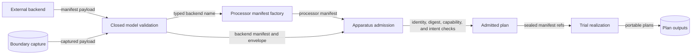

# Issue #1549: External backend trial realization

Date: 2026-10-25

Contract: GitHub #1549. This issue has no Ground Control requirement.

This note gives design rules. It does not prove live use with LilRAE.

## Decision

[ADR-115](adrs/adr-115-concrete-backends-owned-outside-raes.md) owns the main
decision. RAES keeps the portable processor and contracts. Other projects own
real backends.

Keep the current manifest meaning. Compatibility uses exact names in both
directions. The processor names the backend. The backend names the processor.

The reference processor factory accepts a set of backend names. The default
set remains `stub`. CLI and MCP examples keep their current output.

Trial setup gets each name from a valid backend model. It does this before
admission and plan sealing. It does not change a model after validation.

The LilRAE package name is not a backend name. The checked-in LilRAE capture
uses the backend name `aptl`.

One contract helper checks both names. These paths use that helper:

- experiment apparatus checks;
- trial compiler admission;
- mixed composition admission; and
- trial realization.

No new ADR or schema is needed.

## Architecture

Use the existing manifest factory in `raes_processor.manifest`. Pass the set
through its model and payload functions.

Use the existing models in `raes_contracts.contracts`. They reject unknown
fields and invalid shapes. Do not add a new parser or data type.

Run compatibility after identity and digest checks. Keep envelope, capability,
intent, and allowlist checks. Keep plan checks and planner checks.

Use the current `CompilationFailure` form in the compiler. Use a fixed code,
address, and message. Do not include rejected values in an error.

The set may contain many exact names. A new backend then needs no hard-coded
branch. A changed set creates a changed manifest and digest.

## Data flow and trust boundary

An external manifest is untrusted input. Project ownership gives no trust or
execution right.

The model boundary checks untrusted data. Apparatus admission applies policy.
Trial realization uses only sealed inputs.

There is no network or file lookup in this flow. There is no plugin load,
process call, daemon call, or backend import.

## Security controls

Protect these assets:

- manifest identity and content;
- admitted plan identity;
- backend and processor consent; and
- portable plan output.

Main threats are false identity, changed content, and weak consent. Existing
identity and digest checks stop false or changed input. The shared name check
requires consent from both sides.

Compatibility is only one gate. It does not prove capability, trust, or safe
execution. The other admission checks remain required.

The path reads no secret. It adds no auth route or environment setting. It
writes no log or stored state.

A static error limits data exposure. The error omits model data, file paths,
tracebacks, and backend error text.

Residual risk remains. A saved capture proves only portable admission. Live
use needs evidence from the backend project.

## Evidence and tests

Use this unchanged capture:

`implementations/python/tests/data/boundary_captures/lilrae-aptl-backend-manifest.json`

Parse its manifest and envelope with the current models. Get `aptl` from the
typed backend identity. Pass that name to the processor factory.

Tests cover these cases:

- the capture and processor name each other;
- an external test backend completes trial realization;
- each missing name fails with the same bounded diagnostic;
- a valid but weak manifest still fails capability admission; and
- a stale digest still fails before compatibility.

Do not edit the capture. Do not contact LilRAE or another checkout.

## Repository gates

Published schema files do not change. The schema ledger does not change.
Generated schema checks remain valid.

ADR-036 import rules still apply. Local tests stay narrow. CI runs broad test,
policy, and completion work.

Canonical CI gets the locked Isabelle archive from the approved primary
locator. The removed Cambridge path no longer serves the archive. Exact size
and hash checks remain unchanged.

A content-addressed specification capture binds the changed implementation
source without allocating or changing numbered research-release history.

## Design references

- [Pydantic models](https://docs.pydantic.dev/latest/concepts/models/), version
  2.12.5, defines typed validation for untrusted data.
- [NIST SP 800-207](https://csrc.nist.gov/pubs/sp/800/207/final), August 2020,
  says that location and ownership do not create trust.

## Non-goals

- Do not add a real backend to RAES.
- Do not add discovery, install, or lifecycle code.
- Do not add native execution, rollback, or cleanup.
- Do not change manifest fields or name meaning.
- Do not use wildcards or package names as backend names.
- Do not weaken digest, envelope, capability, intent, or plan checks.
- Do not claim live LilRAE support from a saved capture.
