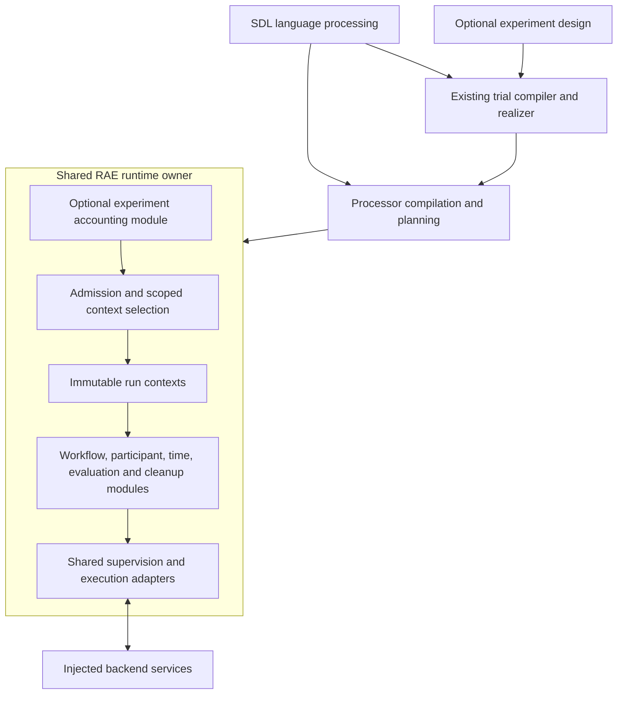
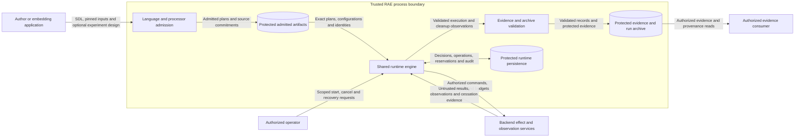
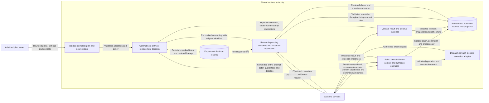
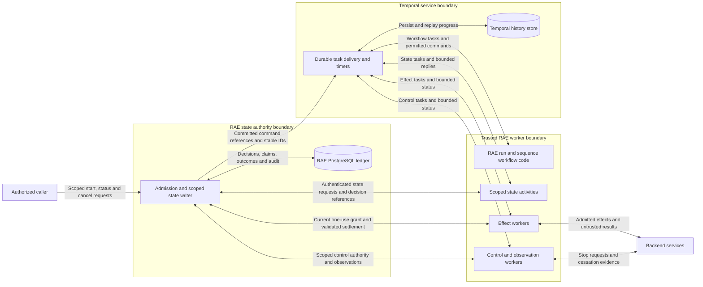
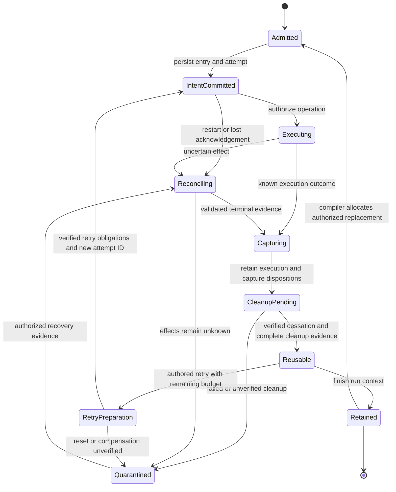

# Shared runtime engine and run contexts

Status: approved on 2026-10-28; implementation and verification are on the delivery branch.
Issue: #1629. Deployment remains an explicit operator action.
The [remediation plan](issue-1629-runtime-remediation-plan.md) records implementation stages and acceptance tests.

## System boundary

RAE supplies one execution engine for the OpenRAE ecosystem.
Experiments, CTFs, product tests, and simulated enterprises use that engine.
Their admitted inputs set the installed modules and execution policy.
An ordinary SDL run needs no experiment wrapper.

The language package parses, composes, validates, and instantiates SDL.
The processor compiles concrete scenarios and produces execution plans.
The trial compiler selects combinations before execution.
It also assigns run IDs.
The shared runtime admits plans and drives backends.
It checks effects and stores valid outcomes.
Backends own concrete realization, observations, credential delivery, and native cleanup.
Scientific analysis consumes retained evidence and run records.

One engine uses one set of execution rules.
Each owned scope has one state writer.
It does not mean one global process, singleton, or snapshot for all deployments.
Separate deployments retain their existing access control and isolation bounds.

For a CTF, the engine starts one run and keeps it open as players act.
It can read later evidence and then tear down the target.
For an experiment, the engine reads a list of planned runs.
It starts each run through the same path.
Each run has its own state and results.
For a long-lived enterprise model, the engine keeps the run open as state changes.
These uses need different modules and policies.
They use the same rules for who may act and how results are checked.
The engine must keep unknown effects visible in every case.

## Coupling before issue #1629

The starting engine already consolidated the manager and control plane.
Its engine lifetime and run lifetime shared the same object state.
The following starting points established the coupling:

| Evidence. | Current behavior. | Required separation. |
| --- | --- | --- |
| `raes_runtime/control_plane.py`, constructor and restore methods. | One target, run, store, generation, snapshot, and operation map belong to the controller. | Retain these run values in an explicit internal context. |
| `raes_runtime/control_plane_composition.py`, `bind_execution_store` | Store binding also creates backend ownership and effect/control/store worker capacity. | Engine services outlive an individual run context. |
| `raes_runtime/runtime_resource_ownership.py`, `RuntimeResourceClaim` | Backend ownership is tied to one owner and ledger; unresolved work retains that binding. | Preserve resource reservations across context retirement and engine recovery. |
| `raes_runtime/control_plane_supervised_execution.py`, `commit_settlement` | Callbacks consult the controller's current operations, generation, and snapshot. | Every callback retains its original context and generation. |
| `raes_runtime/control_plane_lifecycle.py` | Controller shutdown drains calls, closes dispatch, releases claims, and closes its store. | Run completion and engine shutdown have distinct lifetimes. |
| `raes_runtime/control_plane_operation_context.py` | Admission binds requests to the controller's single admitted run. | Admission selects an immutable owned context before dispatch. |

Package paths above start at `implementations/python/packages/`.
The local and PostgreSQL stores also bind their metadata to one target/run scope.
These bindings protect isolation and must remain enforced.

This needs a broader internal refactor than adding experiment sequencing alone.
Changing the controller's current run attributes would make delayed callbacks unsafe.
Creating separate controllers behind a facade would retain separate dispatch and shutdown ownership.
The implementation extracts the existing ownership bounds inside the shared engine.
It does not replace the existing execution rules or storage technology.

## Temporal adoption and scope

[ADR-113](adrs/adr-113-reusable-execution-machinery.md) already selects Temporal for remote execution.
The operation-level path is implemented.
[PR #1601](https://github.com/OpenRAE/rae/pull/1601) merged it on 2026-10-14.
The following code establishes its current scope:

| Evidence. | Implemented behavior. |
| --- | --- |
| `raes_runtime/operation_temporal.py` | Stable operation and control IDs, bounded references, and duplicate-start checks. |
| `raes_runtime/operation_temporal_workflow.py` | The `raes.operation` and `raes.supervision` workflows drive one admitted operation and its controls. |
| `raes_runtime/operation_temporal_worker.py` | Separate effect and control workers request current authority before calling a backend. |
| `raes_runtime/control_plane_store_postgresql.py` | PostgreSQL holds authoritative run state, claims, and operation records. |
| `tests/test_issue_1362_distributed_integration.py` | CI uses a real Temporal test server, PostgreSQL, and scoped HTTP worker authority. |

Test paths start at `implementations/python/`.
The [runtime-supervision job](https://github.com/OpenRAE/rae/actions/runs/40719797665/job/122927263657) passed on 2026-10-28.
This evidence covers operation delivery and recovery.
It does not establish complete experiment execution or a production deployment.
The coordinated P3 profile remains unavailable.

This refactor extends this path to the run and run-sequence lifecycle needed by #1629.
RAE keeps the same execution rules in local and Temporal setups.
In the remote setup, RAE workflow code uses Temporal for durable progress, delivery, and waits.
It reuses the existing operation and control workflows.
Store access and backend calls stay outside replayed workflow code.
The local driver calls the same RAE decision functions through its existing adapters.
An ordinary local run still needs no Temporal service.

Temporal cannot supply the missing run context boundary.
RAE must bind every command, result, reservation, and state write to the correct run.
These bindings must survive process loss in a durable setup.
A restored engine need not retain the same Python object.
It must retain the same admitted identities and enforce current ownership.

RAE owns execution meaning, time domains, retry permission, and verified outcomes.
Temporal owns durable delivery progress within the selected remote setup.
Temporal history cannot prove that a target was reset or that a treatment was applied.
Its default activity retries also cannot grant another effect attempt.
Resolve retry choices from the relevant authored scenario scope through existing RAE policy semantics.
Preserve policy identity, scope, failure classes, effect conditions, attempt limits, delays, and budgets.
An engine delivery retry does not consume or create an authored effect attempt.
Each new effect attempt needs current RAE permission and the required evidence.
Reset or compensation must satisfy its admitted cleanup obligations before another effect.
Unsupported author choices fail admission; they are not replaced with a default recovery choice.
The SDK activity and workflow retry limits are one.
A later progress activity reconciles the same committed operation.
It cannot allocate another semantic attempt without the authored RAE policy.
Native operation policies outside the installed runtime support still fail admission.
Trial attempt limits and reset or compensation use the referenced cleanup policy.
Each run retains the operation guarantees derived from its authored trial controls.
Native and mixed commands carry those guarantees through local or Temporal delivery.
The provider must accept each exact command at live admission and before dispatch.
Restoration cannot weaken the retained run guarantees.
A failed attempt can retry only after verified cessation and reusable state.
Experiment replacement remains a new compiler-assigned trial, with retained lineage.

## Components and interfaces

The public `RuntimeControlPlane` remains the runtime owner.
A run can stay open for later work.
The existing `RuntimeManager` alias remains its single-run entry point.
An internal run context holds a fixed target and run ID.
It holds scoped access rights, a store, a generation, a snapshot revision, and operation history.
It also contains run-local participant, clock, planning, evidence, and secret-reference bindings.
Context methods enter the existing runtime admission path.
The engine owns their worker pools.

The engine owns installed services, bounded worker capacity, resource reservations, and shutdown.
Its existing mutation and commit machinery remains the authority for state changes.
Each operation carries its context.
Admission, dispatch, observation, and settlement all use that context.
An ambient mutable current-run pointer cannot select a callback's destination.
Old single-run calls resolve to their original default context.
Multi-run operations require an explicit admitted run ID.

The experiment module reads the whole trial plan.
It uses the existing compiler, realizer, scheduler order, and replacement compiler.
It requests work through the same engine admission and execution modules.
It owns experiment accounting, but gains no separate backend dispatch authority.
The trial-unit interface carries one entry's plans, settings, controls, and results through this setup.
Participant settings require installed application support and observable execution evidence.

Initial multi-run delivery is serial on a reused target in both local and Temporal setups.
Parallel execution needs existing isolation evidence and current resource grants.
Adding a workload label cannot change retry, cleanup, clock, or safety policy.
Unsupported requirements produce admission refusals before effects.

## Implemented boundaries

| Module. | Responsibility. |
| --- | --- |
| `runtime_engine.py` and `runtime_run_context.py` | Shared capacity, reservations, fixed contexts, retirement, and shutdown. |
| `runtime_run_driver.py` and `runtime_run_preparation.py` | Exact plan binding, existing application phases, persisted progress, and restored local modules. |
| `runtime_experiment.py` and `runtime_experiment_admission.py` | Whole-plan admission, recorded order, attempts, cancellation, and serial reuse. |
| `runtime_trial_unit.py` and `runtime_trial_services.py` | Applied configuration, execution observation, capture, cleanup, and installed evidence verification. |
| `runtime_experiment_replacement.py` | Immutable archive readback, retained failed originals, and fresh compiler allocation. |
| `runtime_decision_store.py` | Atomic private decisions in the existing memory, SQLite, or PostgreSQL provider. |
| `runtime_sequence_authority.py` and `runtime_temporal_workflow.py` | Artifact binding, scoped progress requests, durable waits, and history rollover. |

The trial unit is engine-owned and requires its admitted experiment and attempt.
It cannot serve as an independent execution controller.
Configuration and capture retain their observations before the corresponding operation settles.
Dependent work still requires that operation's validated terminal state.
Capture status, execution outcome, and cleanup status remain distinct.
Retry-only obligations use a separate nonterminal observation; they cannot satisfy a terminal cleanup receipt.

The engine records an attempt's UTC deadline once.
A live attempt consumes a monotonic allowance derived from that deadline.
Restoration uses its remaining UTC allowance and refuses a clock earlier than the recorded start.
This uses the existing trusted host clock assumption; it does not prove continuity across arbitrary host clock changes.
Cleanup and control calls keep their separate bounded allowances.

The public methods and migration procedure are in [runtime lifetime](../migration/runtime-lifetime.md).
The new `/runtime/progress` route uses the existing P2 authentication and mutation boundary.
A reference must match a bound engine, worker, run or experiment, input commitment, and original actor.
On restart the owner must restore its exact artifacts before accepting progress.
History rollover retains the same reference and author budget.
Unknown effects keep the workflow waiting for RAE reconciliation.
A known cleanup failure ends progress with `cleanup-failed` and retains the reservation.

## System context data flow

The boxes below distinguish external entities, trusted processes, and protected stores.
The embedding process is trusted for local P0 setup.
Remote callers retain the existing authentication and access control boundary.

## Dispatch, settlement, and recovery data flow

Run contexts are logical isolation bounds within the engine.
They are not separate services or security principals.
The existing trusted host remains responsible for protecting local storage.

Experiment decisions extend the existing storage code with versioned records and bounded codecs.
They must not be stored as arbitrary snapshot metadata.
Run stores keep their fixed target/run bindings.
The decision record names the plan and actor.
It records admitted order, attempts, deadlines, and replacement history.
Atomic claims stop duplicate work.
They also stop a replacement from using its budget twice.
The local setup reuses SQLite transactions, private paths, leases, and revision checks.
Store checks must reject unsupported multi-run storage before effects.
Legacy single-run stores keep their existing behavior.

Experiment decisions can commit apart from operations.
The archive can also commit apart from both.
Stable references connect them; recovery never assumes a transaction across all three.
A lost acknowledgement needs authoritative readback.
An uncertain external effect needs the existing observation and reconciliation path.
Memory alone cannot restore state after the process stops.

## Temporal data flow

This extends the existing Temporal path.
Run and sequence progress are new; operation delivery and control workers already exist.
The boxes mark service and credential boundaries.
They do not grant new tenant or multi-owner guarantees.

Workflow and activity payloads carry bounded references and status.
Full plans, participant settings, secrets, and raw evidence stay out of Temporal history.
Activities fetch scoped inputs from their existing authorized owners.
Only the RAE state writer commits semantic state.
Workers have no direct ledger write credentials.
No transaction spans the RAE ledger and Temporal history.
Lost start acknowledgements reuse the committed command identity.
Replay cannot renew a consumed effect grant or release a reservation.

Durable waits preserve the admitted deadline and its clock meaning.
On wake or recovery, RAE rechecks the clock segment, remaining budget, and authority.
Scenario time is distinct from Temporal scheduling time.
Workflow versions and history rollover preserve run IDs, budgets, claims, and pending controls.
Rollover cannot create another trial.
Unsupported resume versions must refuse continuation.

## Lifecycle and failure rules

This diagram describes normal result accounting, not permission to dispatch cleanup after an uncertain effect.
Admitted triggers and operation supervision set which cleanup actions may execute.
Cancellation records intent and uses reserved control capacity while effects remain active.
Cancellation acceptance never proves cessation.
Run completion preserves records and leaves the engine available.
Engine shutdown drains all owned work.
The store keeps any unresolved reservations.
Starting another run cannot evade a reservation on the same resources.
Replacement needs a qualifying archived outcome and complete reusable-state evidence.
The existing replacement compiler assigns a fresh run ID.
It retains the original attempts.

## Security requirements and checks

| Asset and boundary. | Threat. | Required control and behavioral evidence. |
| --- | --- | --- |
| Plan and processor ingress. | Changed selection, settings, or identity. | Whole-plan reconstruction and source checks; reject a tampered later entry before any dispatch. |
| Context and backend admission. | Cross-run commands or unauthorized cancellation. | Explicit actor, target, run, and generation joins; deny mismatched commands before effects. |
| Context and settlement. | A delayed callback writes into the next run. | Immutable callback context and revision checks; deliver an old result after another context opens. |
| Resource ownership. | A new run bypasses quarantine. | Engine-owned reservations retain the original ledger reference; reject reuse while effects remain unknown. |
| Decision persistence. | Duplicate work after interrupted commit. | Atomic claims and readback; inject interruption before and after each commit boundary. |
| Temporal delivery and replay. | A replay repeats an effect or admits another trial. | Stable command IDs and current one-use grants; replay after dispatch and verify that no new effect occurs. |
| Temporal history and worker inputs. | Sensitive inputs persist in history or a worker crosses run scope. | Bounded references, scoped fetches, and safe replies; inspect history and reject cross-run requests. |
| Participant and evidence boundary. | Settings are carried but never applied. | Installed configuration support and owner observations; assert model/prompt behavior through the public runtime. |
| Cleanup and target reuse. | Failed cleanup appears successful. | Existing receipt validation plus trusted content/probe checks; reject missing and forged evidence. |
| Secret and archive boundary. | Configuration or evidence leaks through errors. | Existing secret sinks, bounded carriers, private files, and safe diagnostics; test rejected payload disclosure. |

Backend evidence can be incomplete or false; structural validation alone cannot establish physical truth.
Unresolved evidence therefore keeps reuse blocked.
Local resource claims do not establish isolation across hosts.
Multi-owner coordination and new deployment services remain outside this change.
The existing Temporal setup gains shared run sequencing; this does not enable P3.

## Architecture and policy records

The ADR-104 amendment clarifies that engine lifetime can contain several fixed run contexts.
The engine owns shared services and resource reservations; each context retains its existing scoped state authority.
Run completion does not close the engine or retarget an existing store.
ADR-036 package ownership, ADR-084 trial semantics, and ADR-113 execution machinery remain the basis.
The amendment and acceptance-content pin accompany this approved design.

Fixed contexts, versioned decision records, and scoped operation envelopes express the design in code.
The existing package gate needs narrow public imports for trial compilation, realization, and scheduling.
Source limits, schema publication checks, and access control checks remain applicable.
Any changed portable schema needs its manifest entry, fixtures, and generator parity.
Internal record migration does not by itself justify a new portable schema.

## References and document review

- [Python sqlite3](https://docs.python.org/3.14/library/sqlite3.html), Python 3.14, transaction control: explicit local commit boundaries.
- [Temporal workflow execution](https://docs.temporal.io/workflow-execution): durable progress and deterministic replay.
- [Temporal retry policies](https://docs.temporal.io/encyclopedia/retry-policies): activity retries require explicit RAE effect limits.
- [Architecture Patterns with Python](https://www.cosmicpython.com/book/chapter_13_dependency_injection.html), 2020, chapter 13: explicit service composition.
- [NIST SP 800-160 Volume 1 Revision 1](https://csrc.nist.gov/pubs/sp/800/160/v1/r1/final), 2022: connect protection needs, trust boundaries, and verification.
- [ASD-STE100 Issue 9](https://www.asd-ste100.org/assets/files/ASD-STE100_ISSUE9.pdf), sections 1, 5, 6, and 8: terminology, brevity, and document purpose.

The writing review uses consistent technical names and short descriptive sentences.
Procedural delivery steps remain in the remediation plan.
The completed design gate and implementation plan are recorded on issue #1629.
The delivery review records test and CI results separately from this design.
