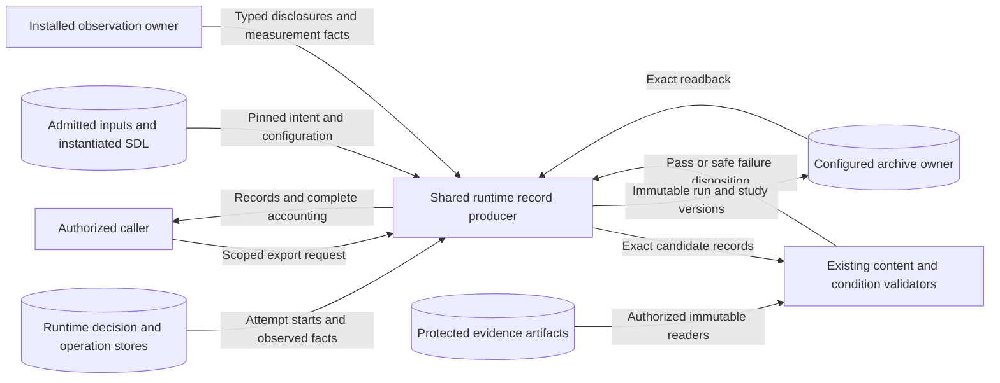

# Complete experiment run accounting

## Decision

Issue #1630 records every started run, including runs without scientific output.
The user confirmed this decision on 2026-10-29.
An archival record can accurately describe failure without satisfying a task evidence requirement.
Record storage and scientific checks are separate operations.

The existing experiment run and study contracts remain the portable authorities.
The runtime decision store remains the authority for live work.
The producer reads stored facts and never dispatches effects.
No new service, data destination, root run schema, or work policy is introduced.

## Architecture

The shared runtime lists durable attempt starts, rather than terminal results alone.
Each admitted entry retains its allocated run ID.
Authored retries have separate attempt IDs within that run.
Fresh replacements keep separate run IDs and links to their prior versions.
Transport redelivery creates neither a new attempt nor a new run.

The run contract gains an explicit partial-record state and typed work accounting.
Existing records default to the archival state and keep their existing requirements.
Typed accounting records can represent deterministic plans without invented stochastic controls or parameters.
Partial records keep known facts without fabricated timestamps, apparatus observed facts, cleanup receipts, artifacts, or measurements.
Complete accounting must match the trial's provenance.
Its plan, entry, attempts, operations, and cleanup records must agree.
Each record keeps the admitted participant settings and exact cleanup receipts.
A partial record cannot claim a successful scientific outcome.
Content-backed checks remain required before task evidence is accepted.
Unknown work remains unresolved after cancellation, timeout, or process loss until observed fact establishes cessation.

The runtime assembles records from admitted plans, stored observed facts, operation receipts, and instantiated SDL.
Installed owners supply typed apparatus observed facts, participant disclosures, measured results, and authorized content readers.
The producer keeps requested settings separately from observed application.
Model ID and prompt delivery use existing realized-form disclosures and evidence references.
Configuration digests alone cannot establish treatment work.
Absent disclosure remains absent; the producer does not infer a model from an implementation name.

Partial record versions are content-bound to a stored fact cut and supplied observed facts.
Complete records use an explicit owner-supplied version that capture evidence can pin before archive write.
Changed complete content requires a new version.
The archive owner writes fixed versions through the existing archive boundary and verifies exact readback.
A repeated archive write uses identical IDs and content.
Study membership references exact run versions.
Runtime observed fact timestamps bound the recorded work, capture, and cleanup interval.
Older observed facts without timestamps remain explicitly partial.
The authored study definition supplies ownership, claims, inclusion rules, allocation, and analysis policy.
Each study snapshot pins that definition through a digest-bound definition reference.
Inherited evidence relations keep the authored definition as their scope authority.
Authoritative study consumers resolve that exact definition and check the inherited policy.
The producer does not invent these fields or reduce allocation targets after failure.

## Failure, retry, and metrics

Work, capture, checks, and cleanup have separate outcomes.
Installed evaluation owners supply the scientific `outcome_status`.
Absent evaluation remains `not-evaluated`, even when work completes and measurements exist.
Completed work can have a failed or inconclusive scientific result.
An archive write grants no retry, replacement, or resource-reuse authority.
Existing attempt limits, cessation checks, cleanup probes, reset, and compensation remain required.
Failed cleanup keeps reservations even when failure records are available.
Scientific checks can reject a stored record without deleting it.
Known scientific failure follows the authored protocol; missing measurements do not become zero.

Accounting reports planned, started, unstarted, resolved, and unresolved runs.
It separately reports attempt counts, retry attempts, replacement runs, capture outcomes, checks outcomes, and cleanup outcomes.
It reports scientific outcome counts from explicit evaluation facts.
Scientific summaries report available and missing measurements with their actual run sets.
Overlapping failure categories are not presented as disjoint run sets.
Unstarted allocations are not failures.
A later successful attempt does not erase earlier failures.
Historical evidence remains stored even when only one attempt supplies the authoritative task evidence cut.
Histories above the proof limit retain versioned references and complete protected source records.
The scientific proof limit remains unchanged.
Study membership and metric eligibility use the same replacement-aware run set.
Replaced parents remain in reported and missing populations.

## Data flows and trust boundaries

The archive and runtime stores have separate commits.
Archive write is idempotent; no transaction across those stores is claimed.
Each supplied archive receives fixed records and must return exact readback.
Publication at another archive cannot establish delivery to this archive.
Validation status changes cannot change bytes under an existing artifact version.
Both runtime archive paths share the same retained version ownership check.
They reject conflicting bytes before storing candidates or writing an archive.
The owner must supply a new version for changed content.
The legacy archive freezes its candidate in the same durable decision store before external I/O.
An uncertain write resumes those exact bytes without rebuilding the candidate.

Additional accounting can have a separate version beside a canonical scientific record.
Either archive path can hold the original scientific record.
Added accounting does not create a second scientific original.
Repeat the checks when the evidence reader becomes available.
The builder joins them only when all scientific facts and prior lineage match exactly.
The accounting version pins the original record through a digest-bound `derived_from_refs` entry.
Fresh evidence checks apply to that original artifact and stay bound to its version.
The returned `validation_records` identify the exact artifacts checked.
Study evaluation membership names those versions; extra accounting versions have role `other`.
Archive publication retains both versions and the complete replacement history.
Changed scientific facts cannot borrow the original record's evidence.
Evidence acquisition, checks, and reader closure run in one bounded worker.
The worker closes transferred readers even when the caller times out.
Evidence-owner failures produce a safe failed-check disposition and preserve records.
This includes ordinary provider exceptions such as a missing catalog key.
Archive writes use a separate existing worker lane.
An enabled replacement policy selects replacement-aware study checks even when no replacement occurred.
The existing runtime lifecycle diagram remains authoritative for effect work and cleanup.

## Security and verification

| Threat and boundary | Control | Verification |
| --- | --- | --- |
| Cross-run disclosure at export | Keep admitted actor scope and reconstruct detached nested models. | Reject another actor and evidence bound to another run. |
| Fabricated success at evidence boundary | Keep content-backed task and plan-aware condition checks. | Reject missing bytes, wrong capture pins, and matching settings without evidence. |
| Sensitive content in diagnostics | Return bounded failure classifications, without raw check inputs or exception text. | Check that private evidence and prompt text are absent from public failures. |
| Duplicate archive write after interruption | Derive stable record versions and require exact archive readback. | Repeat writes and resume with durable stores; reject conflicting content. |
| Failed cleanup disguised by archive success | Keep archive write separate from resource and retry decisions. | Retrieve failure records while reuse remains blocked. |

No artifact reader fetches arbitrary URIs.
Secret references remain opaque and use existing participant disclosure controls.
The configured owner retains protected artifacts; public diagnostics do not include raw prompts or resolved credentials.

## Governance and document review

ADR-065 governs archival provenance and now explicitly covers evidence-free failure records.
ADR-068 governs run, attempt, and replacement ID and complete run sets.
The runtime architecture describes the live-state and archival distinction.
The schema archive write ledger records every changed published schema hash.
The reference schema generator must match that authority.
Fresh offline research captures replay the fixed reference controls for this source.
Their claim limits remain explicit.
Targeted run-record tests check the new accounting behavior.
Existing package-boundary policy remains unchanged because runtime continues to consume public processor and contract owners.
No new policy engine or architecture framework is needed.
Typed models, closed decision unions, and existing checks express the architecture in code.

This document uses short descriptive sentences and consistent technical names.
The terminology and purpose review follows ASD-STE100 Issue 9, sections 1, 4, 6, and 9.
Automated prose checks supplement this review.

## Authoritative references

| Source and version | Section | Application |
| --- | --- | --- |
| [OpenLineage](https://openlineage.io/docs/spec/run-cycle/), current specification read 2026-10-29 | The run cycle | Keep starts, incremental facts, and distinct failure or abort outcomes. |
| [MLflow](https://mlflow.org/docs/latest/api_reference/rest-api.html), current API read 2026-10-29 | Create Run, Update Run, Log Metric | Run existence is separate of available measurements and artifacts. |
| [W3C PROV-DM](https://www.w3.org/TR/prov-dm/), Recommendation 2013-04-30 | Sections 5.1.2, 5.1.3, and 5.1.7 | Separate activities, generated outputs, and unknown end times. |
| [AWS Builders' Library](https://aws.amazon.com/builders-library/making-retries-safe-with-idempotent-APIs/), read 2026-10-29 | Late arriving requests; same request ID, different intent | Keep ID, reject conflicting reuse, and check state uncertain archive write. |
| [Temporal](https://docs.temporal.io/encyclopedia/workflow/cancellation-and-termination), read 2026-10-29 | Cancellation and Activities | Cancellation intent does not prove cessation. |
| [Azure Architecture Center](https://learn.microsoft.com/azure/architecture/patterns/compensating-transaction), read 2026-10-29 | Solution; problems and considerations | Keep cleanup progress and separately failed compensation. |
| [ASD-STE100](https://www.asd-ste100.org/assets/files/ASD-STE100_ISSUE9.pdf), Issue 9 | Sections 1, 4, 6, and 9 | Consistent terms, short sentences, and document purpose. |

## Example

A run starts. A node fails to start. No model is called.
There is no score to report. Keep the failed run.
Keep the cleanup result. Do not count a missing score as zero.
The next run must still pass the normal safety checks.
If an allowed retry works, keep both attempts under the same run.
If a new trial replaces it, keep both runs and their link.

A failed cleanup does not erase a valid measured score.
When all required record facts exist, the task evidence can pass its checks.
Cleanup keeps its own failed status. The target remains blocked for reuse.
