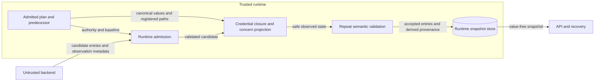

# Credential results with observed realization values

Issue #1638 corrects the composition of two existing result contracts.
The backend supplies observed concern values.
The runtime must retain those values after credential projection.

## Architecture

The admitted plan owns resource identity and realization authority.
The concern registry owns payload paths, observation validation, and safe projection.
The credential boundary uses both owners.
It permits observed values only at registered paths with admitted realization requirements.
It compares all remaining payload values with the submitted operation through typed equality.
For comparison, empty parent objects created only for admitted observations retain their original null or absent shape.
Extra sibling fields remain visible to exact comparison.

The processor supplies the admitted plan's compiled realization views.
Supplemental requirements retain their existing ownership.
The processor also supplies a projection for comparison outside admitted concern paths.
The credential boundary preserves safe observed values at those paths.
The existing artifact evidence contract remains address scoped.
The account credential projection still replaces canonical material with presence fields.

Initial semantic validation and final semantic validation remain mandatory.
The final validation uses the preserved observed values and admitted transient observation metadata.
There is no second observation collection.
Invalid results return the trusted predecessor with coarse diagnostics.

## Security and data flows

Credential material, accepted state, and admission authority are protected assets.
The backend is outside the trusted runtime boundary.
Payload validation precedes recursive projection.

| Threat | Control | Verification |
| --- | --- | --- |
| Credential copied outside canonical material | Exact residual payload comparison | Extra sibling, nested field, and wrong-address rejection |
| Invalid data inside an admitted concern | Existing closed observation validator and safe projector | Unknown concern field rejection |
| Unauthorized realization changes | Plan authority and native semantic admission | CLOSED and EXACT mismatch rejection |
| Credential exposure during publication | Canonical account projection and coarse errors | Serialized snapshot and diagnostic checks |
| Projection changes accepted meaning | Repeat semantic validation | Apply-boundary success and persistence round trip |

Typed identity text can equal fixture text without becoming credential material.
Existing family contracts govern permitted setting values.
This boundary does not identify secrets by their string values.
It does not certify backend truthfulness or roll back infrastructure effects.

## Supporting artifacts

The result-admission specification and account-credential specification describe this composition.
ADR-056 and ADR-057 retain their existing observed-value and name-classification decisions.
No new ADR is needed because ownership and public data shapes do not change.
No schema, deployment, policy configuration, or infrastructure artifact changes are needed.
Existing policy tools enforce repository boundaries.
The regression tests enforce the corrected runtime boundary.

## References and document review

- [Python copy documentation](https://docs.python.org/3.12/library/copy.html), Python 3.12, deep copy: isolated comparison and publication payloads.
- [OWASP input validation](https://cheatsheetseries.owasp.org/cheatsheets/Input_Validation_Cheat_Sheet.html), current edition, structured data and allowlists: field-specific validation across trust boundaries.
- [ASD-STE100](https://www.asd-ste100.org/assets/files/ASD-STE100_ISSUE9.pdf), Issue 9, sections 1, 4, and 6: terminology, sentence structure, and descriptive writing.

The prose review uses consistent technical nouns and short descriptive sentences.
The diagram names processes, data flows, the state store, and the trust boundary.
This document describes system behavior.
The issue plan holds implementation tasks and verification commands.
