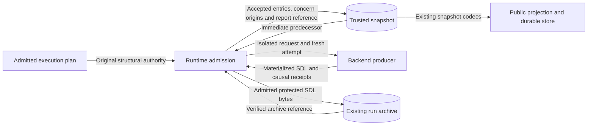
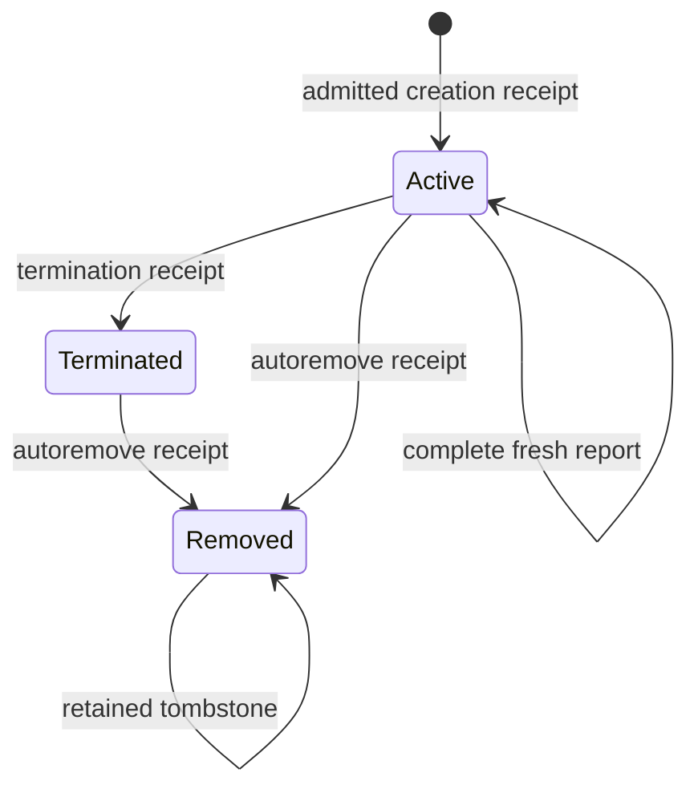

# Runtime descendant admission

This design extends SEM-225, SEM-218 and ASR-532.
The backend reports the world in SDL.
The runtime owns accepted members and value origins.
The source scenarios do not change.

## Components and contracts

`backend-runtime-descendants-v1` negotiates descendant reporting and inventory refresh.
It requires the existing SDL report and collection contracts.
An unsupported producer cannot report descendants.
The SDL report contains a bounded list of known members.
That list holds causal links and lifecycle evidence. It has no world values.
Node values remain in the existing SDL node and infrastructure fields.

The runtime binds a fresh attempt ID before each producer call.
The report binds that attempt, operation, source, run, manifest and immediate predecessor.
The trusted materialization source also carries the selected target scope.
The report must match that scope and the invoking runtime target.
The report sequence increases within the producer's run.
An archive record keeps the admitted member list.
Existing snapshot codecs preserve that typed record.
The protected SDL bytes describe the complete world.
Archive validation compares the retained report with those bytes.

Each child has a portable address and a fixed native ID digest.
Its parent address describes causal ancestry.
Its source address names the original responsible resource.
The creation receipt names its operation and attempt. Its digest binds the native evidence.
Those creation IDs remain fixed across later reports.
Native evidence remains a producer assertion under this contract.
It does not prove who owns or created the resource.
The downstream backend must prove its own native receipts.

Each causal chain must reach its named source. It cannot contain cycles.
The source resource must belong to the original admitted plan.
Imported namespaces keep their existing closed scopes.
Names, topology links and dependency edges cannot establish causal ancestry.
An existing address cannot get another native ID, parent or source.
Removed addresses remain reserved in their lifecycle records.

## Admission and failure

The existing backend result checks run before the runtime adds members.
The producer cannot add children directly to the returned snapshot.
It cannot write value origins or archive references.
The runtime derives proposed resources from the SDL report.
The original enclosing collection relation must admit those members.
Existing node, capability, reference and safe-value checks apply.
The original plan still governs existing resource concerns.
The report cannot grant a new plan or more authority.

The runtime checks addition permission against the original source.
Explicit prospective effects still use the existing preparation contract.
Refresh cannot install apparatus or materialize resources.
Unknown IDs need an already admitted open collection.
A reported resource needs authority before it can join the accepted set.

`RuntimeManager.refresh_inventory()` submits a read-only backend inventory operation.
It receives the original plan and the current trusted snapshot.
The target, source and producer must match the accepted run.
The producer returns complete current SDL with fresh report bindings.
It does not rewrite manager internals or replay apply.
The provisioning plan has an explicit refresh flag.
The published request commitment binds that flag.
The control plane submits refresh through its existing provisioning mutation route.
The runtime checks the exact original planner grant before it accepts refresh.
The producer's refresh method cannot execute provisioning operations.
Existing claims, attempts and supervision apply. The terminal commit still checks the snapshot revision.
No new HTTP route or authorization category is required.

An incomplete report cannot prove successful refresh.
The report names unavailable evidence.
Omission never proves termination or removal.
Termination keeps the resource with a terminal status.
Autoremove needs its own lifecycle evidence. It keeps the causal record as a tombstone.
Replanning keeps admitted open collection members.
Explicit teardown uses accepted live members.

Invalid members, causal links, lifecycle evidence or bindings reject the complete claim.
The result keeps the trusted predecessor. It has empty changed addresses and bounded errors.
Archive failure on this path also preserves the predecessor.
Physical effects can still exist after the runtime rejects a report.
The legacy partial-failure cleanup contract remains separate.

Supervised native results keep their original proposal commitment.
The runtime checks that commitment before and after it checks the isolated proposal.
The runtime adds members, value origins and archive references to the accepted snapshot.
The existing terminal commit owns its durable revision.
The runtime never treats that derived snapshot as another backend proposal.

## Concern provenance

Existing concern descriptors name the applicable origin records.
Original author and processor origins do not change.
New child values have backend origin unless original authority supplies another origin.
A constrained backend choice keeps its constraints and backend value origin.
Equality with a template does not make that choice author-declared.
The report can identify backend-selected concerns through registered address, field and concern references.
The runtime accepts those references only under OPEN or CONSTRAINED authority.
An unchanged processor-selected parameter retains its processor origin without such a backend selection claim.
The producer cannot submit a provenance ledger entry or relabel an exact concern.
The runtime merges current concern records with unchanged predecessor records.
Past archive records keep prior accepted concern context.
Selection, observation strength, ownership and participant visibility remain independent.

## Systems security

Protect original authority, known members, causal evidence and source values. Protect the archive bytes and records.
The producer sends untrusted reports and receipts.
The archive receives only admitted safe bytes.
The public API uses the existing protected snapshot view.

| Threat | Control | Verification |
| --- | --- | --- |
| Membership escalation | Original recursive collection relation and namespace restrictions | Closed collection and foreign source refusals |
| Replay or stale result | Fresh runtime attempt, predecessor digest and increasing sequence | Foreign attempt, stale predecessor and repeated report tests |
| Replacement or false deletion | Immutable lineage identity and explicit lifecycle receipts | Replacement, omission, termination and autoremove tests |
| Exhaustion | Existing byte and recursive limits plus cumulative inventory and ancestry bounds | Excess inventory, excessive lineage and incomplete collection tests |
| Secret disclosure | Native concern projections, protected SDL omissions and value-free diagnostics | Protected-value and invalid-report tests |
| Producer state corruption | Isolated arguments, legacy direct-write checks and atomic accepted projection | Direct-write regressions and durable reload tests |
| Archive substitution | Existing contained immutable publication and byte/report validation | Archive substitution and publication failure tests |

A dishonest native producer remains a risk.
This contract does not contain a hostile backend or undo physical effects.
It never fetches receipt URLs or executes reported commands.
No new service, collector, store or dependency is needed.

## Data flows

The backend report crosses the producer trust boundary.
The runtime sends protected bytes across the archive boundary.
The store and public API retain their existing access controls.

Only provisioning admission can accept the inventory report.
Other phases must use the refresh route.

## State transitions

An invalid or incomplete report leaves the previous state unchanged.

## Architecture, policy and documentation

ADR-004, ADR-036 and ADR-078 retain their component and closed phase boundaries.
No new ADR, deployment topology or external service is needed.
Published schemas and their change receipts describe the added fields.
The generator must produce the same schemas.
Existing policy checks enforce authority paths, source size and schema parity. Requirement links must remain valid.
Behavioral tests enforce admission and lifecycle rules.
This local extension needs no new policy language or deployment model.

The public backend guide explains support, report creation and refresh.
It identifies the existing 7.0.0 pin as insufficient for this extension.
It requires a released version that provides this contract. It does not invent a release number.

## References and document review

- Python 3.12, `copy`: deep copying preserves the trusted predecessor across producer calls.
  https://docs.python.org/3.12/library/copy.html
- Pydantic 2, Models: revalidate serialized boundary carriers because model instances can bypass validation.
  https://docs.pydantic.dev/latest/concepts/models/
- NIST SP 800-160 Volume 1 Revision 1, Appendix E: least privilege, mediated access and protective failure guide admission.
  https://nvlpubs.nist.gov/nistpubs/SpecialPublications/NIST.SP.800-160v1r1.pdf
- ASD-STE100 Issue 9, Sections 1, 3, 5 and 6: controlled terminology, active voice and short sentences guide this document.
  https://www.asd-ste100.org/assets/files/ASD-STE100_ISSUE9.pdf

The writing review checked technical nouns, approved verb use, sentence length and document purpose against the official standard.
Project contract names retain their defined technical meanings.
Implementation tasks and validation results belong in the issue plan and clause mapping.
