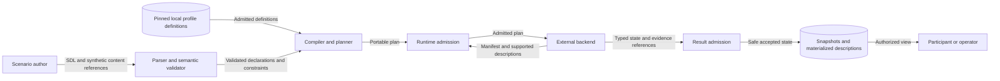

# Cloud resource ownership and secret state

Issue: #1653. This design extends existing SDL owners.
It adds no cloud backend or access-decision engine.

## Existing owners and missing meaning

Identity authorities already own subjects and policy facts.
Applications already own service identity and capabilities.
Content already owns initial payloads.
Deployment cells own range isolation, not cloud projects.
These owners need links to each other.
The links must join cloud scope, identity use, policy and secret versions.

The preflight is `issue-1653-cloud-identity-secrets-preflight.md`.
The source assessment includes these existing paths:

| Path | Use |
| --- | --- |
| `raes/runtime_directory_identity.py` | Extend authority policy and subject descriptions. |
| `raes/runtime_platform_application.py` | Extend application-owned secret state. |
| `raes/runtime_app_authorization.py` | Preserve the separate application-internal authorization owner. |
| `raes/_runtime_service_family_registry.py` | Register stable child identities and reference targets. |
| `raes/_declarations.py` | Resolve exact typed declarations. |
| `raes/composition/_sections.py` | Rewrite declared references during imports. |
| `raes_processor/semantics/realization_runtime_concern_profiles.py` | Preserve authored constraints and exclude observations. |
| `specs/sdl/profile-selections.md` | Preserve existing materialization and private-profile support. |
| `specs/sdl/materialization-attestation.md` | Preserve typed state and origin through descriptions. |

Package paths above start at `implementations/python/packages/`.

## Representation

### Resource scopes and identities

`RuntimeIdentityAuthority.resource_scopes` records cloud ownership boundaries.
Each scope has a portable `scope_id`, provider identity and native scope kind.
Optional native IDs preserve provider spelling.
They can also record which incarnation of a resource was observed.
An optional `parent_ref` names another declared scope.
Supplied parents must have the same provider.
Parent links must not form cycles.
Omitted ancestry makes no inheritance claim.
The authority's node is an SDL address context, not the scope's cloud owner.

`RuntimeIdentitySubject.resource_scope_ref` names its owning scope.
The existing subject remains the only principal identity.
`RuntimeIdentityAuthority.identity_uses` connects a workload to a subject.
Use modes distinguish attachment, impersonation and federation.
A source principal can describe the identity that requests impersonation.
These descriptions grant neither cloud access nor control-plane authority.
They require no credential or key.

### Policy attachment

`RuntimeIdentityPolicy.resource_access` holds resource-policy meaning.
It names the attachment target and contains stable permission-binding records.
Bindings name existing subjects and exact resource targets.
They specify actions, an effect and an optional role.
Conditions retain their language and expression as inert data.
An inherited policy view names its source policy instead of copying its bindings.
The source policy must resolve without an inheritance cycle.
Core does not combine provider policies or expand roles.
A backend must explicitly support the provider's rules.
A valid description does not prove that a provider accepts the policy.

`runtime.app_authorizations` retains application-internal authorization semantics.
Cloud policies do not become another application's private role store.

`RuntimeIdentityAuthority.access_observations` records a reported access attempt.
Each record names the principal, action, resource and outcome.
Allowed and denied outcomes require evidence references.
Unknown and unsupported remain separate outcomes.
These records do not require access tests or grant rights.
Existing evidence rules decide what a result proves.

### Secret state

`RuntimePlatformApplication.secrets` records application-owned secret metadata.
Each secret can name its resource scope.
It has stable versions and consumer selections.
Version state can be enabled, disabled, destroyed or unspecified.
Destroyed versions cannot declare a live payload source.
Payload references name existing `content` declarations.
No new secret-value or operator-credential field exists.
Content and existing service materialization remain the payload owners.

A consumer selection names either an exact version or an inert provider selector.
An optional resolved version stays separate from selector intent.
Observed resolution requires evidence references.
An exact selection cannot resolve to a different version.
A disabled version remains describable and can be the target of an expected failed attempt.
Core never chooses a replacement version.

Optional metadata covers location, replication and service limits.
It can also name required encryption keys.
Optional references name who owns reset and deletion duties.
These fields grant no right to change shared resources.
None of this detail is required when a scenario does not constrain it.

## Reference and lifecycle rules

New child records use the existing runtime-family reference tree.
Permission bindings have policy-local IDs; their policy remains the reference target.
The registry still owns the collection tree.
No second reference walker is needed.
References resolve through the declaration index and registered family records.
Cloud references require the exact declared kind.
Bounded node checks retain content declarations from admitted content placements.
Version ancestry follows the owning secret before its project parents.
Display names and native identifiers never replace portable references.
Repeated names in different scopes remain distinct.
Imports rewrite only declared reference fields.
Native identifiers, selector text and condition expressions remain unchanged.
Instantiation repeats the same semantic checks after variable substitution.

Compilation retains the existing node runtime payload.
Existing runtime concerns carry this state.
Their names are `runtime-identity-authorities` and `runtime-platform-applications`.
Configuration checks exclude access observations and selector-resolution reports.
The resolution basis names the source of the reported version.
It does not change which version was requested.
Configuration verification does not request secret retrieval or an access test.
Backend support checks and result admission retain their existing owners.
Unsupported native execution must fail before effects.
No reference backend advertises new cloud behavior through this change.
Materialized documents and snapshot codecs retain the typed descriptions.

## Data flows and trust boundaries

Author input crosses the parser boundary before it becomes plan data.
Backend claims cross result admission before publication or storage.
Operator credentials remain inside the external backend boundary.
Their bytes never enter these flows.
The existing view and information-flow policy controls what participants can see.

## Security

| Threat | Boundary and control | Verification |
| --- | --- | --- |
| A same-name resource acquires another project's rights. | Exact typed references, provider checks and scope ownership. | Wrong-kind, repeated-name and cross-provider cases. |
| A cycle creates false ancestry or inherited authority. | Bounded finite graph checks. | Parent and policy-source cycle cases. |
| A policy is mistaken for an access result. | Separate declarations and evidence-bearing observation records. | No inferred allow; unknown and unsupported cases. |
| A disabled selection becomes another version. | Exact selection and resolved-version agreement. | Disabled selection and conflicting resolution cases. |
| Secret bytes enter public runtime records. | Payload references only; closed models; existing content and credential boundaries. | Raw-field rejection and sentinel leakage checks. |
| Data executes a provider command or condition. | Inert strings; no resolver, SDK or expression interpreter. | Offline parsing and unsupported execution cases. |
| Imported names change native provider data. | Rewrite only explicit reference fields. | Repeated-import and native-spelling cases. |
| An incomplete description claims complete policy coverage. | Omitted ancestry and state remain unspecified. | Minimal and partial-description cases. |

Residual risks remain with native backend honesty and evidence quality.
RAES cannot prove either from a valid description.

## Alternatives and decision

Evidence-only retention preserves native data but leaves the connected use case unvalidated.
A general cloud resource graph duplicates several established SDL owners.
A vendor-specific SDL schema would couple core to changing provider catalogs.
A private profile cannot add core reference rules.
It cannot make a resource targetable by itself.

The design therefore extends authority policy and application-owned state.
It keeps private materialization profiles at their existing bounded hosts.
It introduces no universal runtime profile field or new policy interpreter.

## Architecture and policy records

Package boundaries and registry tables still express the architecture in code.
The parser and existing checks still enforce policy.
This change extends their typed inputs, not the development workflow.
No new structural workflow gate or formal requirement UID is introduced.
No accepted ADR changes meaning.
The native reference and runtime catalogs document the optional extensions.
Each changed schema has a publication record.

## Sources and document review

Sources were read on 2026-10-27.
The web sources record the design basis on that date.
They do not promise provider execution support.

| Source and version | Section | Application |
| --- | --- | --- |
| [GCP resource hierarchy](https://docs.cloud.google.com/resource-manager/docs/cloud-platform-resource-hierarchy), current. | Resource parents and projects. | Distinct ownership scopes and optional ancestry. |
| [GCP service accounts](https://docs.cloud.google.com/iam/docs/service-account-overview), current. | Permissions and lifecycle. | Principal/resource duality and incarnation identity. |
| [Secret versions](https://docs.cloud.google.com/secret-manager/docs/add-secret-version), API v1. | Version states and required roles. | Immutable versions, lifecycle and provider attachment restrictions. |
| [Secret Manager best practices](https://docs.cloud.google.com/secret-manager/docs/best-practices), current. | Access control and version references. | Credentialless identity and explicit version selection. |
| [Enterprise foundations blueprint](https://docs.cloud.google.com/architecture/blueprints/security-foundations), current. | Architecture. | Keep resource hierarchy, IAM and network controls distinct. |
| [AWS policy evaluation](https://docs.aws.amazon.com/IAM/latest/UserGuide/reference_policies_evaluation-logic.html), current. | Policy combinations. | Do not apply one provider's decision rules universally. |
| [ASD-STE100](https://www.asd-ste100.org/assets/files/ASD-STE100_ISSUE9.pdf), Issue 9, 2025-01-15. | Parts 1 and 2. | Short descriptions, consistent technical nouns and direct verbs. |

The prose review used the official writing rules and relevant dictionary entries.
The review checked sentence length, terminology, brevity and document purpose.
Code identifiers are technical nouns.
A prose linter supplements this review and does not certify STE compliance.
