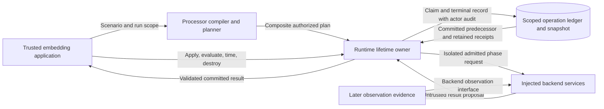
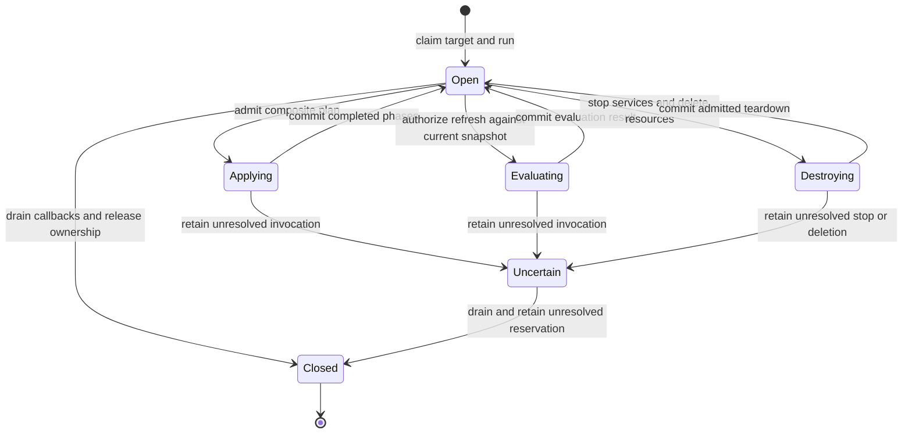

# Runtime interaction ownership

## Architecture

`RuntimeControlPlane` owns the target for the full run.
Both public names select the same class.
The owner holds one resource claim, one operation ledger, and one snapshot.
The owner calls a module for each phase.
The modules keep the phase order and its checks.
They set up time, drive participants, and carry out admitted teardown.
Each phase uses the same call and commit rules.
Each phase starts from the committed predecessor.
A partial failure preserves the completed phases.
If effects are unknown, the owner blocks new work.

## Failure and recovery authority

[Execution and recovery requirements](../../specs/sdl/execution-recovery.md) govern the native plans.
[Supervision sections S5 and S6](../../specs/formal/runtime-control-plane/supervision.md) govern final state and later work.
The runtime preserves the authored policy and its scope.
It refuses unsupported policies before invoking a backend.
The current profile can call each operation once.
It supports a bounded call with a `terminate` policy.
Other responses need the support and proof required by their existing rules.
The runtime must not replace them with an implicit retry or cleanup policy.

A generic exception or failed result does not prove that effects stopped.
Unknown effects retain `INDETERMINATE` and quarantine.
If a result is rejected, the last trusted state stays in force.
The existing linked resolution path checks later proof.
It must show which effects remain.
It must also show that work stopped.
Compensation requires separate admission under SEM-204.
Cleanup failure stops dependent work and denies resource reuse.
Unconditional manager rollback and deletion after a failed stop conflict with these rules.
Those legacy paths do not define an alternative failure policy.

The processor has an explicit refresh option.
The planner marks unchanged evaluation resources for update.
The runtime replans the original compiled model against the current snapshot.
It keeps the original run and value bindings.
The execution plan retains its original compiled input and frozen apparatus decisions.
It also retains profile, selected processor, and mixed-control planning context.
It also keeps materialization source and observation needs.
The owner registers the exact new plan before it calls the evaluator.
Provider-backed phases retain the plan's single observation owner.
They return validated disclosures and materialization output after settlement.
The synchronous `apply`, `destroy`, and inventory methods require local execution.
They refuse distributed composition before they dispatch any work.
The same owner exposes distributed work through operation receipts.
A fresh request gets a fresh operation identity.
A retry with the same key returns the existing receipt.
The request commitment uses the original evaluation planning input.
The owner resolves a durable retry before it plans against current state.
Teardown and reopening therefore do not change the retry identity.

The factory selects needed backend services before it builds them.
Its manifest describes exactly the selected components.
The runtime starts the participant scheduler only when it is needed.
New services use the same typed target and settings.

## Data flows and trust boundaries

The host process is trusted.
The runtime checks backend results before commit.
The optional HTTP adapter keeps its caller and access checks.
The ledger remains bound to one target and one run.
The design adds no service, network destination, credential source, or storage provider.

## Security and failure controls

| Threat | Boundary and control | Verification |
| --- | --- | --- |
| A second owner drives the same components | Keep `RuntimeResourceClaim` and store admission on the single owner | Ownership and blocked callback tests |
| A stale phase overwrites newer evidence | Reload the ledger and use revision checks before each phase | Snapshot and partial failure tests |
| A facade bypasses plan admission | Preserve provenance checks and exact planner authorization | Wrong target, invalid plan, and stale snapshot tests |
| A backend publishes invalid evidence | Reuse isolated calls, result contracts, and observation validation | Invalid evaluation result tests |
| A timeout permits conflicting effects | Keep the invocation ledger and uncertain-effect reservation | Timeout, close, and subsequent admission tests |
| A retry executes evaluation twice | Keep scoped idempotency claims and request commitments | Same-key retry and fresh-key tests |
| A request hash exposes credential material | Project nested plans before hashing; keep exact command proofs private | Inventory commitment test |
| Driver failure leaves healthy state in storage | Commit degraded service state and pacing evidence; close admission | Failure and reopening test |
| Fresh evaluation changes run values | Reuse the compiled model and original `PlanScope` | Run and instantiation preservation tests |
| An unused component starts work | Select components before construction and defer scheduler creation | Minimal target and scheduler tests |

Keep the existing value-free request hashes and audit records.
Driver failure records use the state writer and atomic terminal commit.
They observe a core failure and grant no backend invocation.
Result dictionaries do not replace committed snapshot evidence.
The HTTP adapter passes its checked caller identity to the core.
Local methods use the existing trusted host identity.
Timeout does not prove that a backend effect stopped.
Local ownership checks cannot fence work on another host.

## State model

## Policy and architecture as code

ADR-104 section 11 defines the ownership decision.
Its amendment and content pin accompany this design.
ADR-036 package import checks continue to enforce the processor/runtime boundary.
Target checks require the manifest and installed services to agree.
Published schemas remain the source of truth.
The design uses existing plan actions and operation contracts.
It requires no schema publication change or new policy gate.
Lifecycle changes use the FM3 state model above and behavioral tests.

## Source and document review

The design applies Python 3.11 context management and explicit resource closure.
Settings and service selection stay separate from use.
References:

- [Python data model](https://docs.python.org/3.11/reference/datamodel.html): Python 3.11, context managers and object finalization.
- [Python import library](https://docs.python.org/3.11/library/importlib.html): Python 3.11, programmatic imports and lazy package exports.
- [Dependency injection](https://martinfowler.com/articles/injection.html): 2004, constructor injection and separation of configuration from use.
- [Official STE overview](https://www.asd-ste100.org/about_STE.html): ASD-STE100 Issue 9, writing rules and technical names.

The prose review uses short sentences, active verbs, and consistent technical names.
Each description has one purpose.
Procedures remain in the issue plan.
Architecture and security decisions remain in this document.
