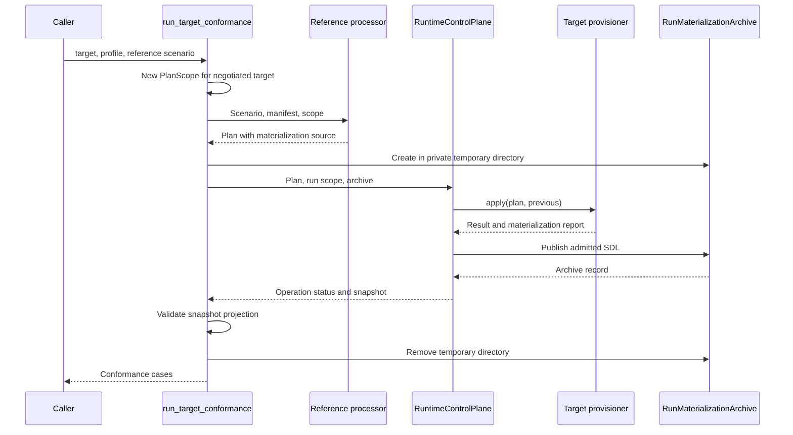
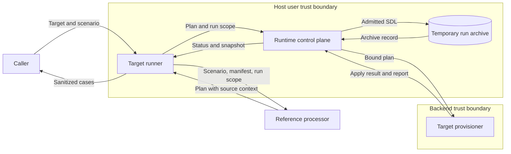

# Target conformance for materialization producers

Issue: #1667. This design changes target-probe composition only.
Materialization admission, inventory authority and protected publication keep their owners.
The binding guardrails are in `issue-1667-target-materialization-conformance-preflight.md`.

## Existing owners

Package paths below start at `implementations/python/packages/`.

| Path | Use |
| --- | --- |
| `raes_processor/planner/materialization.py` | Requires a run identity and a target scope for negotiated reporting. |
| `raes_runtime/backend_materialization.py` | Requires an archive owner before apply. Admits the report after apply. |
| `raes_runtime/control_plane_operation_context.py` | Requires the plan run to match the control-plane run scope. |
| `raes_operations/run_artifacts.py` | Publishes restricted SDL files without following symlinks. |
| `raes_runtime/control_plane_api_models.py` | Published the `runtime-snapshot-v1` projection privately. |
| `raes_conformance/conformance/target_probes.py` | Drives the provisioning and snapshot probes. |
| `raes_conformance/realization.py` | Plans positive realization probes for the caller's harness. |

## Architecture

### Run identity

`raes_conformance._materialization_scope.materialization_probe_scope()` returns a `PlanScope`.
It returns a scope only when the manifest declares `backend-materialization-attestation-v1`.
`target_name` is `RuntimeTarget.name`, as in `RuntimeManager.plan()`.
`run_id` is `target-conformance-<uuid4 hex>`.
This value satisfies `PlanScope`, `MaterializationSource` and the archive label rule.
Each probe gets a new value, so a backend cannot reuse native state from another run.
Other targets get no scope, so their plans and run scope do not change.

The planner remains the only validator of source context.
A target name that the inventory scope rejects fails planning before apply.

### Archive owner and lifetime

`ProbeRuntimeOwner` in `raes_conformance/conformance/probe_runtime.py` owns one target-adapter probe.
It creates a private directory with `mkdtemp` when it opens the first runtime.
It supplies `RunMaterializationArchive` and the matching `run:<id>` control-plane scope.
The provisioning probe, the snapshot probe and the isolated control probes open their runtimes through it.
At the end of the probe, the owner closes every runtime again.
`RuntimeControlPlane.close()` does nothing after a successful close.
It raises while backend calls stay unresolved.
The owner removes the directory only after every close succeeds.
After a failed drain, the directory stays for a late publication, and the error goes to the caller.
The report contains no archive path.
Archive removal does not destroy backend resources.

### Snapshot validation

`raes_runtime.snapshot_contract.runtime_snapshot_contract_model()` is the one public projection.
The control-plane API and the snapshot probe both use it.
The probe therefore validates the attestation records, realization provenance, observations and envelope.
A negotiated producer must also leave at least one archived attestation record.
The new failure code is `conformance.materialization-not-archived`.

### Realization probes

Positive realization probes use the same scope rule.
A plan with an error diagnostic is never sent to the harness.
The harness owns execution and its own archive.

### Sequence

## Systems security engineering

| Asset | Protection need |
| --- | --- |
| Admitted source snapshot | Integrity. Confidentiality inside the host user account. |
| Materialized SDL report | Integrity and binding to plan, run, target and producer. |
| Archive files | Restricted access. No path escape. No silent overwrite. |
| Conformance report | No secrets, host paths or rejected input. |

| Threat | Boundary | Control | Verification |
| --- | --- | --- | --- |
| Report for another run or plan (spoofing) | Backend to runtime | Existing admission checks bindings. | `invalid-report` test. |
| Missing report hidden by success (repudiation) | Backend to runtime | Runtime fails the operation. Snapshot probe requires a record. | `missing-report` and snapshot tests. |
| Archive tampering or path escape | Runtime to filesystem | Private `0700` directory, `0600` files, `O_NOFOLLOW`, label checks. | Mode assertions in the descendant test. |
| Failed delivery accepted (tampering) | Runtime to filesystem | Runtime fails the operation. | `failed-archive-delivery` test. |
| Archive removed under a late publication | Runtime to filesystem | Removal only after confirmed runtime closure. | Failed-drain tests. |
| Leak of exception text or values | Runner to caller | Existing generic runtime diagnostics. | Tests assert absence of mutated and exception text. |
| Cross-run state reuse | Runner to backend | Fresh run identity for each probe. | Fresh-identity test. |
| Unsafe target identity | Runner to planner | Planner rejects it before apply. | Unsafe-identity test. |
| Invalid plan sent to a harness | Runner to harness | Error diagnostics fail the positive probe. | Planning-error test. |

Residual risks:

- The archive directory is inside the host temporary root. Other processes of the same user can read it.
- A backend report is a producer assertion, not independent evidence.
- A failed probe can leave backend resources. Backend cleanup stays with the caller.
- A failed drain leaves the temporary archive directory. The caller gets the drain error.

## Data flow

Backend output is untrusted until runtime admission accepts it.
The archive is the only new data store.

## Supporting artifacts

- Policy as code: `tools/policy/adr_policy.yaml` lets `raes_conformance` import `raes_operations.run_artifacts` and `raes_runtime.snapshot_contract` only.
- Architecture as code: the new modules are `raes_runtime/snapshot_contract.py`, `raes_conformance/_materialization_scope.py` and `raes_conformance/conformance/probe_runtime.py`.
- ADR-115 already names the run archive as a portable RAES surface. ADR-036 already delegates package edges to the policy file. No ADR text changes.
- `docs/explain/reference/backend-conformance.md` describes the runner behavior.
