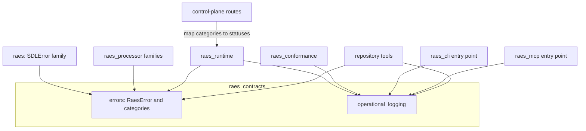
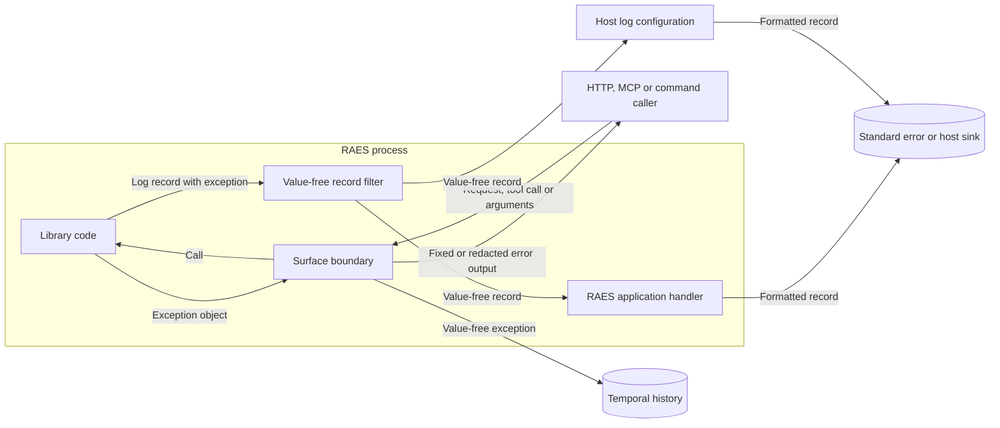
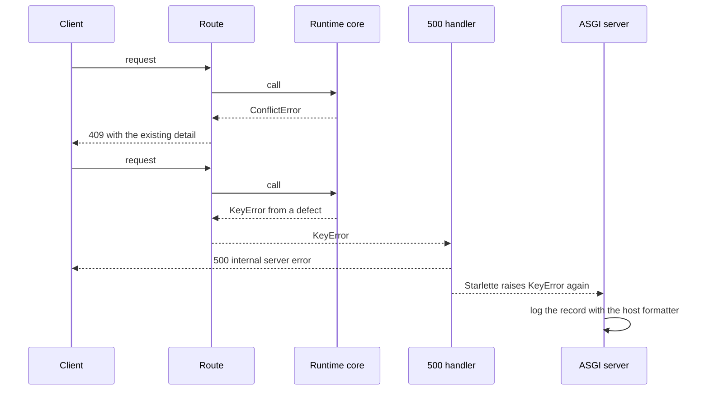

# Issue 1678: Shared exceptions and operational logging design

[ADR-116](adrs/adr-116-shared-exceptions-and-operational-logging.md) records the decision.
[The policy](../develop/exceptions-and-logging.md) states the rules for each raise, handler and log call.
[The preflight](issue-1678-exceptions-logging-preflight.md) records the binding guardrails.

## Architecture

Two standard-library modules in `raes_contracts` hold the shared code.
`raes_contracts` is the neutral package that every first-party package can import under ADR-036.
The modules import no other first-party module.
They keep Python 3.12 syntax for the development container bootstrap.

`raes_contracts.errors` defines `RaesError` and six categories.
Each category answers one question for a caller: what went wrong.
Families keep their modules and derive from one category or from `RaesError`.
`raes_runtime.errors` holds two runtime families that a caller must tell apart.
`RuntimeBudgetExhaustedError` is an `OperationalError`, and `IdempotencyClaimConflictError` is a `ConflictError`.
`SDLValidationError` carries one `SDLValidationFinding` for each error.
A finding holds the message, the owner declaration and, when known, a JSON pointer.
Thus no consumer reads data from message text.

`raes_contracts.operational_logging` defines these functions and classes:

- `get_logger(name)` returns the standard logger and attaches one value-free filter.
- `describe_exception(exc)` returns the exception types and frame locations on one line.
- `ValueFreeFormatter` formats any record without exception values.
- `configure_application_logging(level=..., stream=...)` installs one marked standard error handler on the root logger. A second call changes only the level. Without a stream argument, the handler writes to the current standard error.
- `set_application_log_level(level)` changes only the root level. A command option uses it, so a command that runs inside a host or a test adds no handler.
- `foreign_failure_record(exc)` returns a `ForeignCodeFailure` record for a failure of code that RAES does not own. The record keeps the RAES frames and omits the foreign type, message, chain and frames.
- `run_application(main, unexpected_status=...)` configures logging, runs `main` and logs an unexpected failure one time. The `raes` command uses status 70; the tools use status 1.

The filter and the formatter share one renderer.
The renderer keeps each exception type, cause, context and group member.
It keeps the file, line and function of each frame.
It omits messages, notes, source lines and local variables.
It limits the frames and the chain depth.
A logging call with bad arguments still produces a record, and the call does not raise.

Each surface keeps its own error output.
The surfaces use the categories to choose that output.

## Failure behavior

| Surface | Domain failure | Unexpected failure |
| --- | --- | --- |
| `raes` command | Message on standard error, documented status | Value-free record, status 70 |
| `raes-mcp` tool | Existing tool error result | Value-free record, fixed `ToolError` |
| HTTP route | 403, 404, 409 or 503 with the existing detail | Existing redacted 500, server log record |
| Temporal activity | Value-free exception | Value-free record of the cause, value-free exception |
| Conformance check | Diagnostic with sanitized message | Diagnostic with sanitized message |
| Repository tool | Message on standard error, status 1 | Value-free record, status 1 |

A logging failure does not change a selected response.
It does not hide a failed mutation.
The application handler reports its own failed write with exception types and frame locations only.

## Data flows and trust boundaries

Callers are untrusted.
The exception object stays inside the process.
Only the boundary decides what crosses to a caller.
The filter runs before any handler, so a host handler gets value-free first-party records.
Records from other libraries reach the host without the filter.
RAES applications format them with `ValueFreeFormatter`.

## Security engineering

Protected assets are secrets, tokens, credentials, authored scenario content, hidden participant data and tenant data.
Operators need a diagnosable record of each unexpected failure.

| Threat | Control | Verification |
| --- | --- | --- |
| Exception text in a log discloses values | The filter and the formatter render types and frame locations only | Secret sentinels in messages, notes, causes and groups are absent from captured logs |
| A traceback in a command or tool result discloses values | `run_application()` and the MCP boundary replace tracebacks with fixed output and value-free records | Command and tool tests with secret sentinels |
| Log injection forges records | The filter and the formatter escape control characters | Carriage return, line feed and terminal escape tests |
| A programming error is reported as a conflict | Routes catch categories, not built-in exceptions | A route test with a built-in `ValueError` gets 500 |
| A failure is suppressed without a record | `BLE001`, `S110` and `S112` reject silent broad handlers | Ruff in CI |
| A provider controls text in a log record through its exception type or frames | Isolation handlers for untrusted code log `foreign_failure_record()` | Provider secret-type tests in the control-plane security conformance suite and the shared logging tests |
| A log call fails and breaks the caller | The filter tolerates bad arguments | Bad argument tests |
| The report of a failed log write discloses the values of the handled exception | The application handler writes to the current standard error and reports a failed write with types and frame locations only | Replaced and closed stream tests |
| Logging configuration runs untrusted code | Only fixed code configures logging; no configuration file or listener is accepted | `TID251` and review |
| Hidden causes prevent diagnosis | The handler logs the cause before `from None` | Activity and isolation tests |
| A host formats server records with values | The host uses `ValueFreeFormatter` | Residual risk, documented in ADR-116 |

The design adds no service, network destination, credential, file or dependency.
Log records are not audit records, evidence or observations.

## Unexpected failure in an HTTP route

## Policy as code

The Ruff configuration in `implementations/python/pyproject.toml` adds `BLE`, `LOG`, `G`, `TID251` and these `TRY` rules: `TRY002`, `TRY201`, `TRY203`, `TRY300`, `TRY400` and `TRY401`.
`TID251` bans `logging.getLogger`, `logging.basicConfig` and `logging.config` outside `raes_contracts.operational_logging`.
Tests and test doubles can use the standard logging calls to capture records.
`TRY003` and `TRY004` stay off.
Many messages use project names, and many type checks validate external documents, where `ValueError` is correct.

## Architecture as code

ADR-036 module boundaries already permit every package to import `raes_contracts`.
The policy file `tools/policy/adr_policy.yaml` needs no change.
The Ruff target-version table marks the two shared modules as Python 3.12.
The development container test checks that table against the bootstrap import closure.
The bootstrap tools add the source path with the fixed setup that `tools/check_generated_schemas.py` uses.

## Decision record changes

ADR-116 is new, and `adr-index.yaml` pins it.
No accepted ADR changes.
ADR-075 keeps its own scope; ADR-116 creates the Python exception hierarchy.

## Accounting

The review covered every raise statement, handler, log call and assert in the scope of the policy.
The table compares the merged `dev` revision with this change.

| Area | Built-in raises | Handlers | Log calls |
| --- | --- | --- | --- |
| `raes` | 921 to 868 | 118 to 138 | 5 to 5 |
| `raes_contracts` | 2,803 to 2,788 | 70 to 76 | 3 to 9 |
| `raes_backend_protocols` | 177 to 159 | 12 to 14 | 0 to 1 |
| `raes_processor` | 522 to 446 | 58 to 78 | 0 to 2 |
| `raes_runtime` | 1,011 to 419 | 193 to 275 | 5 to 71 |
| `raes_conformance` | 167 to 126 | 50 to 56 | 0 to 21 |
| `raes_cli`, `raes_mcp`, `raes_operations` | 11 to 0 | 39 to 40 | 0 to 2 |
| `tools/` | 328 to 31 | 165 to 284 | 1 to 1 |
| Other source | 116 to 58 | 12 to 16 | 0 to 0 |

Most remaining built-in raises validate value objects, which Pydantic requires (E3).
The others report programming errors (E2) or follow a protocol (E4).
Every exception class derives from `RaesError` through one base, except eight test doubles that simulate a foreign failure or an interruption.
Ruff `BLE001` reports 110 silent broad handlers on the merged `dev` revision; it reports none on this change.
Each `noqa: BLE001` that remains marks a verified false positive and states the reason.

## Source and document review

The design applies these sources:

- [Python Logging HOWTO](https://docs.python.org/3.14/howto/logging.html): Python 3.14, when to use logging, logger names and library configuration.
- [Python built-in exceptions](https://docs.python.org/3.14/library/exceptions.html): Python 3.14, exception context and inheritance from built-in exceptions.
- [PEP 8](https://peps.python.org/pep-0008/): programming recommendations for exceptions.
- [OWASP Logging Cheat Sheet](https://cheatsheetseries.owasp.org/cheatsheets/Logging_Cheat_Sheet.html): data to exclude, injection and logging failure.
- [OWASP Error Handling Cheat Sheet](https://cheatsheetseries.owasp.org/cheatsheets/Error_Handling_Cheat_Sheet.html): generic responses and server-side records.

The prose review uses short sentences, active verbs and consistent technical names.
The ADR states the decision and its reasons.
The policy states the rules.
This document describes the system, the flows and the controls.
Procedures stay in the issue plan.
