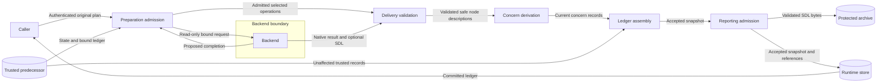

# Provenance for prepared portable resources

Issue #1697 corrects the runtime ledger for admitted backend additions.
The [preflight](issue-1697-prepared-resource-provenance-preflight.md) supplies the binding constraints.
SEM-218 and the existing preparation contract remain authoritative.

## Components and contracts

The processor derives concern records from admitted node descriptions.
Preparation and descendant reporting share the concern registry and its applicability rules.
The shared function accepts the canonical address, qualified name, supplied values, and governing scope.
Explicit empty values remain supplied values.
Absent and null values create no concern records.
Serialized defaults do not establish author intent.
The compiler uses retained explicitness paths to omit absent registered concern fields from node payloads.
It reads those paths without rebuilding the explicitness map used for realization compilation.
This keeps explicitly empty concerns distinct from model defaults after instantiation.
Typed node admission still supplies defaults for validation.
Later reporting compares sparse node payloads through the existing safe typed default projection.
Value commitments remain intact during this comparison.
Comparison restores each supplied concern after typed default expansion.
Closed concern checks accept owner-defined default readback for absent fields.
Other added values remain forbidden.
Added concerns have open explicitness and backend origin.
Dedicated substrate and artifact rules remain with their existing semantic owners.
Substrate observation rules use the added node's semantic scope.
The recorded governing scope remains the admitted collection scope.
Provenance does not establish independent observation or artifact satisfaction.

The runtime keeps original authority separate from the selected completion.
It derives added records after delivery checks, sanitization, and revalidation.
The ledger uses address, field path, domain, and concern kind as its identity.
Current records replace affected records without duplicate identities.
Trusted records remain for unchanged resources and retained additions.
Deleted resources have no current records.
Reporting excludes replaced and deleted records from predecessor merges.
Original author and processor origins remain intact.

Materialization preserves accepted first-party records.
These resources require no descendant ancestry or creation receipt.
Existing descendant reporting retains its separate admission and lineage rules.
The native proposal remains immutable during runtime acceptance.
Existing snapshot codecs store the resulting ledger.

## Data flows and trust boundaries

Preparation selection precedes delivery validation.
Ledger assembly precedes the existing terminal store commit.
No new deployment component or execution state requires another diagram.

## Security and failure behavior

The protected assets are authority, provenance integrity, and selected confidential values.
Backend proposals cross the existing untrusted result boundary.
Collection and capability checks prevent unauthorized additions.
Delivery checks prevent records for undelivered selections.
Runtime ownership rejects backend-written ledger changes.
Concern sanitizers protect values before storage.
Ledger records contain identifiers and enums, without selected values.
Failed native delivery creates no successful records.
Refused proposals retain the trusted predecessor.
Existing partial-failure cleanup semantics remain intact.
Reporting failure retains its existing atomicity or cleanup behavior.
Stub verification cannot prove native delivery or independent observation.

## Policy and architecture artifacts

ADR-036 keeps semantic derivation in the processor and acceptance in the runtime.
The runtime uses the public planner facade.
ADR-070 keeps selection separate from universal envelope support.
The ownership policy names the exact runtime ledger and migration guide paths.
Other runtime files and backend implementations retain their existing owners.
No schema, architecture configuration, store migration, or ADR change is required.
Artifact carriers use the existing neutral contract base to prevent an import cycle.
Existing module policy and targeted behavioral tests enforce these boundaries.
Source changes require fresh formal, specification, and runtime mapping captures.
Content-addressed captures preserve history and baseline pins.

## Reference and writing review

[Python 3.14 dataclasses](https://docs.python.org/3.14/library/dataclasses.html), `replace`, defines immutable carrier replacement.
[W3C PROV-DM](https://www.w3.org/TR/prov-dm/), Recommendation 2013, sections 5.3 and 5.6, separates responsibility from collection membership.
[ASD-STE100 Issue 9](https://www.asd-ste100.org/assets/files/ASD-STE100_ISSUE9.pdf), rules 1, 3, 6, and 9, guides the writing review.
The review checks technical terms, active verbs, sentence length, paragraph scope, and document purpose.
Implementation tasks and verification commands belong in the issue plan.
