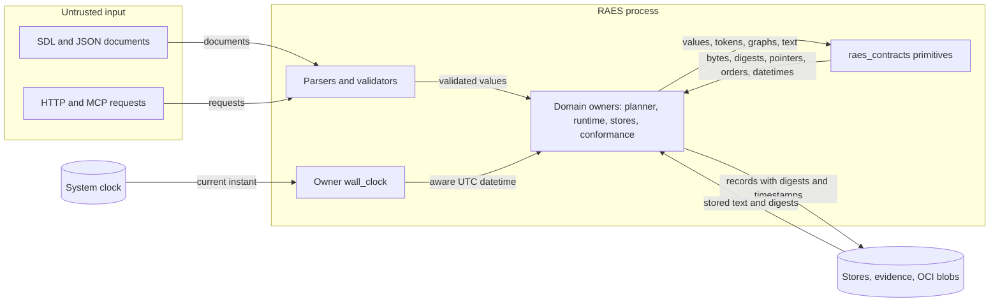
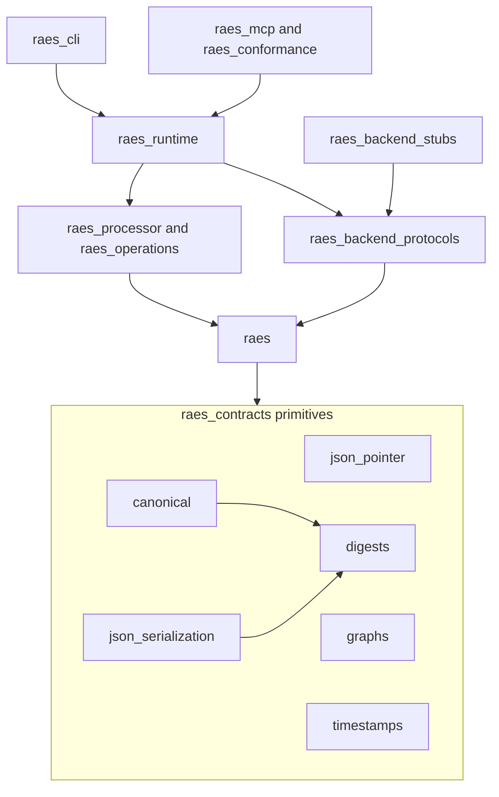
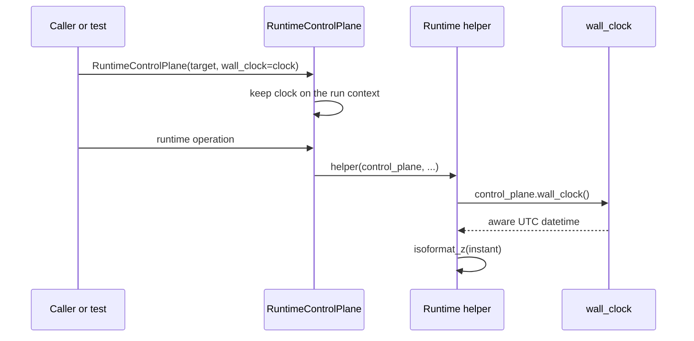

# Issue 1710: Shared primitives design

Date: 2026-10-31

Contract: issue #1710, chunk 01 of the Engineering Quality Refactor. The run has
no Ground Control requirement. The binding guardrails are in the
[preflight note](issue-1710-shared-primitives-preflight.md). The decisions are in
[ADR-118](adrs/adr-118-shared-primitives-and-injected-wall-clock.md).

## Outcome and constraints

Each primitive in the issue findings gets one public, tested implementation in
`raes_contracts`. Every package uses it, and the local copies are removed.

The refactor keeps all observable behavior. This includes return values,
exceptions, messages, logs, CLI, MCP and HTTP output, persisted bytes, digests,
graph orders and generated schemas. Where call sites need different behavior,
the shared module gives each variant its own name.

The maintainer chose an injected wall clock on 2026-10-31. Tests replace the
clock through public constructor arguments. No global setter exists.

## Repository assessment

The assessment used `dev` at `e74eb280f`. The issue counts describe `0ab5bf57`.

| Primitive | Current state |
| --- | --- |
| JSON Pointer tokens | 58 escape or unescape expressions in 49 package files. `raes_contracts.realization_structure._common` has a second private token module. `raes_contracts.json_pointer` has only array-index rules. |
| Sorted JSON text | 30 sorted, compact `json.dumps` calls in 25 files, with five behaviors. Most feed `sha256:` digests. Others give stored text, signatures, size checks or comparison keys. |
| JCS | `raes_contracts.canonical` gives RFC 8785 bytes and digests. Eight other modules call `rfc8785.dumps` directly, and four of them build the `sha256:` digest by hand. |
| SHA-256 | 60 direct `sha256` calls in 42 files. They render hexadecimal text, `sha256:` digests, domain-prefixed identities, truncated names and raw bytes. Three calls hash streams inside bounded, secure read loops. |
| Graphs | Two Kahn cycle checks, one planner Kahn order, one iterative Tarjan and two recursive depth-first checks. Ten modules use `graphlib` directly. |
| Wall clock | 65 call sites read the clock. 19 runtime modules import the private `control_plane_execution._utc_now`. Six other local helpers and 13 direct `datetime.now(UTC)` calls exist. |
| Timestamp parsing | Four parsers with different rules, plus one wrapper. Thirteen `raes_contracts` modules import the private `contracts.base._parse_rfc3339_datetime`. |

The structural baseline records the private imports. The refactor removes them
and drains their entries.

## Architecture

### Components

All new modules are public modules of `raes_contracts`, the lowest package layer
(ADR-036). They import only the standard library and `rfc8785`. They do not
import SDL, processor, runtime, backend or `raes_contracts.contracts` code.

| Module | Public interface | Reason |
| --- | --- | --- |
| `json_pointer` (extended) | `escape_token`, `unescape_token`, `pointer_from_tokens`, `pointer_tokens`, plus the existing `array_index` and `is_array_index_token` | #1678 made this module the pointer owner. RFC 6901 defines the token rules. |
| `canonical` (kept) | `canonical_json_bytes`, `canonical_json_digest` | JCS stays the profile for new digests. Direct `rfc8785.dumps` calls move to this module. |
| `json_serialization` (new) | `sorted_json_text`, `sorted_json_text_finite`, `sorted_json_text_unicode`, `sorted_json_text_unicode_finite`, `sorted_json_digest` | Existing digests and stored records use these exact bytes. They are not RFC 8785 bytes. |
| `digests` (new) | `SHA256_PREFIX`, `Sha256Hasher`, `sha256_hasher`, `sha256_bytes`, `sha256_hex`, `sha256_digest` | One owner for SHA-256 construction and its three renderings. |
| `graphs` (new) | `has_cycle`, `stable_topological_order`, `cyclic_components` | `graphlib` gives the cycle check and the planner order. It has no strongly connected component API, so Tarjan stays hand-written here. |
| `timestamps` (new) | `WallClock`, `utc_now`, `isoformat_z`, `parse_rfc3339_datetime`, `parse_offset_timestamp_utc`, `parse_offset_datetime`, `parse_timestamp_assuming_utc`, `EXPLICIT_OFFSET_TIMESTAMP_ERROR` | One owner for the system clock read, its text forms and the four parser behaviors. |

### Variant rules

- `escape_token` replaces `~` before `/`. `unescape_token` replaces `~1` before
  `~0`. `pointer_from_tokens(())` is `""`. `pointer_tokens` ignores text before
  the first `/`, as the current call sites do.
- A call site that writes `"/"` for an empty path keeps its own join. Walkers
  keep their own `None`, sentinel, boolean and exception contracts.
- `sorted_json_text` uses `sort_keys=True` and `(",", ":")` with the `json`
  defaults. The `finite` names set `allow_nan=False`. The `unicode` names set
  `ensure_ascii=False`. Each name takes an explicit `default` conversion
  callback.
- `sorted_json_digest` is `sha256_digest` of the UTF-8 bytes of
  `sorted_json_text`.
- `has_cycle` uses `TopologicalSorter.prepare`. Edge direction does not change
  the result.
- `stable_topological_order` takes a node-to-dependencies mapping in which each
  dependency is a key. Ready nodes leave in FIFO order. The first ready nodes and
  the newly ready dependents leave in key order. Nodes on or after a cycle follow
  in key order.
- `cyclic_components` is the planner's iterative Tarjan. It visits roots in key
  order and keeps a component that has more than one member or a self-loop. It
  sorts members and components by key.

### Wall clock injection

`WallClock` is a callable that returns an aware UTC `datetime`. `utc_now` reads
the system clock at each call. Each owner keeps its read at the same place and
reads the clock the same number of times.

| Owner | Public seam |
| --- | --- |
| `RuntimeControlPlane` and every run context | `wall_clock` in `ControlPlaneOptions` and `ControlPlaneConfiguration`. Sub-runs copy the engine configuration, and `open_run` refuses a different clock. |
| Runtime helpers that receive the control plane | `control_plane.wall_clock` |
| Helpers without an owner | A required `wall_clock` keyword from the caller |
| `ParticipantScheduler`, `SchedulerRunState`, `InvocationToolActionLedger`, `ParticipantInvocationToolActions` | A `wall_clock` argument from the run context |
| `RuntimeExperiment`, `RuntimeTrialUnit` | The clock of their run context |
| `LocalControlPlaneStore`, `RemoteOperationAuthority`, `maintain_local_control_plane_store` | A `wall_clock` keyword argument |
| `BaseParticipantRuntime`, `StubOrchestrator`, `StubEvaluator`, `create_stub_components` | A `wall_clock` keyword argument |

Public constructors and entry points default to `utc_now`. Thus existing callers
do not change. Internal helpers require the argument, so a missed path fails
instead of reading the system clock.

The name `wall_clock` keeps this seam apart from semantic clocks (ADR-090),
monotonic watchdogs and Temporal `workflow.now()`. None of those change.

### Failure behavior

The shared functions raise the same exceptions as the code that they replace.
`json.dumps` raises `TypeError` and `ValueError`, `rfc8785` raises its own
errors, and parsers raise their current `ValueError` messages. The new modules
log nothing and translate nothing. Domain owners keep their error translation.
`ControlPlaneConfiguration` refuses a `wall_clock` value that is not callable
with `TypeError`, as it does for its other typed options.

### Rejected alternatives

- A process-wide clock setter. It is global state and gives one clock for each
  process. The preflight and the maintainer rejected it.
- RFC 8785 for every sorted JSON call. It changes Unicode, key order and number
  bytes, so it changes digests.
- `graphlib` for the planner cycles. `CycleError` reports one cycle, not each
  strongly connected component.
- `hashlib.file_digest` for streams. It removes the size and identity checks of
  the secure read loops.
- One universal timestamp parser. The four parsers accept different inputs.

## Systems security engineering

| Asset | Protection need |
| --- | --- |
| Persisted records, evidence, OCI blobs, signatures and audit rows | Their digests and bytes stay identical. |
| Admission and integrity checks | They keep their limits, refusals and order. |
| Record timestamps | They come only from trusted owners. |
| Diagnostics and pointers | They keep their RFC 6901 encoding. |

Trust boundaries are unchanged. Untrusted SDL, JSON, HTTP and MCP input crosses
the existing parsers and validators. Stored records cross the existing integrity
checks. The shared functions are pure, except `utc_now`, and add no input
surface.

| Threat | Control | Verification |
| --- | --- | --- |
| A changed digest breaks evidence replay, store integrity or signatures. | Named legacy variants keep the exact `json.dumps` options and encodings. No JCS migration. | Fixed byte and digest vectors, plus existing store, registry, archive and history tests. |
| A widened parser admits a timestamp that a check refused before. | Four named parsers keep their own rules and messages. | Exact acceptance, refusal and offset tests for each parser. |
| A changed pointer decoding addresses a different value. | `~1` before `~0`, and the `""` and `"/"` forms stay distinct. | RFC 6901 vectors and the existing hostile-pointer tests. |
| A changed graph order changes planning or deletion order. | Key-ordered FIFO and Tarjan rules stay the same. | An exhaustive comparison with the old algorithms on small graphs, plus the planner tests. |
| A caller forges record times through the clock seam. | `wall_clock` is a trusted Python dependency only. No SDL, environment, HTTP or MCP setting reaches it. | Configuration tests. A review of every construction path. |
| Deep input exhausts the stack. | `graphlib` and the shared Tarjan are iterative. The replaced recursive checks had inputs bounded to 128 and 256 items. | Long-chain tests. |

Residual risk: a third-party backend that subclasses `BaseParticipantRuntime` and
skips `super().__init__()` has no clock. The current base class has the same
requirement for its other state.

## Data flows

The primitives receive values from domain owners only. They never read stores,
the network or the environment. `utc_now` is the only primitive that reads
process state.

## Other diagrams

## Policy as code

- `tests/test_issue_1710_primitive_owners.py` scans the package sources. It
  refuses wall-clock reads, SHA-256 construction, pointer token escapes,
  sorted compact `json.dumps` calls and direct `rfc8785` serialization outside
  their owner modules. It also proves that each check finds a local copy.
- Ruff `TID251` does not carry these bans. The tooling lint lane checks
  `tools/` with the same configuration, and `tools/` is out of scope. An
  exception for `tools/` would also remove the ADR-116 logging bans there.
- `tools/policy/structural_baseline.json` drops the private imports that the
  refactor removes. The baseline only shrinks.

## Architecture as code

`tools/policy/import_contracts.toml` needs no new layer or ignore. The new
modules sit in the lowest layer and import nothing above them, so they add no
sibling cycle. Ignore entries for removed imports are deleted, because the
contract refuses an unmatched ignore. `_canonical` keeps its deferred history
import.

## ADR changes

ADR-118 records the primitive owners, the named variants, the injected wall
clock and the structural ownership test. ADR-036, ADR-116 and ADR-117 need no
amendment.

## Finding dispositions

| Finding | Disposition |
| --- | --- |
| JSON Pointer escapes | Fixed: `raes_contracts.json_pointer`. |
| Sorted JSON text | Fixed: named variants in `raes_contracts.json_serialization`. JCS cannot give the same bytes. |
| Direct digests | Fixed: `raes_contracts.digests`. `hashlib.new` stays where the algorithm is a parameter. |
| Kahn and recursive cycle checks | Fixed: `has_cycle`. |
| Planner Kahn order | Fixed: `stable_topological_order` on `graphlib`. |
| Planner Tarjan | Moved to `cyclic_components`. The standard library has no strongly connected component API. |
| Ten direct `graphlib` users | Kept. They already use the standard library. |
| Wall clock | Fixed: `utc_now`, `isoformat_z` and the injected `wall_clock`. |
| Timestamp parsers | Fixed: four named parsers. The public runtime names stay as aliases, because tests and callers import them. |
| Inline `fromisoformat` calls | Kept. They call the standard library. The control budget form refuses lowercase `z` and leap seconds by design. |
| CLI and MCP indented output, lockfile text, unsorted JSON | Kept. They are presentation or single-use forms, not sorted, compact text. |

## Verification

- New unit tests for each public function, with RFC and fixed vectors.
- Fixed digest vectors for representative consumers.
- An exhaustive differential test of the graph functions against the old
  algorithms on small graphs.
- Wall-clock tests that construct independent owners with fixed clocks.
- The existing tests that the preflight names. Only targeted modules run
  locally. CI runs the full suites.

## References

| Source | Section | Use |
| --- | --- | --- |
| [RFC 6901](https://www.rfc-editor.org/rfc/rfc6901) | Sections 3 to 5 | Token encoding, decoding order, `""` and `"/"` |
| [RFC 8785](https://www.rfc-editor.org/rfc/rfc8785) | Section 3 | Why JCS bytes differ from sorted `json.dumps` text |
| [RFC 3339](https://www.rfc-editor.org/rfc/rfc3339) | Section 5.6 | The governed date-time grammar |
| [Python 3.14 json](https://docs.python.org/3.14/library/json.html) | Basic usage, Standard compliance | `ensure_ascii`, `allow_nan`, `default`, separators |
| [Python 3.14 graphlib](https://docs.python.org/3.14/library/graphlib.html) | `TopologicalSorter`, `CycleError` | Predecessor graphs, insertion order, one reported cycle |
| [Python 3.14 datetime](https://docs.python.org/3.14/library/datetime.html) | `now`, `fromisoformat`, `isoformat` | Aware reads, accepted forms, `+00:00` text |
| [Python 3.14 hashlib](https://docs.python.org/3.14/library/hashlib.html) | Hash objects | One-shot and incremental hashing |
| [Ruff TID251](https://docs.astral.sh/ruff/rules/banned-api/) | banned-api | Why the bans use a structural test |
| [Dependency injection](https://martinfowler.com/articles/injection.html) | Constructor injection | The wall clock seam |
