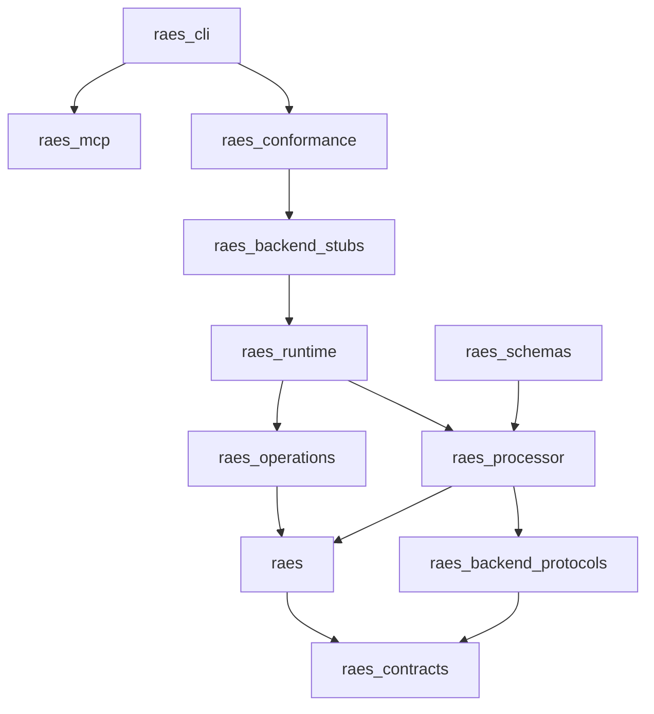
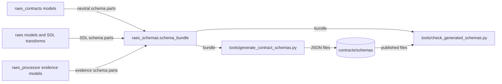
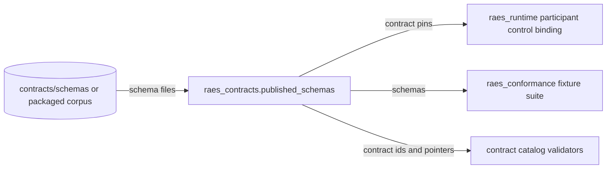
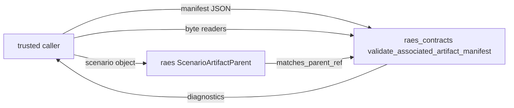
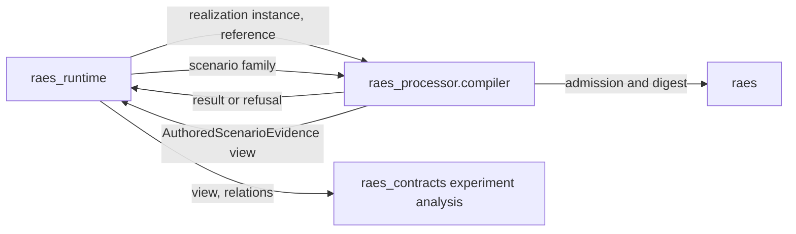

# Issue 1711: Strict package layers design

Date: 2026-10-31

Contract: issue #1711, chunk 02 of the Engineering Quality Refactor, and
requirement `MOD-001`. The binding guardrails are in the
[preflight note](issue-1711-contracts-import-cycle-preflight.md). The decisions
are in [ADR-121](adrs/adr-121-strict-package-layers.md), with amendments to
[ADR-036](adrs/adr-036-sdl-processor-runtime-module-boundaries.md) and
[ADR-117](adrs/adr-117-ratcheted-structural-checks.md).

## Outcome and constraints

`raes_contracts` does not import `raes`. It becomes a self-sufficient base of the
types that cross package boundaries. No import cycle remains inside
`raes_contracts`. Checks enforce the layers, the public interfaces and the
absence of cycles.

On 2026-10-31 the maintainer chose this design (option A in the
[issue plan](https://github.com/OpenRAE/rae/issues/1711)). The decision changes
two issue constraints:

- A moved name gets one new public path. All callers in the repository change.
  No module keeps a compatibility re-export of a moved name.
- Seven validator locator strings change in five published schemas. Each
  schema gets a change-ledger entry under `contracts/schema-publication/entries/`.

On 2026-10-31 the maintainer also added the cycles inside `raes_contracts` to
this issue. No issue of milestone 73 owned them.

All other behavior stays the same: return values, exceptions, messages, logs,
CLI, MCP and HTTP output, persisted data, digests, and all other schema content.

## Repository assessment

The assessment used `dev` at `a601b696c`. The change merges `dev` at `34afe9696`.

| Item | Current state |
| --- | --- |
| Reverse imports | 57 `raes_contracts` → `raes` import statements in 39 modules: 54 at module level, 2 under `TYPE_CHECKING`, 1 inside a function. |
| Cycle | Grimp puts 404 modules in one cross-package component without `TYPE_CHECKING` imports, and 410 with them. |
| Imports inside functions | 152 in 67 `raes_contracts` modules and 56 in 26 `raes` modules. |
| Policy | `adr_policy.yaml` lets `raes_contracts` import `raes`. The import-linter `layers` contract has 54 `raes_contracts -> raes` exceptions. |
| SDL work in contracts | `schema_bundle()` builds the SDL schemas. `associated_artifacts` instantiates and admits scenarios. `satisfiability` and `exploit_path` embed `InstantiatedScenarioSnapshot`. `experiment_evidence_refinement` computes SDL digests. `artifact_requirements` subclasses the SDL `Source` model. |
| Shared SDL models in contracts | Contract fields use `EvidenceRequirement`, `OutcomeInterpretationRule`, `ParticipantInjectDelivery`, `ArtifactIdentity` and `ArtifactMechanismProfile`. All extend `SDLModel`. |
| SDL objects in runtime | `raes_runtime` passes scenario objects into contracts experiment analysis. It calls SDL admission through `require_instantiated_scenario_reference`. |
| Private member access | 906 Ruff `SLF001` findings: 844 in `raes_runtime`, 29 in `raes`, 19 in `raes_contracts`, 9 in `raes_backend_protocols`, 3 in `raes_conformance`, 2 in `raes_processor`. |
| Dynamic imports | 4 `import_module` calls. They hide edges from grimp. |
| Cycles inside `raes_contracts` | The ADR-117 baseline records components of 84 and 2 children of `raes_contracts`, and of 79 and 3 modules of `raes_contracts.contracts`. The import-linter `acyclic_siblings` contract ignores 129 `raes_contracts` imports. |

## Architecture

### Layers

The dependency rule is one way: a package imports only lower packages.

The diagram shows the layer order, not every allowed import.
`adr_policy.yaml` lists the allowed imports of each package.

### Ownership rules

| Rule | Technique | Source |
| --- | --- | --- |
| A type that two layers share has one owner in the lower layer. | Demotion | Lakos, chapter 5 |
| Code that needs the SDL model has its owner in or above `raes`. | Escalation | Lakos, chapter 5 |
| A lower layer receives values or a small interface, not an SDL object. | Boundary data; interface in the client package | Clean Architecture; Martin (2000) |
| The complete schema publication is composed at the top. | Composition root | Seemann (2011) |
| An import inside a function needs a reason other than a cycle. | Module-level imports | Python FAQ |
| Modules that change together are one module. | Common closure | Martin (2000) |

### Moves down to `raes_contracts`

| From | To | Content |
| --- | --- | --- |
| `raes._identifiers`, `raes.identifiers` | `raes_contracts.identifiers` | Identifier grammar, aliases, `QualifiedName`, predicates and refusal helpers |
| `raes._base` | `raes_contracts.sdl_model`, `raes_contracts.variable_references` | The `SDLModel` base class; the variable-reference grammar and its parsers |
| `raes.runtime_values` | `raes_contracts.runtime_values` | Runtime value parsers, the secret-name rule and the redaction check |
| `raes.runtime_vocabulary` | `raes_contracts.governed_vocabulary` | The `GovernedVocabulary` field adapter |
| `RuntimeSensitivityClassification` in `raes.runtime_filesystem` | `raes_contracts.runtime_values` | The sensitivity vocabulary |
| `raes.evidence_requirements` | `raes_contracts.evidence_requirements` | `EvidenceRequirement` and its enums |
| `raes.participant_local_outcome`, `raes.participant_outcome_semantics` | `raes_contracts.participant_outcome_semantics` | The outcome rule family |
| `raes.participant_mixed_control_vocabulary` | `raes_contracts.participant_mixed_control_vocabulary` | Mixed-control enums and models |
| `raes.participant_inject_delivery` | `raes_contracts.participant_inject_delivery` | Inject delivery models |
| `raes.participant_attribution_semantics` | `raes_contracts.participant_attribution_semantics` | Attribution enums |
| `raes.participant_action_semantics`, `ParticipantInteractionClass` | `raes_contracts.participant_action_semantics` | Action enums |
| `ParticipantTimeDomain`, `ParticipantTemporalEventPoint` | `raes_contracts.participant_temporal_vocabulary` | Temporal enums |
| `ExplicitnessClass`, `ExplicitnessProvenance` | `raes_contracts.explicitness` | Explicitness enums |
| `ArtifactIdentity`, `ArtifactMechanismProfile` | `raes_contracts.artifact_identity` | Artifact identity models |
| `raes.semantics.workflow` | `raes_contracts.workflow.semantics` | The workflow step contract and its result check |
| Contract-plane part of `raes.observability_plane_semantics` | `raes_contracts.observability_planes` | `ObservabilityEvidencePlane`, the contract map and `classify_contract_plane` |
| `canonical_contract_digest` in `raes_contracts.satisfiability` | `raes_contracts.canonical` | The canonical digest of a contract model |
| `SourceArtifactIdentityModel` in `raes_contracts.satisfiability` | `raes_contracts.source_identity` | The portable source identity |

Each moved class keeps its base class, configuration, validators and name.
`SDLModel` moves as one class. Thus `isinstance` checks, aliases, dumps and
schema definition names stay the same. The SDL facade `raes` keeps its
documented exports, such as `VARIABLE_TOKEN_PATTERN`.

### Moves up

| From | To | Reason |
| --- | --- | --- |
| `raes_contracts.satisfiability` (evidence models) | `raes_processor.satisfiability.evidence` | The evidence embeds the snapshot and changes with the analysis. |
| `raes_contracts.exploit_path` | `raes_processor.exploit_path.evidence` | Same reason. |
| `raes_contracts.sdl_semantic_migration` | `raes.semantic_migration_context` | Only the SDL migration uses it. |
| SDL part of `raes_contracts.artifact_requirements` | `raes.artifact_requirement_contract` | The contract extends the SDL `Source` model. |
| `require_instantiated_scenario_reference` | `raes.associated_artifacts` | It instantiates and admits scenarios. |
| Scenario parent checks of `validate_associated_artifact_manifest` | `raes.associated_artifacts` | They check SDL types, phases and digests. |
| `contracts.bundle`, `contracts._bundle_access` | `raes_schemas.bundle` | The composition needs every owner. |
| SDL schema parts and SDL schema transforms | `raes.schema_contributions` | They read SDL catalogs and models. |
| Validator-locator resolution | `raes_schemas.bundle` | It resolves callables in every package. |

### Layers inside `raes_contracts`

The `contracts` subpackage holds the published contract models and the checks
that their validators call. A top-level module of `raes_contracts` is below
`contracts` or above it, never both:

- Below: the primitives that the models use, for example `identifiers`,
  `canonical`, `versions`, `vocabulary`, `planning` and `observation_demand`.
- Above: the modules that use the models, for example `runtime_state`,
  `participant_binding` and `schema_contributions`.

| Change | Technique | Modules |
| --- | --- | --- |
| A check that a contract validator calls moves into `contracts`. | Demotion | `admitted_trial_plan_ingress`, `evidence_satisfaction` with `_evidence_content_validation` and `evidence_proof`, `mixed_runtime_history`, `participant_binding_validation`, `participant_configuration`, `participant_flow_policy_profiles`, `participant_outcome_history`, `participant_temporal` (now `contracts.participant_temporal_history`), `participant_temporal_assessment`, `plan_projection`, `random_stream_engine`, `random_stream_profiles`, `realization_preparation`, `participant_information_reconstruction_profiles` |
| The contract schema contributions move above `contracts`. | Escalation | `contracts.schema_contributions` to `raes_contracts.schema_contributions` |
| Shared behavioral types leave the `contracts` base module. | Demotion | `BehavioralRelationId`, `BehavioralTaxonomyRevision` and `BehavioralClaimBindingModel` to `raes_contracts.behavioral_claims` |
| Modules that change together merge. | Common closure | `_snapshot_updates` into `runtime_state`; `_planning_validation` into `planning`; `observation_demand_validation` into `observation_demand`; `realization_envelope_carrier` into `realization_envelope`; `_behavioral_profile_loader` into `behavioral_relation_profiles`; `experiment_factorial_treatments` into `experiment_factorial`; `semantic_comparison_results` into `semantic_comparison`; `immutable_history_stats` into `immutable_history` |
| A function moves to the module of the type that it uses. | Demotion or escalation | `canonical_entry_order` and `scheduling_policy_id` to `admitted_trial_plan`; `require_materialization_records` and `MaterializationArchive` to `materialization_attestation`; `validate_replacement_trial_study` to `trial_replacement_analysis`; the run-criteria signature to `experiment_study`; `AllocationStreamAddressModel` to `random_stream`; the owner-flow resolution records to `participant_flow_control_context`; `RealizationPreparationAuthority` to `planning`; the observation binding functions to `realization_operational_observation` |
| A wrapper that only calls a higher module goes. Callers import the owner. | One public path | `iter_participant_episode_snapshot_violations` in `participant_episode`; `normalize_observation_demands` and `execute_observation_lifecycle` in `observation_demand` |
| A module with mixed purposes splits. | Single responsibility | `contracts.validators` into `contracts.schema_resolution`, the catalog loaders in `contracts.catalogs` and the field validators; the action admission request into `contracts.participant_action_admission`; the evidence output registry into the schema facts in `evidence_output_validation` and the owner bindings in `contracts.evidence_output_contracts` |
| A private name that two modules use becomes public. | One public path | The reference helpers of `contracts.experiment_artifacts`, `casefold_digest` and the `contracts.validators` helpers |
| The history containers do not know their records. | Dependency inversion | `immutable_history` takes a `HistoryFieldPolicy`. `snapshot_histories` gives the policies of the snapshot fields. |

Only `contracts.evidence_satisfaction` mints evidence proofs. The empty proof for
a task that claims no required evidence comes from its
`validate_run_without_evidence`.

### Interfaces at the boundary

A lower layer declares the interface that it needs (Martin 2000: an interface is
placed with its client). The owner of the object implements it.

| Interface in `raes_contracts` | Implementations | Use |
| --- | --- | --- |
| `associated_artifacts.ArtifactParent`: `matches_parent_ref(reference) -> bool` | `raes.associated_artifacts.ScenarioArtifactParent` (scenario, snapshot and materialization parents); `raes_contracts.associated_artifacts.ExperimentArtifactParent` | `validate_associated_artifact_manifest` asks the parent whether it matches `parent_ref`. |
| `experiment_evidence_refinement.AuthoredScenarioEvidence`: `scenario_identity` and `evidence_requirements` | `raes.authored_scenario_evidence.AuthoredScenarioEvidenceView` | Relation validation reads identity and evidence requirements. |

Each SDL implementation keeps the current checks and their order. The view
calculates the SDL digest on first use, as the current code does. Thus the
same inputs give the same results and the same exceptions.

`raes_runtime` gets these implementations only through public `raes_processor`
functions in `raes_processor.compiler`. It already uses `compile_runtime_model`
in the same way. `raes_runtime` never imports `raes`.

### Schema publication

`raes_schemas` is a new top-level package. It is the composition root for the
published schemas.

- Each owner gives its parts through public functions: `raes_contracts`
  (neutral contracts), `raes` (SDL schemas and SDL transforms) and
  `raes_processor` (analysis evidence).
- `raes_schemas.schema_bundle()` composes the parts. It applies the transforms in
  the current order. It resolves and checks each validator locator. It returns
  a fresh copy of a cached template, as today.
- `tools/generate_contract_schemas.py` and `tools/check_generated_schemas.py`
  call `raes_schemas.schema_bundle()`.

`raes_contracts.published_schemas` reads the published schemas from the corpus
through `raes_contracts.corpus`. It indexes the files by contract id and returns
fresh copies. `raes_runtime`, `raes_conformance` and the contract validators use
it. `tools/check_generated_schemas.py` proves in CI that the generated bundle
equals the published schemas. Thus the readers see the same content as before.

### Imports

After the moves, each import that only prevented a cycle moves to module
level. No `raes_contracts` module imports a first-party module inside a
function. An import inside a function stays only for another reason, for example
an optional dependency or a platform module. Cycles inside the other packages
stay in the ADR-117 baseline for chunks 04 to 08.

### Failure behavior

- A published schema that is missing from the corpus raises the existing
  corpus `RuntimeError`.
- An unknown contract id gives the existing validation error. A contract id
  never becomes a file path. The reader looks it up in its index.
- Every moved validator, refusal and limit keeps its error type, message and
  order.
- A capture requirement checks its required encodings against the schema facts
  of the evidence output registry. A damaged or missing published schema still
  refuses it. An offer and emitted content need the schema and the owning
  validator, as before (issue #1237).

### Rejected alternatives

- **Interfaces for every SDL operation (option B).** The SDL is the only
  implementation of admission and digests. Interfaces add wiring at every entry
  point, and a wrong implementation weakens a check.
- **The SDL model in the base package (option C).** The base package then
  changes with every SDL change, and every backend loads SDL code.
- **Re-exports from `raes_contracts`.** A re-export of a `raes` name is an
  import of `raes`.
- **Imports inside functions, `import_module` or startup registration.** They
  hide the edge from the checks and leave the cycle in place.
- **Reading published schemas inside the generator.** Then
  `check_generated_schemas.py` compares the publication with itself.

## Systems security engineering

| Asset | Protection need |
| --- | --- |
| Admission and integrity checks (scenario admission, parent identity, digests, evidence refinement) | Same checks, order, limits and refusals |
| Secret and redaction rules in the runtime value helpers | Same rules after the move |
| Published schemas and their validator locators | Same content, except seven recorded locator strings |
| Persisted records and digests | Same bytes |

Trust boundaries do not change. Untrusted SDL, JSON, HTTP and MCP input crosses
the existing parsers and validators. Manifest JSON and payload bytes are
untrusted. Parent objects and scenario views come from trusted in-process code.

| Threat | Control | Verification |
| --- | --- | --- |
| A move drops or reorders a check. | Code moves without logic changes. Each class keeps its validators. | Existing behavior tests for each moved surface. |
| A caller passes a forged parent or scenario view. | Only trusted code supplies these objects, as for the current parent objects. The SDL implementations do the current type, phase, validation and digest checks. | Tests that pass each wrong parent kind and an unvalidated scenario. |
| A contract id from a catalog reads a file outside the corpus. | The reader looks up ids in an index of corpus files. It never joins an id into a path. | A test with a traversal id. |
| A published schema reader sees stale content. | CI fails when the generated bundle differs from the published schemas. | `tools/check_generated_schemas.py`. |
| A hidden import brings back a cycle or crosses a boundary. | The hidden-import check resolves aliases, re-exports and each possible value of a name. It fails closed on a call without a literal target. Each literal target joins the import graph and meets the layer, module-boundary and cycle rules. | Negative policy tests. |
| Code reaches into private members across modules. | A ratcheted check with the `SLF001` rule. | Negative policy tests. |

Residual risk: an in-process caller can still build a fake parent or view. The
current API has the same property for parent objects.

## Data flows

### Schema publication

### Published schema reads

### Associated-artifact manifest validation

The trust boundary is between the caller and the manifest JSON and payload
bytes. The validator keeps its limits, digest checks and bounded reads.

### Runtime use of SDL facts

## Other diagrams

The import graph before the change has one component of 404 modules across
both packages. After the change, no edge goes from `raes_contracts` to `raes`.
The layer diagram above shows the target. The import-linter `layers` contract
holds it with no exceptions for `raes_contracts`.

## Policy as code

| Artifact | Change |
| --- | --- |
| `tools/policy/adr_policy.yaml` `module_boundaries` | `raes_contracts` has no allowed first-party imports. `raes_schemas` is a new module. Each package that imports `raes` gets `public_import_prefixes` for `raes`. `raes_conformance` gets `raes_processor.satisfiability` and `raes_processor.exploit_path`. |
| `tools/policy/import_contracts.toml` | The 54 `raes_contracts -> raes` exceptions go. `raes_schemas` joins the layer order. All 129 `raes_contracts` cycle exceptions go. |
| `tools/policy/structural_baseline.json` | The `raes_contracts` and `raes_contracts.contracts` cycle components leave. 137 private import entries leave. New families record existing private member accesses and imports inside functions. |
| `contracts/schema-publication-manifest.json` | One change-ledger entry for each of the five changed schemas. |
| `pyproject.toml` wheel packages | `raes_schemas` joins the wheel. |

## Architecture as code

The model is the ADR-001 enforcement of the shifter repository:

- one layer for each package;
- an allowlist that refuses other imports;
- public facades only, and refused private names;
- import-linter as a second check;
- a rule-to-check registry.

| Rule | Check | Failure |
| --- | --- | --- |
| Layers | `module_boundaries` (all scopes, including `TYPE_CHECKING`) and the import-linter `layers` contract | An import of a higher package, or of a package that is not allowed |
| Public interfaces | `module_boundaries` `public_import_prefixes` | An import of a module outside the declared public prefixes |
| Private modules and names | `module_boundaries` and the ADR-117 private-import family | An import of `_name` or `a._b` from another module |
| Private members | New ADR-117 family with the Ruff `SLF001` rule | A new `obj._x` access where `obj` is not `self`, `cls` or `super()` |
| Hidden imports | New check, which also applies the layer and module-boundary rules to each dynamic target | A first-party `import_module`, `__import__` or `find_spec` call without a literal target, or a dynamic target that a static import could not have |
| Imports inside functions | New ADR-117 family | A new first-party import inside a function |
| One public path | `tests/test_issue_1711_retired_paths.py` | A former owner still gives a moved name |
| Cycles | import-linter `acyclic_siblings` and `layers`, with the hidden-import edges | A new cycle between sibling modules or packages |

Each check has a test that proves it fails on a violation. ADR-117 names the
check for each rule.

## ADR changes

- New [ADR-121](adrs/adr-121-strict-package-layers.md): the strict layers, the
  layers inside `raes_contracts`, the ownership rules, the boundary interfaces
  and the schema composition root.
- ADR-036 amendment: `raes_contracts` imports no first-party package. It also
  owns the shared authored types. `raes_processor` owns its analysis evidence.
  `raes_schemas` composes the published schemas.
- ADR-117 amendment: the private-member, hidden-import and inside-function
  checks, and the public-interface rule.

## Finding dispositions

| Finding | Disposition |
| --- | --- |
| Both packages import each other, and the policy allows both directions. | Fixed. `raes_contracts` imports no first-party package, and the policy refuses it. |
| Contracts import SDL modules. | Fixed by the moves and the boundary interfaces. |
| 405 modules in one cycle. | Fixed for the cross-package cycle. Cycles inside the other packages stay in the baseline for later chunks. |
| Cycles inside `raes_contracts`. | Fixed by the layers inside `raes_contracts` and the changes in that section. |
| Imports inside functions prevent import-time failures. | Fixed. No `raes_contracts` module imports a first-party module inside a function. A new check stops new ones. |

## Verification

- Targeted tests for each moved surface: identifiers, phase contracts,
  canonicalization, instantiated-scenario schema, associated-artifact
  manifests, satisfiability, exploit path, workflow semantics, evidence
  refinement, execution policy, inject delivery and outcome reports.
- New tests: boundary interfaces, the published-schema reader, the schema
  composer, and each new policy check.
- Cold-import tests that import each package in different orders, and a cold
  import of each `raes_contracts` module in a new process.
- `tools/check_generated_schemas.py`, `tools/check_schema_publication.py`,
  `tools/check_repo_policy.py` (structural checks) and the ADR checks.
- CI runs the full suites.

## References

| Source | Use |
| --- | --- |
| R. C. Martin, *Design Principles and Design Patterns* (2000), package coupling principles | Acyclic and stable dependencies, interfaces with their client |
| J. Lakos, *Large-Scale C++ Software Design* (1996), chapter 5 | Escalation and demotion |
| https://blog.cleancoder.com/uncle-bob/2012/08/13/the-clean-architecture.html | The dependency rule and boundary data |
| https://opentelemetry.io/docs/specs/otel/library-guidelines/ | A self-sufficient base package |
| https://github.com/kubernetes/api | A canonical types package |
| https://blog.ploeh.dk/2011/07/28/CompositionRoot/ | A composition root at the top |
| https://fastapi.tiangolo.com/how-to/extending-openapi/ | Schema composition from all parts at the top |
| https://docs.python.org/3/faq/programming.html | Imports inside functions |
| https://import-linter.readthedocs.io/en/stable/ | `layers` and `acyclic_siblings` contracts |
| https://docs.astral.sh/ruff/rules/private-member-access/ | The `SLF001` rule |
