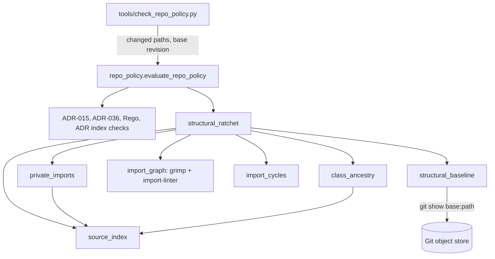
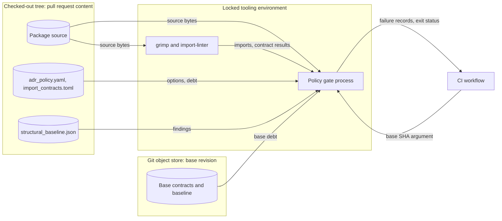

# Issue 1734: Ratcheted structural checks design

[ADR-117](adrs/adr-117-ratcheted-structural-checks.md) records the decision.
[ADR-015](adrs/adr-015-sdl-processor-layering-and-source-file-size-cap.md) records the 1,000-line cap.
[The preflight](issue-1734-structural-policy-preflight.md) records the binding guardrails.
MOD-001 is the governing requirement.

## Architecture

The repository policy gate gets one more evaluation step.
`evaluate_repo_policy()` runs it in the full check set, before the early return for an empty change list.
`tools/check_repo_policy.py` gives it the base revision.

| Component | Responsibility |
| --- | --- |
| `tools/policy/source_index.py` | Find the package modules under `module_boundaries.package_coverage_roots`. Check that each path stays in the repository. Parse each file once. |
| `tools/policy/private_imports.py` | Resolve each import and report private names and private modules that another module imports. Count the occurrences of each identity. |
| `tools/policy/class_ancestry.py` | Resolve class bases statically and count the distinct package ancestors of each class. Report unresolved package bases. |
| `tools/policy/import_graph.py` | Build the grimp graph and run the import-linter contracts. This is the only module that imports grimp and import-linter. |
| `tools/policy/import_cycles.py` | Project imports onto sibling pairs, find cyclic components, check ignored imports, and verify the layer order against ADR-036. |
| `tools/policy/structural_baseline.py` | Load and validate the baseline and the contract ignores. Read them at the base revision. Compare head and base. |
| `tools/policy/structural_ratchet.py` | Run the analyses, compare findings to the baselines, and return `PolicyFailure` records. |

Configuration and data:

| File | Content |
| --- | --- |
| `tools/policy/adr_policy.yaml` | `structural_checks` block (ADR, ancestor limit). `oversized_source_files.line_cap: 1000`. |
| `tools/policy/import_contracts.toml` | import-linter options and the two contracts, with their `ignore_imports` debt. |
| `tools/policy/structural_baseline.json` | Provenance, analysis record, cyclic components, private imports, deep classes. |

### Interfaces

- `evaluate_repo_policy(repo_root, changed, *, check_set, structural_runner, base_rev, ratchet_runner)` returns all failures. `ratchet_runner` defaults to the real structural evaluation.
- `evaluate_structural_ratchet(repo_root, policy, *, base_rev, import_analyzer)` returns structural failures. `import_analyzer` defaults to `import_graph.analyze_imports`.
- `analyze_imports(packages_root, root_packages, config_path)` returns the direct imports of the graph and one result for each contract.
- `PolicyFailure.waivable` is false for structural failures. `apply_exceptions()` keeps such failures.

### Failure behavior

| Condition | Result |
| --- | --- |
| New finding, or a count above the baseline | Failure with the identity, the file and the fix |
| Baseline entry without a current finding | `structural-baseline-stale`, which names the entry to remove |
| Baseline larger than at the base revision | `structural-baseline-grown` |
| Baseline absent at the base, and no adoption commit in the history | `structural-baseline-bootstrap` when package files changed |
| Baseline absent at the base, and larger than at the adoption commit | `structural-baseline-grown` |
| Analysis record differs from the analyzers and options | `structural-baseline-analysis` |
| Malformed configuration or baseline | `policy-config-malformed` |
| Missing analyzer, unsafe path, unreadable source, unresolved base | Failure or `OperationalError`/`InvalidInputError`; exit status 1 |

## Data flows and trust boundaries

The checked-out tree is untrusted pull request content.
The base revision comes from the CI workflow, not from the tree.
The gate reads source as data and never runs it.

## Systems security engineering

| Asset | Protection need |
| --- | --- |
| Structural debt record | Integrity: debt only decreases |
| Policy gate result | Integrity and availability: no false pass |
| CI host | Integrity: no execution of analyzed code |

| Threat | Control | Verification |
| --- | --- | --- |
| A change adds a finding and its baseline entry | I5 base comparison; I6 bootstrap rule | Unit tests with Git fixture repositories |
| A new cycle passes through an ignored import | I4 component equality on the graph without ignores | Unit test: new return path through an ignored import |
| A fixed finding makes room for a new one | Exact identities and occurrence counts | Unit tests: replacement finding fails |
| Analysis fails and reports no findings | I8: failures and exceptions, never an empty set | Unit tests: missing analyzer, unresolved base, unsafe path |
| A symlink makes the gate read outside the tree | `safe_repo_path` for each discovered file | Unit test: escaping symlink |
| Analyzed code runs during the check | Static parsing only; no import of package code | Design review; grimp parses files |
| A malformed or huge baseline crashes the gate | `load_bounded_json_object` and shape checks | Unit tests: malformed, duplicate keys, wrong types |
| A waiver hides structural debt | `waivable=False` (I9) | Unit test with an exceptions entry |
| A tampered or vulnerable analyzer | Exact pins in the locked tooling environment; tooling artifact policy; OSV scan of the tooling lock | Tooling artifact policy check; OSV lane tests |
| A base revision that Git reads as an option | Revision allowlist and `--end-of-options` | Unit tests: refused revisions |

Residual risks:

- An author can edit the policy code, the configuration and the base comparison in one change. Review defends against that (ADR-015 trust model).
- Dynamic imports and attribute access are not analyzed.

## Policy as code

- `adr_policy.yaml`: new `structural_checks` block; `line_cap` 1000.
- `import_contracts.toml`: the layers order, the sibling-cycle contract and their debt.
- `structural_baseline.json`: exact findings and provenance.
- `repo_policy.py`: `_ADR015_INITIAL_OVERSIZED_FILES` is empty after the re-baseline.
- `.gc/plan-rules.md`: each plan names the module that owns new code and the public interface that other modules use.
- `requirement_order.yaml`: the `modularity-initiative` phase owns the paths of this change.
- The OSV lane scans `implementations/tooling/python/uv.lock` as well as the application lock.

## Architecture as code

The layers contract is the machine-readable package order.
It agrees with `module_boundaries` (ADR-036), and the gate checks that agreement.
Order, from high to low: `raes_cli`; `raes_conformance | raes_mcp`; `raes_backend_stubs`; `raes_runtime`; `raes_processor | raes_operations`; `raes_backend_protocols`; `raes`; `raes_contracts`.
The 54 existing `raes_contracts` → `raes` imports are debt.
ADR-036 allows `raes_conformance` → `raes_cli`, but `raes_cli` imports `raes_conformance`, so the order forbids the reverse direction.

## External setting

The SonarCloud project of this repository (`sonar.projectKey` in `sonar-project.properties`) uses a new Python profile, `Python-Strict RAES`.
The profile inherits the organization profile `Python-Strict` and overrides S104 with maximum 1001.
The other organization projects keep their profile.
The S104 exemptions `e11`–`e13` in `sonar-project.properties` cover files of 742 to 912 lines, so they are removed.

## Decision record changes

- ADR-117 (new): the structural checks, baselines and invariants.
- ADR-015 (amendment): the 1,000-line cap, the S104 profile and the empty re-baseline.
- ADR-036: no change. The layers contract adds an order check and keeps the direct-import rules.

## Document review

Each document was reviewed against ASD-STE100 and against its purpose.
The ADRs state decisions and reasons.
This note describes the system.
The implementation tasks are in the issue plan.
