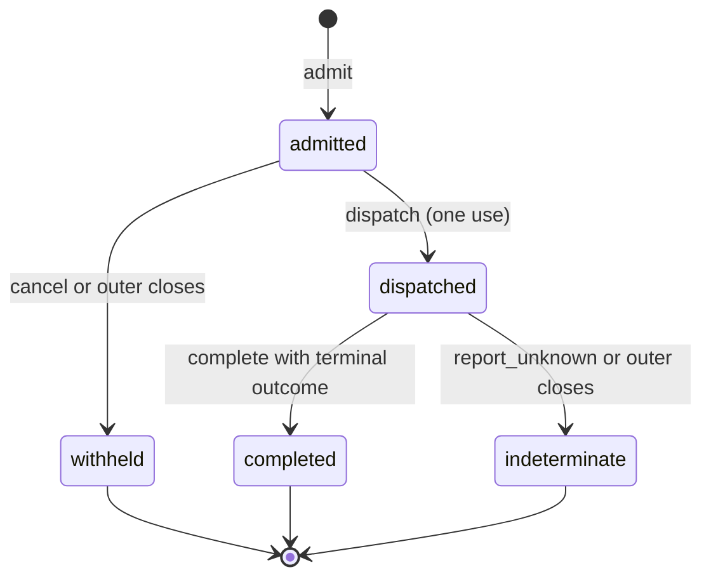
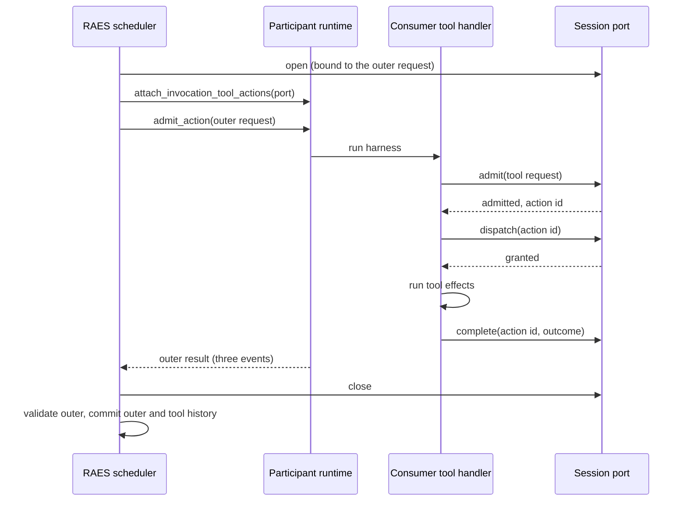
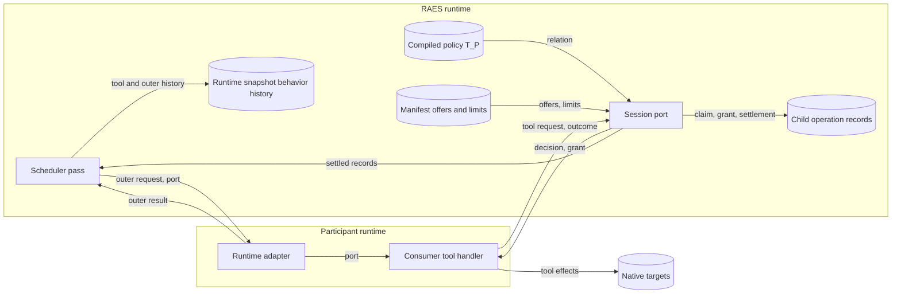

# Invocation tool actions

Issue: #1740. The issue has no requirement UID. The issue title, body and
acceptance criteria are the contract. The binding guardrails are in
[the preflight note](issue-1740-active-invocation-tool-actions-preflight.md).
This design adds the versioned composition `participant-invocation-tool-actions/v1`.
An active autonomous invocation can host participant tool actions. Each tool
action has its own admission, identity, typed outcome and behavior history.

## Existing owners

Package paths below start at `implementations/python/packages/`.

| Path | Use |
| --- | --- |
| `raes_runtime/participant_execution_control.py` | The runtime owner runs each scheduler phase as one composition operation. |
| `raes_runtime/participant_scheduler.py` | `ParticipantScheduler.run_due` owns one deterministic due pass and its cancellation sink. |
| `raes_runtime/participant_scheduler_operations.py` | Serial dispatch and settlement of one outer action. |
| `raes_runtime/participant_scheduler_concurrent_dispatch.py` | Concurrent dispatch, indeterminate settlement and serialized commit. |
| `raes_runtime/participant_action_validation.py` | Exact three-event validation of the outer action. This design does not change it. |
| `raes_contracts/participant_binding_history.py` | Construction of the ordered three-event action history. |
| `raes_contracts/contracts/participant_runtime.py` | `ParticipantBehaviorHistoryEventModel` and `ParticipantActionResultModel`. |
| `raes_contracts/contracts/manifests.py` | `ParticipantRuntimeCapabilitiesModel` holds participant runtime claims and execution-binding offers. |
| `raes_backend_protocols/protocols.py` | Capability-specific participant runtime protocols. |
| `raes_runtime/registry_target_validation.py` | Registration refuses a claim without its executable protocol. |
| `raes_processor/compiler/participant_autonomous_execution.py` | Compiles the autonomous policy and its exact action-to-target relation. |
| `raes_processor/compiler/participant_behaviors.py` | Compiles authored tool affordances (SEM-219). |

## Architecture

### Relationship

The outer invocation is one autonomous action. It keeps its exact ordered
`action_attempted`, `state_transition_recorded` and `observation_emitted`
history. A tool action is a separate participant action of the same
participant. It is not part of the outer action. The outer action is the
enclosing execution, not an authority grant.

Every tool-action history event carries one `invocation_tool_context`. The
context names the composition version, the outer action instance and contract,
the tool affordance, the consumer tool-call identity, the admission ordinal,
the settlement kind, the execution scope and the generation.

### Components

| Module | Responsibility |
| --- | --- |
| `raes_contracts/participant_tool_actions.py` | Request, decision, refusal-code and settlement carriers. Event construction for one tool action. |
| `raes_contracts/contracts/participant_runtime.py` | `ParticipantInvocationToolContextModel` and the optional event field. |
| `raes_contracts/contracts/manifests.py` | `ParticipantInvocationToolActionCapabilitiesModel` with the version and finite limits. |
| `raes_backend_protocols/protocols.py` | `ParticipantInvocationToolActionPort` and `InvocationToolActionParticipantRuntime`. |
| `raes_processor/models/behavior_resources.py` | `ParticipantInvocationToolBindingRuntime` on the autonomous policy. |
| `raes_processor/compiler/participant_autonomous_execution.py` | Joins policy participants, affordances, action contracts and authored targets. |
| `raes_runtime/participant_invocation_tool_actions.py` | The thread-safe session that implements the port for one outer invocation. |
| `raes_runtime/participant_invocation_tool_settlement.py` | Opens, attaches and closes sessions. Commits settled tool actions into the scheduler state. |
| `raes_runtime/participant_execution_control.py` | Builds the port configuration. `InvocationToolActionLedger` writes each tool action as a child operation record of the enclosing due operation. |
| `raes_runtime/participant_invocation_tool_claims.py` | Decides whether a child claim is compatible with its parent's effect reservation. |
| `raes_runtime/interaction_dispatch.py` | Gives an operation-aware composition method its operation id and admitted context. |

### Authority

The compiler derives a relation for each autonomous policy:

```text
T_P = { (affordance, action, observations, participants, targets, bound) }
```

Each member comes from one authored affordance under the policy's behavior
specification. The participant set is the intersection with the policy
participants. Targets come from the action contract effect and precondition
references, as for the policy relation `R_P`. `bound` is true when the action
has a shared-time binding. The policy digest covers `T_P` when it is not empty.

A tool request is admitted only when all of these conditions are true:

1. The session is open, and the backend did not close the dispatch grant.
2. The participant, live episode, implementation reference, outer action
   instance, execution scope and generation equal the runtime-issued values.
3. Exactly one member of `T_P` has the requested affordance and action and
   includes the participant.
4. The observation boundary is in that member, and the targets are a non-empty
   subset of its targets.
5. The action has no shared-time binding.
6. Exactly one manifest execution-binding offer has the action and the selected
   implementation, and covers every requested target.
7. The policy is not resource-governed (`participant-autonomous-execution/v3`).
8. No participant-crossing policy is installed.
9. The admitted count and the dispatched count are below the declared limits.
10. The enclosing operation is still live, the engine and run admit effects,
    and the run holds no unresolved indeterminate operation.
11. The store retains the accepted child record.

The port repeats condition 10 before it consumes a dispatch grant. A grant is
also refused with `semantic_conflict` when the action's authored interaction
footprint conflicts with an active hosted action or with another invocation's
outer action. The rule is the scheduler's own conflict rule. One registry for
each scheduler pass holds the active footprints.

A refusal returns a fixed code. It records no behavior history and causes no
native call.

### Port lifecycle

The scheduler registers each port for cleanup before it attaches the port to the
backend. The port is inactive during attachment and refuses every operation with
`invocation_inactive`. The scheduler activates the port only as the matching
outer dispatch begins.



- `admit` returns an admitted decision with a runtime-issued action instance
  id, or a refused decision. The id is a digest of the outer action, episode,
  execution generation and tool call identity, so it stays unique after a reset.
- `dispatch` consumes the grant once. The consumer starts tool effects only
  after it receives a granted dispatch.
- `complete` records one typed terminal outcome against the dispatched action.
  The port builds a bound action request for the outcome and runs the canonical
  binding validation. Withheld or undeclared evidence and a foreign observation
  point refuse with `outcome_invalid`.
- `cancel` before dispatch records `withheld`. After dispatch, cancellation is
  refused, because a cancel request is not proof that effects stopped.
- `report_unknown` records an action with unknown native effects. The first
  unknown effect fences the port: later admissions and grants refuse with
  `unresolved_effects`, and accepted work can still settle. The fence is set
  before the settlement write, so a failed write keeps it. The pass registry
  shares it with every port, and the indeterminate action keeps its
  interaction reservation. The scheduler then dispatches no further outer
  invocation in the pass.
- Closure at outer settlement records `withheld` for each undispatched action.
  It records `indeterminate` for each dispatched action without an outcome.

Replay of an identical request or completion returns the retained decision. A
different request or outcome under the same identity is refused, and the
original record stays.

### Sequence



### Progress

The scheduler holds the runtime operation while the outer invocation runs. The
session never calls the runtime manager or the control plane. It uses one leaf
lock and in-memory state that the scheduler created. Tool admission thus makes
progress while the outer invocation waits. No recursive manager call and no
second runtime owner occurs. Tool actions use no scheduler worker capacity.
Their own finite limits bound them.

### Settlement and history

The scheduler closes every session before it validates or settles the outer
result. Closure and new admission use the same lock, so closure cannot race a
new call. The outer result is validated with the unchanged three-event rule.

At the end of the due pass, the scheduler commits each session. This happens
before the cancellation sink receives the settled state. For each settled tool
action, the scheduler appends one ordered triple. The triples go in admission
order, immediately before the outer action's triple. If the outer action did
not commit, the triples go at the end of the participant history. The
scheduler writes the history itself. It does not use the generic map merge, so
peer and predecessor histories stay unchanged.

The scheduler commits nothing for a session whose generation or episode
changed. It reports a stale-settlement diagnostic instead.

| Condition | Disposition |
| --- | --- |
| Outer result valid | Commit outer and tool history. |
| Outer result protocol-invalid | Consume the outer attempt. Commit tool history. |
| Outer call raised, serial path | Settle as protocol-invalid. Commit tool history. |
| Outer batch indeterminate or cancelled, concurrent path | Fence the outer actions as now. Commit tool history. Then propagate the cancellation. |
| A tool action is indeterminate | Commit it with status `unknown` and observation status `orphaned_action`. Mark the participant scheduler `failed`. Fail the pass. |

### Durability

Each tool action is a child operation record in the selected store. Its context
copies the actor, authorization scope, target and run of the enclosing due
operation and names it as `parent_operation_id`. Its request commitment is the
digest of the claim-time binding.

| Port event | Store write before the port answers |
| --- | --- |
| `admit` | Claim an `accepted` record. |
| `dispatch` | Save the record as `running`. This persists the consumed grant. |
| `complete` | Commit a terminal `succeeded` record with an actor audit. |
| `cancel` or closure before dispatch | Commit a terminal `cancelled` record. |
| `report_unknown` or closure after dispatch | Commit a terminal `indeterminate` record. |

A failed write refuses the operation with `ledger_unavailable`, and the port
state does not change. A failed closure write fails the due pass, and startup
recovery classifies the record later. The payload keeps the binding, the
settlement and the typed outcome. It holds no tool arguments or results.

After a restart, startup recovery classifies each non-terminal child record.
An `accepted` record becomes `cancelled`, because no grant was consumed. A
`running` record becomes `indeterminate` and needs explicit resolution. An
`indeterminate` record blocks new effectful claims until an operator resolves
it. RAES never repeats a tool effect to recover history.

Tool history enters the snapshot only with the enclosing due operation. After a
process loss, the child records stay the authoritative account of the tool
actions.

### Claim compatibility

A supervised due operation reserves the effect lane of its run. A child claim
is compatible with that reservation only when all of these conditions are
true:

- The parent is a running composition-phase operation with the child's
  `parent_operation_id`.
- Actor, authorization scope, target and run equal the parent's.
- The child is a participant-action record without its own invocation.
- The operation id, idempotency key, payload kind and request commitment match
  the tool-action binding.

A parent id alone grants nothing. Every other claim stays excluded.

## Systems security engineering

### Assets and protection needs

| Asset | Need |
| --- | --- |
| Child operation records | Integrity. Written before each decision and grant. Recovered without replay. |
| Accepted behavior history | Integrity. Append-only. No fabricated success. |
| Native target state | Integrity. No effect without a granted dispatch. No replay. |
| Execution generation and episode | Integrity. No stale or foreign commit. |
| Session port | Confidentiality of authority. Only the attached runtime holds it. |
| Tool arguments and results | Confidentiality. RAES does not receive or store them. |

### Trust boundaries

- TB1: RAES runtime and participant runtime. The backend receives a detached
  outer request and the port.
- TB2: Participant runtime and consumer tool handler. The consumer owns
  transport authentication, argument validation, credentials and redaction.
- TB3: Port input. Every request and outcome is untrusted data.

### Threats and controls

| Threat | Control | Verification |
| --- | --- | --- |
| Forged or foreign binding (TB3) | Conditions 2 to 6 resolve against compiled and runtime-issued state. | Negative authority tests with zero native calls. |
| Effects during attachment (TB1) | The port is inactive until the scheduler activates it at outer dispatch. | Attachment-phase refusal test. |
| Sensitive refs in an outcome (TB3) | Canonical binding validation against the exposure policy and compiled boundary evidence. | Exposure-binding test. |
| Lost claims after restart | Child records persist before each decision and grant; startup recovery classifies them. | Durable persistence and restart tests. |
| Claim forged into the parent lane | Exact parent, scope, actor and binding commitment checks. | Claim-compatibility negative tests. |
| Effects after unknown effects | Port fence, store barrier on unresolved indeterminate operations, outer-dispatch fence. | Fence and barrier tests. |
| Grant after the parent lost authority | Live-parent, run and engine admission checks before each claim and grant. | Live-authority and engine stop tests. |
| Conflicting effects overlap | Authored interaction footprints checked against active hosted and outer actions. | Conflict test. |
| Driver failure abandons closure | The write boundary refuses any store failure; closure always finishes. | SQLite closure test. |
| Stale completion after reset or closure | Closed sessions refuse. Settlement rechecks generation and episode. | Stale-completion and stale-settlement tests. |
| Replay causes double effects | Stable tool-call identity. One-use dispatch grant. Conflicting reuse refused. | Replay and conflict tests. |
| Outer worker rewrites tool history | Tool history is not in the worker snapshot. Outer validation is unchanged. | Test that extra events in the outer snapshot stay protocol-invalid. |
| Lost history after outer failure | Settlement runs on every terminal path. | Raised, invalid and cancelled outer tests. |
| Deadlock on recursive call | The port never calls the manager. | Concurrent red and blue test with reverse completion. |
| Resource-budget bypass | v3 policies refuse tool actions. | v3 refusal test. |
| Information-flow bypass | An installed crossing policy refuses tool actions. | Crossing refusal test. |
| Disclosure through refusals | Fixed codes and value-free diagnostics. | Refusal-code tests. |
| Unbounded admission | Declared finite limits. | Limit tests. |

### Residual risks

- RAES cannot prove that the consumer obeys the dispatch grant. History records
  only what the consumer reports.
- A consumer can report a false outcome. Evidence references carry its proof.
- After a process loss, settled tool actions are in child records but not in
  snapshot history.

## Data flow



Trust boundary TB1 is between `RAES` and `BACK`. TB2 is between `RT` and `TH`.
TB3 is every flow into `PORT`.

## Capability contract

`ParticipantRuntimeCapabilitiesModel.invocation_tool_actions` declares
`semantic_versions` (`participant-invocation-tool-actions/v1`),
`max_tool_actions_per_invocation` and
`max_concurrent_tool_actions_per_invocation`. It requires autonomous execution
support and positive `tool_affordances` support. Registration requires the
`attach_invocation_tool_actions` method. Without the claim, the scheduler opens
no session, and ordinary execution does not change.

## Policy and architecture as code

- `tools/policy/import_contracts.toml` keeps the layers: contracts, backend
  protocols, processor and runtime. The new modules obey it without change.
- `contracts/schema-publication-manifest.json` records the behavior-history
  and backend-manifest schema changes.
- `tools/policy/structural_baseline.json` ratchets size. New modules stay in
  the limits.

## Decision records

ADR-092 receives amendment section 10 for the composition. ADR-104 already
owns the single runtime owner. This design adds no new owner, so ADR-104 does
not change.

## Nonclaims

The composition does not support nested tool actions, tool actions with
shared-time bindings, resource-governed v3 policies or crossing-mediated
participants. It adds no conformance probe family. It does not prove tool
fidelity, consumer honesty or exactly-once native execution.
