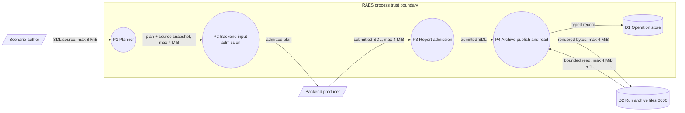

# Issue 1742: bounded materialization source delivery

The supplied issue #1742 is the contract; there is no formal requirement UID.
This note records architecture guardrails, not an implementation plan. Current
behavior below refers to the committed baseline inspected during preflight.

## Decision

Extend the existing, finite `raes_contracts.materialization.MATERIALIZATION_MAX_BYTES`
budget. Keep the existing source, submission, archive protocol and runtime delivery
path. No alternate source format, remote source reference, streaming protocol,
backend-specific exception or new configuration system is needed.

The released TechVault 0.1.3 instance from `raes-env-packs==6.5.0`, set digest
`sha256:530ca558c02c6c4dd80f1d5e45ea0ceaa799ba687a3bf8294be0aade5116d0eb`,
needs more than the current 1,048,576 bytes even with minimum valid bindings.
The supplied measurements are 1,055,386 and 1,055,926 canonical input bytes.
These are issue evidence, not measurements repeated during this preflight.

Select and document one finite ceiling that admits the full regression instance
**and its complete rendered report with provenance**. Keep it within the existing
SDL parser's 8 MiB document ceiling; a larger ceiling would require a separate
parser-policy decision. Do not choose the instance's exact byte count as the new
ceiling. This note deliberately leaves the numerical choice to evidence from the
full-size regression. The contract constant is the extension parameter: future
bounded increases must reach every consumer and published shape together.
Do not add per-stage knobs, caller assertions of a larger limit, automatic growth
or a pack-name/digest allowlist. Keep the existing negotiated contract identity;
an increased length allowance is additive under ADR-061.

Document bytes, parsed-value bounds and transport-envelope bytes are distinct
budgets. Use the same materialization ceiling for canonical source JSON,
submitted SDL, normalized archived SDL and prospective augmentation content.
Preserve the independent per-scalar, aggregate, depth, member and work limits.
The materialized report is a separate descriptive artifact; it need not have
the same length or byte checksum as the source.

## Selected limits

The maintainer selected these values after preflight:

- `MATERIALIZATION_MAX_BYTES` is 4 MiB (4,194,304 bytes). The released
  TechVault instance needs 1,055,386 bytes. The parser ceiling stays at 8 MiB,
  so a rendered report has space to expand and still parse.
- A contract field that declares `DOCUMENT_SCALAR` holds one document body.
  `RealizationConstraintLimits.max_document_scalar_bytes` bounds that field.
  Only the field annotation grants this ceiling, not the runtime type of a value.
  All other runtime scalars keep the 1 MiB limit. The 8 MiB total stays.
- The released TechVault plan has approximately 74,000 value nodes. The runtime
  node limit is 65,536. Backend input admission uses `PLAN_VALUE_LIMITS` for
  planner-produced plans and for their compiled realization authority. This
  limit permits 262,144 nodes. Other backend inputs keep the runtime limits.

## Data flow

The backend producer is outside the RAES trust boundary.
P2 bounds each plan under `PLAN_VALUE_LIMITS` before the backend receives it.
P3 bounds the returned document before parsing. P4 bounds the incoming text and
the rendered bytes before it writes a file. A size refusal names the limit,
not the rejected content.

## Current failure points and required owners

Python paths below are relative to `implementations/python/packages/`.

| Layer | Canonical incumbent and guardrail |
| --- | --- |
| Source and identity | `raes.canonical.canonical_instantiated_sdl_bytes()` / `canonical_instantiated_sdl_digest()` and `raes_contracts.materialization.MaterializationSource` own the full admitted `raes-sdl-instantiated-snapshot/v2` envelope and authored/instantiated joins. Preserve exact canonical source bytes in the plan. Never reconstruct them from compiled resources or a returned snapshot. Keep strict UTF-8 JSON ingress through `parse_bounded_json_object()`: duplicate members, invalid roots and non-finite values remain invalid. |
| Planner refusal | `raes_processor.planner.materialization.planned_materialization_source()` currently catches every source `ValidationError` and emits `materialization.source-context-required`. Size rejection needs its own stable, value-free diagnostic, distinct from absent source/run/required target context. Classify structured validation types/reasons, including strict JSON `input-too-large`, rather than matching exception prose. Do not misclassify malformed identity, digest mismatch or portable-value exhaustion as missing context or successful reporting. Reuse `Diagnostic`; validators use Pydantic-compatible `ValueError`/`PydanticCustomError`, not a new exception family. |
| Closed carriers and defensive ingress | `MaterializationSource`, `MaterializationSubmission`, `backend_call_contracts._bounded_materialization_submission()` and `AugmentationPreparation` must share the ceiling. `Field(max_length=...)` bounds characters, not UTF-8 bytes; retain byte checks and reject unencodable strings. Revalidate foreign objects before copying, parsing or serializing them, including objects made with `model_construct()`. No private-constant overrides or validator bypasses. |
| SDL parser, phase and semantics | `raes.parser`, `_source_profile.SDLParserLimits`, `_yaml_loader`, `SemanticValidator`, `admit_instantiated_scenario()` and `admit_materialized_scenario()` remain authoritative. Preserve single-document/duplicate-key/alias/depth/work checks, closed shapes, qualified identities, reference resolution, unresolved-token rejection and phase restrictions. Reporting never performs imports/substitution or turns descriptive SDL into execution authority. |
| Portable runtime values | `runtime_value_limits.RUNTIME_SNAPSHOT_VALUE_LIMITS` and `realization_structure.validate_realization_value()` separately bound parsed content and runtime carriers: currently 1 MiB per scalar and 8 MiB total scalar bytes, plus node/member/work bounds. A document above 1 MiB composed of many small scalars does not justify larger individual scalars. Keep `backend_snapshot_contracts`, `RuntimeSnapshot` and `preparation_snapshot_digest()` checks. Do not increase global runtime limits to carry an opaque SDL string; snapshots carry typed references, not document bodies. |
| Source consumers and preparation | `planner.materialization_admission`, `materialization_inventory`, `augmentation_admission`, `backend_augmentation` and `compiler.materialization_origins.compose_materialization_content()` already consume the shared bound. Include augmentation parsing, cumulative prospective content and predecessor archive readback in the consistency review. A broader transport allowance grants no added effects or collection membership. |
| Execution and scope authority | Keep `PlanScope`, `InventoryTargetScope`, `runtime_plan_digest()`, plan projection/reverse conversion, `register_planner_produced_plan()` and operation admission. The source run ID must satisfy the narrower archive-safe label (128 characters, leading alphanumeric, no path separators); the control plane uses the same ID as `run:<id>`. For descendants bind `target:<RuntimeTarget.name>`, not manifest producer name. Keep operation/attempt, predecessor, producer manifest/configuration and original source digests. Do not strip source before hashing or alter a registered plan. |
| Report and result admission | `admit_materialization_submission()`, `validate_materialization_origins()`, `admit_runtime_inventory()` and `validate_actual_augmentation()` retain complete inventory, original collection/exact/import/closure authority, causal lineage and preparation checks. Keep `_call_backend_apply()` isolation, result/domain/transition validation and runtime-owned provenance projection. A successful producer must report even when nothing was added. A size increase changes capacity only. |
| Secret and environment shapes | Reuse `runtime_environment.RuntimeEnvironmentVariable`, `runtime_values.enforce_observed_value_redaction()`, `runtime_ssh_server.SshForcedCommand`, `backend_account_credentials` and existing realization projections/sanitizers. Preserve literal `value`/`value_from` exclusivity, generated-value ownership, operator-secret restrictions and native withheld/redacted forms for additions as well as authored content. Neither completeness nor digest verification authorizes disclosure of protected values. |
| Protected local bytes | `raes_operations.run_artifacts.RunMaterializationArchive.publish()` currently parses/renders with the broader SDL limit but does not apply the materialization byte ceiling; `read()` does. Both original incoming text and rendered UTF-8 bytes must be bounded before publication; whitespace normalization must not admit excessive input, and rendering may expand otherwise valid input. `read()` retains its size check and bounded `limit + 1` read. Validate advertised attestation size through the existing record/admission boundary as appropriate; do not impose this role-specific limit on every `ExperimentArtifactRefModel`. |
| Host/OS containment | Keep runtime-owned `runs/<run-id>/attestations/<attestation-id>.sdl`, safe labels, directory-relative `O_NOFOLLOW` opens, regular-file/permission checks, private `0700` directories, `0600` files, immutable conflict checks and file/directory synchronization. Reject before writing when bytes exceed the bound. Artifact URNs remain inert identities, never fetch instructions. No shell, host scanner, credential lookup or source/token values in process argv is needed. |
| Archive and durable state | `validate_materialization_archive_record()`, `MaterializationArchiveRecord`, `require_materialization_records()`, snapshot/store codecs and `RuntimeSnapshotEnvelopeModel` own delivery. Publish admitted bytes before the accepted reference. Keep semantic digest separate from SHA-256 of the actual rendered file, and verify actual size/checksum on read. Preserve revisions/CAS, terminal commits, restart/idempotency and no replay of apply after archive failure. Keep existing legacy cleanup and descendant predecessor-preservation behavior; failure is not physical rollback. `scenario_snapshot_ref` continues to identify the original input. |
| HTTP/auth/configuration | `ControlPlaneSecurityConfig`, `control_plane_api._auth`, target-bound roles, operation admission, `ControlPlaneConfiguration` and `ControlPlaneOptions` remain the owners. No new config fields or environment overrides are needed. `RequestSizeLimitMiddleware` defaults to **1,000,000** request bytes: larger source-bearing plan envelopes can require an explicitly configured transport allowance including JSON escaping and other plan fields. Do not silently raise the HTTP default with the materialization limit. In-process delivery must work without HTTP. Keep sealed app composition, safe validation/500 responses and no-store output. |
| Errors, logs and audit | Reuse `raes_contracts.errors`, `Diagnostic`, `backend_result_diagnostics`, existing inventory invariant codes, control-plane audit correlation and HTTP `_responses`. ADR-116 / `docs/develop/exceptions-and-logging.md` govern logging: `get_logger()`, value-free formatting and foreign failure isolation. Preserve expected refusal categories; unexpected defects still reach their existing boundary. Never print source excerpts, Pydantic inputs/error strings, raw backend exceptions, native output, environment values, tokens or host paths. Size diagnostics need a stable reason, not the rejected data. |

The associated-artifact path already provides bounded injected readers,
size/checksum checks and `AssociatedArtifactValidationLimits`. Keep it;
do not create another resolver, persistence store, DTO, source wrapper or logger.
Caller-owned archive adapters retain the same protocol obligations and do not
gain authority merely by receiving larger content.

## Published contracts and repository boundaries

`contracts/schemas/` is normative. A limit change reaches at least
`plans/{provisioning,orchestration,evaluation}-plan-v1.json` (embedded
`MaterializationSource`), `plans/backend-materialization-attestation-v1.json`
and `plans/backend-augmentation-scope-v1.json`. Review actual schema output for
other embeddings rather than globally replacing every `1048576` in the repo.
Do not alter unrelated description, composition, resource-budget or domain-profile
limits. JSON Schema `maxLength` cannot alone express the UTF-8 byte invariant.

Keep `raes_contracts.contracts.bundle.schema_bundle()` identical to the published
bundle and record each affected contract's content hash and `last_change` in the
existing publication registry. The registry currently uses
`contracts/schema-publication-manifest.json` with split entries under
`contracts/schema-publication/entries/`; do not create a second ledger.
Reuse `tools/check_generated_schemas.py`, `tools/check_schema_publication.py` and
the schema fixtures/invariant annotations. Consumer docs must state the actual
new ceiling and distinguish it from parser and HTTP budgets. This issue note
supersedes the descriptive 1 MiB observation in the #1667 preflight, not its
source/authority rules.

Keep dependency-neutral carriers and limits in `raes_contracts`, SDL semantics
in `raes`, planning/admission in `raes_processor`, runtime enforcement in
`raes_runtime`, and local storage in `raes_operations`. Build on the existing
public interfaces; no reverse imports, private cross-package access or filesystem
ownership in a contract model. Follow ADR-015/036/117 and
`tools/policy/adr_policy.yaml`. Use `.ground-control.yaml`, `.gc/plan-rules.md`,
`.pre-commit-config.yaml` and the canonical nox/verification tooling. Do not invent
a requirement UID for this requirement-free issue. Versions and changelogs remain
owned by the existing release process; the consumer-visible fix needs a `fix:`
release classification.

## Evidence required before declaring the implementation ready

Reuse the #1241 context/runtime/archive/snapshot/durability/schema/artifact tests,
`runtime_descendant_fixtures.py` and `test_issue_1649_inventory_bounds.py`.
The regression may use the pinned released pack or an equivalent full-size,
deterministic local fixture; it must not depend on a live package download or
another checkout. An equivalent fixture must exercise many bounded values and
normal admission, not one oversized string or whitespace that disappears during
canonicalization. Preserve all ten valid typed bindings when using the pack.

Evidence must traverse ordinary compilation/planning with safe run and selected
target binding, all phase plan projections, runtime report admission, accepted
snapshot/store serialization, protected publication and readback. Compare the
retained source to the original canonical bytes and their SHA-256 instantiated
identity, preserve the authored identity, and independently verify the archived
rendered bytes' size/checksum and semantic identity. Planner success alone, a
checksum of reconstructed source, or metadata-only delivery is insufficient.

Cover the former limit crossing, the new inclusive boundary and one byte beyond,
including multibyte UTF-8, render expansion, direct archive calls and unsafe backend
carriers. Negative cases must distinguish size from missing/invalid scope, preserve
closed collection admission and existing failure state, prevent backend mutation
for invalid plans, and produce no accepted reference on failed publication.
Exercise corruption/conflicting retries and durable replay through incumbents.
Run only targeted checks locally; full, integration, fuzz and completion suites
belong to CI.

Non-goals:

- implementation during preflight;
- changes to the released pack, other repositories or native backends;
- new SDL semantics or schema or contract families;
- chunking, compression, remote storage or fetching, or public endpoints;
- blanket parser, runtime or HTTP limit increases;
- weaker disclosure, collection or evidence checks;
- truncated or omitted source, disabled negotiated reporting or validation,
  and private consumer monkeypatches.

This preflight does not merge, publish or release anything.
