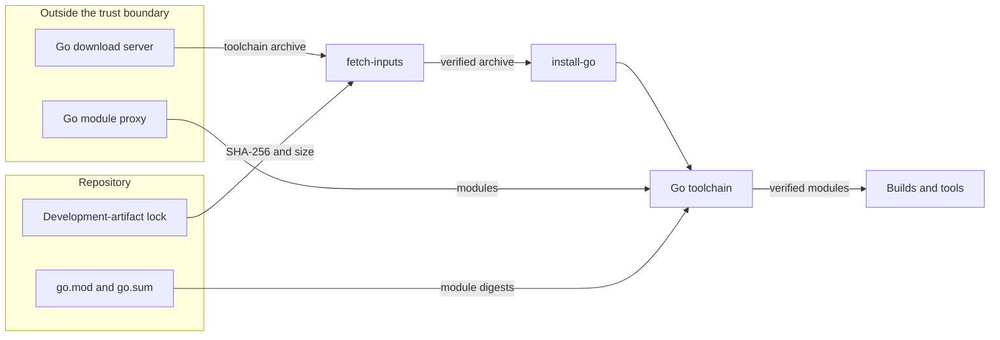

# Go toolchain admission

Issue #1773 admits the Go toolchain and the Go tools under the supply-chain policy of [ADR-106](adrs/adr-106-developer-package-and-artifact-management.md).
Pull request #1808 comes first in the same stack.
It adds the `go-cutover` integration branch to the CI triggers, so each pull request into that branch runs the gates.

## Problem

The Go port needs a Go toolchain and Go tools in CI and in the development container.
Each input must come through a digest that review admitted, as each Python input does.
A build must not fetch a toolchain or a module that review did not admit.

## Architecture

| Input | Authority | Route |
| --- | --- | --- |
| Go toolchain | The development-artifact lock: the archive SHA-256 and size for each platform | `fetch-inputs` and `install-go` in `tools.bootstrap_profile` |
| Go modules | The `go.mod` and `go.sum` of each module | The `go` command, which checks each module against `go.sum` |
| Go tools | The `tool` directives of `implementations/tooling/go` | A build of each tool from its module source |

`GOTOOLCHAIN=local` keeps each build on the admitted toolchain.
The tooling policy refuses `actions/setup-go`, and `go install` or `go run` with a module version.
The OSV-Scanner gate scans the `go.mod` of each Go module.

## Security and data flows

The protected assets are the integrity of the toolchain, the modules, and the tools that CI and the development container run.
The Go download server, the module proxy, and the checksum database are outside the trust boundary.
The development-artifact lock and each `go.sum` are reviewed repository files.

| Threat | Control | Verification |
| --- | --- | --- |
| A changed toolchain archive | The lock pins the SHA-256 and size of each archive, and `install-go` extracts only the locked archive | `test_bootstrap_go_install_extracts_the_locked_toolchain_as_a_new_goroot` and `test_bootstrap_go_install_refuses_an_archive_outside_the_go_root` |
| A changed module under the same version | The `go` command checks each module against `go.sum`, and CI runs `go mod verify` | The `go mod verify` step of the bootstrap qualification |
| A build fetches a newer toolchain | `GOTOOLCHAIN=local` | `test_every_new_terminal_finds_the_locked_clients_the_setup_installs` |
| A tool arrives through a route that review did not admit | The tooling policy refuses `actions/setup-go` and a versioned `go install` or `go run` | `test_go_toolchain_and_tools_must_use_their_admitted_routes` |
| A module with a known vulnerability | The OSV-Scanner gate scans each `go.mod` | `test_osv_scan_targets_cover_each_tracked_dependency_closure` |
| A pull request into `go-cutover` skips the gates | #1808 adds `go-cutover` to the push and pull request triggers of CI | `test_ci_uses_the_same_canonical_verifier_for_github_sha` |

## Supporting artifacts

- [ADR-106](adrs/adr-106-developer-package-and-artifact-management.md), the issue #1773 amendment
- `implementations/tooling/artifacts.lock.json` and `implementations/tooling/go/go.mod`
- `tools/bootstrap_profile.py` and `tools/tooling_artifact_policy_actions.py`

## References and document review

- [Go modules reference: authenticating modules](https://go.dev/ref/mod#authenticating)
- [Go toolchains](https://go.dev/doc/toolchain)
- Issue #1773
