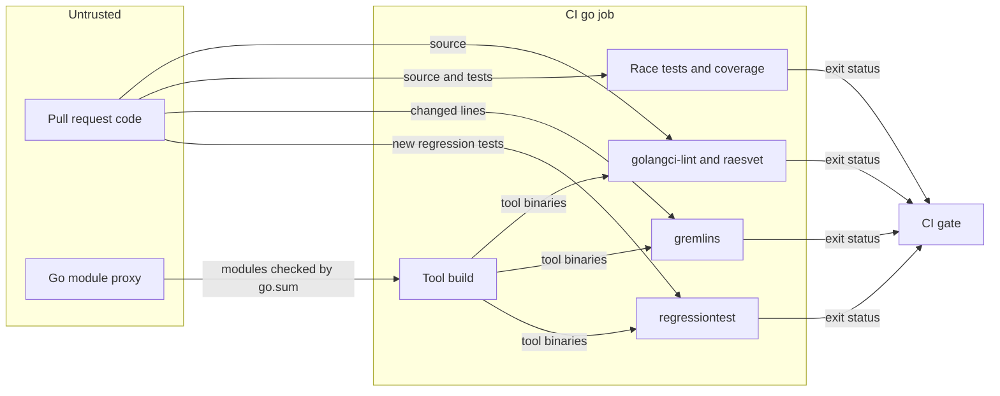

# Go engineering standards

Issue #1774 sets the engineering standards of the Go code and enforces them in CI.
[ADR-121](adrs/adr-121-go-engineering-standards.md) records the standards.
This document describes the enforcement system and its threats.

## Problem

The code standards of the repository are specific to Python.
The Go port needs its own standards, enforced from its first line of code.
Each gate must fail a pull request that breaks its rule.
A gate that reports a failure and then passes is a defect.

## Architecture

The tooling module `implementations/tooling/go` holds the tools of the Go lanes.
Its `go.mod` pins each third-party tool with a `tool` directive.
CI builds each tool from module sources that `go.sum` verifies.

| Rule | Check | Configuration |
| --- | --- | --- |
| Each golangci-lint linter is on, and each finding fails | `golangci-lint run` | `implementations/.golangci.yml` |
| A suppression names its linter and states a reason | `nolintlint` | `implementations/.golangci.yml` |
| Deterministic Google style rules that no linter checks | `raesvet` with `getprefix`, `gotwant`, and `wrapverb` | `implementations/tooling/go/lint/` |
| Tests pass with the race detector | `go test -race` | the CI `go` job |
| The statement coverage of each module is at least 90% | `go tool cover` | the CI `go` job |
| Each mutant on the changed lines is killed or times out | `gremlins unleash --diff` | `implementations/.gremlins.yaml` |
| Each new regression test fails on the merge base | `regressiontest` | the CI `go` job |

The issue requires a custom `go/analysis` analyzer for each deterministic rule that no linter checks.
No linter of golangci-lint checks the placement of `%w`, the `Get` prefix, or the order of got and want.
No standard tool runs a new test against the merge base, so `regressiontest` is custom.

## Security and data flows

The protected assets are the integrity of the CI verdict and the integrity of the tool binaries.
The code of a pull request is untrusted until review.
The CI `go` job runs that code with a read-only token and no secrets.
The Go module proxy and its checksum database are outside the trust boundary.

| Threat | Control | Verification |
| --- | --- | --- |
| A gate reports a failure and passes | Each step runs under `bash -e`. The gremlins thresholds are numbers in `.gremlins.yaml`, because gremlins ignores a threshold flag. | The workflow test pins the gremlins command and its thresholds. A gremlins run on a module with one live mutant exits with status 10. |
| A changed tool binary | CI builds each tool from verified module sources | `go mod verify` and `go mod tidy -diff` in the `go` job |
| A suppression hides a real finding | `nolintlint` requires the linter name and a reason | golangci-lint in the `go` job |
| An option injected through the base revision of `regressiontest` | The command refuses a base that starts with `-`, and `--end-of-options` comes before the revision | `TestRunRejectsBadUsage` |
| A regression test that does not reproduce its defect | `regressiontest` runs each new test at the merge base and requires its failure | The `regressiontest` tests |
| A fixture, a renamed file, or an unrelated new test decides the base outcome | Regression tests live in `_regression_test.go` files. The base run removes the base test files and testdata of the package, and gets the head regression test files and testdata. | `TestRunReplaysTheTestdataOfTheHead`, `TestRunIgnoresTheOtherTestFilesOfThePackage`, `TestRunFindsANewRegressionTestInARenamedFile`, and `TestRunRemovesTheBaseTestdataThatTheHeadDeletes` |
| Untested code passes | The 90% coverage floor and the mutation gate | The `go` job |
| Pull request code reads a CI secret | The reusable workflow grants `contents: read` only, and the `go` job uses no secret | `test_canonical_verifier_requires_and_checks_out_an_exact_commit_sha` and `test_go_lanes_enforce_each_go_engineering_standard` |

## Supporting artifacts

- [ADR-121](adrs/adr-121-go-engineering-standards.md)
- `implementations/.golangci.yml` and `implementations/.gremlins.yaml`
- `implementations/tooling/go/lint/` and `implementations/tooling/go/cmd/`
- The `go` job in `.github/workflows/canonical-verification.yml`

## References and document review

- [Google Go Style Guide](https://google.github.io/styleguide/go/)
- [Gremlins](https://gremlins.dev/)
- Issue #1774
