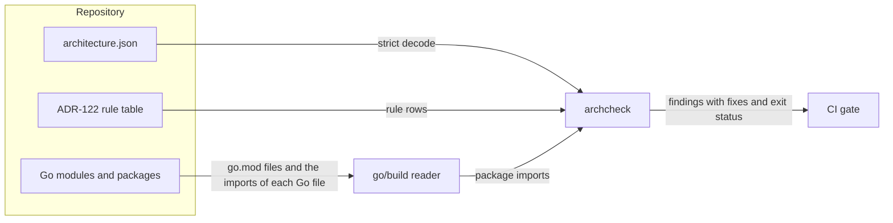

# Go architecture model

Issue #1775 defines one machine-readable architecture model for the Go code of the repository.
[ADR-122](adrs/adr-122-go-architecture-model.md) records the model, its rules, and the design step.
This document describes the check and its threats.

## Problem

The Go port must not grow undeclared packages or undeclared dependencies.
Each change must record its design in the model before its code exists.
The checks must cover the whole repository, and each finding must state its fix.

## Architecture

`implementations/architecture.json` is the model.
It declares the Go modules, the layers, and each package with its layer, visibility, and first-party imports.
Each layer lists the layers that it uses and the external import paths that it may import, each with a reason.

The `arch` package in the tooling module loads the model and checks it.
`archcheck -design` checks only the model, so the design step runs it before the code exists.
`archcheck` without the flag also reads the imports of each Go file through `go/build`, whatever its build constraints.
It then checks the code and the rule table of ADR-122.

| Rule | Check |
| --- | --- |
| ARCH-001 to ARCH-004: modules, layers, packages, and declared imports | `archcheck -design` |
| ARCH-005 to ARCH-009: declared packages, exact imports, test imports, external paths, and the rule table | `archcheck` |
| ARCH-010: declared package cycles | `archcheck -design` |
| ARCH-011 and ARCH-012: `internal` visibility and exported identifiers | `go build` |
| ARCH-013 and ARCH-014: typed interface commitments and current system views | `archcheck` |

[ADR-122](adrs/adr-122-go-architecture-model.md) compares go-arch-lint, depguard, and Bazel.
go-arch-lint matches packages by directory globs.
Thus a new package or a new import between permitted components changes no model, and no design can record it first.
The tool also has no package visibility, and its messages state no fix.

## Security and data flows

The protected asset is the integrity of the architecture verdict.
The model and the ADR rule table are reviewed repository files.
The code of a pull request is untrusted until review.

| Threat | Control | Verification |
| --- | --- | --- |
| A change adds a package or an import that its design does not declare | ARCH-005 and ARCH-006 require an exact match of the model and the code | The `arch` tests and the `go-architecture` CI job |
| A permission without a reason, or a stale permission | ARCH-008 requires a reason and reports an external path that no package imports | The `arch` tests |
| A cycle between layers | ARCH-002 finds cycles in the uses graph | The `arch` tests |
| A test file imports a package that the layers forbid | ARCH-007 | The `arch` tests |
| The rule table and the checks disagree | ARCH-009 compares the table with the rule registry | The `arch` tests |
| An ambiguous model passes | The loader rejects unknown fields, data after the model, and an unknown schema | The `arch` tests |
| Code for another platform or build tag escapes the check | The reader ignores build constraints and reads each Go file | `TestLoadCodeReadsEachBuildConfiguration` |
| The check changes `go.mod` or uses an unpinned toolchain | The job sets `GOFLAGS=-mod=readonly` and `GOTOOLCHAIN=local` | `test_go_architecture_check_runs_once_from_the_repository_root` |
| Packages import each other in a cycle | The design checker rejects declared cycles; the compiler also rejects actual cycles | `archcheck -design` and `go build` in the `go` job |

## Supporting artifacts

- [ADR-122](adrs/adr-122-go-architecture-model.md)
- `implementations/architecture.json`
- `implementations/tooling/go/arch/` and `implementations/tooling/go/cmd/archcheck/`
- The design-step rule in `.gc/plan-rules.md`
- The `go-architecture` job in `.github/workflows/canonical-verification.yml`

## References and document review

- [go-arch-lint](https://github.com/fe3dback/go-arch-lint)
- [go/build](https://pkg.go.dev/go/build)
- Issue #1775

See the [current Go system overview](../develop/go-architecture.md) for application components and trust boundaries.
This checker design is supporting evidence, not a parallel system overview.
