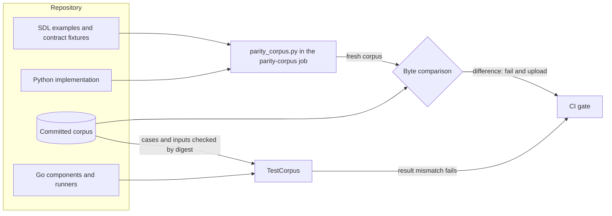
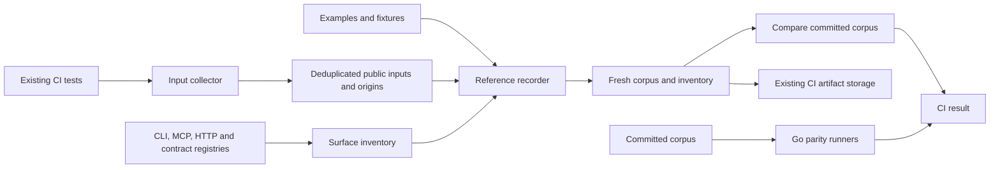

# Golden parity corpus

Issue #1778 records the machine-readable behavior of the Python implementation as a golden corpus.
The Go port checks each Go component against it.
After the cutover, the corpus stays as a regression suite.

## Problem

The Go port must keep the SDL and the published contracts the same for consumers.
Only machine-readable behavior is parity data.
Help text and free-text messages may change.
The check must compare each Go component with recorded Python results, not with hand-written expectations.

## Architecture

`tools/parity_corpus.py` records the corpus from the Python implementation.
The corpus is in `implementations/go/internal/parity/testdata`, inside the Go module.
Mutation testing copies only the module, so the Go tests read no file outside it.

| Part | Content |
| --- | --- |
| `manifest.json` | The corpus schema, Python source commit and tree, recorder digest, and locked environment digests |
| `inputs/<sha256>` | Each input file once, under the SHA-256 digest of its content |
| `cases/<surface>/<command>/<sha256 of the name>.json` | One recorded invocation: name, surface, command, arguments, input digests, and result |

The `cli` surface runs `raes semantic` commands on the SDL examples and the contract fixtures.
Its result is the exit code and the JSON standard output, without the free-text `message` of each diagnostic.
The `schema` surface validates each contract fixture against its published schema, and its result is the verdict.
The case file names use digests, because repository path policy reserves some fixture path names.

The Go package `internal/parity` loads the corpus and verifies each input against its digest.
Each Go port adds a runner for the commands that it implements.
`TestCorpus` runs each case that has a runner, and it fails a runner that has no case.

The CI job `parity-corpus` records the corpus again from the Python implementation.
It fails when one corpus file differs, and it uploads the fresh corpus for review.
Recordings run in CI only.

## Security and data flows

The protected assets are the integrity of the corpus and the integrity of the parity verdict.
The recorder runs the Python implementation of the repository on repository inputs.
A corpus edit by hand is untrusted, because it could make a wrong Go result pass.

| Threat | Control | Verification |
| --- | --- | --- |
| A hand edit of the corpus makes a wrong Go result pass | The `parity-corpus` job records the corpus again and compares each file byte for byte | `test_parity_corpus_check_runs_in_the_gate_and_uploads_a_fresh_corpus` and the job |
| An input file changes under a case | The loader verifies each input against its SHA-256 digest | `TestLoadRejectsAnInvalidCorpus` |
| An ambiguous corpus file | The loader rejects unknown fields, data after the value, and an unknown schema | `TestLoadRejectsAnInvalidCorpus` |
| Free text becomes parity data | The recorder drops each diagnostic `message` | The `tests/test_issue_1778_parity_corpus.py` tests |
| A Go runner with no case passes | `TestCorpus` fails each runner without a case | `TestCorpus` |
| A recorded input holds a credential | Gitleaks scans the corpus in the hygiene lane | The hygiene lane |

## Supporting artifacts

- `tools/parity_corpus.py` and `implementations/python/tests/test_issue_1778_parity_corpus.py`
- `implementations/go/internal/parity/`
- The `parity-corpus` job in `.github/workflows/canonical-verification.yml`

## References and document review

- Issue #1778

## Review remediation design

The parity package owns exact JSON comparison. JSON numbers compare by decimal
value, including equivalent fractional and exponent spellings, without conversion
to floating point. Normalization keeps a decimal coefficient and an arbitrary-size
exponent rather than expanding attacker-controlled exponents into huge integers.
Malformed or concatenated JSON results fail before comparison.

`runner-inventory.json`, outside the generated corpus, records implemented runner keys.
Removing a registered runner for an implemented key fails, as does a runner without
cases. `RAES_PARITY_REQUIRE_COMPLETE=1` rejects all uncovered keys at cutover and
requires the derived corpus inventory to pass. Every normal run validates that
the declared surfaces, fixture digests and regression origins have actual cases.
The implemented inventory includes the canonical JSON and random-stream runners.
Port issues must add both their runner and its required key in the same change.

The manifest also binds the Unicode table version used by the primitive adapters.
The manifest records the last commit changing the Python packages, their Git tree
identity, the recorder SHA-256, Python version, and the SHA-256 of the Python
lockfile. Reproduction checks preserve the recorded source commit when its tree
still matches; unrelated commits must not invalidate unchanged behavior. Source,
recorder or lock changes require a new CI recording. CI fetches history so the
recorded commit can be verified. Provenance is checked before runners execute.
The loader rejects missing provenance, unsafe input names, missing results,
empty or duplicate cases, and malformed input digests.

Coverage inventory must distinguish observed cases from complete surface coverage.
The parent issue remains incomplete until every exposed surface, published contract,
fixture, example and exposed Python regression input has recorded behavior.

## Complete exposed-surface recording

The development-tool recorder owns the additional adapters. The publishing
phase repair described below is the only Python product change. `tools/parity_support.py` owns the case format, canonical JSON,
diagnostic normalization and deterministic recording context.
`tools/parity_surfaces.py` owns enumeration and invocation of CLI, MCP and HTTP
surfaces. `tools/parity_inputs.py` is a CI-only pytest input collector. The
existing `tools/parity_corpus.py` remains the recording/checking entry point.
No Go dependency direction changes: future ports still register runners through
the parity package's existing entry point.

The inventory is derived from the live CLI registry, MCP registry, HTTP OpenAPI
route table and schema-publication entries. It lists all fixtures and examples,
including source fragments and context fixtures, and all regression input cases
collected by CI. Completeness is derived from these sets, rather than from a
hand-maintained assertion that the corpus is complete. Missing cases fail the
recording job. New operations therefore require recordings before CI passes.

The recorder adds command/flag definitions, tool input/output schemas and the
HTTP OpenAPI contract as machine-readable cases, excluding descriptions and help
wording. It records successful and refused invocations, each published contract's
real sample inputs, all source examples and fixture inputs, and the captured
regression inputs. Prose-only tool results retain their protocol envelope but
not their wording; JSON/YAML payloads and diagnostic codes/locations are retained.
Authored payload data is never removed merely because its field is named message.

The regression collector observes calls without replacing their assertions or
results. CI collects inputs at the CLI, MCP, HTTP, SDL source, analysis-file and published-contract validation boundaries. It
retains source test identities as provenance and deduplicates identical inputs.
Recorded invocations run against an explicitly declared reference configuration;
the corpus does not pretend that private Python mocks are a portable backend.
HTTP regression requests use the same in-memory reference target, fixed clock,
identity policy and initial state as the ordinary HTTP corpus cases. This keeps
the configuration that determines their result visible to Go runners. Stateful
reference traces retain their ordered setup requests.

UUIDs generated during recording use a case-specific deterministic stream. Wall
clocks use the public clock injection points (ADR-118). Temporary input paths
are mapped into case-local files, preserving local source dependencies. The
collector never reads secret files, never copies a complete working directory,
and never records host credentials. Generated signing keys use an explicit
public test-key recipe rather than storing private-key material. Input
collection and corpus generation run only in isolated CI without repository
write credentials. Existing CI artifacts carry the recordings; publication to
the PR remains a separate controlled fast-forward push.

Invariants:

- Registry identities and all declared inputs have recorded cases.
- A recording and its reproduction have the same source and environment identity.
- The collector does not change the original call's return value or exception.
- Private test doubles are not treated as part of the portable exposed contract.
- No path escapes the case's input root, and no private signing material is stored.
- Normalization controls nondeterminism and free text, while retaining numeric
  values, payload structure, status/exit codes, diagnostic codes and locations.
- A completed Go surface cannot become a passing skip.

The input-capture job is separate from the normal shards, integration and fuzz
jobs. It runs all test markers in isolated CI with a deterministic Hypothesis
profile and public, reproducible UUID/signing-key fixtures; the ordinary jobs
retain their original environments. The test tree and collector source digests
bind the frozen inputs. Unchanged sources reuse those inputs; changed sources
require a new complete capture. Non-JSON Python-only probes are listed explicitly
as non-protocol tests rather than being presented as JSON-RPC payloads.

## Bounded opaque storage (corpus v2)

Public regression inputs include invalid UTF-8, significant trailing whitespace,
missing final newlines and oversized-input probes. They are opaque bytes, so
text-hygiene rewrites would corrupt their identity. Corpus v2 stores input blobs
as deterministic gzip streams (`mtime=0`), addressed by the SHA-256 of their
original bytes. Encoded pieces remain below 256 KiB. Larger streams use a small
`{"parts": N}` index and NUL-prefixed pieces at `pieces/<digest>/<index>`.
A JSON corpus document larger than 256 KiB uses a single `document_ref` to the
same blob store. Go validates references, enforces bounded decoding, verifies
original-byte digests, and compares the decoded data exactly.

Compression must never hide credentials from the scanner. Recording jobs scan
the complete uncompressed blobs with the existing qualified Gitleaks tool before
uploading any corpus artifact. The decoder is a standalone standard-library
module (`tools/parity_storage.py`), so stored inputs remain inspectable without
the Python product implementation after cutover. The Go loader uses only its
standard gzip/JSON and digest libraries. No file-size or secret gate is waived.

The primitive adapters and runners from #1822 remain part of the corpus. Approved
`ingress-exception` cases retain both the unchanged Python result and the Go
outcome, bound to the maintainer decision documented in the ingress design.

The regression source identity binds the test, Python package, contract and example
Git trees, the Python dependency/configuration files and collector helpers. Model
validation observers include constructors, explicit validation methods and literal
schema versions without defaults. Published JSON Schema validations are observed
by their normative schema identity. Original results and exceptions are preserved.

Case-file and source-inventory references use the standard `sha256:<digest>`
notation; blob filenames use the bare digest. This identifies hashes even when
an input filename contains words such as token or key. Credential scanning stays
fully enabled; digest fields need no secret-scanner exception.

CLI observation expands `--option=value` before mapping file arguments. The
backend conformance command carries its fixture/profile directories explicitly,
including empty directories; only contract data files under the allowed input
roots are copied. Output directories and arbitrary working directories are not
captured. The portable setup creates recorded empty input directories.

Input capture reuses `tools.pytest_shard_plugin` and its stable eight-way
partition. Every worker retains the unpartitioned collection as well as its
executed tests; the reducer rejects missing shard inputs. Worker metadata names
include the shard index. Unchanged frozen data is uploaded only once. This keeps
full input collection in CI while avoiding a single long-running capture job.

Two functional durability fixtures use an explicit ten-second store budget.
They check recovery and readback semantics under CI filesystem contention;
production defaults and tests of deadline enforcement remain unchanged.

## Publishing phase repair found during recording

An imported authoring source becomes `ExpandedScenario`; that phase deliberately
has no module descriptor. Publishing must validate the expanded graph, then read
the descriptor from the normalized authoring root using the existing parser and
`Scenario` model. Missing descriptors retain the governed import refusal. Tests
cover both publishing a local module graph and refusing a graph whose root has
no descriptor. The corpus provenance binds this repaired Python reference.

CLI observation also covers direct console-entry calls and installed `raes`
subprocess invocations. Subprocess working directories and standard input are
retained without changing execution arguments, environment, return values or
exceptions. Performance probes and unrelated subprocesses are left to their
original execution paths.

Reference recording additionally fixes `PYTHONHASHSEED=0` before interpreter
startup. The recorder refuses other seeds and records the seed in provenance,
so hash-dependent iteration cannot vary between recording and reproduction.
The ordinary test and fuzz environments retain their existing settings.
