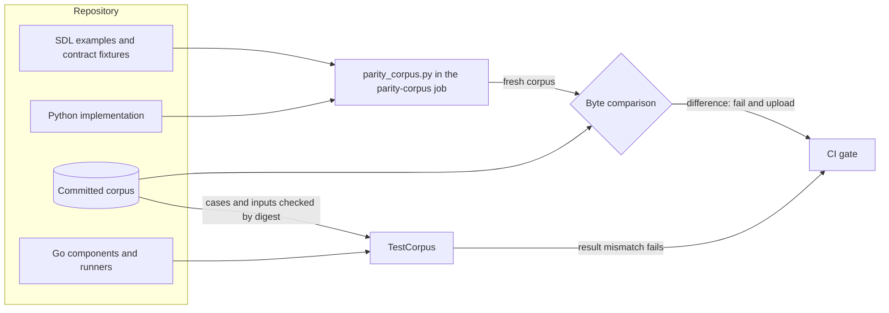

# Golden parity corpus

Issue #1778 records the machine-readable behavior of the Python implementation as a golden corpus.
The Go port checks each Go component against it.
After the cutover, the corpus stays as a regression suite.

## Problem

The Go port must keep the SDL and the published contracts the same for consumers.
Only machine-readable behavior is parity data.
Help text and free-text messages may change.
The check must compare each Go component with recorded Python results, not with hand-written expectations.

## Architecture

`tools/parity_corpus.py` records the corpus from the Python implementation.
The corpus is in `implementations/go/internal/parity/testdata`, inside the Go module.
Mutation testing copies only the module, so the Go tests read no file outside it.

| Part | Content |
| --- | --- |
| `manifest.json` | The corpus schema `raes-parity-corpus/v1` |
| `inputs/<sha256>` | Each input file once, under the SHA-256 digest of its content |
| `cases/<surface>/<command>/<sha256 of the name>.json` | One recorded invocation: name, surface, command, arguments, input digests, and result |

The `cli` surface runs `raes semantic` commands on the SDL examples and the contract fixtures.
Its result is the exit code and the JSON standard output, without the free-text `message` of each diagnostic.
The `schema` surface validates each contract fixture against its published schema, and its result is the verdict.
The case file names use digests, because repository path policy reserves some fixture path names.

The Go package `internal/parity` loads the corpus and verifies each input against its digest.
Each Go port adds a runner for the commands that it implements.
`TestCorpus` runs each case that has a runner, and it fails a runner that has no case.

The CI job `parity-corpus` records the corpus again from the Python implementation.
It fails when one corpus file differs, and it uploads the fresh corpus for review.
Recordings run in CI only.

## Security and data flows

The protected assets are the integrity of the corpus and the integrity of the parity verdict.
The recorder runs the Python implementation of the repository on repository inputs.
A corpus edit by hand is untrusted, because it could make a wrong Go result pass.

| Threat | Control | Verification |
| --- | --- | --- |
| A hand edit of the corpus makes a wrong Go result pass | The `parity-corpus` job records the corpus again and compares each file byte for byte | `test_parity_corpus_check_runs_in_the_gate_and_uploads_a_fresh_corpus` and the job |
| An input file changes under a case | The loader verifies each input against its SHA-256 digest | `TestLoadRejectsAnInvalidCorpus` |
| An ambiguous corpus file | The loader rejects unknown fields, data after the value, and an unknown schema | `TestLoadRejectsAnInvalidCorpus` |
| Free text becomes parity data | The recorder drops each diagnostic `message` | The `tests/test_issue_1778_parity_corpus.py` tests |
| A Go runner with no case passes | `TestCorpus` fails each runner without a case | `TestCorpus` |
| A recorded input holds a credential | Gitleaks scans the corpus in the hygiene lane | The hygiene lane |

## Supporting artifacts

- `tools/parity_corpus.py` and `implementations/python/tests/test_issue_1778_parity_corpus.py`
- `implementations/go/internal/parity/`
- The `parity-corpus` job in `.github/workflows/canonical-verification.yml`

## References and document review

- Issue #1778
