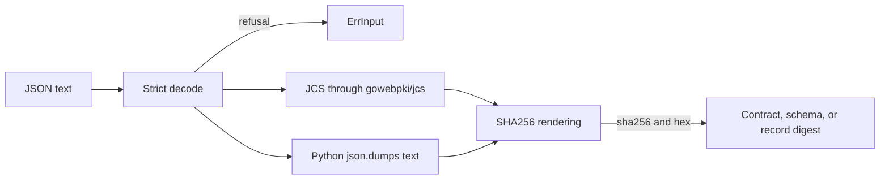

# Canonical JSON and digests in Go

Issue #1779 ports the shared primitives to Go.
This part ports canonical JSON and the rendered SHA-256 digests.
[ADR-118](adrs/adr-118-shared-primitives-and-injected-wall-clock.md) records the shared primitives of the Python implementation.

## Problem

RAES digests use two canonical JSON forms.
Contract digests use RFC 8785, the JSON Canonicalization Scheme (JCS).
Schema content hashes and older digests use the text of Python `json.dumps` with sorted keys and compact separators.
The two forms differ, for example in number notation and in key order.
The Go forms must give the same bytes as the Python forms, because stored records hold the digests.

## Architecture

| Package | Function | Implementation |
| --- | --- | --- |
| `base/canonjson` | `JCS` | `github.com/gowebpki/jcs`, a maintained fork of the Go reference implementation by the author of RFC 8785 |
| `base/canonjson` | `Sorted` | A writer of the Python `json.dumps` text, with or without `ensure_ascii` |
| `base/digest` | `SHA256` | `crypto/sha256`, rendered as `sha256:` and 64 lowercase hexadecimal digits |

Both forms take UTF-8 JSON text with one value, and a later duplicate member replaces an earlier one, as in Python.
`JCS` refuses an integer above 2^53 - 1 in magnitude, because RFC 8785 gives it no exact value.
Both forms refuse a number outside the finite float64 range.
`Sorted` refuses an integer with more than 4,300 digits, as Python does (`sys.int_info.default_max_str_digits`).
It writes each other integer as its JSON text, which is the decimal form of Python, except `-0`, which Python reads as `0`.
Thus no form converts integer text to a big integer.

The ASCII compatibility form preserves lone UTF-16 surrogate escapes, as Python
`ensure_ascii=True` does. JCS and the Unicode form refuse a surviving lone
surrogate. This is an encoder compatibility boundary, not untrusted JSON ingress.
The standard-library decoder validates JSON syntax and nesting before a token
walk. The walk keeps surrogate code points in a private three-byte string
representation; that representation never leaves this package. Key order and
duplicate-member identity therefore remain Python-compatible, including keys
containing a surrogate. The ASCII writer emits the original code point as an
escape, without replacing it with U+FFFD. A valid surrogate pair is one Unicode
code point. Strict forms validate surviving strings after duplicate replacement,
as Python does. Integer digit limits apply during decoding, including discarded
members, because Python applies them in `json.loads`.

The corpus includes lone high and low surrogates, pairs, escaped backslashes,
replacement characters, duplicate keys, and mixed Unicode key ordering. The
parity comparator keeps numbers exact, and a declared implemented command cannot
silently become a skipped command when its runner is removed.

`Sorted` is custom, because no Go encoder writes the Python text.
The standard library has an RFC 8785 canonicalizer, `Value.Canonicalize` in `encoding/json/jsontext`.
Go 1.27 builds that package only with `GOEXPERIMENT=jsonv2`, so `JCS` uses `gowebpki/jcs`.
`encoding/json` escapes U+2028 and U+2029, writes floats in another notation, and has no `ensure_ascii` mode.
`Sorted` writes each float as Python `repr` does: the shortest digits, and scientific notation below 1e-4 or from 1e16.

The parity corpus checks both forms.
Its `canonical` surface holds each JSON contract fixture and explicit edge texts.
The Go runner `canonical encode` compares the digest of each form with the Python result.

## Security and data flows

The protected asset is the integrity of the digests that identify contracts, schemas, and records.
The input text can come from outside the trust boundary, for example in a supplied contract payload.

| Threat | Control | Verification |
| --- | --- | --- |
| Two different texts get one encoding, so one digest names two values | The decoder refuses invalid UTF-8 and data after the value. Lone surrogates survive only as ASCII escapes; strict forms refuse them after duplicate replacement. | `TestFormsRefuseInputWithoutAnEncoding` |
| A large integer loses precision and changes a JCS digest | `JCS` refuses an integer above 2^53 - 1 in magnitude | `TestJCSRefusesAnInexactInteger` |
| A digest differs between the Python and the Go implementation | The corpus compares each form for each fixture and edge text | `TestCorpus` and `TestFormsMatchThePythonReference` |
| A non-finite number gets an encoding | Both forms refuse a number outside the finite float64 range | `TestFormsRefuseInputWithoutAnEncoding` |
| A long integer costs quadratic time in a big-integer conversion | `JCS` reads an integer only within the int64 range, and `Sorted` copies the integer text and refuses more than 4,300 digits | `TestJCSRefusesAnInexactInteger` and `TestSortedKeepsThePythonIntegerDigitLimit` |
| Deep nesting exhausts the stack | `encoding/json` refuses nesting above 10,000 levels | The Go standard library |
| A form is not stable under repeated encoding | Each `Sorted` text encodes to itself, and each JCS text is canonical for the transform | `FuzzForms` in CI |

## Supporting artifacts

- `implementations/go/internal/base/canonjson/` and `implementations/go/internal/base/digest/`
- The `canonical` surface of `tools/parity_corpus.py`
- [Golden parity corpus design](issue-1778-parity-corpus-design.md)

## References and document review

- [RFC 8785: JSON Canonicalization Scheme](https://www.rfc-editor.org/rfc/rfc8785)
- [github.com/gowebpki/jcs](https://github.com/gowebpki/jcs)
- Issue #1779

## Delivery inventory

PR #1820 delivers issue #1779 in one pull request. The random-stream and
ingress contributions from #1821 and #1822 are incorporated through real
merges, together with their review repairs. The
[completion design](issue-1779-shared-primitives-completion.md) records the
remaining package interfaces and security boundaries.

| Primitive / behavior | Owner and acceptance evidence |
| --- | --- |
| Canonical JSON and digests | `canonjson`, `digest`; canonical corpus, Unicode/number boundaries, fuzz targets |
| Published random streams | `randstream`; published vectors, wide integer and rejection boundaries, corpus |
| Ingress, pointers, URI safety and addresses | `ingress`, `jsonpointer`, `urisafety`, `address`; failure precedence, safety ceilings, previous defect vectors and corpus |
| Named timestamp policies | `timestamp`; leap seconds, offsets, ISO week/basic forms, precision/range boundaries, corpus and fuzz target |
| Debian, RPM and triplet versions | `softwareversion`; exact relation identity, wide epochs/digit runs, endpoint validation, univers reference corpus and fuzz target |
| Bounded domains and snapshot limits | `domain`, `value`; typed membership, every limit definition, aggregate budgets, cycles, document allowance and refusal before unknown callbacks |
| Errors, logging and clock | `fault`, `logrecord`, `clock`; six categories, standard traversal, log privacy/controls/ceilings, injected UTC reads and corpus |
| Graphs and secret references | `graph`, `secretref`; FIFO order, cyclic components, deep iterative traversal, grammar/length boundaries and corpus |
| Unknown snapshot carriers | `value`; explicit Go refusal, with the unchanged Python outcome and the maintainer decision recorded in the corpus |

The canonical-encoding security inventory includes invalid UTF-8, JSON
syntax/trailing data, 10,000-level nesting, 4,300-digit integers (also in
discarded members), finite float output, JCS exact-integer range, Unicode and
surrogate identity, duplicate replacement, key ordering, and number notation.

Python's Pydantic base class has no Go inheritance analogue. Strict model
bindings and the schema identifiers in `versions.py` belong to #1780; this
primitive layer neither changes schemas nor accepts unmodeled snapshot values.
Current-head CI remains the authority for full tests, mutation, fuzzing and
release gates. Local verification selects the affected packages and modules.
