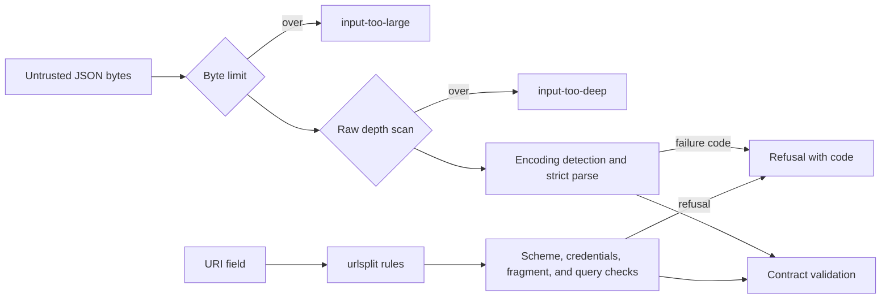

# JSON ingress, JSON Pointers, URI safety, and addresses in Go

Issue #1779 ports the shared primitives to Go.
This part ports the strict JSON ingress, the JSON Pointer tokens, the URI safety check, and the compiled addresses.
The [canonical JSON design](issue-1779-canonical-json-design.md) and the [random-stream design](issue-1779-random-streams-design.md) cover the earlier parts.

## Problem

These primitives check untrusted input before contract validation.
They must accept and refuse the same inputs as the Python implementation, and report the same codes.
Each refusal must happen before the input reaches the contract code.

## Architecture

| Package | Behavior | Reference |
| --- | --- | --- |
| `base/ingress` | Parses JSON text with byte and depth limits, and reports one code for each failure | `raes_contracts.json_ingress` |
| `base/jsonpointer` | Converts RFC 6901 reference tokens and array indexes | `raes_contracts.json_pointer` |
| `base/urisafety` | Refuses a relative URI, a forbidden scheme, credentials, a fragment, and a secret query field | `raes_contracts.uri_safety` |
| `base/address` | Validates and renders the compiled runtime addresses | `raes_contracts.addressing` |

`ingress` has a custom parser, because `encoding/json` gives other results.
`encoding/json` keeps the last of duplicate members, reads NaN and Infinity as syntax errors, replaces invalid text with U+FFFD, and stops at 10,000 levels.
The Python ingress reports a duplicate member when the object closes, NaN and Infinity as non-finite numbers, and a depth failure before it decodes.
The parser reports the same codes in the same order.
It detects UTF-16 and UTF-32 text as `json.detect_encoding` does.

`urisafety` splits a URI as Python's `urlsplit` does and reads its query as `parse_qsl` does.
`net/url` follows other rules, so it would accept and refuse other URIs.
`golang.org/x/text` provides case folding and NFKC normalization.

`jsonpointer` uses `strings` and `strconv` for the token rules of RFC 6901.
A third-party module would add a dependency for two replacements.

Two differences from the Python implementation are deliberate:

- `ingress` refuses a UTF-16 surrogate that is not part of a pair. Valid UTF-8 cannot hold it, and I-JSON forbids it.
- `golang.org/x/text` implements Unicode 17.0.0, and Python 3.14 implements Unicode 16.0.0. Normalization is stable for assigned characters, so NFKC can differ only for characters that Unicode 17.0.0 adds.

## Security and data flows

The protected assets are the integrity of contract validation and the availability of the processes that parse input.
Payloads, scenario documents, and URIs come from outside the trust boundary.

| Threat | Control | Verification |
| --- | --- | --- |
| A large input exhausts memory | `Parse` refuses input above the byte limit before it reads the input | `TestParseMatchesThePythonReference` |
| Deep nesting exhausts the stack | A raw depth scan runs before the parse, and the parser stops at 65,000 levels | `TestParseMatchesThePythonReference` and `TestParseStopsAtTheDecoderDepth` |
| Duplicate members make a payload ambiguous | The parser refuses a duplicate member when its object closes | `TestParseMatchesThePythonReference` |
| A non-finite number or a very long integer reaches the contract code | The parser refuses NaN, Infinity, an overflowing float, and an integer above 4,300 digits | `TestParseMatchesThePythonReference` |
| Two texts decode to the same value | The parser refuses invalid UTF-8 and an unpaired surrogate | `TestParseRefusesAnUnpairedSurrogate` |
| A URI carries a credential or a secret query field | `urisafety` refuses userinfo and secret field names after percent decoding and case folding | `TestCheckMatchesThePythonReference` |
| A URI host hides a delimiter that NFKC normalization exposes | `urisafety` refuses a netloc whose NFKC form contains a delimiter | `TestCheckMatchesThePythonReference` |
| A crafted input crashes a parser | Each parser has a fuzz target that CI runs | `FuzzParseNeverPanics` and `FuzzCheckNeverPanics` |

## Supporting artifacts

- `implementations/go/internal/base/ingress/`, `jsonpointer/`, `urisafety/`, and `address/`
- The Python reference modules in `implementations/python/packages/raes_contracts/`

## References and document review

- [RFC 8259: The JavaScript Object Notation Data Interchange Format](https://www.rfc-editor.org/rfc/rfc8259)
- [RFC 7493: The I-JSON Message Format](https://www.rfc-editor.org/rfc/rfc7493)
- [RFC 6901: JSON Pointer](https://www.rfc-editor.org/rfc/rfc6901)
- [Unicode normalization stability policy](https://www.unicode.org/policies/stability_policy.html)
- Issue #1779

## Review remediation design (PR #1822)

`ingress.Parse` must reject a `Root` other than `Object` or `Array` before
reading input, using the existing `invalid-root` code. No new public API is
needed. Explicit limits must never raise the decoder's stack-safety ceiling.
The existing four owner packages and their interfaces stay in place.

The parity recorder will call the unchanged Python functions for ingress,
URI safety, pointer tokens/indexes, and addresses. Cases retain both accepted
values and refusal codes, including duplicate/error precedence, byte encodings,
limits, and the prior ingress and pointer defects. The Go parity package will
call the four existing public APIs; its architecture-model imports must name
those dependencies before implementation. Reference results must not be
replaced with hand-written Go expectations. Compatibility exceptions require
an explicit maintainer decision and separately visible reference results.

The standard JSON decoder cannot preserve duplicate detection or the reference
error precedence without a token adapter, and replaces lone surrogates. A
streaming token adapter also imposes its 10,000-depth ceiling. The existing
parser is therefore retained rather than replaced with another parser. The
standard URI parser rejects malformed percent escapes and accepts different
scheme/host syntax, so the small compatibility splitter stays isolated in
`urisafety`; `netip` and the maintained Unicode tables do the complex host and
normalization work. No network requests or value-bearing logs are added.

Issue #1779 remains the delivery inventory: canonical JSON/digests and random
streams are earlier slices; this slice supplies ingress, pointers, URI safety,
and addresses. Timestamps, versions (including Debian/RPM), bounded domains,
errors/logging, clock, graphs, and secret references remain pending under that
issue. This slice must reference, rather than close, the parent issue.

The inherited corpus checker must compare JSON numbers exactly: converting
numbers to `float64` hides adjacent integers above 2^53. Its comparison uses
`json.Number` and exact rational equality, so equivalent decimal/exponent
spellings compare equal without losing a unit. An independent inventory of
implemented commands prevents a deleted runner from silently becoming a skip.

Corpus provenance binds the unchanged Python package source tree and dependency
lock to a deterministic content hash, and records a separate recorder hash,
Python ABI and Unicode-table version. The loader rejects missing or malformed
reference identities; CI re-recording detects source, recorder, dependency or
environment drift. The complete source identity is independent of the branch
name or commit used to package the same source.

## Maintainer decision, 2026-11-02

During review of PR #1822, the maintainer explicitly approved retaining strict
UTF-8, the bounded default decoder depth, and current Unicode tables, with
reference and Go outcomes recorded explicitly in the corpus. Unpaired surrogate
inputs therefore remain `invalid-json` in Go; default decoding stops at 65,000
levels. Explicit limits can lower, but cannot raise, that safety ceiling.
The Unicode dependency remains at its admitted version. A URI containing the
new Unicode 17 modifier letter U+A7F1 is included as a boundary example.

The `ingress-exception` cases store the unchanged Python result alongside the
approved Go refusal and the decision identifier `maintainer-1822-2026-11-02`.
The checker checks the Go result against that explicit field, rather than
silently rewriting the reference result. Ordinary cases retain strict parity.
This decision keeps ingress consistent with the existing Go canonical encoder's
strict Unicode boundary; it does not change the Python release or published
schemas, and it does not claim Python's legacy ASCII surrogate encoding exists
in Go.
