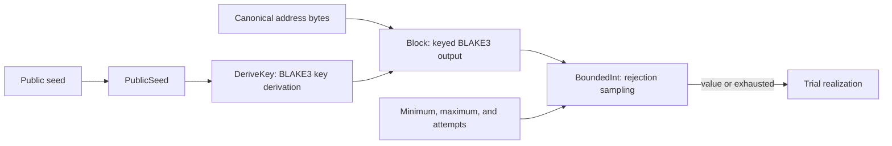

# Random streams in Go

Issue #1779 ports the shared primitives to Go.
This part ports the published random-stream profiles `blake3-xof-v1` and `blake3-xof-participant-v1`.
The [canonical JSON design](issue-1779-canonical-json-design.md) covers the first part.

## Problem

Trials draw random values from the published random-stream profiles.
Each draw must give the same value as the Python implementation, because recorded trials and evidence hold the values.
A draw must not depend on the order of other draws.

## Architecture

The package `base/randstream` implements the profiles with pure functions.

| Function | Behavior |
| --- | --- |
| `PublicSeed` | Decodes an inline public seed: 64 hexadecimal digits in the `hex-fixed-width` encoding |
| `DeriveKey` | BLAKE3 key derivation from 32 bytes of root entropy, under a context that names the profile |
| `Block` | The keyed BLAKE3 output for the canonical address bytes, from the offset of the local coordinate |
| `BoundedInt` | Rejection sampling over the smallest number of big-endian bytes that covers the range |

`github.com/zeebo/blake3` provides BLAKE3.
The evaluation also tried `lukechampine.com/blake3` v1.4.1.
Its output reader returns other bytes after a seek to 64 bytes or more.
`TestBlockAtALaterCoordinateMatchesTheReference` keeps that defect visible.

`BoundedInt` never falls back to a biased value.
After the last permitted rejection, it reports an exhausted draw without a value.
The batch draw needs the typed stream address, so the contract bindings of #1780 add it.

The parity corpus checks the published vectors.
Its `randstream` surface holds each vector under `contracts/fixtures/random-stream-vectors/`.
The Go runner `randstream vector` compares the key, the address bytes, the block, and the draw.

## Security and data flows

The protected assets are the integrity and the reproducibility of each draw.
An inline public seed is public, so its streams are reproducible but not unpredictable.
The seed, the address, and the range come from scenario and trial documents.

| Threat | Control | Verification |
| --- | --- | --- |
| A biased draw | Rejection sampling without a fallback; an exhausted draw has no value | `TestBoundedIntDrawsWithinTheRangeAndRecordsExhaustion` and `FuzzBoundedIntStaysInItsRange` |
| A draw differs from the Python implementation | The corpus checks each published vector, and unit tests check Python draws at each boundary | `TestCorpus` and `TestBoundedIntMatchesThePythonReferenceAtEachBoundary` |
| Position arithmetic overflows and reads another block | `Block` refuses a negative position and a position beyond the int64 range | `TestFunctionsRefuseInvalidInput` and `TestBlockReadsTheLastPosition` |
| A library defect changes the bytes after a seek | The package uses `zeebo/blake3` and tests a block at an offset of 64 bytes or more | `TestBlockAtALaterCoordinateMatchesTheReference` |
| One draw changes another | The functions keep no state, and the same inputs give the same draw | `FuzzBoundedIntStaysInItsRange` |
| An unsupported profile or seed encoding | Both functions refuse each value outside the closed set | `TestFunctionsRefuseInvalidInput` |

## Supporting artifacts

- `implementations/go/internal/base/randstream/`
- `contracts/fixtures/random-stream-vectors/` and `contracts/profiles/random-stream/`
- The `randstream` surface of `tools/parity_corpus.py`

## References and document review

- [BLAKE3 specification](https://github.com/BLAKE3-team/BLAKE3-specs)
- [github.com/zeebo/blake3](https://github.com/zeebo/blake3)
- Issue #1779
