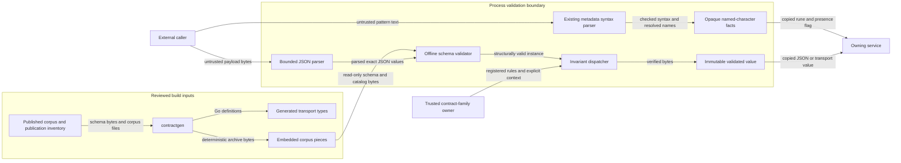

# Go contract bindings and validation

Issue #1780 adds the shared contract boundary on `go-cutover`.
ADR-009, ADR-061, ADR-121 and ADR-122 govern the work.
The published schemas and Python code stay unchanged.

The maintainer made two scope decisions on 2026-11-03.
Go must enforce published schema types, without Python's implicit type conversions.
The work also includes all published family rules and full semantic admission.
The [conversion record](issue-1780-coercion-findings.md) retains the type findings and decision.
Integral JSON numbers keep Draft 2020-12 integer semantics.

## Owners and interfaces

| Owner | Public boundary | Purpose |
| --- | --- | --- |
| Tooling generator | `contractgen`, with `-check` | Generate all transport types and embed the corpus |
| Corpus package | `corpus.Open` | Return a read-only `fs.FS` |
| Binding package | Generated types and `Field[T]` | Keep the original transport states |
| Schema package | `validation.New`, `CheckSchema`, `DecodeSchema` | Check published shape and transport round trips |
| Schema package | `Rule`, `Key`, `Invocation`, `WithRules`, `Validate` | Run each rule at its matched schema instance |
| Schema package | `Defaulted`, `DefaultedObjectFragment`, fragment and instance checks | Provide bounded views to rule owners |
| Family package | `admission.New`, `Validate`, `CheckPortable` | Own the family rules and local model checks |
| Family package | `ParsePythonPattern`, `PythonPatternSyntax.NamedCharacter` | Share metadata syntax checks and resolved named escapes |
| Digest package | `digest.NewChecksum` | Construct a stream hash for a published checksum algorithm |

The architecture model declares packages, layers, imports and external libraries.
The schema engine is `github.com/santhosh-tekuri/jsonschema/v6`, version 6.0.3.
It uses the Apache-2.0 license.
The standard library has no Draft 2020-12 schema engine.
BLAKE3 stays within the existing base-layer dependency.

The [admission guide](../../implementations/go/contract/admission/README.md)
describes the family contexts and phase data.
The [predicate crosswalk](../../specs/conformance/contract-predicate-sources.json)
links all 180 invariant IDs to their Go rules and Python owners.
It is a review aid, not a new source of contract authority.

## Build and packaging

The generator reads the publication inventory and normative corpus.
It emits one transport root for each of the 148 published contracts.
There is no second hand-kept list of contract IDs.
The embedded ZIP has fixed byte output and bounded hexadecimal pieces.
The loader decodes each piece before reading the same archive bytes.
Each decoded piece is at most 128 KiB; at most 64 pieces are allowed.
Hexadecimal storage avoids treating compressed bytes as live identity text.
It includes all needed corpus families and notices.
The drift check compares full output, including extra and missing files.

`corpus.Open` needs no checkout, Python, shell, network or writable directory.
It does not extract files or guess a source path.
Missing or corrupt resources fail construction.
The schema loader refuses external references.

The concept-authority path gate permits the single generated Go concept-family type file.
Its complete filename is listed in the existing allowed paths.
The JSON catalog keeps its current authority path.
Sibling JSON files, draft authority notes and suffix lookalikes remain blocked.
No policy waiver or new authority surface is added.

## Transport and schema checks

`Field[T]` keeps absent, null and supplied values distinct.
Supplied values include false, zero and empty lists or maps.
Numbers use `json.Number`.
Union members retain raw JSON until the schema selects their branches.
Open objects keep all members.
DTOs grant no semantic authority and do not become store models.

Ingress checks bytes, depth, duplicate members and number bounds first.
The caller sets its byte and depth limits.
Decimal coefficients have at most 4,300 digits.
The absolute exponent is at most 4,300.
These checks run before exact rational arithmetic.
A short number cannot request an unbounded denominator.

The regular-expression adapter uses Go's bounded engine.
It supports the published Unicode digit and whitespace classes.
It retains Python's final-newline rule for the dollar assertion.
It handles the published terminal lookahead and Unicode escapes without editing schema bytes.
Unsupported syntax fails compilation.
Format annotations remain annotations, as in the recorded schema results.
Domain-profile schema admission stays with its own owner.

`DecodeSchema` checks the DTO round trip with the existing canonical JSON helper.
Schema success alone does not grant semantic admission.
Errors use stable fault codes and do not expose payload values or library error text.
Broken build resources remain distinct from bad input.

## Reference-model catalogs

`validation.CheckReferenceBinding` owns lookup within the compiled schema bundle.
It checks a known contract, local schema pointer, dot path and declared key fields.
The path supports schema properties and the map wildcard.
Local references and one nullable wrapper use the reference owner's lookup rules.
Cycles and excessive work fail closed.
The API returns no raw schema and changes no compiled data.

The admission owner checks each model's family against the packaged family catalog.
It rejects duplicate key fields and reused bindings, including reuse of the main binding.
It then checks every schema pointer and instance path through the lower API.
The catalog checks run for full and portable admission.
The same catalog audit covers UCO family membership, provenance and canonical class IRIs.
Pinned vocabulary sources retain unique identities and their required source order.

## Rule dispatch and defaults

Each rule key names a contract and invariant ID.
The walk follows local references and applicable object, array and union branches.
It checks the original input when it chooses a branch.
Missing rules, duplicate registrations and missing required context fail closed.
The rule and model walks have finite visit budgets.

The source string in `Invocation` retains original JSON member order.
Trial coordinate ties use that order, as the reference owner does.
Map iteration order cannot change a tie.

Default views are fresh copies.
They add only published defaults after the original input passes its schema.
They cannot insert a required field to make bad input pass.
They retain the original branch choice and refuse conflicting defaults.
Recursive expansion is bounded.
Object-fragment defaults use the same walk and reachable compiled definitions.
They expose no mutable schema and grant no admission.
Each family still owns its serializer omissions and digest profile.

`Value` stores admitted bytes privately.
`JSON` and `Transport` return copies.
The zero value is not admitted.
A caller can share a validator when its rule and context owners are safe to share.

Vocabulary metadata can contain Python regular-expression syntax.
A syntax parser checks those expressions without running them.
It checks groups, references, repetition, flags and fixed-width lookbehind.
Unicode names come from the pinned text library and Unicode 16 data.
The parser bounds nesting. Model checks retain no caller data.
Schema patterns keep their existing linear-time matcher.

Issue #1963 exposes that same syntax owner for Go repository tools.
`ParsePythonPattern` returns an opaque `PythonPatternSyntax` or the existing invalid-input fault.
The result retains only the named-character escapes used by that expression.
`NamedCharacter` returns a rune and presence flag; callers receive no mutable map or parser state.
Names retain the parser's Unicode 16 spelling and alias rules.
The zero value has no resolved names. Separate parses do not share caller facts.
This API validates syntax only. It never compiles or runs an expression.
The tooling module consumes it through a pinned public module version.

## Family admission

`admission.New` binds every published key to a real predicate.
It also checks the catalogs those predicates consume.
It returns no partial registry or success stub.
`Validate` checks schema shape, family invariants and extra model rules.
`CheckPortable` keeps the reference portable entry point's local claim.
It does not invent the context needed for full conformance.

The consuming service supplies each context through an explicit interface.
Input claims cannot create trusted owner records.
Contexts bind exact identities, versions, digests, scopes, references and histories.
A narrow support or normalization operation can call its established owner.
It cannot return the whole contract's admission decision.
Go checks the resulting relationships and complete coverage.

Experiment rules bind tasks, studies, plans, treatments, results and evidence.
Factorial expansion checks its size and combined work before it allocates output.
It retains the reference's derived fields through a bounded authoring step.
Schema-only decoding still checks the original transport.

Participant rules check content, control, crossing, information and flow records.
Control history retains its v1 batch and v2 prefix rules.
Flow checks join source labels, policy cuts, releases, actions and final sinks.
Owner-flow checks retain each owner's release grant and reader or integrity rule.
A declaration is not proof of delivery, execution or lifecycle change.

Mixed-composition rules resolve the full profile closure with cycle and work limits.
They check one installed binding per active edge or handoff.
Stage reports bind the actual backend history and time or composition fences.
A stage proves only its own claim.

Associated artifacts bind an admitted parent, exact set identity and original bytes.
Readers remain caller-owned.
The rule bounds reads and checks the declared size and stream checksum.
It never opens a payload locator.

## Materialization

The contract layer cannot import the higher SDL or compiler layers.
`MaterializationCompiler` calls the configured owner for the exact source bytes.
It returns supplied and full model JSON, resources and registered comparison data.
The source SHA-256 must match, and the compiler cannot mutate its request bytes.
Go bounds and checks the returned data before use.
The library supplies no partial SDL parser or permissive default compiler.

The compiler's collection, concern and typed-presence views come from their existing owners.
They are complete phase data, not candidate grants or whole-rule decisions.
Node normalization must retain native identities and protected value commitments.
Both sides of a node comparison use that owner.

The execution context holds the completed published plan, manifest, actual snapshot and source bytes.
The plan uses its exclude-none serializer.
The predecessor uses the native snapshot projection without the published schema version.
These views preserve the existing digest profiles.
Go recomputes source, plan, predecessor and producer commitments.

Origin checks compare full SDL content, with native keyed collection identities.
Missing values stay distinct from null.
The claimed origin set must match every actual change.
Scoped inventory and node bindings must be complete.
Replica counts are bounded before a range could be built.

The archive rule binds protected bytes to size, checksum, path and semantic identity.
It also binds run, operation, producer and timestamp.
Semantic identity uses supplied fields; record comparisons use typed defaults.

The descendant rule selects the latest retained producer report from the trusted predecessor.
It reads and checks the exact protected archive record.
It requires report progress, fixed creation identity and bounded, acyclic ancestry.
Lifecycle state can move only through the published transitions.
Changed lifecycle receipts bind the current operation and attempt.

Projected descendants must satisfy exact description coverage and the original enclosing collection.
The configured envelope must match the manifest pin.
Native identity, dependencies, capability support and augmentation policy are checked.
Backend selections must refer to an eligible row in the value-free provenance ledger.
A descriptive SDL result never grants execution authority.

## Data flow and security

| Threat | Control | Evidence |
| --- | --- | --- |
| Changed authority bytes | Generate from published sources and compare full output | Drift checks |
| Reference-based data access | Use offline loaders and embedded resources | Offline and isolated-binary tests |
| Private values in errors | Return stable fault codes | Privacy tests |
| Excessive work | Bound bytes, depth, numbers, visits and family expansion | Boundary and refusal tests |
| False semantic authority | Require real predicates and explicit owner context | Context and history tests |
| Changes after admission | Keep private bytes and return copies | Aliasing and zero-value tests |
| Missing corpus files | Fail construction | Corrupt-resource tests |

This layer performs no login, secret lookup, environment expansion, storage or work dispatch.
It does not transfer data to a new service.
Store owners retain version, recovery and persistence checks.
The remaining trust boundary is the configured family or compiler owner.
Tests use independent reference-admitted data and changed owner facts to check those joins.

Raw JSON and number root bindings use Go aliases.
The aliases keep the standard JSON methods and exact number text.
A new named byte slice would lose those methods.

## Verification

Schema parity compares recorded structural verdicts.
Portable admission parity compares 363 recorded contract-admission decisions.
A separate case inventory prevents silent loss of coverage.
It does not claim that the full SDL CLI command is implemented.
That command retains its own port and command-inventory gate.

The maintainer chose separate structural and full reference results.
The structural corpus remains unchanged.
A full result binds each input to explicit independent owner records when required.
A structural positive with a placeholder digest can have a negative full result.
Model-based event equality supplies inherited empty collection factories that the schemas omit.
These private comparison views retain the admitted bytes and all supplied fields.

Context tests enter through `Validator.Validate` with separate owner records.
They check accepted data, changed owner facts and missing context.
The complete constructor is used by family tests, so a partial registry cannot mask a gap.
The [regression crosswalk](../../specs/conformance/contract-validation-regressions.md)
links reference limits and defect tests to Go tests.
Participant manifests and provenance also check model rules with no schema annotation.
These rules check compatibility, governed terms, declarations, selections and exposure.
Manifest capability checks also bind cleanup, observation, time and participant support to declared contracts.
Autonomous execution needs complete finite limits and compatible bindings.
Tool support needs its typed capacities and exact feature declarations.
Resource-budget checks retain canonical identities, exact quantities and pool limits.
Policy parents form an acyclic graph with bounded child totals.
Private resource measures need exact offline profile resolution and declared semantic support.
`validation.CheckInertSchema` owns their structural checks.
Its `InertLimits` sets byte, depth, node, scalar, reference and evaluation budgets.
The checker accepts explicit supported keywords and counts reference keyword work.
It retains source member order for the budget trace and uses the pinned engine's offline meta-schemas.
The reference wraps callbacks until a declared dialect selects the standard validator.
The Go counter keeps that boundary, including the shared schema and value budget.
Caller IDs never enter the trusted meta-schema registry.
Atomic assertions and the complete private schema compile under a private ID.
The maintained engine checks the complete schema after the bounded work trace.
The trace controls work; it cannot replace that engine's final verdict.
The private compilation identity avoids a reserved schema URI collision.
The admitted document and its digest keep the original ID.

Reduced ratio checks apply to every schema-owned `ExactRatioModel`, including timing limits.
Clock comparisons use private coordinate views.
They fill absent segment and microstep fields with zero, as the Python model does.
The required tick and supplied values remain intact.
History links, final state and transitions compare these views.
Ordering and mapped coordinates use the same defaults.
The original input bytes remain the admitted evidence.
Separate Python results cover omitted defaults and invalid explicit values.

Targeted local tests cover changed families and refusal boundaries.
CI owns complete tests, race checks, coverage, mutation checks and fuzzing.
The existing policy, architecture, review, Sonar and readiness gates remain in force.
No schema, reference result or test gate is weakened to make the port pass.

## References

| Reference | Version or section | Use |
| --- | --- | --- |
| https://json-schema.org/draft/2020-12/json-schema-core | Draft 2020-12 | References, branches, annotations and regex rules |
| https://pkg.go.dev/github.com/santhosh-tekuri/jsonschema/v6 | v6.0.3 | Offline compiler and schema checks |
| https://pkg.go.dev/embed | Go 1.27.3 | Embedded corpus pieces |
| https://pkg.go.dev/encoding/json | Go 1.27.3 | Number, raw JSON and transport methods |
| https://www.asd-ste100.org/assets/files/ASD-STE100_ISSUE9.pdf | Issue 9, sections 1, 5, 6 and 9 | Plain terms and short sentences |

The design applies existing decisions and needs no new ADR.
The architecture model changes.
Published schemas and the authority manifest do not change.

## Architecture snapshot storage

The integration branch now requires exact typed API snapshots.
The generated binding surface is larger than the 4 MiB model bound.
The model may declare `api_files` instead of an inline `api` for a package.
`arch.Package.APIFiles` maps each build configuration to ordered snapshot paths.
The existing `arch.Load` interface expands those files before design and API checks.
The files live under `implementations/architecture-api/` and contain string arrays.
Each file is bounded to 500 KiB; at most 64 files are allowed per package.
All expanded files share a 16 MiB read budget.
The model keeps its current 4 MiB bound.
Inline and file-backed snapshots cannot be combined for one package.
Unsafe paths, missing or malformed files and exhausted bounds fail loading.
The complete typed declarations still drive API equality and design commitments.
The owning design commits to the expanded content, not the list of filenames.
This changes storage, with no omitted types or weaker architecture comparison.
Targeted tests cover changed declarations, path refusals and read budgets.

<!-- go-api implementations/go/internal/contract/corpus a354155ee7280ffe18807e1e647515621c7625ac683a5090e01864afc94ac274 -->

<!-- go-api implementations/go/contract/binding 5b19be099a1427702f3603820cada98e8a2bd4171f71ccabdb411d4a78fd5f53 -->

<!-- go-api implementations/go/contract/validation 887f3adff0e539a3c0c2fc93aa1fef8eac94bdd39b01d7ba7dd10976971a09f8 -->

<!-- go-api implementations/tooling/go/contractgen 87666ceb97f022789f40a56348e27f85ee3d5d861f37920162f2ad7e027ebabe -->

<!-- go-api implementations/tooling/go/cmd/contractgen dd92019f9ac35814436893305a3163d7a7ce002936e9c6037a734e820cc1c2fa -->

<!-- go-api implementations/go/contract/admission 92768c44dc77a3008bc6fd796ff64799647ee6ee974911482610a5aa9d7c5be3 -->

## Model parity repairs

`validation.Validator.HasContract(id string) bool` exposes read-only membership in the compiled publication inventory.
It grants no schema verdict or admission.
Semantic-profile phases reuse that inventory and the existing manifest scope rules.
They check unique contracts, families, binding scopes and assumption IDs.
Satisfiability records check canonical scalar order, graph references, outcome selection and digest joins.
A satisfiable witness uses the existing `MaterializationCompiler` as its native SDL admission owner.
The owner supplies typed phase data for the exact source bytes.
Go retains the source binding, supplied-field comparison and canonical witness digest check.
Missing, nil, changed or failing owners cannot grant witness admission.
This adds no retrieval, solver execution or persistence.
The generator and snapshot tests cover exact limits and stable transport type identity.

Local model regressions also check study factor declarations and allocation membership.
Blocking factors need declared levels and a governed blocking kind.
Condition assignments must name declared factors and levels.
Envelope digest views include the reference model's null defaults, including an omitted witness seed.
The SDL content owner retains its documented `service-content` profile default when that profile selector is absent.
That exception applies only to the content service-materialization schema; other missing discriminators still fail.
These default views preserve the supplied evidence bytes.
Integer singleton intervals use the reference model's integer witness when checking subset membership.
Their float-serialized endpoints do not change the declared integer kind.
Snapshot entries retain exact map-key and embedded-address agreement.
Stored execution-service records use the same typed state checks as standalone service-state admission.
Manifest configuration targets retain key, alias and value-kind constraints.
Capture offers must supply a channel kind or a channel reference.

Configuration target checks also preserve the reference model’s alias namespace, secret/default coupling and pinned control-context values. These are local declaration checks; they grant no external owner authority.

Supplemental local models also enforce participant lifecycle phase coupling, proposition polarity and lineage claim/notice joins. The published schemas continue to own shape and enum checks; these additions reuse the local model visitor without introducing owner authority or new public APIs.

The capture-media rule visits each declared requirement in its enclosing specification. Study references, snapshot archive identities, and participant manifest configuration aliases use their respective local model checks. Integral JSON numbers retain their published integer type even when the Python binding validator distinguishes a float carrier; the regression record keeps that reference verdict separately from the requested integer admission result.

## SDL phase admission owner

Full admission of `sdl-authoring-input-v1`, `instantiated-scenario-v1`, `materialized-scenario-v1` and `instantiated-scenario-snapshot-v1` requires the configured SDL compiler owner. The contract package owns the `SDLPhaseOwner`, `SDLPhaseRequest` and `SDLPhaseAdmission` port types. `Validator.Validate` reaches that port after schema and local contract rules pass. The owner admits the complete native phase, including native resource bounds, identities and parameter derivations. It returns the phase contract ID, the SHA-256 commitment to the exact source bytes, and its admitted supplied-field JSON projection.

The contract package copies the request source, rejects mutation, checks the returned phase and commitment, schema-checks the admitted projection and compares its values with the submitted document. Integral JSON numbers compare by exact value; other scalar kinds stay distinct. Owner failures and panics return a value-free refusal. An absent owner cannot produce a full admission value. Portable checks remain explicitly local and do not establish native SDL admission. The existing compiler port continues to own compiled resources for execution and archive checks; this phase port grants no materialization, archive, or runtime-inventory decision.

Focused model comparisons additionally enforce nested inject occurrence/outcome identity joins, materialization-parent canonical references, ordered exploit-witness observations and prerequisites, and participant time-management claim/mode coupling. These remain local contract/model checks in the existing admission package and visitor; they add no public API or external authority.

The allowed-enum reference matrix extends the portable model visitor to nested artifact coordinates, plan-operation identities, recursive closure/domain rules and context-view source joins. It also covers joint-action conflicts, local outcome claims and interpretation rules, observation selectors, operation authority scopes and bounded-vector outcomes. Native instantiated-scenario snapshots use the existing exact-source compiler-owner port alongside the other native SDL phase roots. The contract layer continues to validate portable payloads and owner commitments; it does not acquire native SDL admission authority.

## Artifact provider names

The single-method artifact ports use provider names: `CleanupPlanProvider`,
`CompletenessTaxonomyProvider`, `BehavioralClaimProvider`,
`ExperimentTaskProvider` and `InjectClaimsProvider`. Their existing methods and
trust requirements stay the same. The original `Context` names remain as type
aliases, so existing consumers continue to compile. No published schema or
context payload changes.

## SDL fragment reuse — issue 1782

Expose `Validator.CheckModelFragment(contract, pointer, data, limits)` for the SDL model owner.
It delegates to the existing published-fragment implementation introduced with issue 1781.
The check includes the compiled shape, local invariants and nested model predicates.
It grants no SDL phase or contextual admission.

`NewWithSchemas` reuses the immutable published schemas and installs the complete stock admission registry.
Caller rule callbacks are replaced by owner rules; this constructor cannot grant a missing predicate success.

The definition rule for `ResolvedImportProvenance` also applies through `CheckModelFragment`.
It checks local binding arity and uniqueness, module identity, digest spelling, absolute host paths and registry userinfo.
The schema retains the published field and namespace limits.
The SDL formatter uses this boundary for resolution-header validation without claiming phase admission.

### SDL construction stage

`CheckSDLConstruction` is distinct from published-contract validation.
It checks only the packaged authored and materialized SDL model views.
The views omit the two Node OS dependency clauses, which Python runs in semantic validation.
A fixed digest pins the exact omitted clauses.
Changed clauses fail construction of the validator until their stage assignment is reviewed.
The published schemas, their compiled maps, and their entry points remain unchanged.
The admission owner supplies stock local rules and nested model predicates.
No caller flag or callback grants SDL semantic authority.
