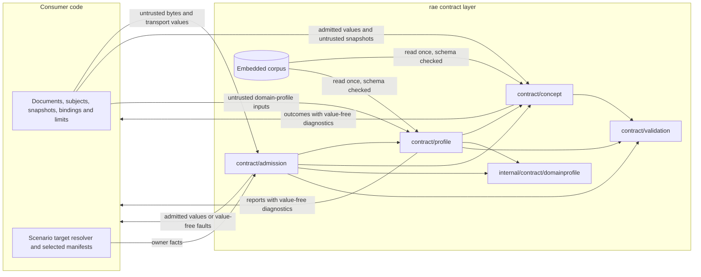

# Concept authority and profiles for issue #1781

Issue [#1781](https://github.com/OpenRAE/rae/issues/1781) ports the concept-authority catalogs, the controlled vocabularies and the published profiles to Go.
It also ports the domain-profile resolution, admission and validation.
The [consumer API reference](issue-1825-public-go-api.md) assigns two more admission operations to this issue: `AdmitFragment` and `ValidateExperimentBindingTargets`.
The maintainer decided on 2026-11-06 that this issue delivers both operations.
ADR-012, ADR-062, ADR-072, ADR-081, ADR-121 and ADR-122 govern the work.
The published schemas, the catalogs, the profiles, the vocabulary snapshots and the Python code stay unchanged.

## Starting point

[Issue #1780](issue-1780-contract-validation-design.md) put all published family rules in `contract/admission`.
That package also reads the catalogs and the profiles that its rules use.
Thus no package gives the SDL and processor code a typed interface to that authority.
The concept-binding resolver and the domain-profile admission have no Go port.

## Owners and interfaces

Each piece of authority has one owner.
The owner reads the packaged documents, checks them and gives typed operations.
`contract/admission` keeps the family rules, as #1780 decided.
It reads the authority only through the owners.

| Owner | Public interface | Purpose |
| --- | --- | --- |
| `contract/diagnostic` | `Diagnostic`, `Range`, `Error` | The shared result record of the [planned declarations](../../implementations/architecture-api/planned/rae/contract/diagnostic.go.txt) |
| `contract/concept` | `Load`, `Authority` and its methods, `Vocabulary`, `Family`, `RelationCatalog`, `SchemeSnapshot`, `ResolutionOutcome` | The 16 concept-authority documents and the concept-binding resolver |
| `contract/profile` | `Load`, `Profiles` and its methods, `EvaluateCompleteness`, `DefaultDomainLimits`, `DomainDefinitionDigest` | The 28 packaged profiles and the domain-profile operations |
| `internal/contract/domainprofile` | `CheckModel`, `DefinitionDigest`, `Digest`, `Limit` | The domain-profile model rules that `profile` and `admission` share |
| `internal/contract/packaged` | `Read` | The bounded, schema-checked reader of packaged documents |
| `contract/validation` | The inert-schema outcome codes and `InspectInertValue` | The outcome of each inert-schema check |
| `contract/admission` | `AdmitFragment`, `ValidateExperimentBindingTargets` and the existing interface | The family rules, now fed by the owners |
| `internal/base/value` | `Encode` | The exact JSON text of a bounded value, which `AdmitFragment` keeps |

The dependency direction is `admission` to `profile` to `concept` to `validation`.
`profile` and `admission` also use `internal/contract/domainprofile`.
No owner imports `admission`, so the graph has no cycle.

The packages hold no global state.
`concept.Load` and `profile.Load` take the compiled `validation.Validator`.
`admission.New` compiles the 148 published schemas once and passes that validator to both owners.
A caller that uses only an owner compiles a validator with `validation.New` and keeps the loaded owner.

### Changes to the planned declarations

| Planned declaration | Change | Reason |
| --- | --- | --- |
| `concept.Vocabulary(name string) (map[string]any, error)` | `Authority.Vocabulary`, `ScopeVocabulary`, `Permits` and `CheckScope` with a typed `Vocabulary` record | A typed record and the scope check replace an untyped map; the catalog keys its vocabularies by ID |
| `concept.AdmitBindings(subjects, bindings binding.ExternalConceptBindingsV1, snapshots)` | `Authority.AdmitBindings` takes a `validation.Value` | Only an admitted document can reach the resolver; the subject check uses the authority's compiled schemas |
| No `contract/profile` package | Adds `contract/profile` | The issue requires one owner with a public interface for the profiles |
| `ValidateExperimentBindingTargets(descriptors, ...)` | Takes the admission validator first, as `LoadAssociatedManifest` does | The descriptors and manifests pass their schemas and local rules, and the module has no global validator |
| `AdmitFragment(profile, document, limits)` | Takes the admission validator first | A profile check uses the compiled published definitions, and the module has no global validator |

`contract/diagnostic` uses its planned declarations without a change.
#1782 and #1783 extend its use; this issue adds only the record types that the concept resolver returns.

## Concept authority

`concept.Load` reads each catalog from the embedded corpus.
It applies the strict ingress limits of #1779, checks the published schema and decodes the result into typed records.
A packaged document that fails any step is a damaged build.
The owner then returns an `Operational` fault with the code `concept-authority-invalid`.

| Catalog | Typed interface |
| --- | --- |
| `controlled-vocabularies-v1` | `Vocabulary` records; `Permits` applies the term set, the closed policy and the extension pattern |
| `concept-families-v1` | `Family` records with the authority and the provenance |
| `behavioral-relations-v1` and its six history revisions | `RelationCatalog`, keyed by the exact taxonomy revision |
| The five pinned source snapshots | `PinnedSnapshots` adapts each source to a `SchemeSnapshot` |
| `reference-models-v1`, `uco-alignment-v1` | `Documents` only; no Go or Python code reads them outside the family rules |

The `history/` files stay unchanged.
`RelationCatalog` accepts only the six registered history revisions and the current revision.
A history file whose embedded revision differs from its registry entry is a damaged build.
An unknown revision returns a `NotFound` fault with the code `behavioral-authority-unsupported`.

`Permits` matches the extension pattern against the complete term with Go's linear-time engine.
The catalog has one extension pattern, and it uses only ASCII classes.
Thus the Go and Python matches agree, which the tests show for each vocabulary.
A pattern that Go cannot compile makes the catalog a damaged build.
`CheckScope` refuses a scope that no vocabulary governs, as the Python helper does.
`ScopeVocabulary` returns no vocabulary for such a scope, so a family rule can keep its own policy.

### Concept-binding resolution

`AdmitBindings` ports `admit_external_concept_bindings` without discovery or network access.
The caller supplies the subjects and the scheme snapshots.
The method first checks that the document is an admitted `external-concept-bindings-v1` value.
It checks each subject against the published subject definition.
It checks each snapshot with the Python snapshot rules: non-empty identity, a prefixed digest, an inert source locator, at least one concept and consistent successors.
A failure in these input checks returns an `InvalidInput` fault and no result.

The resolver then visits the bindings in sorted ID order, as the reference does.
It keeps the reference outcome order: subject match, scheme identity, exact revision and digest, and then the concept.

| Condition | Outcome |
| --- | --- |
| More than one exact subject | `ambiguous` |
| A subject with the same coordinate but another digest | `stale` |
| No subject with the coordinate | `subject-not-found` |
| No snapshot with the scheme and authority | `unavailable`, with a warning |
| No snapshot with the exact revision, locator and digest | `stale` |
| More than one exact snapshot | `ambiguous` |
| No term with the concept ID | `unknown-concept` |
| More than one term with the concept ID | `ambiguous` |
| A superseded term | `superseded`; the original ID is kept and no successor replaces it |
| One current term | `resolved-current`, the only active outcome |

Digest comparison ignores ASCII case, as the reference does.
A diagnostic carries the code `external-concept.<outcome>` and the domain `external-concept-binding`.
Its address is the binding position, and its message never repeats a subject, scheme or concept identifier.
`ResolutionOutcome.Admitted` is true only when there is at least one result and every result is active.

## Profiles

`profile.Load` reads all 28 packaged profiles, with the same ingress, schema check and damaged-build rule.
No published schema covers the two semantic-comparison profiles.
The owner checks them with the rules of the reference comparison-profile model: the closed literals, the complete dependency-rule set, every owner projection version and the comparison limits.
The `Profiles` methods give these typed operations.

| Operation | Reference behavior that it keeps |
| --- | --- |
| `RelationProfileIDs`, `RelationProfile` | The five supported profile IDs, the portable identifier check, the two history revisions and the revision match |
| `CheckBehavioralClaim` | The catalog revision, the relation, the required projection, profile and assurance axis, and the exact profile join |
| `ValidationCatalog`, `SelectValidationProfile` | The exact profile identity and the declared subject kind |
| `CompletenessTaxonomy`, `CompletenessAssessment`, `EvaluateCompleteness` | The two retained assessment revisions, the exact taxonomy join and the blocking concerns |
| `ComparisonProfile` | The two packaged comparison profiles and their RFC 8785 digest with the published defaults |
| Domain-profile operations | See the next section |

Errors keep the reference categories.
An unsupported profile ID, profile revision or assessment revision is `NotFound`.
A damaged packaged profile is `Operational`.
A claim that does not join its catalog or profile is `InvalidInput`.

The Python profile loader also opens a trusted file path with `O_NOFOLLOW` and refuses a file that is not regular.
The Go owner reads only the embedded corpus and accepts no path.
Thus no file path can reach it, and those two checks have no Go equivalent.
Each packaged behavioral-relation profile must meet the reference 256 KiB limit, `MaxRelationProfileBytes`.

### Domain profiles

The operations port the reference resolution, admission and inert schema validation of issue #1202.

| Operation | Behavior |
| --- | --- |
| `DefaultDomainLimits`, `DomainLimits.Validate` | The eight limits, their defaults and their published bounds |
| `ResolveDomainProfile` | The namespace authority check, then the exact identity, revision and digest selection, with the reference outcome order |
| `AdmitDomainBindings` | Flattens the binding tree within the depth and count limits, refuses duplicate IDs, resolves and admits each binding, and stops at the diagnostic limit |
| `ParseDomainBinding` | Strict bounded ingress, the value inspection and the binding schema and model rules |
| `DomainDefinitionDigest` | The RFC 8785 digest of the self-free definition projection, with the published schema defaults |

The context is the bytes of a `domain-profile-resolution-context-v1` document.
The member order of a profile schema sets the order in which the bounded evaluator visits its keywords.
That order can change the outcome when the evaluation budget is close to its limit, and a transport map does not keep it.
The bindings and the policy are the published transport types `binding.DomainProfileBindingV1` and `binding.DomainProfileAdmissionPolicyV1`.
Each operation checks each input against its published schema and the shared model rules before it reads a field.
A failed input check returns an `InvalidInput` fault and no report.

Structural validation uses `validation.CheckInertSchema`, the pinned Draft 2020-12 engine of #1780.
That function refuses retrieval, unsafe keywords, recursive references and work above the limits.
It now returns one fault code for each reference outcome: `contract-profile-limit-exceeded`, `contract-profile-unsupported-keyword`, `contract-profile-schema-invalid` and `contract-profile-value-invalid`.
Its checks run in the reference order: the schema budget, the schema walk, the supported keywords, the value budget, the combined work bound, the meta-schema and then the value.
The admission resource-profile rule now calls the domain-profile operations, as the reference does.

The model rules move from `admission` to `internal/contract/domainprofile` without a change in behavior.
`admission` applies them at each matching schema instance, as before.
`profile` applies the same rules to its inputs.

## Changes in contract admission

`admission.New` compiles the published schemas once and loads both owners with that validator.
The constructor still validates every catalog and profile that it consumes.
It now reads those documents through `Authority.Documents` and `Profiles.Documents`.
It validates all 42 schema-bound packaged documents with the complete family rules, not only the subset that it read before.
The vocabulary, concept-family and behavioral-claim rules call the owner operations.
The other rules keep their logic and read their packaged data from the owner documents.

### Experiment binding targets

`ValidateExperimentBindingTargets` ports `validate_experiment_binding_targets`.
The descriptors and each selected manifest first pass their published schema and local rules, as the reference model construction does.
The operation then resolves each descriptor through exactly one plane owner.

| Plane | Owner | Checks |
| --- | --- | --- |
| Scenario | The caller's `ScenarioBindingTargetResolver` | A valid resolution, value type, binding owner, permitted value kind and the secret-reference rule for secret targets |
| Participant implementation | The selected participant manifest | Manifest key, identity, manifest version, a configuration registry, the declared target or its single alias, owner, value type and value domain |
| Apparatus | The selected processor or backend manifest | Component kind, identity, manifest version, a configuration registry, the declared target or its single alias, owner, value type and value domain |

Each descriptor then carries the canonical target ID.
The rebuilt set passes the descriptor-set rules again, so an alias and its canonical target cannot both remain.
An `ApparatusManifest` must hold exactly one of a processor or a backend manifest.
A resolution failure returns an `InvalidInput` fault with the code `experiment-binding-target-invalid`.
An input that fails its schema or local rules returns `experiment-binding-input-invalid`.
Neither carries a supplied value.

### Native fragments

`AdmitFragment` takes the admission validator, a closed `FragmentProfile`, a native document and ingress limits.
It takes the validator first, as `LoadAssociatedManifest` does, because the module has no global validator.
It copies and bounds the document, checks the profile's native shape and local rules, and returns an opaque `Fragment`.
`Fragment.Document` returns a fresh copy.
A fragment grants no execution authority and adds no published contract ID.

The copy admits only exact JSON carriers and refuses cycles and unsupported values with the bounded value walk of #1779.
`value.Encode` gives the exact JSON text of the copy.
`value.Canonical` cannot do this, because RFC 8785 refuses an integer outside the exact IEEE 754 range.
A reference owner model can hold such an integer, for example the reserved amount of a resource measurement.
The encoded copy must then meet the caller's byte and depth limits.
Only the `RealizationValue` profile accepts every bounded JSON root; each other profile requires an object.

## Fragment profiles

The #1825 plan names the profiles but not their owner models.
This design selects each owner model with these rules, in order:

1. The Python type of the field or parameter that a planned consumer declaration gives the profile.
2. When that type is a union of contract versions, the profile admits each version.
3. Otherwise, the published schema definition with the profile's name.

A profile whose owner model is a published schema definition uses `validation.CheckLocalFragment`.
That check applies the definition, the local invariants within it and the existing admission model rules at each instance.
A profile whose owner model has no published definition uses a Go port of the reference model rules.
A port checks a closed object: each required member is present, each member has its declared type and no other member occurs.
A nested model with a published definition uses that definition.
For example, the execution authority binds its cleanup template to the fixed compiler identities and checks the bound `trial-cleanup-plan-v1` document, as the reference model does.
A union with a discriminator requires the tag, and the tag selects the definition.

| Profile | Owner model | Check |
| --- | --- | --- |
| `trial-input-refs` | `AdmittedTrialPlanInputRefsModel` | `admitted-trial-plan-v1` definition |
| `trial-apparatus` | `AdmittedApparatusBindingModel` | `admitted-trial-plan-v1` definition |
| `trial-execution-authority` | `TrialExecutionAuthorityModel` | Go port |
| `admitted-mixed-composition-binding` | `AdmittedMixedCompositionBindingModel` | `admitted-trial-plan-v1` definition |
| `realization-requirement` | `ResolvedRealizationAuthorityModel` | `provisioning-plan-v1` definition |
| `realization-designation` | The SDL designation resolution, `RealizationResolution` | Go port |
| `realization-concern` | The declarative part of `RealizationConcernDescriptor` | Go port |
| `realization-value` | A bounded realization value | Go port of the bounded value rules |
| `realization-support` | `RealizationSupportDeclarationModel` | `backend-manifest-v2` definition |
| `realization-constraint` | `RealizationConstraintDocument` | `plan-realization-profiles-v1` definition |
| `realization-constraint-evaluation` | `RealizationRelationResult` | Go port |
| `realization-structure` | The `RealizationStructure` union | The tag selects a `provisioning-plan-v1` definition |
| `validated-action-selection` | `ParticipantValidatedActionSelection` | Go port |
| `participant-implementation-selection` | `ParticipantImplementationSelectionModel` | `experiment-run-v1` definition |
| `participant-action-result` | `ParticipantActionResultModel` | `participant-behavior-history-event-stream-v1` definition |
| `participant-temporal-context` | `ParticipantTemporalRuntimeContextModel` | `participant-behavior-history-event-stream-v1` definition |
| `participant-resource-measurement` | `ParticipantResourceMeasurementRequirementModel` | Go port |
| `participant-temporal-evidence` | `ParticipantTemporalEvidenceModel` | `participant-behavior-history-event-stream-v1` definition |
| `participant-execution-state` | `ParticipantAutonomousExecutionStateModel` | `runtime-snapshot-v1` definition |
| `operation-execution-policy` | `EffectiveExecutionPolicy` | `provisioning-plan-v1` definition |
| `operation-policy-scope` | `EffectiveExecutionPolicy`, the element type of the operation's policy scopes | `provisioning-plan-v1` definition |
| `stochastic-control` | `ExperimentStochasticControlModel` | `experiment-apparatus-context-v1` definition |
| `participant-control-request` | `ParticipantControlRequestModel` or `ParticipantControlRequestV2Model` | `participant-control-evaluation-v1` or `-v2` definition |
| `participant-control-result` | `ControlMechanismResultModel` | `participant-control-evaluation-v1` definition |
| `participant-control-invocation` | `ControlInvocationV2Model` | `participant-control-evaluation-v2` definition |
| `participant-control-stage-result` | `ControlMechanismResultV2Model` | `participant-control-evaluation-v2` definition |
| `participant-control-support` | `ControlEffectiveSupportModel` or `ControlSupportAssessmentV2Model` | `participant-control-evaluation-v1` or `-v2` definition |
| `control-artifact-reference` | `ControlArtifactReferenceModel` | `participant-control-evaluation-v1` definition |
| `participant-control-policy` | `ParticipantControlOccurrencePolicyModel` | Go port |
| `participant-control-intent` | The runtime `ParticipantControlIntent` union | Go port |
| `participant-control-declaration` | `ParticipantControlDeclarationModel` | Go port |
| `participant-inject-delivery` | `ParticipantInjectDeliveryRuntime` | Go port |
| `participant-inject-content` | `ParticipantInjectContentModel` | `participant-inject-delivery-receipt-v1` definition |
| `participant-crossing-evidence` | `ParticipantCrossingEvidence` | Go port |
| `compiled-realization-requirement` | `CompiledRealizationRequirement` | Go port |
| `crossing-subject` | `ParticipantCrossingSubjectReferenceModel` | `participant-crossing-occurrence-v1` definition |
| `crossing-policy` | `ParticipantCrossingPolicyReferenceModel` | `participant-crossing-occurrence-v1` definition |
| `opacity-enforcement` | `ParticipantOpacityRuntimeEnforcementBindingModel` | `participant-crossing-occurrence-v1` definition |
| `opacity-support` | `ParticipantOpacityRuntimeSupportModel` | Go port |
| `control-realization-binding` | `ControlRealizationBindingModel` | `participant-control-evaluation-v1` definition |
| `trial-processor-plan-reference` | `TrialProcessorPlanReferenceModel` | `experiment-run-v1` definition |
| `cleanup-obligation-result` | `CleanupObligationResultModel` | `trial-cleanup-receipt-v1` definition |
| `trial-execution-controls` | `AdmittedExecutionControlModel` | `admitted-trial-plan-v1` definition |

Each definition that the table names has one body in every published schema that contains it.
Recorded Python verdicts for valid and changed documents of each profile verify the Go checks.
The expected verdict of a published owner is the reference model verdict and the published definition verdict.
The expected verdict of a ported owner is the reference type verdict and the verdict of its closed JSON schema.
A reference dataclass is closed, because a native dataclass has exactly its fields.

## Definition-level model rules

A fragment check applies the admission model rules at each schema instance.
An audit compared each reference model validator in the fragment closure with the Go rules at its definition.
The audit used fixture instances, crafted instances and changed copies of each.
It found Python validators whose Go rules ran only from some containing documents, and some that had no Go rule.
In those cases a native fragment or another containing document accepted what the reference model refuses.

`admission` now applies these rules at each instance of the definition, in a fragment and in a whole document:

| Definition | Rule |
| --- | --- |
| `AdmittedApparatusBindingModel`, `AdmittedMixedCompositionBindingModel`, `AdmittedTrialPlanInputRefsModel` | Reference kinds, digest pins, no host paths and unique keys |
| `ArtifactMechanismCapability`, `RealizationSupportDeclarationModel`, `ResolvedRealizationAuthorityModel` | Unique routes, resources, mechanism identities and bound keys |
| `CleanupObligationResultModel`, `ExecutionRetryPolicyModel` | The existing cleanup-result and retry-policy rules |
| `ControlMechanismBindingModel`, `ControlMechanismBindingV2Model`, `ControlProfileObligationV2Model`, `ControlResultSlotV2Model` | The existing binding rule, the owning kinds, bounded strength and the admitted support |
| `EvidenceRequirement` | The capture dimensions, the capture contract, canonical selectors, unique non-blank lists and the enumerated terms |
| `GovernedReferenceDomain`, `NumericIntervalDomain`, `VersionDomain` | The bounded-domain rules, with the default kind of the definition |
| `InjectTriggerRequestModel`, `InjectEventPlacementModel`, `InjectSchedulePlacementModel`, `ParticipantInjectContentModel` | The existing inject request, placement and content rules |
| `ParticipantAutonomousExecutionStateModel` | The counters and the random-control identity of each profile |
| `ParticipantCrossingPolicyReferenceModel`, `ParticipantOpacityRuntimeEnforcementBindingModel` | The order interval and the finite enforced claim |
| `ParticipantTemporalBindingModel` | The existing temporal-binding rule on the defaulted binding |
| `ProcessResourceLimitCapabilityModel` | The maximum is not less than the minimum |
| `RealizationCollection`, `RealizationKeyedCollectionConstraint`, `RealizationSequenceConstraint` | Digest member keys, identity arity, aliases and item bounds |
| `TrialProcessorPlanReferenceModel` | The existing digest-bound plan reference rule |

The published schema allows any string for six enumerated `EvidenceRequirement` fields.
The reference model accepts a member, after case folding and with a hyphen read as an underscore, or a whole-field variable reference.
The Go rule does the same.
A rule that the published schema already enforces has no Go copy, because it can never decide an outcome.
`validation.CheckLocalFragment` now reports the discriminator of each union instance, as `CheckInstances` does.
Thus a nested union member without its tag is refused in a fragment, as in a whole document.

## Typed interfaces

The architecture model records the typed interface of each package.
Each line below commits this design to that interface.

<!-- go-api implementations/go/contract/diagnostic 040441af1c0bec9978fafa927a6a3366d0e3b5bb302581c35fdcf809819b376e -->

<!-- go-api implementations/go/contract/concept d6861ce78451cf3d07e03ca17bb051a51a44651b9e238e9a5de724ced47c11cd -->

<!-- go-api implementations/go/contract/profile 4ac84f8912b9e07e288358a13b71fee3e3a7a87f094d0a58f795899278c69417 -->

<!-- go-api implementations/go/internal/contract/domainprofile 1e611b77eb3507157548369c33197223032cef8639f34cc59147901f53624b9c -->

<!-- go-api implementations/go/internal/contract/packaged 1e02037593ff0b098dbc63bbc77fe9aac3b14e58388406c8ec1a3c0900afdf61 -->

## Findings from the review

| Finding | Disposition |
| --- | --- |
| ADR-012, ADR-062, ADR-072 and ADR-081 govern the authority | The owners keep the catalogs, profiles and claims under those rules; no authority file changes |
| The vocabulary catalogs derive from pinned external sources | `PinnedSnapshots` adapts the five admitted snapshots and keeps their revision, locator and digest |
| Domain-profile validation uses one pinned in-process Draft 2020-12 validator | `profile` uses `validation.CheckInertSchema`, the single pinned engine |
| `contracts/concept-authority/history/` names Python source paths | The history files stay unchanged; the owner keeps each revision under its registry entry |

## Security and data flows

Assets: the packaged authority documents, the admission decisions, the caller's subject and scheme inputs and the domain-profile values.
Trust boundaries: the public package boundary, where callers supply documents, snapshots, resolvers and manifests, and the embedded corpus, which the build fixes.

| Threat | Control | Verification |
| --- | --- | --- |
| A forged or unadmitted binding document is resolved | `AdmitBindings` accepts only an admitted `validation.Value` of the exact contract | `TestAdmitBindingsRefusesUnadmittedDocuments` |
| A snapshot locator carries a credential or opens a local resource | The snapshot check refuses relative, `file`, `data`, credential-bearing, secret-query and fragment locators | `TestSchemeSnapshotLocatorsAreInert` |
| A diagnostic discloses a supplied identifier | Fixed messages carry no subject, scheme or concept identifier | `TestBindingDiagnosticsDoNotEchoIdentifiers` |
| A successor silently replaces a superseded concept | The resolver keeps the original ID and marks the binding inactive | `TestSupersededConceptIsNotRewritten` |
| A duplicate candidate is resolved as one | Ambiguity is a distinct inactive outcome for subjects, snapshots and terms | `TestDuplicateCandidatesAreAmbiguous` |
| A damaged build changes authority | Each owner checks the schema and identity of each packaged document; `admission.New` checks all family rules | `TestLoadRefusesDamagedDocuments`, `TestLoadRefusesDamagedProfiles`, `TestConsumedCatalogsPassTheProductionChecks` |
| A stored claim names an unpackaged revision | Revision lookup accepts only registered revisions | `TestRelationRevisionsAreExact` |
| A profile schema retrieves a resource or runs code | The inert engine refuses retrieval, unsafe keywords and non-local or recursive references | `TestInertProfileReferenceVerdicts`, `TestDomainAdmissionMatchesTheReference` |
| A profile input exhausts memory or time | Ingress, node, depth, scalar, reference, evaluation and diagnostic limits apply before and during validation | `TestInertProfileReferenceVerdicts`, `TestDomainAdmissionMatchesTheReference`, `TestParseDomainBindingIsBoundedAndStrict`, `TestDomainLimitsBounds` |
| Opaque carriage bypasses validation | Opaque exchange needs the host policy, no required operation and an unavailable definition | `TestDomainAdmissionMatchesTheReference` |
| A namespace is claimed by another authority | Resolution needs exactly one admitted authority for the namespace | `TestDomainResolutionMatchesTheReference` |
| A reordered profile schema changes an admission outcome | The context keeps its document bytes and their member order | `TestDomainAdmissionMatchesTheReference` (keyword-order cases) |
| A binding target escapes its plane owner | Each target resolves through its selected owner and must keep its owner, type and domain | `TestBindingTargetsResolveThroughOwners` |
| A fragment grants authority | Fragments are opaque copies and carry no capability | `TestFragmentsAreCopies` |
| A native fragment exhausts memory or holds an unsupported value | The bounded value walk, the caller's byte and depth limits and the object-root rule apply before the profile check | `TestFragmentsRefuseUnboundedOrUnknownInput` |
| A nested definition escapes its owner rule | Each definition-level rule applies at every instance of its definition | `TestModelRulesMatchTheReferenceModels`, `TestFragmentsMatchTheReferenceModels` |

The change adds no service, network call, credential, file path, log record or external dependency.

## Verification

Local checks are targeted: the new packages, `contract/admission`, `contract/validation` and the parity package.
Recorded Python verdicts are test data: `admission/testdata/fragment-vectors.json` for each fragment profile and `admission/testdata/model-rule-vectors.json` for each definition-level rule.
CI runs the full Go suites, the mutation tests, the fuzz targets and the parity corpus.
Each input limit, security check, error case and defect case in the Python tests in scope has a Go test.

## References

- ADR-012, in the [ADR index](adrs/README.md)
- [ADR-062](adrs/adr-062-concept-authority-catalog-governance-gate.md)
- [ADR-072](adrs/adr-072-validation-and-admission-profiles.md)
- [ADR-081](adrs/adr-081-behavioral-relation-taxonomy-and-claim-discipline.md)
- [ADR-122](adrs/adr-122-go-architecture-model.md)
