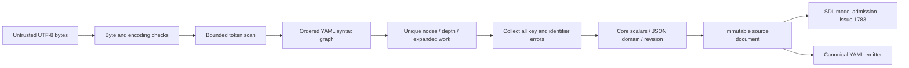
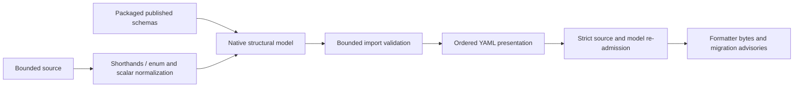

# SDL source loading design — issue 1782

## Classification

Classification: FM1
Required artifacts: the invariants below, the architecture model, source vectors and targeted Go tests.
Waivers: none.

## Boundary

`internal/sdl/source` owns decoding of one bounded source, its syntax graph, key preflight, source ranges and YAML emission.
It returns an immutable document, not an admitted scenario.
The public `sdl` owner will admit this document through the model and semantic checks of #1783.
The composition owner of #1785 will use the same source reader and aggregate budget.
The source package owns parse-specific metadata, including authored-key pairs and related ranges.
The public `contract/diagnostic` envelope remains a downstream adapter contract; source loading does not grant scenario admission.
The decoder has no runtime dependency.

The exported source boundary comprises `Limits`, `Options`, `Document`, `Decode`, `Read`, `DefaultLimits` and `DefaultOptions`.
`Diagnostic`, `Position`, `Range` and `Diagnostics` expose source metadata.
`Capture`, `Sources` and `ResolvePath` own copied source bytes and lexical paths.
`NewBudget` and `Budget` reserve imports, decoded bytes and nodes, and check depth and qualified names.
Document access returns copies of values, ranges and advisories.
Source options select structural, literal or data key treatment, a base pointer, source identity, migration and required semantic revision.
Limits carry the six per-source bounds and five composition bounds from the reference.
Source-set helpers copy supplied bytes and resolve paths lexically within the supplied root.
Composition-budget helpers share accounting across imports; they do not perform admission or fetch a registry.

## Processing and controls

The token scan bounds source bytes, scalar bytes, lexical depth and alias occurrences before composition.
Graph metrics check effective depth and unique nodes before domain construction.
Graph work is checked before alias expansion, mapping analysis or value copying.
Memoized subtree cost and height bound repeated aliases without expanding an exponential graph.
Cycles are diagnosed before construction.
Mapping entries remain ordered and distinct until all conflicts are collected.
Merge sources must be disjoint; migration never authorizes overwrite precedence.
Structural keys normalize only under explicit migration; literal and embedded JSON keys retain their text.
Every node retains half-open, one-based ranges.
Alias occurrences refer to the declaration range, as in the reference.
The decoder never resolves tags, invokes host constructors or reads a network resource.
Error text and logs contain no source payload; diagnostics carry only their declared source metadata.
Each filesystem read is limited before UTF-8 decoding.
A supplied source set copies caller buffers and admits only canonical relative paths.
The source loader cannot grant semantic admission, import trust, digest or lock authority.

## Reuse and reference evidence

Use the standard library for UTF-8, numbers, copies, bounded reads and path handling.
Reuse `internal/base/jsonpointer` for RFC 6901 token conversion.
Use the existing pinned `x/text/cases` with the `Und` locale for full Unicode structural-key lowercasing.
ASCII keys use the standard library; simple Unicode rune lowercasing cannot preserve the reference collision rules.
Use the MIT-licensed `github.com/goccy/go-yaml` scanner for pre-composition bounds and token end marks.
Use the maintained `go.yaml.in/yaml/v3` grammar composer for its ordered node and alias graph.
The public scanner exposes tokens before composition; the grammar composer preserves duplicate and complex keys.
Expanded reference cases found that the scanner library's AST parser rejects complex keys before SDL can diagnose them.
Do not use that parser. Keep the grammar and scalar-policy responsibilities separate.
The standard library has no YAML parser.
Do not use library scalar conversion or object decoding: SDL's resolver differs from general-purpose YAML libraries.
[The library parser](https://pkg.go.dev/github.com/goccy/go-yaml/parser) and
[YAML 1.2.2 Core](https://yaml.org/spec/1.2.2/#103-core-schema) define these dependency and resolution choices.
Pin dependencies and their checksums in the product module.
The source presentation writer retains PyYAML quoting, ASCII escapes, indentless sequences, field order and wrapping.
This compatibility boundary does not perform model normalization.
The [maintained YAML composer](https://pkg.go.dev/go.yaml.in/yaml/v3) supplies grammar and node identity, without object decoding.

The behavior reference is `raes/_source_profile.py`, `_source_validation.py`, `_yaml_loader.py`, `_mapping_key_analyzer.py`,
`_mapping_scopes.py`, `_source_identifier_paths.py`, `_supplied_sources.py`, `parser.py` and `formatting.py`.
The reference stays unchanged.
Published schemas stay unchanged.
Artifact-reference models in `_source.py` remain contract/model work; they are not YAML constructors.
`value_parsing.py` re-exports model helpers; this source loader does not create a second model-validation owner.

## Invariants

- A key conflict prevents value construction; migration cannot hide it.
- A cyclic alias prevents value construction.
- Domain values contain only JSON scalars, sequences and string-keyed maps.
- A returned document exposes copies and remains unchanged after caller edits.
- A supplied source set performs no host read, registry request or trust admission.
- Each composition reservation precedes the work that consumes it.
- The source reader cannot create a semantically admitted scenario.

## Verification

Before implementation, run `archcheck -design` against this model and record the result on the issue.
Run focused Go cases for scalar resolution, all per-source limit boundaries, graph reuse, cycles, conflict collection and ranges.
Cover structural, literal, embedded JSON, merge, identifier, UTF-8, revision and malformed-source cases.
Record source-layer Python verdicts and exact emitter bytes as portable local fixtures with reference commit identity.
Run targeted parity cases locally; the full corpus, mutation, fuzz, coverage and race lanes run in existing CI.
`tools/parity_source_vectors.py --check` reproduces the source vectors from the unchanged Python reference.
The reference fixture includes exact values, key and value ranges, diagnostics and emitted bytes.
The source-corpus boundary test checks source outcomes in the unchanged command corpus.
It leaves model verdicts and command envelopes with their port owners.
Full formatter-command validation depends on model admission and import composition; keep that dependency explicit.
Do not claim a formatted source is an admitted scenario.

## Configuration compatibility

The maintainer authorized manual workflow execution and a rollback to Ground Control schema version 1.
Remove unsupported `workflow.design` and `architecture.modules` from `.ground-control.yaml`.
The architecture model, ADR-122 and CI retain the design rules.
Manual checks are `archcheck -design`, `archcheck`, `archcheck -view`, package builds and the selected acceptance test.
A model check is not proof of runtime behavior or formatter-command parity.

## Current evidence and remaining gate

The pre-code package and dependency design check passed; the issue plan records that order.
The final typed API snapshot was reviewed after implementation and added to the model.
The current fixture has 315 source cases from Python commit `9ce61105e833d4edfe465bbc0bebce12cd8a9a6d`.
Targeted source tests pass with 93.0% statement coverage.
Selected canonical-profile corpus cases and two example sources pass their source-boundary checks.
A targeted 10,000-field decode benchmark took about 130 ms on the development host.
Fuzz seeds are present; full fuzz and mutation runs belong to CI.
Python implementation files and published schemas remain unchanged.

The maintainer selected option 2: include the model and import-composition prerequisites needed for full formatter parity.
Full formatter validation and normalization use the model and composition ports assigned to #1783 and #1785.
`Document.Render` provides YAML presentation, without model defaults, shorthand expansion, legacy model migration or import admission.
No full formatter-command or issue-completion claim is made by this source component.

## API commitments

<!-- go-api implementations/go/internal/sdl/source 35366d84b9f3c94b83a7ef482f8add5f5e305acf6d0450095625ea5d53099d85 -->

## Expanded formatter prerequisite design

The maintainer approved this scope on 2026-11-07, before the expanded implementation.
`internal/sdl/authoring` owns the native structural model and formatter operation.
`Parser`, `New`, `Decode`, `Format`, `Request`, `Result` and immutable `Document` are its package interface.
A document exposes copied normalized JSON and typed authored/materialized contract bindings.
No caller flag can create an admitted document or mark it semantically valid.
The existing public SDL consumer plan remains with its delivery owners; no placeholder public operations are added.

The owner reads the packaged, unchanged published schemas and reuses contract model predicates through `CheckPortable`.
A non-authoritative compatibility layout preserves the reference's field order and serializer omissions.
Its records name published definition IDs and serialized fields, not Python executable paths or a copied class hierarchy.
A schema-directed normalization walk preserves enum aliases, whole-field variables, scalar conversions and supplied-field omission.
Go-specific shorthands and legacy VM migration run before structural validation.
Decoded input and every retry, copy and serialization remain bounded.
The output is reparsed under strict source policy and model-checked before return.

Import validation shares one request budget and ancestry set.
It reads only an explicitly supplied filesystem or captured source map.
Each supplied-source edge requires a local source, digest pin and unique matching companion lock record.
The authoring filesystem path retains its existing optional local pins and locks.
Descriptor, version, revision, exports, parameter, namespace and collision checks apply before combining declarations.
The formatter emits the normalized authored source, not the expanded import graph.
Only validation uses the expanded graph; import omission must not hide a malformed imported model.
Registry authority is explicit and cannot come from an untrusted supplied source set.
All refusal paths retain typed source diagnostics and value-free error text.

Targeted checks cover model normalization and rejection, exact formatter bytes, imported model failures and each import refusal boundary.
The existing full formatter corpus runs in CI; local checks select explicit source cases.
No Python implementation or published schema changes are permitted.

<!-- go-api implementations/go/internal/sdl/authoring bbd60f28c8ed8129a8a320b9ad04b8e91c2dc671e541287f950e9ef696b5870c -->

Module version admission uses the Apache-2.0 [Aqua PEP 440 library](https://github.com/aquasecurity/go-pep440-version).
The adapter refuses its OR extension and retains Python packaging specifier and prerelease rules.
Version and constraint inputs remain source-bounded before parsing.

The compatibility metadata also names explicit scalar normalization operations at published model fields.
These records distinguish enum normalization from strict literals, and ordinary scalar coercion from strict scalar fields.
Do not infer enum normalization from an `enum` annotation: some reference fields require exact spelling.
The recorder extracts presentation and primitive-conversion facts from the unchanged reference, filters them through published schema fields, and checks regeneration.
The Go implementation owns the conversion algorithms and model predicates; metadata contains no executable code or class paths.
Keep unrestricted JSON values outside model scalar coercion.

### Module-version boundary correction

Reference vectors found that the proposed Aqua adapter refuses integer version components above 64 bits.
It also differs from the pinned packaging 26.0 membership policy and arbitrary equality grammar.
Do not ship that adapter or dependency.
The authoring owner will parse the [PEP 440 grammar](https://peps.python.org/pep-0440/) with bounded RE2 matches and compare normalized decimal strings without integer narrowing.
Native keys order epoch, zero-padded release components, prerelease, postrelease, development and local labels.
Specifier checks retain prefix equality, compatible releases, arbitrary equality and the reference's invalid-version fallback.
Digit limits distinguish a numeric conversion failure from an invalid version spelling.
The input and scalar ceilings apply before parsing; reference vectors cover the library defects and each specifier operator.
