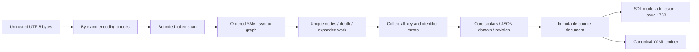
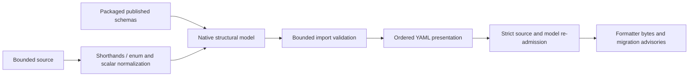
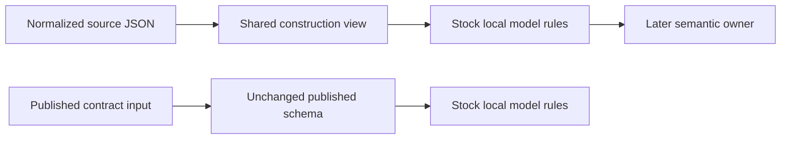

# SDL source loading design — issue 1782

## Classification

Classification: FM1
Required artifacts: the invariants below, the architecture model, source vectors and targeted Go tests.
Waivers: none.

## Boundary

`internal/sdl/source` owns decoding of one bounded source, its syntax graph, key preflight, source ranges and YAML emission.
It returns an immutable document, not an admitted scenario.
The public `sdl` owner will admit this document through the model and semantic checks of #1783.
The composition owner of #1785 will use the same source reader and aggregate budget.
The source package owns parse-specific metadata, including authored-key pairs and related ranges.
The public `contract/diagnostic` envelope remains a downstream adapter contract. Source loading does not grant scenario admission.
The decoder has no runtime dependency.

The exported source boundary comprises `Limits`, `Options`, `Document`, `Decode`, `Read`, `DefaultLimits` and `DefaultOptions`.
`Diagnostic`, `Position`, `Range` and `Diagnostics` expose source metadata.
`Capture`, `Sources` and `ResolvePath` own copied source bytes and lexical paths.
`NewBudget` and `Budget` reserve imports, decoded bytes and nodes, and check depth and qualified names.
Document access returns copies of values, ranges and advisories.
Source options select structural, literal or data key treatment, a base pointer, source identity, migration and required semantic revision.
Limits carry the six per-source bounds and five composition bounds from the reference.
Source-set helpers copy supplied bytes and resolve paths lexically within the supplied root.
Composition-budget helpers share accounting across imports. They do not perform admission or fetch a registry.

## Processing and controls

The token scan bounds source bytes, scalar bytes, lexical depth and alias occurrences before composition.
Graph metrics check effective depth and unique nodes before domain construction.
Graph work is checked before alias expansion, mapping analysis or value copying.
Memoized subtree cost and height bound repeated aliases without expanding an exponential graph.
Cycles are diagnosed before construction.
Mapping entries remain ordered and distinct until all conflicts are collected.
Merge sources must be disjoint. Migration never authorizes overwrite precedence.
Structural keys normalize only under explicit migration. Literal and embedded JSON keys retain their text.
Every node retains half-open, one-based ranges.
Alias occurrences refer to the declaration range, as in the reference.
The decoder never resolves tags, invokes host constructors or reads a network resource.
Error text and logs contain no source payload. Diagnostics carry only their declared source metadata.
Each filesystem read is limited before UTF-8 decoding.
A supplied source set copies caller buffers and admits only canonical relative paths.
The source loader cannot grant semantic admission, import trust, digest or lock authority.

## Reuse and reference evidence

Use the standard library for UTF-8, numbers, copies, bounded reads and path handling.
Reuse `internal/base/jsonpointer` for RFC 6901 token conversion.
Use the existing pinned `x/text/cases` with the `Und` locale for full Unicode structural-key lowercasing.
ASCII keys use the standard library. Simple Unicode rune lowercasing cannot preserve the reference collision rules.
Use the MIT-licensed `github.com/goccy/go-yaml` scanner for pre-composition bounds and token end marks.
Use the maintained `go.yaml.in/yaml/v3` grammar composer for its ordered node and alias graph.
The public scanner exposes tokens before composition. The grammar composer preserves duplicate and complex keys.
Reference cases exposed a scanner defect. Its AST parser rejects complex keys before SDL can diagnose them.
Do not use that parser. Keep the grammar and scalar-policy responsibilities separate.
The standard library has no YAML parser.
Do not use library scalar conversion or object decoding: SDL's resolver differs from general-purpose YAML libraries.
[The library parser](https://pkg.go.dev/github.com/goccy/go-yaml/parser) and
[YAML 1.2.2 Core](https://yaml.org/spec/1.2.2/#103-core-schema) define these dependency and resolution choices.
Pin dependencies and their checksums in the product module.
The source presentation writer retains PyYAML quoting, ASCII escapes, indentless sequences, field order and wrapping.
This compatibility boundary does not perform model normalization.
The [maintained YAML composer](https://pkg.go.dev/go.yaml.in/yaml/v3) supplies grammar and node identity, without object decoding.

The behavior reference is `raes/_source_profile.py`, `_source_validation.py`, `_yaml_loader.py`, `_mapping_key_analyzer.py`,
`_mapping_scopes.py`, `_source_identifier_paths.py`, `_supplied_sources.py`, `parser.py` and `formatting.py`.
The reference stays unchanged.
Published schemas stay unchanged.
Artifact-reference models in `_source.py` remain contract/model work. They are not YAML constructors.
`value_parsing.py` re-exports model helpers. This source loader does not create a second model-validation owner.

## Invariants

- A key conflict prevents value construction. Migration cannot hide it.
- A cyclic alias prevents value construction.
- Domain values contain only JSON scalars, sequences and string-keyed maps.
- A returned document exposes copies and remains unchanged after caller edits.
- A supplied source set performs no host read, registry request or trust admission.
- Each composition reservation precedes the work that consumes it.
- The source reader cannot create a semantically admitted scenario.

## Verification

Before implementation, run `archcheck -design` against this model and record the result on the issue.
Run focused Go cases for scalar resolution, all per-source limit boundaries, graph reuse, cycles, conflict collection and ranges.
Cover structural, literal, embedded JSON, merge, identifier, UTF-8, revision and malformed-source cases.
Record source-layer Python verdicts and exact emitter bytes as portable local fixtures with reference commit identity.
Run targeted parity cases locally. The full corpus, mutation, fuzz, coverage and race lanes run in existing CI.
`tools/parity_source_vectors.py --check` reproduces the source vectors from the unchanged Python reference.
The reference fixture includes exact values, key and value ranges, diagnostics and emitted bytes.
The source-corpus boundary test checks source outcomes in the unchanged command corpus.
It leaves model verdicts and command envelopes with their port owners.
Full formatter-command validation depends on model admission and import composition. Keep that dependency explicit.
Do not claim a formatted source is an admitted scenario.

## Configuration compatibility

The maintainer authorized manual workflow execution and a rollback to Ground Control schema version 1.
Remove unsupported `workflow.design` and `architecture.modules` from `.ground-control.yaml`.
The architecture model, ADR-122 and CI retain the design rules.
Manual checks are `archcheck -design`, `archcheck`, `archcheck -view`, package builds and the selected acceptance test.
A model check is not proof of runtime behavior or formatter-command parity.

## Current evidence and remaining gate

The pre-code package and dependency design check passed. The issue plan records that order.
The final typed API snapshot was reviewed after implementation and added to the model.
The current fixture has 318 source cases from Python commit `9ce61105e833d4edfe465bbc0bebce12cd8a9a6d`.
Targeted source tests pass. CI runs the full coverage, race, fuzz and mutation lanes.
Selected canonical-profile corpus cases and two example sources pass their source-boundary checks.
Fuzz seeds are present. Full fuzz and mutation runs belong to CI.
Python implementation files and published schemas remain unchanged.

The maintainer selected option 2: include the model and import-composition prerequisites needed for full formatter parity.
The expanded formatter operation uses `internal/sdl/authoring` for normalization and import validation.
`Document.Render` provides YAML presentation, without model defaults, shorthand expansion, legacy model migration or import admission.
No full formatter-command or issue-completion claim is made by this source component.

## API commitments

<!-- go-api implementations/go/internal/sdl/source a2a5ad5613ae85f6def674c8cba57a9cf95af77ab4cac72145dceb290d80b340 -->

## Expanded formatter prerequisite design

The maintainer approved this scope on 2026-11-07, before the expanded implementation.
`internal/sdl/authoring` owns the native structural model and formatter operation.
`Parser`, `New`, `Decode`, `Format`, `Request`, `Result` and immutable `Document` are its package interface.
A document exposes copied normalized JSON. Contract bindings remain with the existing binding owner.
No caller flag can create an admitted document or mark it semantically valid.
The existing public SDL consumer plan remains with its delivery owners. No placeholder public operations are added.

The owner reads the packaged, unchanged published schemas and reuses contract model predicates through `CheckPortable`.
A non-authoritative compatibility layout preserves the reference's field order and serializer omissions.
Its records name published definition IDs and fields. They contain no Python code paths or copied class tree.
A schema-directed normalization walk preserves enum aliases, whole-field variables, scalar conversions and supplied-field omission.
Go-specific shorthands and legacy VM migration run before structural validation.
Decoded input and every retry, copy and serialization remain bounded.
The output is reparsed under strict source policy and model-checked before return.

Import validation shares one request budget and ancestry set.
It reads only an explicitly supplied filesystem or captured source map.
Each supplied-source edge requires a local source, digest pin and unique matching companion lock record.
The authoring filesystem path retains its existing optional local pins and locks.
Descriptor, version, revision, exports, parameter, namespace and collision checks apply before combining declarations.
The formatter emits the normalized authored source, not the expanded import graph.
Only validation uses the expanded graph. Import omission must not hide a malformed imported model.
Registry authority is explicit and cannot come from an untrusted supplied source set.
Source refusals retain typed parse diagnostics. Model and import refusals retain value-free error text. Complete later-stage diagnostics remain with their admission owners.

Targeted checks cover model normalization and rejection, exact formatter bytes, imported model failures and each import refusal boundary.
The existing full formatter corpus runs in CI. Local checks select explicit source cases.
No Python implementation or published schema changes are permitted.

<!-- go-api implementations/go/internal/sdl/authoring 0ccbc254d08a8904a07032230fc9442ef6f59c5e90efd4a31f53f05927fdbe9c -->

The compatibility metadata also names explicit scalar normalization operations at published model fields.
These records distinguish enum normalization from strict literals, and ordinary scalar coercion from strict scalar fields.
Do not infer enum normalization from an `enum` annotation: some reference fields require exact spelling.
The recorder reads field order and scalar rules from the unchanged reference. It selects published schema fields and checks each new output against the stored records.
Go owns the conversion code and model checks. The records contain no code or class paths.
Keep unrestricted JSON values outside model scalar coercion.

### Module versions

Parse the [PEP 440 grammar](https://peps.python.org/pep-0440/) with bounded RE2 matches. Compare normalized decimal strings without integer narrowing.
Native keys order epoch, zero-padded release components, prerelease, postrelease, development and local labels.
Specifier checks retain prefix equality, compatible releases, arbitrary equality and the reference's invalid-version fallback.
Digit limits distinguish a numeric conversion failure from an invalid version spelling.
Input and scalar limits apply before parsing. Reference vectors cover the known defects and each specifier operator.

### Composition and ordering interfaces

`source.Document.View` returns an immutable source cursor.
`View.Keys`, `View.Child` and `View.Range` give copied key sequences, child cursors and original ranges.
Construction order is distinct from physical key positions for aliases and disjoint merge sequences.
The authoring owner uses these sequences and records keys created by list shorthands before model field ordering.
This avoids reconstructing order from source ranges or reparsing rendered YAML.

`contract/admission.Validator.CheckModelFragment` exposes the existing published-fragment model check.
It checks a reachable compiled model, local invariants and nested owner predicates without granting phase admission.
Bound imported declarations use this owner after substitution. Qualified declaration keys use native composition checks.
Do not duplicate contract predicates in the SDL owner.

### Metadata allocation

A cursor follows one graph edge at a time and avoids repeated full-path lookups.
Cache canonical member indexes per mapping and key scope. The cache is synchronized and contains no mutable domain values.
Bulk range accessors materialize requested metadata on demand.
Store diagnostic paths as shared token prefixes until the caller requests their text.
This preserves all source metadata while preventing eager pointer-string multiplication on deep inputs.
The model owner uses cursors and materializes advisories after model validation.
No new source-profile limit or parse refusal is introduced by this storage change.

Share one immutable compiled schema set between admission and concept owners through `admission.NewWithSchemas`.
The constructor installs the complete owner rule registry and checks the packaged catalogs.
The authoring owner uses `concept.Authority` for governed extension identities.
Use full Unicode lowercasing for authored enum aliases. Extension identities retain the reference's exact spelling rules.

### Authoring checks and binding

Model predicates check artifact identity uniqueness, materialization input joins and exact Source selectors after child normalization.
Governed mechanism tokens use full matches, including at trailing newlines.
Authored behavior references cannot introduce the reserved private namespace segment.
Binding may preserve an identical reference generated by expansion. Substituted parameters cannot create new private references.
Control-context descriptors reject variable tokens before binding and are pinned only at the scenario root.
Inline substitution uses Python scalar spelling and numeric equality without narrowing integer values.
The JSON writer disables HTML escaping. A string with `<`, `>` or `&` does not use extra bytes to escape those characters.
Common presentation records are stored once. The contract-specific records retain each root model's published field order.

### Formatter byte oracle in CI

CI runs the unchanged Python formatter on stored CLI inputs. It saves exact output bytes in a temporary local oracle file.
The Go parity test compares both acceptance and bytes for every stored formatter case.
The recorder checks its results against the corpus verdicts. It cannot replace an expected refusal.
Local runs select named cases. The full corpus remains a CI check.
The oracle defines no new published contract. It uses only existing repo inputs and CI runner storage.

### Composition accounting before model coercion

`Budget.AddValue` charges the normalized source JSON directly, without serializing it or applying scalar coercion and serializer omissions.
It counts mapping keys, values, strings and repeated subtrees as the reference does.
It reserves the remaining node capacity before queuing children and rejects unsupported native carriers.
The authoring document retains this private source view for accounting. Callers receive only checked, copied model values.
`AddDocument` remains available for source graphs.
Neither operation grants admission authority.

Workspace trust and lock files retain the reference's default configuration-read limits.
Only supplied lock bytes consume the supplied-source composition budget.
Workspace policy files are validated for each expanded module, including a leaf.
A leaf's local-import policy controls that leaf's import edges.

### Command behavior

The corpus adapter accepts formatter flags before or after its one source path.
It preserves the command's parse-refusal exit code, silent `--check` verdict and `--write` stdout shape.
The check compares formatter bytes with the text that the reference CLI reads, including universal newline handling.
The byte oracle checks the formatter result apart from the CLI verdict. It also checks exact output bytes for a valid source whose format changes.

A supplied request must identify its captured root and supply those exact root bytes.
Its filesystem field grants no authority.
A supplied root must be authored. Materialization provenance cannot select a stronger phase.

### Duration arithmetic

The duration adapter preserves Unicode decimal digits and the reference's two arithmetic paths.
Bare decimal strings take an exact ceiling. Compound durations use 28 significant decimal digits with half-even ties. Round each product and sum, then take the ceiling.
The context retains the reference's exponent and subnormal bounds.
Use `math/big` for this arithmetic adapter. The [apd documented exponent range](https://pkg.go.dev/github.com/cockroachdb/apd/v3#pkg-constants) cannot hold the full reference context.
The source scalar limit applies before arithmetic, and this adapter adds no source-profile limit.

Float strings follow Python's decimal grammar and preserve Unicode decimal digits.

Network field checks validate each concrete address before cross-field checks.
A variable in one field does not exempt the other field from its address grammar.
The adapter preserves the reference's IPv4 netmask and hostmask forms and IPv6 zone handling.
Use standard `net` and `netip` address and mask operations. These checks perform no lookup or network access.

### Filesystem import confinement

Supplied paths use the source owner's lexical bundle resolver.
Filesystem paths use POSIX filename rules and resolve symlinks before applying the importing-directory boundary.
Resolve path components in order, including `..` after a link, and detect active link cycles.
Use `fs.ReadLinkFS` when the caller filesystem exposes links. A virtual filesystem without links keeps its existing read authority.
`Request.RootDir` is optional trusted metadata for the canonical absolute directory represented by `FS`.
It maps absolute local references back into that filesystem's names and grants no additional read authority.
Supplied mode ignores this metadata and never reads the filesystem.
Canonical resolved names identify module cycles and select each module's workspace policy files.

### Resolution headers

The formatter validates resolution headers even though it emits only authored source.
`contract/admission` owns `ResolvedImportProvenance` predicates at the published instantiated-scenario definition.
These checks preserve digest spelling, local parameter identities, portable module identities and locator privacy.
Check actual descriptor values through that fragment boundary. Keep namespace identities to check nested-header bounds and duplicates.
An absolute link target can resolve inside the caller filesystem. An authored absolute locator still fails the existing provenance privacy rule.
No resolution record is exposed as admitted phase evidence.

### Budget boundaries and model values

Source limits apply to authored input and rendered strict source.
Import budgets count raw normalized input across the import tree.
They do not count JSON working buffers or charge shared parameter values again.
A source without imports does not use an import budget.
Model trees come from bounded source graphs and fixed conversion rules.
JSON checks use the actual encoded length.
The format parser also uses that length as its work bound.
It then checks the emitted bytes with the original source limits.
Unchanged strings and whole-token replacements share their bytes.
Each binding caches repeated inline replacements.

### Structured inputs and nested variables

Convert these inputs before the published-model check:

- Filesystem permission modes.
- Workflow timeout shorthands and compensation order.
- Legacy datastore manifests.
- Participant-scope spelling.

The reference vectors retain accepted spellings and invalid types.
Imported variation variables keep their authoring status.
Rewrite their target names and value tokens through the same namespace map as their declarations.
Pin root control-context assets throughout this step.
A parent module can then bind its own variables and preserve its child's variables.

### Constructor compatibility decision

The reference accepts `name: a` with `nodes: {n: {type: compute, os_version: '22'}}`.
The published `sdl-authoring-input-v1` schema requires `os_distribution` for a nonempty version.
The same mismatch applies when the version is a variable token.
Published-schema checks and model construction are distinct operations.
Keep the published schema and its conditional checks unchanged.

Exact formatter parity needs the shared model owner planned in #1783.
It also needs parts of the import and registry work planned in #1785.
The current source package and formatter helpers do not provide that broader behavior.
The maintainer already authorized these formatter prerequisites with option 2.
Continue that work in this branch.

### Shared construction check

Add `CheckSDLConstruction` to the contract validation and admission owners.
The lower owner compiles a separate, fixed view of the two packaged SDL schemas.
That view excludes only the two Node OS dependency clauses.
The Python Node schema hook assigns those clauses to semantic validation.
Pin their exact canonical digest before removing them from the construction view.
Refuse a changed clause set until its stage assignment is reviewed.
Clone the root, definitions map and Node definition; never change the published map.
The offline compiler, scalar checks, local rules and model predicates remain shared.
The admission owner runs its stock model rules on each constructed instance.
Control and flow defaults are applied to their own model fragments.
No caller can replace these checks or select arbitrary schema edits.

Published-schema checks still enforce the OS dependency chain.
Construction checks grant no semantic or execution authority.
The source formatter uses the construction boundary before its later-stage checks.
[Pydantic's schema guide](https://pydantic.dev/docs/validation/2.12/concepts/json_schema/) documents model-level schema hooks.
The stage assignment here comes from the repository's Node hook and formatter calls.

The legacy alternative target may omit `kind` and still construct a ReferenceTarget.
Infer that kind for model checks only; preserve its unset status in emitted source.
Other discriminated unions still require their tag.

The SDL source budget can admit more work than the generic contract walk's 100,000-visit cap.
A targeted reference case with 20,000 minimal nodes proves this boundary.
For construction, bound visits by JSON byte length times the fixed compiled schema graph size.
Count graph edges as well as nodes, because two paths can queue the same schema instance.
Saturate integer multiplication and check the bound before each walk step.
Other contract entry points keep their existing work cap.

### Workspace policy files

Workspace trust files use the reference SafeLoader's YAML 1.1 scalar rules.
SDL documents continue to use YAML 1.2 Core.
Both paths share the token and graph limits from the source profile.
Add `ParseSyntax(data, limits, name)` to return an immutable `View` before scalar and mapping policy.
Add `View.Kind`, `View.Scalar`, `View.Members` and `View.Elements` for that syntax view.
`ViewMember` contains copied Key and Value cursors.
Scalar access retains decoded text and whether it was quoted.
Members retain every authored pair, including duplicates and merge keys.
A syntax view grants no domain or model validity.
Only the policy owner resolves its values; strict `Decode` keeps all existing checks.

The policy owner applies YAML 1.1 scalars and SafeLoader merge precedence.
It caches shared graph nodes and removes each merge edge before following its target.
SafeLoader can flatten a self merge to an empty mapping.
Unsupported scalar types cannot satisfy a trust field.
Check scalar construction failures before duplicate keys can discard their values.
Validate the resulting policy shape with its existing closed-key and type checks.
Flags use the reference's boolean coercion, including numeric zero and one.
A quoted boolean flag with surrounding whitespace remains invalid.
The [YAML 1.1 boolean](https://yaml.org/type/bool.html) and
[timestamp](https://yaml.org/type/timestamp.html) definitions explain the scalar forms.
The unchanged PyYAML resolver defines the exact forms used by this reference.

Workspace read and parse failures retain `sdl.workspace-config.invalid` diagnostics.
Preserve a source parser's original range when it supplies one.
The outer diagnostic takes precedence over the wrapped cause.
Diagnostic accessors return copies and grant no model authority.
Resolve optional policy and lock symlinks within the caller filesystem before reading.
A policy link can cross its importing directory, but cannot escape the caller's filesystem authority.
