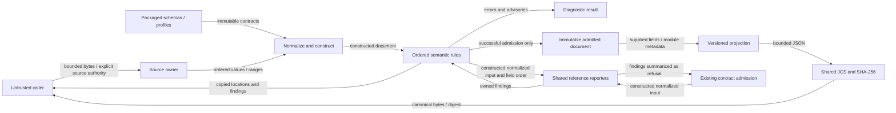
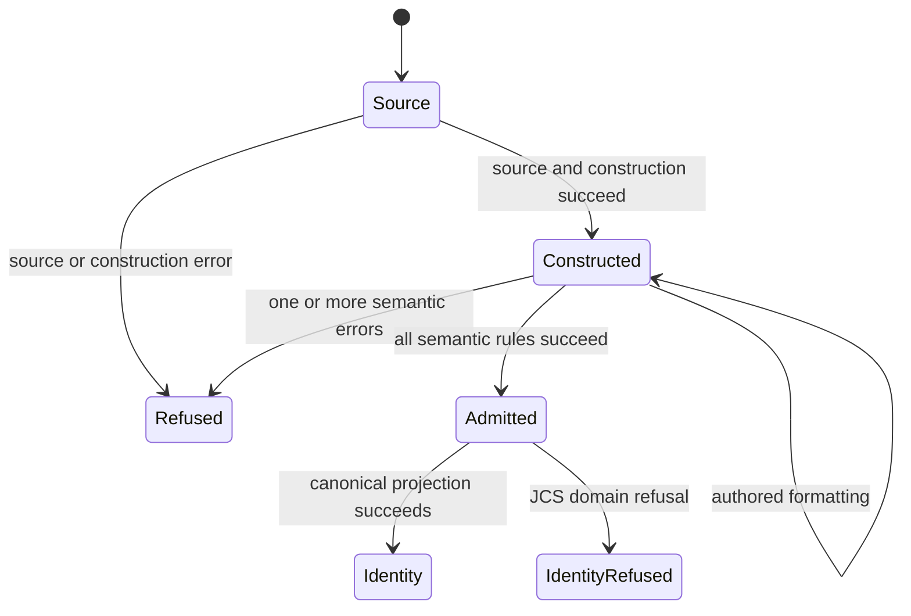

# SDL semantic admission design — issue 1783

## Classification and boundary

Classification: FM3
Required artifacts: typed views, invariants, parity tests, and the state machine below.
Waivers: none.

`internal/sdl/authoring` owns one immutable SDL document and its admission operations.
It already normalizes and builds models. It also owns imports and materialized formatter checks.
Semantic admission extends that owner. It does not create a competing document model.
The package name remains stable for existing callers.
The public API follows the existing #1825 and #1892 design.

`Parser.Validate` accepts only a constructed `Document` and returns a separate, admitted document on success.
It also returns advisories through `contract/diagnostic`.
A refusal returns no admitted document. Its error implements `diagnostic.Error` and retains ordered findings.
`Document.Validated` reports the private phase state.
`Document.CanonicalBytes` and `Document.CanonicalDigest` require successful admission.
Neither a caller field nor a previous digest grants that state.
The zero document cannot pass these operations.

## Document and rule ownership

Keep the normalized supplied fields for output and identity.
Keep source cursors and locations apart from rule facts.
After construction, build private typed views. Use schema-derived bindings and closed variants.
`binding.Field[T]` supplies presence and null distinctions.
Rules use typed fields and reference domains. They do not discover fields through reflection.
Keep free-form JSON opaque unless its contract requires a check.
Defaults used by rules do not alter supplied-field serialization.

Keep constructor predicates in `contract/admission` and published shape checks in `contract/validation`.
The SDL owner checks joins, reference eligibility, and graphs. It also owns semantic advisories.
Change the existing fail-fast checks to shared reporters before full admission uses them.
The formatter consumes the same rule result and preserves its current failure category.
Authored formatting still stops at construction and imports. Materialized formatting still requires semantic validity.
Do not run a predicate and its replacement as separate rules.

`internal/contract/sdlrules` owns the shared stateful-resource, service-content, and participant shared-time reference reporters.
Both admission callers use these reporters.
The caller bounds and constructs its normalized JSON input first.
Each reporter decodes schema-derived bindings. Closed typed views hold the needed runtime fields.
Each reporter returns ordered findings. Separate fields hold the owner section and name.
SDL admission attaches service-content findings after the target checks for that content declaration.
The shared `TemporalBindings` reporter owns participant clock, constraint, dwell, and policy joins.
Both admission callers use its ordered findings.
SDL admission places these findings before participant behavior analysis.
The reporter uses closed typed projections and preserves variable deferral and declaration order.
Malformed projection input returns a fixed invalid-input fault.
Diagnostic string quoting uses the existing Go supplementary Unicode library with Python 3.14's Unicode 16 assignment table.
The helper does not grant admission, perform host reads, or resolve generated values.
This keeps the contract API stable. Each reference predicate still has one owner.

The admission sequence follows the reference's fixed semantic pass order.
Declaration collisions come first. Advisories follow the error passes.
Within a pass, preserve model field order, authored map order, and list order.
Ordered source cursors and normalized field records supply these orders.
Go map iteration cannot determine diagnostic order.
Missing references stop dependent checks only. Independent checks continue.
Reference indexes distinguish declared, targetable, actionable, and authority purposes.
Reuse the existing address and iterative graph owners.

Existing import expansion already constructs the combined value for formatter admission.
Retain that result and its source provenance for semantic admission and canonical projection.
This storage change adds no import or composition behavior.
Preserve both module-variable metadata maps. A namespace change must not erase their canonical identity.
Later composition and instantiation operations must use these same document and rule owners.

The user approved these import prerequisites for issue 1783.
Keep the authored view for formatting and `Document.JSON`.
After existing import checks succeed, retain a separate private expanded snapshot for semantic admission.
That snapshot uses the same document type. It has no separate public admission API.
Keep the bound constructor defaults and empty sections that the reference expansion supplies.
Use existing schema and layout facts to fill defaults with a finite work allowance.
Do not apply the smaller portable runtime limits to authoring expansion.

A private expanded schema view reuses the published authoring definitions.
Its provenance definitions come from the published instantiated schema.
It removes the authoring-only module, imports, and realization fields.
The existing layout recorder supplies expanded field order and provenance carrier facts.
This view grants no new structural or phase authority.
Existing declaration-fragment checks still admit generated qualified keys.

Retain finite-domain constraints before parameter binding removes the variable declarations.
Keep nested parameter identities and qualify their field pointers through the existing symbol map.
The compatibility maps use the reference's private parameter naming rule.
Node mappings include null `os` and `count` entries. Add `architecture` only when constrained.
The runtime value visitor skips classified model fields unless their owner marks them public.
It also skips fields excluded from realization dimensions.
The source layout recorder captures those owner facts; it does not record any input values.

Retain admitted import namespaces and realization records for semantic policy checks.
Keep source ranges and original pointers with imported declaration identities through nested namespaces.
Collect errors against that snapshot and its retained source facts.
Canonical bytes use the expanded serializer view and both compatibility maps.
The authored view and caller-owned source maps remain unchanged.
All retained data is private and bounded. It adds no filesystem or network authority.

Variation validation uses the shared `internal/base/domain` scalar equality and membership rules.
The SDL owner retains the closed target-slot table and selection constraints.
Candidate checks use private bounded model copies and remove variation points from the validation probe.
A probe grants no transformed document, host authority, or execution permission.
The base must be otherwise valid before candidate semantic checks run.
The solver uses a fixed search order. One finite state budget covers the family and all member witnesses.

## Explicitness metadata

The admitted document exposes a copied map through `Document.Explicitness`.
Each `ExplicitnessRecord` holds the model path, class, provenance, reason, and variable names.
The method returns no authored values and grants no realization permission.
The document keeps bounded JSON with all constructed supplied fields. Output omissions apply later.
Canonical identity and `Document.JSON` continue to use the existing serializer view.
The content constructor can add the legacy `service-content` discriminator before it selects a union branch.
That field enters both retained views as supplied. It therefore affects metadata and identity.
Profile-binding fields never receive this service default.

Use the existing layout recorder for the few visitor facts absent from JSON Schema.
Record atomic sequence carriers and actual enum types. Also record model field names behind output aliases.
Keep these facts beside existing scalar and factory-default metadata.
They do not generate model classes or replace the published schemas.
The classifier visits supplied fields in model order. It follows source map order and list index order.
It preserves the reference's atomic-container behavior and value-free variable constraint reasons.
The same schema-guided visitor supplies variable-reference checks. These use model field names, not output aliases.
The DNS record-set extension rule remains a closed typed projection for its exact type-code knowledge.
Returned maps and variable-name slices are independent copies.

## Default-aware portable value limits

`internal/base/value` retains sole ownership of portable value limits.
Add `ValidateProjected(root, limits, project)` to its existing bounded traversal.
The caller explicitly supplies a trusted projection function.
The traversal checks depth and node limits before calling that function.
It checks projected container membership and queued work before visiting children.
The projection produces one shallow JSON view at a time.
Unknown scalar carriers still fail through the existing value checks.
A nil projection fails without visiting input. Projection errors remain explicit.
`Validate` keeps its existing behavior and uses the same traversal.

The SDL owner supplies a private schema-driven projection frame.
It supplies published and checked-in factory defaults at each model.
Children retain their schema frames until the bounded traversal visits them.
It never builds a fully defaulted scenario before checking portable limits.
Defaults do not alter the source document, its serialization, or its canonical identity.
Materialized admission checks scenario content with the runtime snapshot limits.
Descriptor tree admission checks the binding sequence with the default value limits.
The formatter retains its separate construction and semantic boundary.
Neither this helper nor its projection performs host reads or grants execution authority.

## Data flows and trust boundaries

The caller sets source contents and names. It also supplies filesystem read authority.
The caller cannot replace the packaged schema or concept authority.
The source owner enforces input, scalar, depth, alias, node, and composition budgets before dependent work.
Semantic indexes retain bounded input facts. They do not expand aliases or perform host reads.
Supplied-source calls keep their pin, lock, path, and copy rules.
There is no persistent store, network client, credential resolver, or runtime import.

| Threat | Control and boundary | Verification |
| --- | --- | --- |
| Forged admission | Private document state; successful rules create a fresh handle | Zero-value, failed-validation, and caller-copy cases |
| Changed data after admission | Private model storage; copied accessors and findings | Mutation and independent-request cases |
| Hidden semantic errors | Ordered collect-all reporting; dependent checks guard missing facts | Multiple failures in one declaration and across passes |
| Wrong reference authority | Explicit reference purposes and canonical declaration indexes | Missing, ambiguous, ineligible, and qualified references |
| Resource exhaustion | Existing input and work budgets; iterative graphs; bounded canonical input | Boundary cases and CI fuzz targets |
| Secret or host exposure | Inert declarations; shared redaction predicates; value-free error strings and logs | Redaction and no-host-access cases |
| Wrong identity | Presence-preserving projection; shared JCS and digest owners | Exact Python bytes and digest comparisons |

Diagnostic records retain permitted declaration identities and locations.
Operation error strings remain fixed. They do not render raw input, parameter maps, secrets, or wrapped payloads.
Owned findings use their original source range and canonical model pointer.
The shared diagnostic record adds `OriginalPointer` for the original authored path.
Its JSON member is `original_path`. Omit it when empty to preserve existing diagnostic output.
`Pointer` and `Address` retain the canonical location after namespace composition.
Unowned findings do not invent a source location.
Source-stage errors retain their existing envelope, including related ranges.

Residual risks are behavioral omissions, incorrect ordering, and stage confusion.
The reference inventory and differential tests address these risks.
Validation establishes SDL meaning. It grants no execution or backend authority.

## Abstract admission state machine

An advisory cannot take an error transition.
An error cannot take the admitted transition.
Identity refusal does not change the caller's document.
No transition binds variables or admits an instantiated artifact.
The semantic workflow checks keep their existing state and join contracts.
This port changes their implementation language, not their state machine.

## Canonical identity

Use `canonical.py:canonical_sdl_bytes` as the authoring projection reference.
Its envelope contains `profile`, `scenario`, `module_variable_specs`, and `module_node_variable_refs`.
Preserve supplied fields and serializer omissions. Exclude expansion provenance and empty variation points.
Materialized descriptions retain their distinct profile and admission requirements.
Instantiated snapshot admission remains with its delivery owner.
Use `base/canonjson.JCS` and `base/digest.SHA256`, including the `sha256:` prefix.
Reject nonrepresentable integers and nonfinite numbers without truncation or rounding.

## Architecture and policy

Declare changed interfaces and imports in `implementations/architecture.json` before source changes.
Keep dependencies within SDL, contract, and base layers.
Update the current architecture view when declared dependencies change.
ADR-121, ADR-122, ADR-116, and the existing SDL decisions supply the governing rules.
No new ADR, authority catalog, schema, dependency, policy gate, or runtime permission is required.
The existing architecture, policy, lint, regression, mutation, and parity gates remain authoritative.
This issue has no requirement UID. Do not invent one for policy invocation.

## References and document review

- [Effective Go](https://go.dev/doc/effective_go), Go 1.27.3 language context: interfaces, errors, and private state.
- [Google Go best practices](https://google.github.io/styleguide/go/best-practices), current guide: small consumer interfaces and explicit errors.
- [RFC 8785](https://www.rfc-editor.org/rfc/rfc8785), July 2020, section 3.2: canonical primitive encoding and property order.
- Repository baseline `e71ddbc29e9e06658ddbe2b2c12edf8ed424f044`: source, authoring, admission, binding, diagnostic, canonical JSON, digest, graph, and parity owners.
- Unchanged Python reference: `raes/canonical.py`, `validator/_core.py`, `_declaration_sources.py`, `scenario.py`, and the in-scope model and semantic modules.
- Specifications: `specs/sdl/`, particularly diagnostics, references, document phases, and variation points.

Review prose for one fact per sentence, consistent terms, short sentences, and explanation purpose.
Preserve technical names and normative meaning. Vale checks style, not factual accuracy or complete STE conformance.
Trace each issue criterion, input protection, recovery case, and historical defect to its native test.
Compare ordered findings, advisories, locations, canonical bytes, and digests against the unchanged reference.
Run explicit targeted cases locally. CI owns full corpus, race, coverage, mutation, fuzz, and regression suites.

## Corpus admission checks

The existing reference recorder also reads every retained MCP parse input from the parity corpus.
It admits each description independently of the recorded request's semantic-validation option.
This checks the SDL owner without implementing the MCP response layer.
The recorder tracks construction refusals apart from semantic findings.
It records ordered errors, advisories, source locations, explicitness, canonical bytes, and digests.
It uses a temporary empty source directory for each reference input.
The native check uses an empty memory filesystem. It has the same read authority.
Neither input can read the host checkout or use the network.
Both implementations use the recorded migration option.
The native test uses the existing private decode operation for that source option.
Each later semantic check uses the public admission call.
CI supplies the full oracle in a local temporary file.
A named-case option selects local checks.
CI also verifies the focused semantic and selection records against the unchanged reference.
Store focused semantic records in shards below the existing 500 KB hygiene limit.
A manifest records each shard name, case count, and SHA-256 digest.
The native tests verify the manifest and compare every retained case.
This changes fixture storage only. It does not remove cases or change expected results.
Existing source and import checks retain ownership of their boundaries.

## API commitment

The architecture model records the exact intended API below.

<!-- go-api implementations/go/internal/sdl/authoring efe5759ea65e25a8f450ca1eb64143a5a698e77db9a8ff39d4f2af58b1d3b21e -->

<!-- go-api implementations/go/internal/contract/sdlrules 203d0fa66bb8929cda39310b9eab118147c9f94eb47db0111ea09874d4663a80 -->

<!-- go-api implementations/go/internal/base/value 2072bd6fbc3db74189760642ca1f5bb0c32846bc250355d5251cf96e295f23b0 -->
