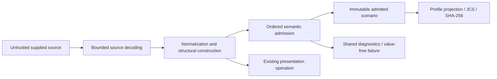

# SDL model and semantic admission preflight — issue 1783

This explanation records architecture guardrails before implementation.
Issue #1783 is the delivery contract; this note adds no SDL semantics or implementation plan.
Inspection baseline: `e71ddbc29e9e06658ddbe2b2c12edf8ed424f044`.

## Boundary and admission

Keep one native typed SDL document model in `rae`, independent of runtime imports.
The published schemas remain authoritative. Generated transport bindings are not a second semantic model.
Use explicit types and closed variants for semantic rules.
Avoid reflection, arbitrary property lookup and a Pydantic-shaped class tree.
Keep absent fields distinct from explicit nulls.
Keep supplied defaults distinct from computed defaults where the reference does.
`contract/binding.Field[T]` already preserves transport presence; do not invent competing transport presence rules.

The existing owners already cover substantial parts of this issue:

| Concern | Canonical incumbent and required boundary |
| --- | --- |
| Source syntax, limits and locations | `internal/sdl/source`: immutable documents, ordered cursors, ranges, copied sources and shared composition budgets |
| Structural normalization and formatter compatibility | `internal/sdl/authoring`: enum/scalar conversion, presentation metadata, model construction, imports and materialized formatter checks |
| Published shape and local predicates | `contract/validation` and `contract/admission`: packaged schemas, `CheckSDLConstruction`, `CheckModelFragment`, `CheckSDLLocalSemantics` |
| Vocabulary and extension authority | `contract/concept`, `contract/profile` and their packaged catalogs; caller documents cannot create trusted authority |
| Consumer operations and diagnostics | `implementations/architecture-api/planned/rae/sdl.go.txt`, public `contract/diagnostic`, and the #1825 API design |
| Shared algorithms and safety | `base/ingress`, `base/canonjson`, `base/digest`; internal base address/pointer, graph, URI, value, scalar-domain and secret-reference helpers |
| Errors and operational records | `base/fault`, internal `base/logrecord`, ADR-116 and ADR-066 |
| Behavioral comparison | `internal/parity`, its runner inventory, and `tools/parity_corpus.py`; retain recorded provenance and expected results |

Reuse these owners through declared APIs. Do not copy their rules into a new validator.
If shared rules need to move, keep one owner.
Keep the same import direction for existing callers.
Contract packages must not import SDL packages. Public consumer signatures must not expose private package types.
The planned `sdl.Scenario` interface is sealed and returns document copies.
It does not require an untyped internal model.

Source success and construction success grant no semantic authority.
Authored formatting stops at construction and import checks; materialized formatting already checks semantics.
Preserve that difference when sharing admission logic.
Instantiation has its own phase gate and later owner.
Direct instantiated-artifact admission also keeps its own gate.
Caller flags and JSON fields cannot grant semantic admission.
Neither can cached results or prior digests.
Mutation must not leave a previously admitted handle valid for changed values.

## Rule ownership and diagnostic completeness

Use `specs/sdl/diagnostics.md` for stage and severity ownership.
Stage 1 implementation remains with source/construction, although #1783 must integrate its results correctly.
Semantic admission checks references across sections, uniqueness, cycles and workflow closure.
It also checks semantic runtime-family constraints.
Binding and unresolved concrete placeholders belong at instantiation. Unbound authored variables are not automatically errors.

There are two existing fail-fast boundaries that cannot supply the complete semantic result unchanged:

- `authoring.checkMaterializedFormat` stops on the first failed pass and uses map-backed checks.
- `validation.checkConstructionInstances` and local semantic admission return the first error.

Retain their predicates. Return ordered findings from each owner before claiming collect-all parity.
An error-only wrapper cannot recover diagnostics discarded by a predicate.
Do not run both an old rule and its replacement, or demote failures to advisories.
Existing construction views deliberately defer pinned semantic schema clauses and root annotations.
Preserve `validation/sdl_construction.go` stage separation; neither bypass full admission nor move those rules into parsing.

The reference `validator/_core.py` records declaration collisions first.
It then runs the fixed `VALIDATION_PASSES` order and collects advisories.
Match the corpus order within each pass, including nested findings.
Keep codes, severity, stage, pointers, addresses, domains and source ranges.
Map iteration, alphabetical rule sorting and parallel append are not diagnostic ordering policies.
Missing references must not panic or prevent unrelated rules from reporting their findings.
Shared typed indexes must keep reference purposes distinct: declared, targetable, actionable and authority.
An existence check alone does not prove a valid target.
Do not parse qualified addresses with ad hoc string splitting.

Use `contract/diagnostic.Error` with standard error wrapping and `base/fault` categories.
Fault codes accept lowercase letters, digits and hyphens; diagnostic codes can contain dots.
Keep these code domains separate. Do not rename published diagnostic codes to fit fault validation.
Source key-conflict diagnostics also carry related ranges; preserve that metadata when adapting results.
The current public diagnostic record has only one range.
If related locations need an API change, declare it in the model before code.

## Security and cross-cutting layers

| Layer crossed | Required control and reuse |
| --- | --- |
| Source and import exposure | Reuse source limits, containment, source-map copying, import pins/locks/trust and aggregate budgets. Never fetch schemas or imports implicitly. |
| Model/configuration shapes | Use packaged schema construction and admission predicates. Validate options and limits before work; reject unknown fields and invalid discriminators. Preserve defaulting and strict-literal exceptions. |
| Enum and variable syntax | Reuse authoring normalization/layout records and schema annotations. Preserve Unicode casing and separator aliases only at eligible fields. Do not lowercase extension identities or accept variables everywhere. |
| Authored security configuration | Reuse admission's environment, command, path, secret and permission predicates. Preserve environment-name restrictions, literal versus `value_from` exclusivity and explicit-redaction enforcement. |
| Semantic security checks | Preserve reference eligibility, scope, flow, participant-control and runtime-family checks. Validation describes permissible SDL meaning; it grants no host credentials or execution authority. |
| Authentication and policy | No new authentication surface. The embedding host retains authentication and runtime policy. Caller configuration and SDL assertions cannot impersonate trusted admission context. |
| Secrets and OS exposure | Secret references remain inert identities. No secret resolution, environment expansion, process launch, shell evaluation, socket opening or credential-bearing argv is needed. Declared paths remain data. |
| Errors and observability | Return machine-readable diagnostics through the shared envelope. Fixed messages and operational records must not echo document values, credentials or wrapped parser payloads. Preserve permitted location metadata. Logs do not replace evidence or audit. |
| Persistence and concurrency | No store or workflow engine is required. Copy outward-facing values; keep request state isolated. Any cache must retain immutable inputs, phase and relevant context without sharing admission authority. |

Check limits before allocating, expanding graphs, walking values, copying and hashing.
Apply them to already-decoded inputs too.
Reuse iterative graph operations where applicable. Do not add arbitrary caps that reject documents accepted by the reference.
Collect-all does not permit unbounded findings or work.
Keep the existing limits and refusal behavior.
Runtime-named declarations can require SDL validation without importing runtime execution code.
The #1784 ownership split must not leave nested security/configuration checks unenforced in the SDL model.

## Canonical identity and extension seams

Use `canonical.py:canonical_sdl_bytes` as the authoring projection reference, then `base/canonjson.JCS` and `base/digest`.
The projection contains the exact SDL profile and the scenario's supplied fields.
It also contains both module-variable metadata maps.
It excludes expansion provenance and omits empty variation points as the reference does.
Keep aliases, serializer omissions, numeric semantics and explicit field presence.
Defaults used for validation must not silently enter the projection.
Sorted Python JSON, formatter YAML and raw source hashes are different identities.
JCS number/domain refusals must become controlled errors, never rounded or truncated successes.
Check canonical bytes as well as digests, including the `sha256:` prefix.
Semantic admission must succeed first.

Keep authored, expanded, instantiated-snapshot and materialized profiles distinct.
Do not let a profile string select a stronger phase or reuse an authoring digest for another artifact.
Use the existing parse options and explicit limits as extension seams.
Keep semantic revision, source context and sealed phase handles explicit too.
Future composition and instantiation must feed the same typed model and rules.
They must retain field presence, module metadata and source locations.
Use explicit phase/context parameters where behavior differs.
Do not add a global mode flag or a plugin rule framework.
Do not expose the entire planned SDL API as placeholder operations in this slice.

## Evidence and implementation gate

Go tests must cover every in-scope input limit, security check, error, recovery and historical defect.
Corpus success alone does not prove that coverage.
Trace these cases to the unchanged Python models, validator, semantics and issue-named tests.
Use existing parity runners and inventories; do not hand-edit expected corpus results or call Python from product Go code.
Local verification selects explicit relevant tests and corpus cases.
Full corpus, race, coverage, mutation, fuzz and regression gates remain in CI under the existing canonical workflow.

Before code, declare exact owners and imports in `implementations/architecture.json`.
Declare exported identifiers and typed interfaces there too.
Bind the owning design and API commitments, then pass `archcheck -design` under ADR-122.
This preflight does not select those package interfaces.
It does not approve the implementation design.
Reuse `.ground-control.yaml`, `.gc/plan-rules.md`, the existing policy tools, Go lint/mutation configurations and canonical verification workflow.
This requirement-free issue must not acquire an invented requirement UID.

## Non-goals

Do not change Python, published schemas, SDL semantics, severity classifications or corpus expectations.
Do not implement source loading again, new import/composition behavior, runtime execution, language services, synthesis or realization envelopes.
Do not add stores, workflow engines or an exception hierarchy.
Do not add duplicate schema catalogs or a universal validation framework.
The runtime split permits necessary ownership and public API work only.
It does not authorize unrelated behavior changes.
