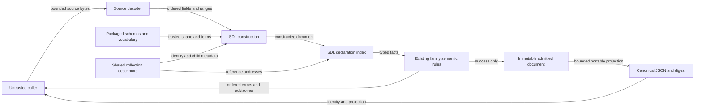

# SDL runtime inventory design — issue 1784

## Ownership and contracts

Classification: FM3.
Required artifacts: typed projections, invariant tests, reference cases, and the existing admission state machine.
Waivers: none.

Runtime inventory remains authored SDL data in `rae`.
The existing construction and semantic owners retain their responsibilities.
The Python reference and published schemas remain unchanged.

`internal/contract/sdlrules` owns one runtime collection descriptor tree.
Move the existing SDL reference tree to this shared owner.
`RuntimeFamilies` returns independent collection trees with identity fields and addressable children.
`RuntimeCollectionIdentity` returns the identity field for a registered collection pointer.
An unknown family or malformed pointer returns an empty string.
Literal collection names and canonical ASCII array indices are required.
This lookup grants no comparison, closure, admission, or execution authority.

`internal/sdl/authoring` consumes this tree for declaration indexing.
`contract/admission` consumes the same tree for family collection identities.
Keep owner-wide and collection-local uniqueness rules distinct.
Nested datastore IDs share one service namespace.
Forwarding agents retain qualified root identities.
Process names, PIDs, package tuples, paths, and native unit names keep their separate rules.
Family predicates remain in their existing family files.

The existing normalizer owns wire shapes, defaults, vocabulary spelling, and scalar conversion.
The shared field-predicate records also enforce numeric bounds during direct construction.
Their recorder reuses the existing scalar-plan analysis.
Optional text checks preserve empty defaults and reject invalid non-empty values.
Family files retain database address, mail address, and permission-mode checks.
Generated types keep supplied and absent fields distinct.
Private semantic projections retain only facts used by their rules.
Do not add a generic policy, provenance, setting, or runtime entity model.

The existing process-selector rules retain their matching behavior.
Keep process-limit projection, identity, and support checks in their existing owners.
Reuse canonical JSON, digest, integer, and finite-domain helpers.
Identity excludes soft and hard values and description.
Projection retains supplied selector facts and reference defaults.
A support claim must admit the resource and scope.
It must also admit every soft and hard value.
No helper grants execution permission.

## Admission and failures

The source owner limits bytes, text, depth, aliases, nodes, and import work.
Construction applies packaged schemas and local predicates once.
Semantic admission collects independent errors in reference order.
A missing target stops only dependent checks.
Advisories stay warnings.
The collector keeps canonical and original pointers.
It also keeps source ranges.
Authored formatting stops at construction.
Materialized formatting requires semantic validity.
Only a successful semantic check creates an admitted document.
The state machine in the issue 1783 design remains unchanged.

## Data flow and security

The caller supplies source values.
It also grants source read access.
The contracts and collection tree are trusted code.
All inventory values are inert.
There is no store or network call.
The code does not run a shell or look up credentials.
It does not expand environment values.

| Threat | Control | Verification |
| --- | --- | --- |
| Registry mutation | Each metadata call returns independent nested slices | Mutation and repeated-call tests |
| Forged collection identity | Check each child and index | Unknown names, escaped names, Unicode, leading zeros, and scalar paths |
| Hidden duplicate identities | Existing scope rules use shared descriptors | Root, sibling, nested, qualified, and composite-key cases |
| Secret disclosure | Existing explicit redaction predicates and fixed operation faults | Withheld values, permitted empty defaults, and posture-only cases |
| Incorrect authority | References remain descriptive; admission state stays private | Deferral, missing references, and phase tests |
| Resource exhaustion | Existing ingress, schema, source, and portable-value budgets | Relevant boundary and recovery cases |
| Identity drift | Use existing canonical encoding and defaults | Compare exact outputs and digests |

Raw command and secret values do not enter logs or operation faults.
Secret-name heuristics remain advisory under ADR-057.
Partial inventories stay partial.
Runtime declarations do not prove execution, observation, or host authorization.
The remaining risks are missing checks and wrong error order.
Reference cases and the behavior list address those risks.

## Architecture and policy

The model declares the changed shared interface before code changes.
Both callers already use `internal/contract/sdlrules`.
No new package, external dependency, import direction, schema, ADR, service, or policy gate is needed.
ADR-121, ADR-122, ADR-116, and the runtime-family decisions govern this change.
Existing CI checks retain their coverage, race, mutation, regression, and parity responsibilities.
The current architecture view binds the changed shared interface.
This issue has no requirement UID.

## Evidence and document review

Baseline: `17bf4515bf12747af69c8598a2fc82d73e9651b9`.
The preflight note inventories existing owners and semantic traps.
The issue 1780 design supplies contract construction.
The issue 1783 design supplies semantic admission, phase state, source locations, and canonical identity.
`specs/sdl/runtime-inventory.md` and the runtime ADR amendments define the family contracts.

Use existing constructor, semantic, and golden-corpus recorders.
Keep expected results independently recorded from unchanged Python.
The acceptance list maps limits and checks to native tests.
It also maps failure recovery and recorded defects.
Full corpus, mutation, coverage, fuzz, race, and integration runs remain in CI.
Local checks select relevant cases and file-local policy.

References read before design:

- [Effective Go](https://go.dev/doc/effective_go), Go 1.27.3 context: interfaces, errors, and value ownership.
- [Google Go best practices](https://google.github.io/styleguide/go/best-practices), accessed 2026-11-09: small interfaces, naming, and tests.

Reviewed for explanation purpose, consistent technical terms, short sentences, and preserved obligations.
Automated style checks do not establish full STE conformance.

## API commitment

<!-- go-api implementations/go/internal/contract/sdlrules 4da86b7df033ccdfb527a31ca85aae45f4f5300a41cbaa24df67374239c6c631 -->
