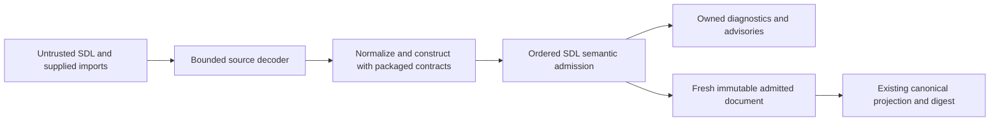

# SDL runtime inventory architecture preflight

Issue #1784 is the delivery contract; there is no requirement UID.
This note sets architecture guardrails.
It is not an implementation plan and does not claim parity.
The inspected baseline is `17bf4515bf12747af69c8598a2fc82d73e9651b9`.
The issue's findings describe an older revision, `036d1af96`.

## Ownership and existing implementation

Runtime inventory is authored SDL data and stays in `rae` under the
[repository split decision](issue-1891-runtime-repository-boundary.md).
It grants no execution, observation, credential, or host access authority.
The [runtime inventory specification](../../specs/sdl/runtime-inventory.md) and published schemas govern meaning.
Apply each ADR with its amendments.
ADR-036 supplies module boundaries.
ADR-041, ADR-054, and ADR-055 do not introduce inventory families.

The current Go code already covers substantial construction and semantic behavior.
Build on the [contract design](issue-1780-contract-validation-design.md) and
[SDL admission design](issue-1783-sdl-semantics-design.md).
Missing behavior belongs with its existing rule owner, rather than in a second inventory validator.
Existing tests do not prove that #1784 is complete.

Paths below are relative to `implementations/go/`, unless stated otherwise.

| Concern | Canonical incumbent and boundary |
| --- | --- |
| Source and imports | `internal/sdl/source` bounds decoding and keeps ordered source ranges. `internal/sdl/authoring` owns normalization and imports. It holds immutable documents. |
| Wire shapes | The root `contracts/schemas/` owns published contracts. `contract/validation` compiles the packaged bundle offline. `contract/binding` supplies generated transport types. `Field[T]` preserves presence. |
| Construction rules | `contract/admission/model_validators.go`, `sdl_fields.go`, and the existing `sdl_*.go` family files own local predicates. `CheckSDLConstruction` visits schema-selected instances. This includes nested fragments. |
| Cross-declaration semantics | `internal/sdl/authoring/semantic_runtime_*.go` owns family joins. It uses `semanticRuntimeCheck` and the ordered semantic collector. `Parser.Validate` grants native semantic admission. |
| Shared reference reporters | `internal/contract/sdlrules` owns stateful-resource and generated-output joins. It also owns service-content and temporal joins. Contract and SDL admission share these reporters. |
| Reference identities | `internal/sdl/authoring/declarations.go:runtimeDeclarationSpecs` owns the Go runtime reference tree. `base/address` owns address syntax. `internal/base/jsonpointer` owns pointer syntax. |
| Vocabulary and profiles | `contract/concept` loads controlled vocabularies. Existing scalar policies normalize core aliases. `contract/profile` and `internal/contract/domainprofile` own typed profile admission. |
| Portable primitives | Reuse `internal/base/value`, `domain`, `softwareversion`, `graph`, `urisafety`, and `timestamp`. `base/canonjson` and `base/digest` own canonical identity. |
| Errors and logs | `base/fault`, `contract/diagnostic`, source diagnostics, and the SDL collector own refusals and locations. `internal/base/logrecord` bounds operational logs under ADR-116. |

Generated transport names preserve contract identity.
Do not copy them into a domain class hierarchy.
Keep private typed family projections limited to facts their rules consume.
Preserve missing, null, empty, false, zero, and explicit-default distinctions where the reference distinguishes them.
Rule defaults must not change supplied-field serialization, explicitness, or canonical identity.
Use existing presentation metadata and its recorder for normalization facts absent from schemas.

## Shared mechanics and family boundaries

Reuse `sdlUniqueKey`, `sdlUniqueLists`, `sdlUniqueCollections`, and `sdlLocalIdentityRule` in `contract/admission`.
Reuse `sdl-field-rules.json` and `sdl_fields.go` for existing field policies.
Shared helpers check identities, walk collections, normalize scalars, and dispatch rules by schema instance.
Keep family-specific predicates in the existing family rule files.
Do not create a universal setting, policy, provenance, kind, or runtime-entity type.

Collection identity is the extension seam.
Each owning rule states its identity field, namespace scope, and composite key.
It also states whether empty values are skipped.
Some families share an owner-wide namespace; others require collection-local uniqueness.
Datastore plugin and endpoint IDs participate in the whole datastore service namespace, including children under different nodes.
Native names, paths, PID selectors, and package tuples must retain their own identity rules.
The next nested child uses the existing reference descriptor tree and traversal.
It needs no new address parser.
That tree does not decide comparison order, closure, or execution eligibility.
Do not create another independently maintained runtime-family registry.
Preserve layer direction: contract code cannot import the SDL registry to reuse it.

Use the existing governed-scope lookup for vocabulary variation.
Core aliases retain their normalization; private `x-<owner>:<term>` identities retain exact spelling.
`unknown`, `other`, absence, and a known private identity have different meanings.
Effects, operators, sensitivity decisions, recurrence kinds, and profile selectors keep their contracts' closed vocabularies.
Do not make all enums extensible or collapse all policy and provenance vocabularies.
DNS `other` with `type_code` retains its existing numeric identity exception.

## Gates across the complete data path

This extends the existing admission flow; it adds no execution or persistence path.

| Layer | Required protection |
| --- | --- |
| Source/parser | Retain UTF-8, byte, scalar, alias, depth, node, and composition-work bounds. Keep duplicate-key checks and supplied-source containment. Input paths never grant read authority. |
| JSON/schema | Keep `base/ingress` before JSON model work. Retain the bounded schema walk. Use packaged references only. Keep unknown-field, union, numeric, and cross-field checks. |
| Construction/config shapes | Normalize through the existing SDL owner. Run local rules at their owning stage. Do not bypass `CheckSDLConstruction` or loosen published schemas. Add no parallel config decoder. |
| Semantic/phase | Reuse ordered declaration indexes and qualified references. Keep imported source provenance and shared reporters. Preserve variable deferral and collect-all errors. Keep advisory severity and dependent-check recovery. |
| Secret handling | Enforce explicit withholding through existing schema clauses and local predicates. Preserve permitted empty defaults. Posture-only records cannot carry raw credentials. |
| Environment/generated values | `sdl_environment.go` owns literal/reference exclusivity. Shared stateful rules resolve output identity and exclude `producer_private`. Generated secret environment values require `redacted`. Env-file names remain portable IDs. File contents remain opaque. |
| OS/network exposure | Commands, cron specifications, paths, pipes, listeners, images, and URIs remain inert data. Run no shell, process probe, environment expansion, DNS lookup, or socket access. Fetch no package or credential. Reuse URI/path predicates. |
| Error envelopes/logging | Keep fixed fault codes and copied `diagnostic.Error` findings. Keep allowed identity text and source ranges. Preserve canonical and original pointers, order, and stage. Never log raw values, commands, secrets, backend responses, or tracebacks. Faults must omit them too. |
| Authentication/authorization | Add no transport, principal, role, token, or auth config. Application grants, secret references, ownership roles, and control paths grant no host permission. Downstream execution keeps its actor/scope/target gates. |
| State and persistence | Keep request-local indexes and immutable parser metadata. Copy values at document accessors. Return fresh admitted handles. Add no database, repository service, caller-value cache, store adapter, audit stream, or worker workflow. |

The existing log handler bounds and escapes records; it does not make arbitrary payload strings safe to log.
The library must not configure global logging or emit per-field inventory values.
Operational logs are separate from evidence and audit.
Logical operator secret references reuse `internal/base/secretref` only where that grammar applies.
Do not apply that grammar to every credential posture field or generated-artifact reference.

Construction is not semantic admission.
Keep #1783's formatting boundaries.
Authored formatting requires construction; materialized formatting requires semantic admission too.
Portable contract checks do not grant native phase admission.
Retain the `SDLPhaseOwner` commitment checks.
Do not relax finite work limits or apply snapshot ceilings to all authoring input.
Reuse existing default-aware portable-value checks where the phase requires them.
Reuse the existing byte-quantity, integer, boolean, timestamp, and port parsers.
Keep their exact coercions and bounds.
The product schema matcher is `contract/validation/sdl_pattern_engine.go`.
Do not use the tooling governance matcher here.
It has a separate Go-pattern contract.

## Semantic traps to preserve

- ADR-057 supersedes ADR-056's name-driven omission rules. A secret-shaped name can produce an advisory. It cannot cause structural rejection or silent value removal.
- Partial inventories remain partial. A product identity does not require a completeness threshold or operational profile. This applies to engines, platforms, forwarding agents, orchestration, and app authorization.
- Keep identity models distinct. Scenario accounts are not local OS users. Directory subjects, app principals, database roles, and participants also have separate owners.
- Image build provenance and image defaults describe the artifact. Runtime effective state belongs elsewhere. Keep delivery metadata and capture evidence with their owners under ADR-023 and ADR-033.
- Service declarations, process listeners, published host ports, and datastore topology endpoints describe different facts. Keep their explicit joins. Infer no exposure or readiness.
- Service-manager `unit_id` is portable identity. `unit_name` is native data. Only an explicit systemd manager selects systemd state rules.
- Scheduled jobs carry cadence and run state. Keep service lifecycle with service units. Keep inputs and outputs with forwarders. Add no event triggers or dispatch logic.
- Node-scoped and scenario-scoped forwarding agents share rules. Their positions stay distinct. A detection source's `generated_by` must resolve to exactly one declared agent.
- Detection definitions, DNS records, mail rules, SSH commands, and seccomp options are typed inventory facts. Add no interpreters or provider config dumps.
- Software components and exact package requirements keep their existing joins. So do shared repository state and trust bindings. Acquisition refinements retain bounded profile checks. A URI or profile does not authorize acquisition.
- Filesystem presence, digest/algorithm pairing, command redaction, mounts, and named-pipe rules stay with each surface. Do not broaden a path rule across unrelated fields.
- Process identity is a selector. It does not own capability policy. Process-limit identity excludes soft/hard values. Keep process limits' own variable and stable-selector rules.

The Python scope includes ordinary helper behavior as well as decorated validators.
For example, `runtime_inventory.py` defines collection-pointer lookup and
`runtime_resource_limits.py` defines projections, identity digests, matching, and capability-domain checks.
Constructor verdicts alone cannot establish parity for these functions.
Reuse their existing Go primitive owners; declare any necessary callable seam before coding.

## Architecture and evidence boundaries

No new ADR, schema, package, external dependency, or exported API is required by this preflight.
`implementations/architecture.json` remains the sole Go architecture model.
This guidance changes no model declaration or source-bound architecture evidence.
The implementation design must declare changed packages, imports, and APIs before coding.
It must then pass `archcheck -design` under ADR-122.
Review private-only changes against the existing owners too.
A passing model does not prove behavioral coverage.
The planned public SDL consumer API does not make `internal/sdl/authoring` externally importable.
Do not add a competing public inventory facade or move packages to evade that boundary.

Reuse the existing evidence paths, rather than creating a second parity framework:

- `internal/parity` and the #1778 corpus retain exposed-surface results, inventory, digests, and regression provenance.
- `contract/admission/sdl_constructors_test.go`, field tests, and retained local-model inputs cover distinct construction and portable-contract boundaries.
- `internal/sdl/authoring/semantic_*test.go` and import/format tests cover ordered diagnostics, source locations, deferral, canonical identity, and phase differences.
- Repository-root `tools/parity_authoring_layout.py`, `parity_sdl_field_rules.py`, `parity_sdl_constructors.py`, and `parity_authoring_vectors.py` are the existing reference recorders. Product Go must never call Python.

Each scoped Python input limit and security check needs a Go test.
Cover every error, recovery path, and issue-named defect in scope.
Trace tests by behavior.
Test filenames alone do not define scope.
Relevant defect sources include #847, #1043, #1066, #1074, #1078, #1206, and #1759; this list is not exhaustive.
Also retain the cross-family invariants in `test_runtime_family_invariants.py` and redaction cases in `test_runtime_observed_values.py`.
Do not copy Python class-name conventions into Go drift tests.
Do not delete fixtures, rewrite expected failures, or weaken checks to manufacture parity.
Pin the reference revision and retain independent expected results.

The canonical workflow is `.github/workflows/canonical-verification.yml`.
Keep ADR-121's lint, architecture, coverage, mutation, race, regression, and parity gates.
Local checks select explicit cases or existing file-scoped checks; full suites remain in CI.
Use `.ground-control.yaml` and `.gc/plan-rules.md` for the integration branch and workflow commands.
This requirement-free issue does not justify inventing a requirement UID.

## Non-goals

Do not change Python, published schemas, SDL meaning, or exposed machine-readable behavior.
Do not implement capture, provisioning, acquisition, secret realization, schedule execution, or reconciliation here.
Do not move authored inventory to the runtime repository or broaden the repository split.
Add no new controller, service, or store.
Do not duplicate error types, validation frameworks, or workflows.
The preflight leaves implementation and its behavior-completeness evidence to #1784.
