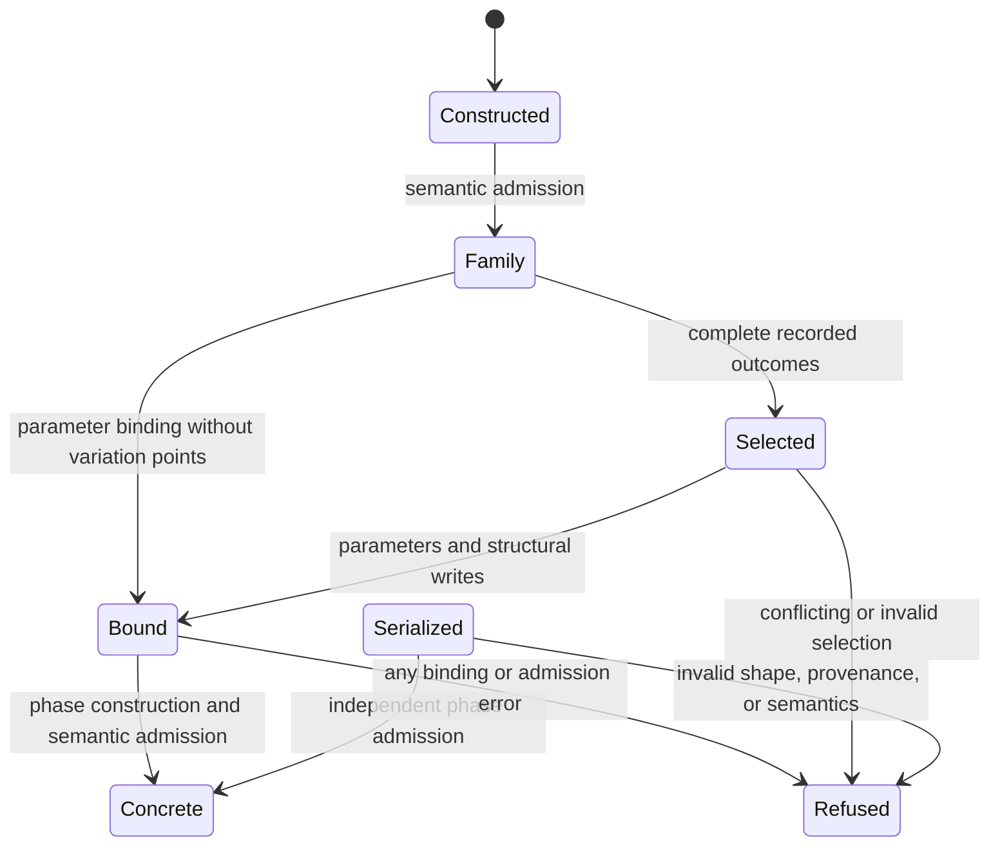
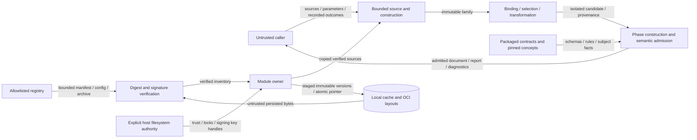

# SDL operation design — issue 1785

## Boundary and ownership

Classification: FM3.
Required artifacts: phase invariants, typed interfaces, differential tests, and the state diagram below.
Waivers: none.

`internal/sdl/authoring` retains the immutable document and its existing construction, composition, and semantic rules.
The same owner binds parameters, selects variants, and changes declarations.
They reuse its declaration index and reference rules.
They keep field order and provenance.
There is no second document model or semantic validator.

`sdl/module` owns registry policy, signed modules, lock records, archive inspection, cache recovery, and local OCI publication.
Composition consumes copied, verified source bytes from this owner.
The module owner decodes sources and checks contracts.
It does not import the authoring package.
The existing public module declarations remain the consumer contract.
Callers grant registry access.
That grant includes policy, transport, and cache access.
The `Admitter` callback runs after the native checks.
The `TrustPolicy` alias preserves the planned API name.
It can only narrow policy.
`NewRegistry` receives the cache directory and both policies.
The second policy is optional.
`Registry.Verify` checks supplied OCI bytes; `Registry.Resolve` acquires only allowlisted modules.
`Registry.Publish` receives its source filesystem, output directory, and signing bytes explicitly.
It requires the existing authoring owner through `PublicationAdmitter`.
`Parser.AdmitModuleSources` checks source construction and composition without semantic execution.
It returns the canonical entrypoint and a copied local source snapshot.
The publisher packages those exact checked bytes.
It does not reopen source paths.
The module publisher does not implement another composition validator.
`DecodeLockfile` is the shared strict lock decoder.
Lock resolution validates only the root import declarations.
An optional `SourceAdmitter` checks each complete imported source.
It uses the native constructor.
`Parser.AdmitModuleSource` supplies this port.
It keeps the hashed bytes and does not expand imports.
Without this port, direct module callers supply normalized source values.
The contract owner checks them.
The module and semantic command adapters always supply the native source owner.
`Registry.ResolveLocked` verifies the exact locked manifest and retains all other integrity checks.
The bundle returns copied sources, the root identity, and checked lock facts.
`DecodePolicy` retains the existing bounded SafeLoader-compatible trust parsing.
Move the existing workspace reader and PEP version code to this owner.
The authoring package delegates to them instead of keeping copies.

The parity package adapts existing command cases to these operations.
It does not implement their semantics or launch Python.
`Document.ReferenceBindings` reads the admitted declaration index.
It returns a sorted copy of the alias sets.
The read-only semantic command uses these sets.
It does not build another index.
`DecodeContext` and `FormatContext` pass the caller context through each call.
This reaches registry requests and locks.
The existing `Decode` and `Format` methods use a background context.
Methods receive the context as a parameter.
Requests and documents do not store it.
The Python implementation and published schemas remain unchanged.
The runtime repository split changes no processing behavior.

## Concrete construction and admission

`Parser.Instantiate` accepts a constructed authoring document, parameters, and an optional profile.
It runs semantic admission before binding.
Binding collects required, type, allowed-value, and undeclared-parameter errors in reference order.
A whole-field binding keeps its type.
Text bindings use Python's scalar form.
It leaves mapping keys and pinned control-context assets unchanged.
It makes one substitution pass.
It bounds copies before it allocates their output.

The operation fills constructor defaults through the existing schema-guided visitor.
It preserves omitted listener protocols.
It records binding origins before it removes variables.
It also records constraints, derivations, explicitness, and realization intent.
Imported records retain their namespaces and original locations.
The concrete payload has no authoring-only declarations or unresolved tokens.
The owner constructs and checks the whole concrete payload again.
Success returns a fresh sealed handle.

`Parser.AdmitInstantiated` checks supplied bytes.
It does not trust claims from their producer.
It checks the published phase shape and concrete-token exclusion.
It checks binding identities and semantic rules.
It checks that constraints and derivations match the output.
A caller field cannot set private admission state.
Snapshot admission retains its own envelope and digest projection.
Materialized descriptions retain their separate contract and phase.

`Parser.AdmitFamily` derives an expanded family from a sealed authoring document.
It keeps imported facts.
It uses the existing bounded default and composition visitors.
It grants no admission to arbitrary serialized expanded objects.

`Parser.Select` consumes a complete recorded outcome for every admitted variation point.
It uses closed outcome variants and the existing domain and reference owners.
It checks sizes, order, precedence, fixed positions, and cross-point relations.
These checks run before any writes.
All writes resolve against the unchanged family.
Equal writes may coincide; conflicting, ancestor, or absent-owner writes fail.
Structural selection keeps row content and source order.
It moves or removes provenance with the selected rows.
It then instantiates the result.
Selection never generates backend secrets or infers an outcome.

## Module integrity and persistence

The module owner uses Go's standard library.
This supplies Ed25519, SHA-256, gzip decoding, tar, HTTP, and rooted file access.
The publisher keeps Python tar headers.
A bounded adapter wraps the standard tar writer.
The standard Go compressor failed the exact compressed-byte vector.
For this byte profile, use `github.com/autonubil/go-wazuh/pkg/zlib` v1.4.0.
Its raw deflate encoder matched the Python fixture in a separate probe.
The package has no runtime imports beyond the standard library.
Only the encoder receives the bounded local input for publication.
The received-archive path retains standard-library decoding.
The module pin is commit `52a4472cf366abd2408ca6f146e8578d54780a05`.
Its module checksum is `h1:YgVmxlAAvzjbEsShinkyq9R71aV0aQhC8Wn2NVDFekk=`.
The upstream license is Apache-2.0; normal dependency provenance and distribution checks apply.
One payload builder serves signing and verification.
It uses `base/canonjson.Sorted` with ASCII escaping and no newline.
The signed fields are `module_id`, `module_version`, `exports`, `content_digest`, and `root_file`.
Export hashes use the same sorted profile.
Each manifest, config, bundle, local source, and cache identity hashes its own exact bytes.
Scenario identity continues to use its separate JCS projection.

An explicit registry allowlist precedes requests.
The client bounds reads and request time.
Redirects must stay within the approved authority.
Config bytes must match the manifest before decoding.
Bundle bytes must match the layer digest before archive inspection.
Verification binds the exact root entrypoint and trusted signer.
Locks cannot supply missing trust or bypass version, export, module, or digest checks.
Lock resolution checks requested parameter names against the verified descriptor
before it returns a record.

The archive reader builds an inventory.
It does not extract content.
It bounds compressed bytes and expanded stream bytes.
Separate limits cover member count, member size, total size, ratio, and path depth.
It rejects links, devices, traversal, duplicate paths, path conflicts, and reserved metadata.
It checks actual member sizes against their headers.
Verified source capture copies the reachable SDL graph.
The existing composition limits apply.
Publication admits only explicit local imports.
It refuses lock aliases even when the workspace can resolve them.
The published graph needs no workspace lock.

Persistent cache and layout operations use explicit host directories.
They check file identity and safe modes.
They retain no-follow checks, bounded locks, staging, immutable versions, and atomic pointers.
Recovery validates orphaned versions before publication.
Cache checks compare the whole tree with the verified archive inventory.
It never trusts a local manifest as independent evidence.
Composition uses the captured bytes after it releases the lock.
It does not reopen cache paths.
Publication writes the established local OCI layout.
It does not push to a remote service.
Callers supply signing key bytes in memory.
The keys never enter commands, logs, or diagnostics.

## Transformations and migration

Transformations take admitted documents.
Targets must be exact canonical declaration addresses.
Rename uses the existing reference ownership tables and namespace rewrite operations.
It preserves explicit field presence and verifies the reverse canonical identity.
Removal requires the exact authorized loss kind and refuses dangling references.
Both operations reconcile current provenance model paths and field pointers.
They share path reconciliation with selection.
Removal drops records for the removed declaration.
Historical import identities remain unchanged.
The owner retargets linked concept documents.
It checks them against exact subjects and pinned scheme snapshots.
Each operation returns an admitted document and a separate JSON result envelope.
The envelope contains the published report and any transformed binding documents.
A refusal returns the report without a document or partial linked output.
Reports retain the published operation, policy, derivation, preservation, and digest profiles.
Publication corpus comparisons validate the complete immutable layout coordinate and its matching index path.
They omit only the independent random nonce of that directory.
All publication digests and other publication output values remain exact.

Syntax migration remains with the formatter.
Semantic migration requires source-bound author decisions and the published migration context.
Typed sentinel fields remain distinct from arbitrary strings.
Decisions apply to original positions before list removals.
Imports require independent migration.
Classification, participant, and mixed-control migration use separate profiles.
Each keeps its own required decisions.
`Migrate` accepts a closed operation envelope with `operation_profile` and `context`.
Progressive migration also accepts its published author context directly.
Its extended context contains `author`, linked `bindings`, and local `snapshots`.
Classification context contains `bindings`, `existing`, `snapshots`, and the loss `policy`.
Participant context retains the source digest and exact objective decisions.
Mixed-control conversion has no author context.
Success does not prove equal behavior across versions.

## Data flow and security

| Threat and boundary | Control | Verification |
| --- | --- | --- |
| Forged concrete admission | Private handles; independent phase and provenance checks | Forged flag, changed payload, unresolved token, and failed-semantic cases |
| Substitution or selection changes authority | Exact targets; inert secret references; pinned assets; complete readmission | Environment, command, permissions, reference, and structural conflict cases |
| Resource exhaustion | Existing aggregate budgets and separate archive ceilings, charged before dependent work | Each threshold, malformed archive, and bounded-copy case |
| Registry or cache tampering | Independent signed payload, exact digests, authenticated inventory, contained descriptor reads | Python-signed vectors, changed entrypoint, altered tree, symlink, and mode cases |
| Concurrent or interrupted publication | Locks, immutable stages, validated recovery, atomic pointer replacement | Concurrent readers, interrupted writes, orphan recovery, and stale-pointer cases |
| Lost meaning or linked evidence | Owning reference tables, provenance reconciliation, exact binding admission | Qualified imports, dependent selection, rename reversal, and linked-document cases |
| Information disclosure | Value-free fault strings; owned diagnostic metadata; no payload logging | Sentinel secrets and parser, OS, HTTP, and signing failure cases |

The operations grant no execution, materialization, network discovery, or backend authority.
Risks remain in missed cases, diagnostic order, and phase boundaries.
Reference vectors and the existing CI gates check these risks.

## Architecture and verification

Declare each changed interface and dependency in `implementations/architecture.json` before its implementation.
Bind exact API commitments to this design and review the generated architecture view.
Keep SDL dependencies within the SDL, contract, and base layers.
Reuse the existing policy, standards, corpus, regression, coverage, and scheduled mutation gates.
No new policy gate, schema, requirement UID, or service is required.
Publication uses the pinned pure Go zlib encoder described above.
The [verification index](issue-1785-sdl-operations-verification.md) maps issue criteria to code and tests.
Local checks select specific operation cases and changed documents.
CI owns full corpus, race, coverage, mutation, fuzz, and regression runs.

## Sources and document review

Repository baseline: `17bf4515bf12747af69c8598a2fc82d73e9651b9`.
The behavioral sources are the issue's Python operation owners and their CLI adapters.
The published SDL schemas and specifications supply the normative rules.
ADR-053, ADR-084, ADR-105, and ADR-119 also apply.
ADR-121 and ADR-122 own Go standards and architecture checks.
The operation-specific [preflight](issue-1785-sdl-operations-preflight.md) supplies the binding guardrails.

- [Effective Go](https://go.dev/doc/effective_go), Go 1.27.3: private state, errors, and interfaces.
- [Google Go best practices](https://google.github.io/styleguide/go/best-practices), current reference: small interfaces and explicit dependencies.
- [Ed25519](https://pkg.go.dev/crypto/ed25519), Go 1.27.3: standard signing and verification.
- [Archive reader](https://pkg.go.dev/archive/tar), Go 1.27.3: sequential bounded inspection without extraction.

- [Zlib-compatible encoder](https://pkg.go.dev/github.com/autonubil/go-wazuh/pkg/zlib), v1.4.0: exact raw deflate with the established parameters.

This document explains the operation design; the issue plan owns implementation tasks.
Review keeps technical terms, quantities, and normative meaning.
Each sentence states one fact.
The repository guide supplies sentence and paragraph limits.
The official STE website returned HTTP 403 during reference access.
No dictionary-conformance claim follows from the prose review or Vale checks.

<!-- go-api implementations/go/internal/sdl/authoring 2ea8f0d84a88a2aef7c2024a87f0bb84eade8c99c6a3502f340bc05cf15774d4 -->

<!-- go-api implementations/go/sdl/module 311915e9a23375f03f7fdeda63240de76bcd6209e3227983cacd4e2e0824b31b -->
