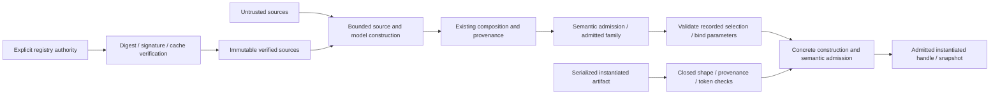

# SDL operations architecture preflight — issue 1785

This note records guardrails. It is not a plan or an approved package design.
Issue #1785 is the delivery contract. It has no formal requirement UID.
Inspection baseline: `17bf4515bf12747af69c8598a2fc82d73e9651b9`.
The issue's `036d1af96` findings describe an older tree. The owners below describe this checkout.

## Ownership and reuse

Keep these operations in `rae`, as the [runtime split](issue-1891-runtime-repository-boundary.md) requires.
Runtime consumes admitted results through public module APIs. It does not compose, instantiate or transform them again.
The [SDL admission preflight](issue-1783-sdl-semantics-preflight.md) records shared rules for checks and identity.
This note adds boundaries for these operations.

| Concern | Canonical incumbent and boundary |
| --- | --- |
| Source parsing and work limits | `internal/sdl/source` owns copied sources and ordered syntax. It owns source ranges, positive limits and request-local `Budget`. |
| Model and composition | `internal/sdl/authoring` owns `Parser` and immutable `Document`. It expands imports and rewrites references. It owns locks, workspace policy and retained provenance. |
| Semantic admission | Reuse `authoring.Parser.Validate`, its typed views and ordered collector. Reuse constructor predicates in `contract/admission`. |
| Portable phase admission | Implement the native `contract/admission.SDLPhaseOwner` seam. Its existing gate binds exact source bytes, contract ID and the admitted projection. |
| Published shapes | Use `contracts/schemas/`, packaged `contract/validation` and generated `contract/binding`. `Field[T]` keeps absent, null and supplied values distinct. |
| Vocabulary and linked bindings | Reuse `contract/concept`, `contract/profile`, explicit admission context and pinned scheme snapshots. |
| Identity and algorithms | Reuse public `base/canonjson`, `base/digest` and `base/ingress`. Reuse internal base address, JSON Pointer, graph, version, random-stream and secret-reference owners. |
| Errors and logs | Reuse `base/fault`, `contract/diagnostic.Error` and internal `base/logrecord`. Follow ADR-066 and ADR-116. |
| Consumer and command boundaries | Follow the [public API design](issue-1825-public-go-api.md). Typed declarations are in `implementations/architecture-api/planned/rae/sdl.go.txt` and `sdl/module.go.txt`. |
| Checks | Reuse `internal/parity`, its inventories, `tools/parity_surfaces.py` and `tools/parity_regressions.py`. Keep the canonical CI workflow. |

Local composition already exists. Extend its owner instead of adding another expander behind the public facade.
Keep registry transport, verification and cache ownership together. Composition consumes verified source bytes and descriptor facts.
Contract packages must not import SDL. SDL must not import runtime, backend execution, adapters or tooling.
Generated transport records do not grant semantic admission. Output layout data is not a second schema.
Use typed domain views and closed variants. Do not build a generic rule engine over maps.

## Phase and identity boundaries

Keep authored, expanded, selected, instantiated, snapshot and materialized values distinct.
Materialized descriptions are not authored inputs. Instantiation does not acquire or realize resources.
Preserve recursive partial-description meaning under ADR-105. Absence must not become an inferred capability or execution promise.
Each changed value needs fresh admission. A copied validation flag cannot grant it.
Nor can a prior digest or caller-supplied provenance.
Caller data must not set the private `Document.validated` state.
Check the full instantiated payload. A producer's claim that it passed does not replace this gate.
`SDLPhaseOwner` already connects portable contracts to their native SDL owner without a reverse import.
Keep its source commitment, copied request bytes and exact projection check.
An echo callback or a schema-only success cannot supply native phase admission.

Rebuild the concrete model and reuse semantic rules.
These include nested environment, command, secret and permission checks.
Collect every error within the applicable pass, in reference order, under `specs/sdl/diagnostics.md`.
Preserve the difference between instantiation failures and semantic failures during direct artifact admission.
An error-only wrapper cannot recover findings lost by a fail-fast check.
Never run both old and new checks to claim a complete result.

Binding preserves whole-field types. Match the reference's embedded-string conversion, including Boolean and number behavior.
Do not substitute mapping keys or pinned control-context assets.
Keep required/default/undeclared handling and bounded derivations.
Keep binding origins, explicitness and capability constraints.
Binding and structural edits must retain imported identities and source ranges.
They must also retain declaration order and provenance.
Composition must preserve export visibility, private names, collision refusals and every reference family. Textual search-and-replace cannot do this.

Selection applies recorded outcomes against the unchanged admitted family. Check complete coverage and valid target/domain identities.
Reuse existing family satisfiability checks. They do not themselves produce a recorded selection.
Keep ordering and conflict checks from `selected_scenario.py` and `selected_structure.py`.
Keep their rules for reconciling provenance.
Where stream draws apply, use existing profiles and address grammar. Preserve exhaustion behavior.
`random_value.py` describes backend-generated unpredictable values. It does not authorize generating secrets during deterministic SDL selection.

Use the owning projection before serialization. Keep these byte identities separate:

- Scenario and snapshot identities use their existing versioned projections, JCS and SHA-256.
- Module signatures bind exactly `module_id`, `module_version`, `exports`, `content_digest` and `root_file`.
  Reuse `base/canonjson.Sorted` with ASCII escaping for the Python sorted-JSON payload, without a newline.
- Export hashes use that sorted-JSON profile. Raw local source, OCI manifest/config and bundle digests hash their exact bytes.
- Cache inventory hashing includes the reference's trailing newline. Lockfile presentation is a separate indented format.

Use one signer-payload builder for publishing and verification. Use standard-library Ed25519.
Do not replace signed or pinned bytes with JCS or `json.Marshal` output.
Nor may YAML output or normalized source bytes replace them.
Do not merge manifest, content, export, semantic and cache-tree digests into one identity.
Test Unicode exports and entrypoint changes. Test altered bytes and malformed signatures as well as valid modules.

## Security, configuration and persistence boundaries

| Layer crossed | Required design control |
| --- | --- |
| Authentication and network authority | No new auth service. Check the registry allowlist and signer policy before I/O. Default policy grants no network access. A payload or lock record cannot create verified facts. |
| Source and composition limits | Reuse all eleven source controls and one shared request budget. Defaults retain 256 imports, depth 32 and 32 MiB composed bytes. Charge before expansion, copying and traversal. Imports must not reset counters. |
| Workspace configuration | Reuse `authoring` workspace parsing and lock checks. Keep closed keys, defaults and version checks. Keep SafeLoader-compatible trust-file scalars. Trust YAML is not SDL YAML. Lock JSON uses bounded ingress and depth 8. Reject duplicate members. |
| Supplied-source authority | ADR-119 requires local-only imports and exact lowercase SHA-256 pins. Require one matching lock beside each importer. Do not read workspace trust, fetch a registry or fall back to host files. Missing supplied files must fail. |
| Registry response admission | Preserve timeout, capped streaming reads and error precedence from `module_registry`. Content-Length is advisory. Verify config bytes against the manifest before JSON decoding. Verify bundle bytes before archive use. Verify the exact signed root before use. Retain locked-source cycles, version selection and every digest comparison. |
| Archive admission | Inventory without extraction. Keep `_OCIResourceLimits` bounds on compressed bytes and the expanded stream. Keep member size/count, total-byte, ratio and depth limits. Reject links, devices and traversal. Reject noncanonical paths, duplicate/conflicting entries and reserved metadata. Check declared versus actual member size. |
| Filesystem and cache | Preserve no-follow opens and descriptor identity/mode checks from `_filesystem.py` and `_cache_integrity.py`. Keep contained paths and platform behavior. A clean path or `fs.FS` alone does not prove these properties. Authenticate the complete inventory against verified bundle bytes. Checking a local manifest against itself is insufficient. |
| Concurrency and recovery | Reuse `_cache.py`, `_filesystem.py` and `publishing.py` behavior. Preserve bounded thread/process locks, staging, atomic version/pointer publication and valid orphan recovery. Capture the reachable verified SDL graph while locked. Compose those immutable bytes after unlock. Never reopen mutable cache paths as trusted sources. |
| Secret and environment shapes | Reuse `contract/admission` rules after substitution and transformation. These cover environment, `value`/`value_from`, command, path and explicit redaction. Logical secret references remain inert. Do not expand the host environment or resolve secrets here. |
| Signing and OS exposure | Preserve paired signer ID/private-key options and Ed25519 PEM admission. Read key material through the authorized host boundary. Never pass key bytes in argv, environment, diagnostics or logs. Use Go libraries, without shell, subprocess or external signing service. |
| Error envelopes and logs | Reuse fault categories and structured diagnostics through standard error traversal. Fault codes and dotted diagnostic codes have different grammars. Preserve stage, severity, pointer, source and ranges. Sanitize wrapped OS/parser/HTTP errors. Operational logs contain no payloads or keys and do not replace provenance or audit. |

The reference inventories archives without extraction, then separately materializes a verified cache tree.
Keep cache publication, containment and recovery checks.
Verification-only inventory must not create files. Publishing creates the existing local OCI layout; it does not imply a remote registry push.
The module owner writes locks, caches and layouts. It does not use runtime stores or workflow engines.
Keep filesystem and HTTP access explicit and replaceable for tests. Library calls must not discover ambient authority.
Review redirect, proxy and TLS behavior when selecting Go HTTP transport. Do not silently widen the approved registry boundary.

## Transformations, migration and extension seams

Transformations remain pure and deterministic. Return an admitted output and linked artifacts or an atomic refusal report.
Reuse `artifact-transformation-report-v1` and its admission rules.
Keep sorted report fields and explicit loss authorization.
Rename/remove operations use canonical addresses and reference ownership. Do not replace strings recursively.
Re-admit changed linked concept bindings before reporting success.
Use exact subjects and pinned snapshots.
Keep source, policy, derivation and target digests under their named profiles.
No partial output, stale binding, or target digest may accompany a refused transformation.

Keep formatter syntax migration separate from author-authorized semantic revision adoption.
Preserve the source-bound `sdl-semantic-migration-context-v1`.
Keep explicit sentinel decisions and current-target admission.
Keep the refusal that requires migrating imported modules on their own.
Classification, participant and mixed-control migration retain their existing owners.
Formatting or conversion cannot imply authorization or cross-version semantic equivalence.

The existing seams are source context, positive limits, semantic revision, explicit phase handles and registry trust policy.
Keep OCI resource limits in the resolver policy boundary, separate from SDL document limits.
A future source kind or operator limit belongs at this seam.
It should not need separate edits in parser, compiler, runtime and CLI.
Inject transport/cache access at the registry owner. Do not create a universal provider framework or global mode flag.

Two planned API gaps require resolution in the implementation design:

- `module.TrustPolicy.AdmitModule` receives verification facts after resolution.
  It cannot alone supply pre-fetch registry rules, signer keys, transport authority or cache access.
  Declare that capability boundary explicitly, preserving the public policy callback and fail-closed defaults.
- Planned `AdmitInstantiated(Scenario)` accepts a sealed scenario, while the issue also requires serialized-payload admission.
  Declare how bytes/generated bindings reach that gate through the existing `SDLPhaseOwner` boundary.
  Keep snapshots and materialized profiles distinct.
  Do not invent a public Boolean, untyped bypass or alternate schema to bridge the gap.

## Evidence, gate and non-goals

Before code, record exact package owners, imports, exported identifiers and typed APIs in `implementations/architecture.json`.
Bind the owning design/API commitments and pass `archcheck -design` under ADR-122.
This preflight does not change the model or claim that the forthcoming design has passed.
Review `docs/develop/go-architecture.md` with its existing source/view commitments when that design changes them.
Reuse `.ground-control.yaml`, `.gc/plan-rules.md`, `implementations/.golangci.yml`, `implementations/.gremlins.yaml` and `.github/workflows/canonical-verification.yml`.
Use the existing requirement-free workflow; do not invent a formal requirement UID.

The behavior reference includes the issue's Python modules and delegated operation owners.
It includes `raes_cli/sdl.py` and `raes_cli/semantic.py`.
Cover import safety and instantiated admission flags in regression tests.
Cover structural/dependent variation, transformations, semantic migration and linked binding preservation.
Map every in-scope Python limit, security check, failure, recovery and issue-named defect to a Go test.
The corpus inventories retain test origins. Passing available runners does not prove unimplemented surfaces or unmapped defects.
Compare exact command envelopes, diagnostics and output files through existing runners.
Do not rewrite golden expectations or invoke Python from Go product code.
Local checks select relevant cases. Full corpus, race, coverage, mutation, fuzz and regression suites remain in CI.

No Python implementation, published schema, golden expectation, SDL meaning or trust default changes belong in this issue.
No new service, runtime workflow/store, secret generator, remote publisher, second CLI dispatcher or duplicate validation/error hierarchy is needed.
The runtime split permits necessary ownership/API work only; it does not authorize semantic improvements or unrelated cleanup.
