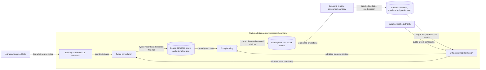
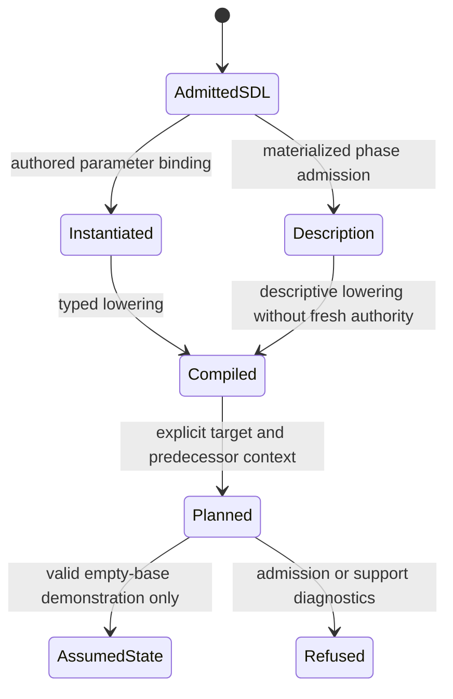
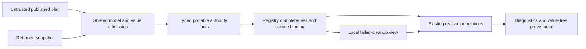
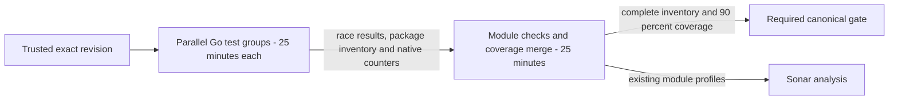

# Processor compilation and planning design

Classification: FM3.
Required records: typed rules, graphs, tests against the reference, and the diagrams below.
Waivers: none.
The source follows the declarations and invariants below.

## Ownership and API design

The processor port adds compatible entry points to the public Go declarations.
The [public API design](issue-1825-public-go-api.md) requires ports to follow those declarations.
It does not authorize replacement consumer APIs.
The [preflight](issue-1787-processor-semantics-preflight.md) identifies the missing inputs and typed access.

Keep all declared entry points and published contracts.
Add the missing inputs and native typed access in the existing processor packages.
Implement the public SDL facade through the existing internal owner.
Expose its existing concept-subject projection and selection-policy checks through native methods.
The facade performs no independent semantic admission.
Implement the declared recursive relation in `contract/admission`.
These last two tasks complete existing declarations.
The existing entry points keep their signatures and meanings.
The additions preserve the behavior required by issue 1787.

## Public additions

Paths below are relative to `implementations/go/`.
The declaration files specify the exact native records.
The changed model must pass its design check before implementation.

| Owner | Addition | Purpose |
| --- | --- | --- |
| `processor` | `RuntimeModel.View() CompiledScenario` | Give planning typed access to the single compiled model. Return an independent copy. Keep `Document()` as an external projection. |
| `processor` | `CompileOptions` with `Parameters map[string]any` and `ProfileAuthority *binding.PlanRealizationProfilesV1` | Retain the reference compiler's parameter and profile-authority inputs. The parameter map remains an external input. |
| `processor` | `CompileWithOptions(scenario sdl.Scenario, options CompileOptions) (Compilation, error)` | Add explicit inputs while preserving `Compile` and `CompileInstantiated`. |
| `processor` | `CompileMaterialized(scenario sdl.Scenario, options CompileOptions) (Compilation, error)` | Admit descriptive materialization through its existing phase owner. Do not create author authority from observed descriptions. |
| `processor` | `Manifest(version string, compatibleBackends []string) (binding.ProcessorManifestV2, error)` | Build the processor manifest with an explicit version and existing contract order. |
| `processor/planning` | `Options.RealizationEnvelope *binding.RealizationEnvelopeV1` | Supply the complete envelope explicitly. The published backend manifest carries only its identity. |

`CompiledScenario` contains typed resources and time data.
It keeps requirements, authority, and ordered diagnostics.
It also keeps both kinds of dependency.
Its concrete record definitions are in the processor declaration file.
Compiler passes and planning read these records directly.
They do not decode `Document()` maps or exchange untyped assembly maps.

`Resource` carries the canonical identity, domain, kind, two dependency lists, and typed capability facts.
Its `ResourcePayload` keeps an immutable wire projection.
The published operation boundary uses this projection.
Passes do not decode this projection to recover model facts.
Planning uses these bytes only to emit wire data and compare values for bounded reconciliation.
Resources keep typed facts about placement.
They also keep typed facts about access rules.
They keep account features and domain topology.
They also keep artifact consumers, service requirements, and workflow needs.
These records preserve resolved target addresses and source consumer bindings.
Planning checks target support through those facts.
Evaluation facts keep the quantifier and deferred expected-value requirement.
The planner checks these fields without decoding proposition payloads.
The typed resource facts remain the source of capability and ordering decisions.
Reusable definitions stay separate from bound resources.
Participant facts stay separate from resources that become backend operations.

Pass methods update typed records in one request-local compiler state.
The compiler owns its diagnostic slice.
Independent domain owners return their findings to this compiler.
They do not receive a shared mutable diagnostic slice.
The compiler appends findings in reference pass order.
It preserves declaration order within each pass.
The input boundary decodes the admitted SDL representation into the generated transport binding once.
It records declaration order without relying on Go map traversal.
`sdl.DocumentBytes` preserves that admitted representation and its order.
`sdl.ModelBytes` supplies constructor defaults from the same native document.
The internal owner exposes a copied `Document.ModelJSON` projection for this purpose.
`Parser.AdmitInstantiatedSource(data []byte, policy string)` binds source order to concrete admission.
It uses the native source decoder and JSON writer.
It then runs the existing concrete admission checks.
Before this check, the facade must not sort source maps.
`Parser.DecodeWithPolicy` applies the selected migration policy through the same native decoder.
At the compiler input boundary, source presence and native defaults stay distinct.
Generated bindings decode both projections without defining another SDL model.
No later pass uses source JSON as its shared state.
`sdl.ReferenceBindings` delegates canonical alias resolution to the existing declaration owner.
`sdl.ReferenceBindingsFor` keeps that owner's rules for targets and authority.
It also keeps the rules for operating scope.
Its purposes include `declared`, `targetable`, `action-target`, and `observation-subject`.
They also include `authority-anchor`, `authority-scope`, and `operating-scope`.
Action targets follow the native owner's eligibility rules.
They also use its full ambiguity domain.
The internal document provides the same copied projection through `Document.ReferenceBindingsFor`.
The compiler projects those canonical declarations to runtime addresses.
It does not create a second SDL alias index.
`sdl.NormalizeConcernValue(descriptor, value admission.Fragment)` uses the SDL field constructor.
Both inputs must come from the exact native fragment owner.
The descriptor supplies the section and authored field path.
The SDL owner permits only known fields under `nodes` or `content`.
Its `Parser.NormalizeConcern(section string, path []string, data []byte)` method bounds input bytes before decoding.
It uses a private field wrapper to locate the existing schema.
It applies defaults and scalar rules to the selected field.
It checks that field and its nested models.
It then returns a copy of the field JSON.
It does not apply sibling or parent rules to an isolated concern.
`CheckSDLConstruction` keeps the root document as an object.
For a selected schema fragment it also accepts an array or scalar.
The same bounded parser, published schema, and local rules check those values.
It does not check global references or grant scenario admission.
Realization uses this constructor for typed runtime concerns.
It keeps disclosure, commitments, and comparison rules in the realization owner.

`sdl.ObservationScopes` projects supplied pointers and observation references through the native SDL owner.
Its internal document method uses private scope-query containers for each call.
The same declaration index selects eligible observation subjects.
It keeps ambiguity.
Registered collection profiles select semantic member identities.
They use `ResolveSDLObservationScopeWithProfiles`.
The helper reuses the existing address-step owner and rejects invalid profiles.
`Document.ArtifactSources` visits schema-owned Source models.
It returns complete source JSON keyed by structural pointer.
The facade wraps each source in the existing artifact-requirement contract.
An arbitrary data key named artifact_requirement is not a source model.

`admission.NormalizeObservationDemands` owns scope, authority, selector, and lifecycle normalization.
It accepts a checked observation-demand document, explicit target scopes, and finite limits.
It returns copied diagnostics and exact native `EffectiveObservationDemand` fragments.
Each selector-local policy keeps its authority.
It cannot erase independent prohibitions.
The compiler keeps those immutable fragments in typed observation-demand records.
It also projects every capture dimension into typed capture-demand records.
Planning compares each demand against one complete capture offer.
It never combines dimensions from separate offers.
The planner projects observation demands into each phase plan.
`ExecutionPlan.ObservationOwner` selects orchestration when it has actionable operations.
Otherwise it selects evaluation when actionable, then provisioning.
An unchanged operation does not select an execution owner.
Neither policy projection nor capability admission asserts that capture occurred.

`admission.CheckTransport(document any, limits ingress.Limits)` checks direct transport inputs before serialization.
It accepts only native generated binding records at its root.
It uses `value.ValidateProjected` with a private, closed projection of those records.
It reads native fields and optional wrappers.
It also reads maps, arrays, and scalar values.
It checks byte, depth, node, member, and Unicode bounds before copies or hashes.
Raw JSON leaves pass bounded strict ingress before traversal.
It calls no methods on supplied values.
Unknown carriers are refused.
`admission.ValueFreeAccountPlacement` accepts an exact native value fragment.
It copies only the canonical account credential bindings into presence-only material records.
It checks the existing closed credential shape.
It discards fixture values and operator reference identifiers.
The CLI projection uses this helper before it renders an account operation.
The compiled model keeps the original material for authorized downstream use.
This check grants no schema or semantic admission.
The owning contract checks the encoded payload next.
`admission.ProjectProcessIdentity` and `ProjectProcessResourceLimit` reuse the existing process-limit owner.
They check exact native value fragments and the closed local SDL model.
Their results are native value fragments.
Realization must use these projections for process identities and limits.
`admission.ProcessResourceLimitCapabilityAdmits` reuses the same process-limit domain check.
It admits the capability through its existing local model.
The typed demand supplies resource and scope names.
Native value fragments supply the complete finite soft and hard domains.
An explicit empty domain keeps its meaning.
`realization.SanitizeSnapshot` takes the compiled requirements with the snapshot.
These requirements select the concern paths and their recursive policy.
The sanitizer must keep stateful mounts and exclude comparison-only identities.
Native counts keep the admitted JSON integers.
Exact time ratios keep them too.
The machine's integer width does not truncate them.

Keep the original admitted scenario and frozen planning choices behind sealed handles.
Never treat a caller-created view as admitted compiled input.
The processor owner checks exact native handles through `AdmitCompilation` and `AdmitRuntimeModel`.
The admission owner checks native fragment identity through `CheckFragment`.
This check runs before calls to its projections.
An interface may embed a genuine handle.
Caller callbacks still cannot override these checks.
Resolve each apparatus default once for its requirement key.
Return copies from public projections.

Capability constraints keep finite values and parameter identities.
Both stay separate from resource payloads.
`Scalar` preserves each admitted integer, floating-point number, string, or boolean.
Its private storage accepts no caller-created composite value.
Planning uses `sdl.NormalizeCapabilityValue` for finite OS, architecture, and count alternatives.
This function accepts only the five existing capability fields.
It calls the same field constructor used for concerns.
The internal constructor also permits the selected infrastructure count field.
It does not create a second scalar grammar.
It intersects OS choices as complete family, distribution, and version rows.
Finite source domains keep the SDL admission bounds.
`ParameterDerivationImage` uses the native SDL substitution and leaf constructor.
One finite input may have repeated references; independent finite inputs are refused.
An unbounded input fixes the selected public leaf and does not create a type-wide domain.
Before a query, the native owner indexes the typed source derivations.
Each query distinguishes three cases.
The derivation can be missing, the input unbounded, or the image unrepresentable.
The compiler consumes these retained source images only for verbatim public scalar projections.
Presence and commitment projections cannot publish a parameter image.
Architecture images use the native canonical values.
After deduplication, they keep source order.
The smaller budget for relation work must not truncate those domains in the compiler.
Native time records keep domains, clocks, and mappings.
They also keep policies and temporal constraints.
`admission.ResolveExecutionPolicy` selects one complete lexical policy.
Before using their values, it checks the exact native document and evidence fragments.
It returns an admitted effective policy with its defining namespace and evidence.
The compiler supplies typed declaration pointers and bound-template identities.
It does not recover these identities from operation payloads or rendered addresses.
Workflow step policies keep their separate native retry units.
`admission.ExecutionPolicyCapabilityGaps` checks exact native effective and support fragments.
Continuation, trial allocation, reset, and compensation claims keep their separate authority refusals.
The planner attaches primary and scoped policies without substituting a different response.
The native SDL owner exposes admitted descriptor bindings through `DescriptorProfiles`.
The compiler keeps explicit placement and identity selections in `Resource.SelectedProfiles`.
These records keep their core resource owner.
The compiler does not infer target support.
Shared admission reuses `contract/profile` for local definition resolution and binding admission.
`DomainProfileContextDigest` binds the fully defaulted independent target context.
`ResolvePlanProfileAuthority` conjoins exact authored selections with supplied authority.
`CheckPlanProfileAuthority` checks definition cover and owner identity.
It also checks source commitments and support.
`CheckPlanProfileSelection` also checks each retained backend value against the recursive constraint.
The planner checks the committed context digest and required preparation contracts.
It keeps an old selection only when the full authority still admits it.
`realization.CompileSoftwareProfiles` lowers explicit software refinements into that same plan host.
It keeps definition pins and source commitments.
It also keeps owner identity and lexical value scopes.
It merges programmatic authority.
It refuses duplicate binding identities.
Authored definitions do not establish target support or acquisition authority.
Planning uses these typed records for support and control checks.
`processor.ParticipantSupport` checks the retained native participant records.
It returns tool, execution, and mixed-control diagnostics separately.
The planner may omit mixed-control refusals only when it has the matching native admission.
The helper grants no execution or installed-owner authority.
`admission.ParticipantFeatureSupportGaps` owns feature strength and evidence checks.
It reuses the existing feature contract and evidence catalogs.
Both entry points check supplied manifest transports before they inspect them.
Each realization requirement keeps its source binding.
It also keeps process limits and the origin of each constraint.
Authority records keep their mode, source, and payload path.
They keep the governing scope and the required observation posture too.
These facts cannot be reconstructed from an operation payload.

The full envelope must match the selected manifest's complete identity.
Its configuration must also match.
An absent or mismatched envelope cannot authorize planning against that identity.
Keep the CLI refusal of identity-only envelope manifests.
Fetch no envelope, profile, source, or secret implicitly.

`processor/realization` owns concern descriptors, lowering, safe projections, and support comparisons.
Its `Compile` receives the admitted instantiated handle.
Its `Resolve` uses typed requirements, authority, and explicit target context.
`processor.ResolveRealization` calls that owner for an exact native compiled model.
It returns the effective model and the resolved result.
It keeps the original participant facts behind the same model owner.
Callers cannot supply a replacement model view to this function.
The planner keeps the original model in its frozen context.
Its `Equivalent` compares bounded admitted values under those requirements.
Its `SanitizeSnapshot` produces the existing public disclosure projection.
Sanitization grants no result-publication authority.
Generic recursive evaluation stays in `contract/admission`.
The processor does not create another recursive evaluator.
That owner also provides `NormalizeRealizationLiteral` and `RealizationConstraintBinding`.
Normalization accepts a native value, a semantic profile, closure, and typed source metadata.
The metadata keeps scopes, collection profiles, origins, leaf constraints, and presence.
Leaf constraints must be exact native value fragments and pass the published constraint model.
Before it builds a document, the owner checks the metadata and total work.
Source positions become semantic identities within profiled collections.
Duplicate identities and unresolved metadata produce build diagnostics.
The result separates an ordinary semantic refusal from an invalid native handle.
Constraint binding uses the existing canonical JSON and digest owners.
Process limit demands keep their identity digest.
Finite leaf bounds keep that digest, the leaf name, and the parameter name.
The parameter identity keeps its separate namespace segments.
`realization.AdmitRequirement` checks a typed requirement through the existing compiled requirement model.
It returns the native fragment for wire projection and support checks.
This check does not grant execution authority.
Realization uses `internal/contract/sdlrules.RuntimeCollectionIdentity` for registered inventory paths.
This is the existing metadata owner used by SDL admission.
It does not expose internal types through the public processor API.
Deferred requirements keep their original native source privately.
Resolution lowers that source under the frozen apparatus decision.

`processor/planning` owns operation construction, resource matching, and reconciliation.
`Reconcile` calls the same planner for the baseline and candidate.
`AssumedSnapshot` requires an empty-base, valid plan.
Its output is assumed state, not evidence of backend delivery.
An invalid baseline yields no candidate action report.
Candidate failures keep their ordinary operations and diagnostics.

## Planner invariants

Ordering dependencies select startup order and reverse deletion order.
Refresh dependencies propagate updates transitively.
Both use the existing graph mechanics with the planner's known-node projection.
Canonical address order resolves independent nodes and cycle recovery.
Diagnostics remain in their defined pass order.

Resource matching checks domain, resource kind, payload, profiles, and both dependency lists.
Realization-aware comparison uses the single realization owner.
A malformed legacy concern requires an update when the reference requires recovery.
It cannot prove equivalence or discard protected sibling facts.

Retain profile selections only while the complete original constraint still permits them.
`realization.CompileNodeCollection` owns enclosing portable membership.
Its `NodeCollectionMember` carries only address, kind, and name.
No recipe or secret enters membership.
It queries native lexical designations for each admitted import and node namespace.
`ResolveRealizationDesignationForNamespace` reuses the facade's existing designation owner.
A child designation cannot open its parent collection.
Unresolved delegation grants no additions.
The resulting `PortableNodeCollectionAuthority` fragment uses the published preparation model.
`NodeCollectionAdmits` checks the exact native authority through the shared recursive relation.
Planning keeps open collection members and accepted reported descendants.
A closed collection reports a lifecycle conflict when accepted descendants lack an explicit disposition.
Keep target support independent of author authority.
Bind each random-value regeneration request to its required run or instantiation identity.
The compiled model keeps typed facts for the descriptive phase.
It also keeps typed facts for explicit augmentation requirements.
`CanonicalBytes` exposes the existing native snapshot owner through the SDL facade.
Planning seals the full canonical source only when materialization reporting is negotiated or required.
It uses the original admitted instance.
Authored and instantiated identities stay distinct.
The shared `MaterializationSourceContext` fragment checks snapshot bounds, identities, and safe run scope.
Runtime inventory reporting also requires a selected target scope.
Source refusals carry fixed diagnostics.
They never show source or rejected identity values.
Descriptive models produce inspection plans and do not supply new authoring authority.
Refuse a missing identity.
Keep the existing stable behavior for `once`.
Keep refresh-evaluation behavior within the evaluation domain.

An open enclosing collection may preserve admitted additions within its own namespace.
It cannot create participant roles, feature bindings, or generated-artifact consumers.
Closed omission schedules deletion through the ordinary dependency rules.
Neither omission nor disclosure erases trusted predecessor facts before comparison.

## Existing prerequisites

The baseline is `29a0d35a5c3753d234fb790933adc70642c60bf4` on `go-cutover`.
The SDL prerequisite issues are closed, but the public `sdl` facade is still only declared.
The existing source and authoring packages implement the underlying operations.
The processor's declared signatures require the public `sdl` types.
Delegate to the existing owners instead of copying their checks.

`contract/admission` already declares `ConstraintLimits` and `EvaluateRealizationConstraint` for consumers.
Their implementation is absent at this baseline.
Keep generic recursive relations in that contract owner.
Keep concern projection and processor-specific lowering in `processor/realization`.

## Data and protection boundaries

The runtime remains outside this port's execution boundary.
Planning performs no backend calls, state writes, network retrieval, or secret resolution.
Scope identifiers do not authenticate callers.
Sealed handles do not grant execution authority.

Keep source reads within their root.
Bound all work across each request.
Keep strict presence and diagnostic order.
Revalidate direct Go inputs before copying or hashing them.
Use the existing contract, fault, address, digest, graph, and profile owners.
Preserve the different meanings of ordering and refresh dependencies.

| Threat | Protection and verification |
| --- | --- |
| Forged phase or compiled input | Existing SDL admission and sealed compilation handles; direct-input and copied-view tests. |
| Excessive recursive work or cyclic native values | Existing ingress and native-value bounds before copies, hashes, and relation work; exact-limit and exhaustion tests. |
| Changed target context | Full envelope, manifest, profile, and snapshot joins; changed-identity and changed-context tests. |
| Secret disclosure | Existing safe concern projections and value-free faults; credential, raw-value, and diagnostic-redaction tests. |
| Ambiguous collection identity | Existing address grammar and recursive identity rules; duplicates, aliases, and reorder tests. |
| Missing versus null confusion | Existing `binding.Field[T]` and recursive presence rules; omitted, null, empty, false, and zero vectors. |
| Incorrect resource retention | Complete matching and transitive refresh rules; typed update, deletion, cycle, and legacy-recovery tests. |
| False observation or execution claim | Pure planning, separate assumed state, independent observation support; unsupported-target and report tests. |

No deployment or authentication topology changes.
The existing runtime protection boundary remains downstream.
Residual risks include unsupported target capability and incomplete external observation.
These produce their existing diagnostics; the planner does not infer success.

## Architecture and policy as code

The package model declares the public SDL and processor owners before source exists.
The parity layer gains processor dependencies for native command adapters.
Existing contract and SDL owners keep their dependencies and validation rules.
The processor depends on SDL, contracts, and shared primitives.
Contracts do not import processor or SDL code.
Product code does not import the parity or tooling owners.

Update the exact typed snapshots and owning-design commitments with the model.
Review the generated system view and the authored trust explanation together.
The existing architecture, policy, lint, contract, and regression gates still enforce these rules.
No new policy gate or service is introduced.
ADR-008, ADR-036, ADR-121, and ADR-122 already govern these changes.
No new ADR is needed because ownership and published behavior remain unchanged.

## Verification boundary

The unchanged baseline architecture model passed `archcheck -design`.
The additions have declaration files, model entries, and matching design commitments.
The changed design must pass before implementation starts.

The golden corpus has 272 command cases for these surfaces.
It contains 93 compile, 85 plan, 92 reconcile, and two manifest cases.
The port also needs targeted tests for native errors, bounds, security checks, and recovery behavior.
Corpus agreement alone does not prove that coverage.
Full test, mutation, fuzz, and coverage suites remain in CI.
Use targeted native cases locally for red, green, and recovery checks.
Register all four command surfaces in the existing parity harness.
Product code neither reads golden expectations nor calls Python.
Keep Python source, published schemas, and recorded expectations unchanged.

## References and review

- [Public Go API](issue-1825-public-go-api.md): fixed consumer declarations and delivery owners.
- [Architecture preflight](issue-1787-processor-semantics-preflight.md): missing inputs and binding protections.
- [ADR-008](adrs/adr-008-processor-layer-and-execution-artifact-boundaries.md): compilation and planning ownership.
- [ADR-122](adrs/adr-122-go-architecture-model.md): design and architecture checks.
- [Effective Go](https://go.dev/doc/effective_go): explicit interfaces and error handling.
- [Google Go best practices](https://google.github.io/styleguide/go/best-practices): small interfaces and direct dependencies.

Review keeps the published meaning intact.
It checks the design and the source as distinct records.
The official STE website returned HTTP 403 during reference access.
The repository guide and pinned documentation skill supplied the available writing guidance.
No dictionary-conformance claim follows from this review.

<!-- go-api implementations/go/contract/admission 6a56cc02d2853aec7e9f8b0c1aee8a826ba73be2dd147f092baf092823283008 -->

<!-- go-api implementations/go/internal/sdl/authoring 0af5a8686d144917ca9b4179d7b304148f5eb847cd65951915ef2731366fe334 -->

<!-- go-api implementations/go/sdl d0f356c51c7d38ef5545e7109580d2b322db955f12f18a006dc957f2309a566e -->

<!-- go-api implementations/go/processor 9bd8c6890f8c31214989b139640ca5df69a174fdfbce08525e402068f39b0586 -->

<!-- go-api implementations/go/processor/realization 07b25f15ef096ef5313b3262bd6db41e4f1a1ed89b41f2098632adf9f44883e4 -->

<!-- go-api implementations/go/processor/planning b4b92048019f51083190b9f239a868f9e93fc0e35bfb96fab08ea20332459472 -->

### Participant resource measures

The compiler keeps either a built-in resource name or a complete profile coordinate.
The private union preserves the original wire kind and canonical equality.
Participant budget admission calls `admission.ParticipantResourceMeasureSupported`.
This function reuses the existing offline quantity profile owner.
It requires the pinned measure semantic contract.
It also requires independent execution and typed-report support.
The exact unit, accounting mode, meter, and reset remain part of admission.
Before processing, the function bounds the sealed kind fragments.
It also bounds scalar arguments and the generated context.
A coordinate alone grants no resource authority.

### Caller cancellation

The SDL facade has additive context-aware entry points.
`ParseWithContext` accepts source bytes.
`ParseFileWithContext` accepts an explicit filesystem and root.
`ParseSourceWithContext` accepts the existing source and module authority record.
Each function takes `context.Context` first and keeps no context in a model.
Legacy parsing functions use a background context.
The native parser exposes `DecodeWithPolicyContext`.
This lets migrations keep caller cancellation.
CLI adapters pass their incoming context through this chain.
The facade checks cancellation before source reads and before publishing an admitted handle.
Source composition and module resolution keep their existing cancellation owner.
These additions preserve SDL, migration policy, limits, and output contracts.
The cancellation tests assert refusal without source reads and after cancellation during a read.

## Prepared choices and pure readback

`admission.NormalizeBackendManifest` owns the canonical manifest model projection.
It admits the generated transport before serialization.
It reuses published defaults and existing capability checks.
It keeps ordered lists and sorts only the sets that the reference constructor owns.
The root contract list follows the published backend contract order.
Planning hashes this normalized projection for preparation authority.
Raw generated JSON is not that commitment.

`planning.CheckPreparedSelection` checks a selected provisioning plan against a native original plan.
The original handle supplies the target, full envelope, profile context, and predecessor snapshot.
The selected plan cannot supply that authority.
A successful check returns a sealed `PreparedSelection`.
It includes a copy of the provisioning projection.
A refused choice returns the reference violation string.
With malformed input or a foreign handle, it returns an error.
It calls no supplied callback first.
`CheckPreparedDelivery` checks delivery against that admitted choice.
`SanitizePreparedSnapshot` applies the same native concern disclosure rules.
These helpers perform no backend call, apply, or evidence publication.

`realization.Evaluate` checks registered concerns against a declared plan and returned snapshot.
It uses admitted generated inputs and typed indexes.
It reuses native concern projections.
It also reuses the shared constraint, domain, process, and observation owners.
Its options carry the independently supplied manifest and complete envelope when needed.
It returns ordered diagnostics and value-free provenance records.
Exact, constrained, open, absent, malformed, and unsupported observations keep distinct results.
The evaluator neither applies a plan nor publishes a snapshot.

Private wire projections must use the shared value budget.
They must do so before encoding an assembled document.
The compiler and phase plans use the plan budget.
Assumed state uses the runtime budget.
Private projections admit only their owned wire records and strict raw JSON leaves.
They call `value.ValidateProjected`.
They do not create a new value grammar or grant source authority.
Only the declared materialization source snapshot receives the document-text ceiling.
Direct generated inputs still pass `CheckTransport` before copies or serialization.

## Shared reference string spelling

`internal/base/pyrepr.Quote` owns quoted diagnostic spelling and reference scalar sort keys.
It extracts the existing SDL rule helper without changing its Unicode 16 printability table.
SDL diagnostics reuse this owner.
Realization scalar ordering and profile-coordinate labels reuse it too.
It uses the existing Unicode dependency and calls no supplied methods.
A quoted spelling is presentation.
It never grants identity or authority.
Typed resource coordinates keep their complete independent identity.
Tests cover quote choice, escapes, and characters added after Unicode 16.

<!-- go-api implementations/go/internal/base/pyrepr 23d65359768393690fdaa21e17ce8c36ed2a4827853b1c02d0f8df2188d62acc -->

`realization.ArtifactAvailability` owns explicit availability and verified evidence facts.
The planning type is an alias of that record, preserving its existing fields.
`ArtifactSupport` checks source-artifact support and availability in reference order.
Readback uses the same facts and returns a value-free artifact satisfaction disclosure.
`Provenance.ArtifactSatisfaction` is a native fragment of the existing snapshot disclosure model.
The fragment profile adds no schema or alternate artifact model.
Missing, duplicated, or unverified facts cannot become successful artifact satisfaction.

`admission.RealizationOfferAdmits` reuses the existing envelope membership owner.
It checks complete envelope admission and an exact native value fragment.
It also checks bounded path and presence data.
Presence is explicit comparison data derived from the typed compiler.
A candidate map cannot supply the original plan's presence facts.
The primitive returns membership only.
It grants no target, preparation, or observation authority.
The sealed prepared-selection gate keeps those independent joins.
A valid mismatch returns false.
Malformed or foreign input returns an error.
No second envelope evaluator is added.

`realization.SelectionAdmits` checks a selected concern under one admitted requirement.
It projects both the expected authored value and the actual candidate.
Both use the existing concern owner.
The actual candidate uses the closed observation shape, matching the reference preparation gate.
That shape check does not assert delivery or corroborated observation.
Recursive constraints, legacy structures, and finite scalar bounds keep one owner.
The helper returns no provenance and performs no backend action.

## Selected node context

`sdl.ValidateNodeRealizationContext` accepts a native bounded value fragment.
Its context contains only a name, nodes, infrastructure, generated artifacts, persistent volumes, accounts, and content.
The native parser constructs these typed SDL fields.
It then runs the existing narrow semantic passes.
Those passes check node platform identity and infrastructure.
They also check runtime references, stateful resources, and unresolved variables.
The full scenario validator reuses the same runtime pass helper.
The narrow gate does not check or grant features, domain membership, participants, capture, or authored intent.
It returns ordered findings and no admitted scenario handle.
Malformed or foreign inputs return an error before any supplied method.
Its internal parser method is `ValidateNodeRealizationContext(data []byte)`.
Planning supplies the selected live context through this existing SDL owner.
The realization owner still checks closed observation shapes and protected markers.

`admission.CheckPreparationOperations` bounds the selected operations with the shared runtime budget.
Each operation payload also uses the default realization-value budget.
The existing generated-record projector performs these checks before encoding.
The complete selected plan still uses the plan budget.
This helper does not admit a backend response.
It does not replace the independent request and predecessor commitments.

## Portable prepared nodes

`sdl.NormalizeNodeValue` constructs one whole node with the native SDL field owner.
It returns a native normalized value and typed child-presence data.
The internal parser method takes JSON bytes and returns those same projections.
Presence uses the published model schema and existing field-default constructor.
Required fields and values that differ from their typed defaults are present when nonempty.
Fields marked as non-realization dimensions are excluded.
Arbitrary data mappings keep their ordinary mapping semantics.
The function performs no sibling reference resolution or scenario admission.

`realization.CompilePreparedNode` checks the closed observation shape and protected markers.
It reuses that node constructor and the existing concern registry.
It derives exact backend-realized requirements for selected concerns.
It returns the normalized value and typed requirements.
It also returns the same native child-presence view.
The realization owner overlays validated logical presence markers on that view.
It never reconstructs authored intent, delegation, or observation evidence.
Protected placeholders stay within native construction.
Safe markers remain the published values.
The existing artifact owner checks availability with frozen original facts.

`admission.CheckPortableNodeInventory` reuses the existing materialization inventory capability owner.
It accepts generated inventory, manifest, and complete envelope records.
The native planning gate supplies original addresses and independently derived `MaterializationCompilation` facts.
The gate derives normalized node facts from the candidate.
It uses `CompilePreparedNode` and the SDL constructor.
It seals that relationship with the original plan.
The shared checker uses the facts only after that step.
The shared checker binds the exact raw candidate to `MaterializationCompilation.Document`.
It then checks normalized shape and canonical identity.
It does not compare raw scalar spellings with canonical constructor output.
For example, amd64 can normalize to x86_64.
Independently supplied compilation facts, like target manifests, are explicit trusted inputs to this lower relation.
They are not candidate-editable fields of a native prepared-selection handle.
It checks identity, references, dependency cycles, and aggregate counts.
It also checks capabilities, concern support, and configured membership.
Collection permission remains a separate check against the original plan.
The checker neither grants attestation authority nor invokes archive, execution, or report admission.
It returns membership only.
A native prepared-selection handle requires every independent gate.

## Pure participant contract relations

The processor owns the pure rules in the scoped participant model modules.
Future runtime result admission uses these checks.
Recording and ledger changes remain in runtime.
The compiler stores typed argument, precondition, effect, temporal, outcome, boundary, and provenance facts once.
Published raw definition arrays remain wire projections only.
Relation helpers never decode a resource payload to reconstruct these facts.
Default and allowed values use the existing sealed scalar categories.
They preserve integer, floating-point, boolean, absent, empty, and null distinctions.

`ResolveParticipantActionArguments` checks an exact native model and a bounded native proposed-value fragment.
It applies the authored shape, defaults, omission, and normalization.
It also applies ranges, cardinality, and allowed values.
It returns the existing `ValidatedActionSelection` native fragment.
Argument pairs and defaulted names keep reference order.
Omitted names and disclosure references keep that order too.
Unknown names and invalid values return value-free input errors.
`ParticipantFailureClass` uses only the compiled error-code mappings.
It never derives a class from a diagnostic message.

`ParticipantActionResultViolations` and `ParticipantOutcomeInterpretationViolations` check compiled declarations.
The existing published result and outcome-record fragment owners check local shapes first.
Pure internal model invariants also run before compiled joins.
These include fail-closed preconditions and effect presence.
They also check status and failure-class consistency, plus duplicate temporal or resource facts.
Malformed carriers return input errors.
Valid semantic mismatches return ordered findings.
The outcome fragment reuses the existing published history record model.
It adds no new schema.

`ParticipantTemporalStateMachineViolations` keeps diagnostic-and-continue behavior for malformed transition rows.
Private typed transition records reuse the existing time and vocabulary owners.
They do not add a public unpublished fragment grammar.
`ParticipantBehaviorHistoryViolations` checks the complete compiled action, outcome, and boundary relations.
It also checks attribution, provenance, grounding, and anchor relations.
It keeps time-indexed boundary changes.
It also keeps the reference malformed-event recovery behavior.
Optional episode history remains a separate explicit input.
`ParticipantJointActionViolations` checks cross-participant joint ordering in one bounded history map.

All inputs and normalized outputs use shared value budgets.
They also use an explicit finite budget for comparison work.
The owner checks exact native handles before invoking methods.
No helper records an event, calls a participant, applies an action, or publishes evidence.
Protected context stays behind the original compiled owner.
Tests cover constructor refusal separately from ordered semantic findings.

## Prospective common content and augmentation

`sdl.AdmitProspectiveContent` constructs and semantically checks common SDL content.
It permits qualified declaration keys through the existing private expanded-schema owner.
It rejects unresolved variables and fields that belong only to authoring, instantiation, or materialization phases.
Its sealed `ProspectiveContent` provides copied JSON and defaulted model JSON.
It does not implement `Scenario`.
It cannot serve as authored input for compilation or instantiation.
The native parser method returns the same privately constructed document.
The facade uses this document.
No published schema or new SDL document phase is introduced.

`processor.GeneratedArtifactConsumers` takes a native normalized selected context.
It derives the existing compiler's typed delivery facts.
It reuses `generatedConsumerIndex`.
It does not interpret a resource payload as compiler state.
The context passes the narrow SDL semantic checks before derivation.
These facts describe requested consumers and grant no new delivery authority.
The prepared-selection gate compares derived environment consumers with frozen compiler grants.

`admission.ComposeMaterializationContent` merges source, preceding, and local common content.
It uses the existing difference and keyed-collection owners.
Each input has its own runtime value budget.
Conflicting producer-owned leaves or members are refused.
This includes a repeated claim of an already changed value.
The caller re-admits the result through the prospective SDL owner.
The shared four-megabyte byte ceiling applies.
Native nested inventory identity comes from `sdlrules.RuntimeCollectionIdentity`.
Services and registered concern arrays keep their existing identities.
No parallel identity catalog is added.

`CheckAugmentationPreparation` admits the complete prospective report.
The request, normalized manifest, and predecessor state are supplied independently.
It checks the report against those inputs.
It freezes original augmentation permission and evidence requirements.
It checks exact difference and effect coverage, plus canonical source requirements.
It also checks affected scopes and the request binding digest.
Native owners derive the original and prospective compilation facts.
They do so outside the candidate report.
The helper returns ordered diagnostics without archive reads, backend calls, result publication, or attestation grants.
The sealed planning and runtime boundaries keep their independent authority checks.

## Semantic comparison

The pure `processor/comparison` package computes governed comparisons from sealed native artifacts.
It owns subjects, dependencies, identity, and independent change axes.
It also owns bounded impact traversal.
It performs no I/O and has no callback or ambient registry.
`FromScenario` checks exact native authored SDL ownership.
`FromDocument` admits only the five existing experiment and external-concept contract families.
`FromModule` requires the existing resolved-import provenance model.
Every constructor keeps one private typed projection.
Caller-supplied projections never enter analysis.
`Coordinate` and `BuildImpactScope` produce existing owner-specific coordinates and impact scopes.
`Analyze` checks native request ownership and exact artifact coordinates.
It also checks two-sided scope membership, profile pins and request limits.
It returns the existing semantic comparison result through shared admission.
Before it can establish a rename, optional transformation evidence must pass its existing owner.
It must also pass exact source/result joins.
Textual, identity, structural and semantic relations remain independent.
Unresolved, stale and ambiguous dependencies remain distinct on each side.
Partial results keep the reference reason codes for governed traversal limits.

`profile.AdmitComparisonProfile` reuses the existing closed comparison profile decoder and recomputes its normalized canonical digest.
Caller mutations to the copied profile never become trusted pins.
The four new fragment profiles select existing published models.
These are resolved import provenance, the request's coordinate union, impact scope, and exact representation.
No published contract changes.

`sdl.ProjectComparison` returns copied typed native facts for the analyzer.
The projection's `Version` is the scenario version.
The function's version argument selects projection revision 1 or 2.
Revision 2 preserves authored absence and uses the `raes-canonical-sdl/v2` envelope for the coordinate digest.
Revision 1 keeps the historical full-default model digest for coordinate helper compatibility.
Analysis requires revision 2 for current scenario, task, run and study artifacts.
The native root and every dictionary child keep reference model types and supplied field names.
The fixed root structural and semantic field sets follow the existing Python owner.
Full defaulted authored imports provide dependency evidence.

The existing pinned layout generator records reference model type and native SDL ownership.
It also records field aliases, serializers and defaults.
Native ownership permits removal of editorial description fields only on SDL model instances.
Raw private JSON descriptions remain semantic data.
The generator changes compatibility metadata only.
It does not change schemas or reference implementation behavior.
The native document projects these facts through its existing constructor.
It also follows the layout selected by the schema.
The public facade returns admitted fragments and copies of typed records.
It grants no source or execution authority.

The shared finite value budget covers all artifact inputs and duplicate scope entries.
The owner checks this budget before projection.
Configured maxima bound the subjects, edges, depth, paths and diagnostics.
Traversal keeps these bounds and is deterministic.
Tests compare independent Python results for every artifact family.
They cover presence and editorial rules, dependency resolution, pinned rename evidence and exhaustion.

`admission.MaterializationContentMatches` compares independently supplied prospective and actual common content through the existing keyed difference owner.
It applies the same phase and runtime value bounds as composition.
It returns whether the content difference is empty.
It grants no report, execution or archive authority.

<!-- go-api implementations/go/processor/comparison 103ea1cb73e0fc8940e79173ce56c4211613518bf72eac495444e1adeae44c65 -->

## Capture specification and scoped evidence compilation

`processor.CompileCaptureDemands` conjoins the existing SDL and experiment capture-specification demand planes.
`CaptureInputs` holds explicit capture specifications, admitted relation fragments, and an optional native authored relation scenario.
A nil primary scenario is allowed only for the capture-specification plane without relations.
Specifications keep stable identity/version order and sorted requirement keys.
They also keep exact window kinds and every requested capture dimension.
Optional SDL observation requirements keep their existing capability-admission rule.
Capture-specification requirements remain mandatory under their existing owner.
Relations validate first.
They cannot replace, weaken or implicitly resolve base obligations.
The existing demand projection owns the resulting typed records and copied payloads.
`CompileOptions.Capture` keeps the conjoined demand in the sealed runtime model for planning.
The zero value preserves SDL-only behavior.
Authored compilation keeps its original authored relation owner before instantiation when needed.
Direct concrete compilation requires an explicit authored relation scenario when relations are present.
No concrete document is relabelled as authored.

`admission.CheckEvidenceRequirementRelations` wraps the existing evidence relation and refinement owners with a copied, bounded native context.
The relation fragment profile selects the existing published model.
Duplicate relation identities, ambiguous capture references, stale scenario coordinates and invalid refinements fail closed.
The processor does not accept relation callbacks or asserted scenario digests.
`sdl.EvidenceScenario` derives the existing admitted phase value and canonical digest from an exact native, semantically admitted authored handle.
Before shared admission, a private retained phase owner binds the source bytes and contract.
It binds them to that existing immutable handle.
It cannot echo arbitrary requests or reopen imports through a new filesystem authority.
The native parser exposes only this checked document bridge.

The comparison projection also uses `Parser.ComparisonProjection(document, version)`.
Thus, structurally admitted authored handles keep their original schema and constructor owner.
Pure comparison accepts constructed authored content, as the reference does.
It does not assert contextual semantic validity or grant execution authority.
Tests cover both capture planes, all twenty support dimensions, stable ordering, atomic offer matching, exact relation joins, native handle replacement, copies and aggregate limits.

## Selected resource context

`processor.PreparedResourceContext` reconstructs the narrow native context from actual selected provisioning resources.
Its closed input has normalized `nodes`, selected `infrastructure`, and an address-keyed `resources` map.
Each resource wrapper has only `resource_type` and `payload`.
Node normalization and safe commitment-marker restoration stay with the existing realization owner.
Before projecting their SDL fields, the helper validates the complete live specifications.
These cover artifacts, volumes, accounts and content.
Compiler-added consumer keys are checked before removal.
The checks cover exact target, mode, output, mount, content and classification joins.
The existing compiler consumer index supplies the requested deliveries.
The native SDL constructor and narrow reference checks supply model admission.
The returned bounded fragment grants no source, observation or delivery authority.
Prepared selection independently compares requested environment deliveries against frozen original grants.
This boundary decodes untrusted selected transport once.
Compiler stages continue to read typed records.
Tests change live non-node specifications and grant projections independently.
They show that frozen authored declarations cannot mask selected changes.

## Ordinary envelope membership and open demand

The existing realization resolution owner checks governed compute-substrate claims.
It checks them against the selected envelope.
Missing envelopes keep their exact ordered diagnostics.
So do unsatisfied domain or corroboration requirements.
`admission.RealizationOpenOfferDiagnostics` reuses the existing effective envelope leaf and closure owner for open-demand subsumption.
A constrained offered leaf cannot admit universal open demand.
An enclosing closed scope cannot admit a path it excludes.
Preparation negotiation keeps the reference deferral rule.
`admission.RealizationMemberDiagnostics` reuses those same effective leaves, typed scalar domains and closure checks for whole-instance membership.
It returns the reference path-absent, domain-mismatch and closed-extra diagnostics in stable order.
Both helpers admit the envelope independently.
Before traversal, they each use bounded native inputs.
They do not treat supplied presence as source or execution authority.

`sdl.EnvelopeMembershipDiagnostics` accepts only an exact admitted instantiated handle.
Its native parser bridge derives complete constructed values and typed child presence.
It uses the existing schema/default/presence owner.
The shared relation owns membership; SDL owns model construction and presence.
The planner joins membership after artifact admission.
When preparation is negotiated, it defers only the reference choice-dependent diagnostics.
The sealed original compiled scenario supplies the instance, preventing caller replacement of source evidence.
No second envelope evaluator or unconstrained raw-map presence convention is introduced.

## Prepared snapshot aggregate limits

`admission.CheckPreparedSnapshot` applies the shared runtime value limits to a complete prepared snapshot.
This check runs before serialization or copying.
It reuses the existing closed generated-transport projection.
The published snapshot and archive DTOs contain no document-text field.
All snapshot scalar fields and arbitrary payload keys keep the ordinary one-megabyte ceiling.
The materialization source and submission document carriers stay separate.
Each keeps its existing four-megabyte ceiling in its own owner.
The complete snapshot keeps the runtime aggregate limits.
These cover nodes, members and scalar bytes.
The existing transport byte guard remains independent.
Prepared delivery and sanitization call this boundary before copying the response.
General planning snapshot input keeps its existing owner rules.
This response-specific limit does not change that separate contract.

## Prepared-node privacy projection

`realization.SanitizePreparedNodeSnapshot` sanitizes every registered runtime concern at independently selected node addresses.
It uses the existing descriptor registry and recursive observation sanitizer even for exact selected requirements.
Unexpected runtime concerns also receive their native privacy projection.
This happens before any caller can read the sanitized snapshot.
The helper validates addresses and complete snapshot bounds before copying.
It does not create fake constraints, reconstruction markers or observation claims.
Planning supplies addresses retained by its sealed selection owner.
Existing authored-node authority checks remain separate.

The native schema-selected model projection also keeps two kinds of name distinct.
These are serialized aliases and model attribute names.
Whole-instance envelope navigation uses model attribute names, including workflow control aliases.
Historical comparison revision 1 uses model names for its full-model coordinate and semantic payload.
Revision 2 keeps serialized aliases and authored presence as its reference defines.
A shared private projection walker applies this mapping only at typed model fields.
It leaves arbitrary payload keys untouched.
Native presence paths and child names follow the same owner metadata when model navigation is requested.

## Portable plan authority and failed cleanup

The realization owner also accepts the existing published provisioning plan as an independent pure boundary.
`PlannedAuthorityDiagnostics` recomputes registry-derived authority completeness and canonical payload pointers.
It also recomputes recursive source binding and selected-value validity.
With an explicit manifest, it also checks exact envelope identity.
With that manifest, it also checks the existing support and constraint relations.
Diagnostics keep reference priority and order.
The operation never assumes that a well-shaped plan is complete or bound to its source projection.

`PlannedRequirements` recovers non-closed authority as native typed requirement views.
The published model must pass bounded admission first.
It keeps process identities and bounds, plus recursive constraints and bindings.
It also keeps structures, postures and corroboration floors.
Recovery does not build a compiled scenario from resource payloads.
It does not promote a plan into authored authority.
The owner recovers private typed plan facts once, at this input boundary.
`EvaluatePlanned` first validates complete plan authority.
It then reuses the existing registered evaluator for disclosure.
Closed authority uses native constructor defaults and complete reference value equality.
This includes its legacy boolean and number behavior.
Addressed plan constraints keep their separate provenance and add no invented observation floor.
The result contains ordered diagnostics and value-free provenance, with no application or publication.
`SanitizeSnapshot` can consume `PlannedRequirements` to reproduce the portable sanitization helper without a second privacy owner.

`CleanupPlannedDiagnostics` checks the original plan authority before creating its local comparison view.
Only an open concern can lose its verification floor in that local view.
It must be omitted, unstructured, and unconstrained.
Supplied values keep their original floors, bounds, closure and semantic checks.
Cleanup clears local observation demands as the reference defines.
It checks optional supplemental native requirements separately.
It returns diagnostics only and cannot publish successful realization provenance.
Before copying or recovery, all transport and option inputs use shared finite budgets.
Supplemental requirements use those budgets too.

These functions cover portable plan validation and failed-state evaluation only.
Actual apply, stores, ledgers, cleanup effects and evidence publication remain runtime operations.

Descriptive materialized compilation keeps empty capture output when no capture inputs are supplied.
Explicit capture specifications or relations use the pure conjunction.
They keep base obligations and preserve the descriptive phase.
Its observation-demand output stays empty.
Relations still require an explicit authored owner.
Descriptive compilation cannot silently ignore that obligation.

## Packaged validation and verification budget

The processor reuses its existing immutable packaged admission owner for manifest and profile checks.
Only stock schemas, catalogs and rules are shared.
Each request still owns its input, context, findings and returned projections.
Reference fragment tests also share an immutable validator while decoding fresh request values.

Fragment lookup indexes each immutable compiled schema once with `sync.OnceValue`.
The private index stays in `contract/validation`, beside the compiled schema.
It contains only reachable schema locations and keeps the existing 100,000-visit work bound.
An incomplete index refuses all fragment lookups.
Unknown caller pointers do not add entries.
Published and construction schemas keep separate indexes, and copied rule registries share only their compiled schema index.
Each call still parses and validates fresh bounded input, applies the current rules and returns fresh values.
The public API, package imports and trust boundaries do not change.

Normal Go jobs have the 25-minute limit required by ADR-121.
Product race tests use four package groups: shared contracts and primitives, native authoring, parity adapters, and processor with public SDL.
The tooling module has one test group.
Each package keeps its 20-minute test timeout.
The groups must cover each module package exactly once.

Each group runs separate required race and coverage jobs at the same revision.
Race jobs run every selected test with `-race`.
Coverage jobs run the same tests with atomic module instrumentation and native binary data.
This avoids the combined runtime cost of race detection and module-wide counters.
Only the authoring and parity groups need the independent SDL oracles.

Each coverage job instruments the module with `-coverpkg=./...`.
This records shared-owner calls made through SDK tests.
The existing module jobs merge the data with `go tool covdata` and enforce 90-percent statement coverage.
The download action extracts one artifact at the destination root and multiple artifacts in named child folders.
The reducer enumerates native data directories in both layouts.
It counts every directory, including unexpected extra groups, before it reads profiles.
Package and statement inventories must still match the complete module exactly.
They compare the supplied package inventory with `go list ./...` before merging.
They also check that the merged source-block inventory matches the Go-generated group profiles.
Missing groups, duplicate packages, test failures and incomplete inventories fail the gate.
Sonar keeps its existing module coverage artifact names.

All groups use the locked toolchain and the same exact revision.
Their jobs have no secrets or repository write permissions.
The module jobs retain lint, analyzers, contract checks, bounded fuzzing and regression checks.
Exhaustive mutation diagnostics keep their separate explicit input and budget.

## Retained import authority

The native `authoring.Request.LocalTrust module.TrustPolicy` retains the caller policy through composition.
The composer applies it to every workspace local import, including nested imports.
A supplied registry remains the separate network authority.
Its policy also governs local imports; a separate callback can only narrow it.
The composer checks content pins, locks and exports before the callback.
It builds callback facts with existing content and export digest owners.
Workspace restrictions still apply.
Verified bundle members retain their existing immutable source-map boundary and bundle admission.
`Document.RealizationDesignations() (json.RawMessage, error)` copies records from the retained semantic owner.
Composed authored queries use expansion records; concrete queries use instantiation records.
This accessor preserves root `ModelJSON` behavior and creates no authoring authority.
