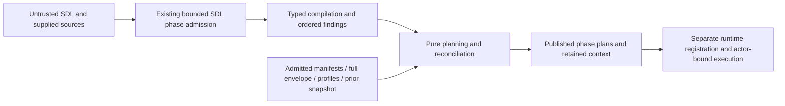

# Processor compilation and planning architecture preflight

Issue #1787 is the delivery contract. It has no formal requirement UID.
This note sets guardrails. It is not a plan or a parity claim.
The inspected baseline is `29a0d35a5c3753d234fb790933adc70642c60bf4`.
The issue's review findings describe the older `036d1af96` tree.

## Owners and boundaries

Compilation, planning, reconciliation and compiled semantics stay in `rae`.
The [runtime split](issue-1891-runtime-repository-boundary.md) changes no plan format or behavior.
Apply [ADR-008](adrs/adr-008-processor-layer-and-execution-artifact-boundaries.md) with ADR-036's module boundaries.
The [profile](../../specs/sdl/plan-realization-profiles.md), [preparation](../../specs/sdl/backend-realization-preparation.md) and [recursive constraint](../../specs/sdl/recursive-realization-constraints.md) specs govern the handoff.
Keep all non-trial contracts under root `contracts/schemas/plans/` in scope.
Authored runtime inventory is distinct from the compiled runtime model and live snapshot.
Templates and metadata need a binding to become planned resources.

The [public API design](issue-1825-public-go-api.md) already assigns the consumer boundaries below.
Paths are relative to `implementations/go/`, except where stated otherwise.

| Concern | Existing owner and boundary |
| --- | --- |
| Source and SDL phases | `internal/sdl/source` and `internal/sdl/authoring` own parsing, imports and phase admission. They also own instantiation and source bounds. Reuse #1784 and #1785. The public `sdl` facade is still only declared. |
| Compilation | Planned public `processor` owns one typed compiled model. Each pass returns typed results and its own findings. Passes do not exchange untyped assembly maps. |
| Planning | Planned public `processor/planning` builds plans and reconciles state. It owns dependency meaning. Its sealed `ExecutionPlan` keeps the model, snapshot, manifest and planning context. |
| Realization | Planned public `processor/realization` owns concern descriptors and projections. It also owns observation-support rules. Compiler lowering and planner comparison use this owner. Runtime must not copy it. |
| Published shapes | Root `contracts/schemas/` owns published schemas. `contract/binding`, `contract/validation` and `contract/admission` own wire types and their checks. Use their packaged schemas offline. Reuse `Field[T]` for presence. |
| Recursive relation | `contract/admission` owns native constraint fragments and their shape checks. Its planned `EvaluateRealizationConstraint` and `ConstraintLimits` API has no code yet. Extend that owner. Add no planner-local evaluator. |
| Profiles and vocabulary | `contract/concept`, `contract/profile` and `internal/contract/domainprofile` own terms and profile admission. They pin exact definitions and check schemas without running profile code. |
| Semantic comparison | Reuse `contract/profile/comparison.go` and `contract/admission/comparison.go`. They own profile loading and report rules. The processor's trusted artifact projections and bounded impact analysis are distinct from plan reconciliation. |
| Shared mechanics | Reuse `base/address`, `base/canonjson`, `base/digest`, and internal base `graph`, `jsonpointer`, `domain`, `value`, `softwareversion`, `secretref` and `urisafety`. Each retains its own grammar and equality profile. |
| Materialization joins | Existing `admission.MaterializationCompiler` and execution/inventory/archive contexts request facts from their owners. Contract admission keeps its decision. The compiler binds its facts to the exact source. |
| Errors and observation | `base/fault`, `contract/diagnostic` and internal `base/logrecord` implement ADR-116. ADR-066 keeps operational logs, evidence, audit and provenance separate. |
| Exposed commands | Python `raes_cli/processor.py`, `_semantic_sdl.py` and `_semantic_result.py` fix output and failure behavior. Use the shared authoring command composition from #1825/#1797, without another dispatcher. |

These consumer APIs are planned. The model has no processor code package yet.
Do not copy the Python package tree or dataclass hierarchy.
Do not rebuild its v1/v2 conversion layers.
Generated transport records serve the wire boundary. They must not become a second compiled domain model.
Typed maps keyed by canonical identity are appropriate. Arbitrary published payload data stays at its declared boundary.
Do not pass `Document()` maps or JSON between compiler stages. Planning must also consume the typed model.

Contract code cannot import SDL or processor code.
Use existing owner callbacks for native facts; callbacks do not grant contextual admission.
Reuse admission's existing predicates. Do not copy them into the planner.
Keep shape, semantic, support and execution checks distinct. Each proves a different claim.

## Design gaps to close before code

The [planned declarations](../../implementations/architecture-api/planned/rae/processor.go.txt) do not yet close every issue boundary.
Resolve these gaps in the owning design and machine-readable model before implementation:

- `RuntimeModel` exposes only `Document() map[string]any`. State how planning reads the single typed model. It must not decode that map or assert a private type across packages. `PlanningContext` also lacks the reference's original model. Keep that input distinct from the effective model for later admission and replanning.
- `Plan` and `PlanWithManifest` receive the published backend manifest. That DTO carries only an envelope identity. Supply the full admitted envelope through an explicit owner input. Check its complete identity/configuration join. Keep the CLI refusal of identity-only envelope manifests. Fetch nothing implicitly.
- `Compile` and `CompileInstantiated` lack the reference's programmatic `profile_authority` input and materialized-description path. Keep those scoped behaviors with their existing phase/profile owners. Descriptive materialization must not gain fresh author authority.
- The declared processor API has no manifest operation. Keep its builder and version input with the processor owner. Preserve `processor-manifest-v2` and contract/feature order. Keep compatibility, concept bindings and participant-tool support.
- The recursive evaluator is declared but absent. Assign any missing normalization, composition, refinement and compatibility operations to the shared contract relation owner. Keep processor-specific lowering and concern projection with realization.
- Prepared-node, selected-plan and materialization helpers in Python's planner also serve later runtime result admission. Declare the narrow public operations those consumers need. Keep pure semantics in `rae`. Apply and result publication stay outside this issue.
- Top-level capture admission, participant-tool support and semantic comparison remain in scope. Name their typed owners and public seams. The planned analysis facade for #1789 does not itself deliver these operations.

Keep private implementation details private, but make every downstream signature usable without `internal` imports.
Sealed handles mark admitted phases and planner origin. They do not authenticate callers or grant cryptographic authority.
Declare changed packages, imports, exported identifiers and typed API commitments in `implementations/architecture.json`.
Pass `archcheck -design` before code, under ADR-122.
Update the existing system views when the design changes their parts or trust boundaries.
This preflight changes neither the model nor its commitments and does not certify the forthcoming design.

## Gates across the data path

| Layer | Required protection |
| --- | --- |
| Source/parser | Keep byte, scalar, node, depth, alias, import and composition-work bounds from `source` and `authoring`. Keep duplicate-key checks and source locations. Contain reads within supplied sources. Compilation needs the proper admitted phase. Construction alone is insufficient. |
| JSON and direct Go values | Use `base/ingress` and existing bounded native-value admission. Run these checks before copying, hashing or recursive work. Cover total scalar bytes, invalid Unicode, cycles, unsupported carriers and direct DTO input. Go types alone do not validate values. |
| Schema/model/config shapes | Reuse packaged `validation` plus `admission`. Keep closed unions, unknown-field refusals, canonical addresses, unique identities and cross-field predicates. Apply the same checks to both planner manifest entrypoints. `CheckSchema`, `CheckPortable` and DTO decoding do not grant full semantic admission. |
| Options and owner hooks | Keep typed scope, snapshot, profile context, artifact availability, processor manifest and mixed-control admission. Check exact model/context joins. Check positive limits and resolver results. Copy retained values. Callbacks cannot mutate committed input. Do not serialize injected services or discover ambient configuration. |
| Secret handling | Reuse SDL account credential predicates and `sdl_environment.go` literal/reference rules. Keep explicit redaction and withholding. Keep generated-output visibility and delivery-consumer authority. Logical `secretref` syntax applies only to its own fields. Do not resolve references or generate credentials. Do not read process environment values. |
| Host/OS/network | Commands, paths, mounts, listeners, URLs and environment bindings remain inert data. Run no shell, subprocess, guest probe, DNS lookup or backend call. Never put credential values in argv, URLs or child output. Locators and profile schemas grant no right to fetch data. |
| Realization and profile policy | Require independent support and the complete admitted envelope/profile context. Keep `internal/contract/domainprofile`'s no-retrieval policy. Keep local references and pinned definition/context digests. A digest, feature flag or support row is not permission to execute. |
| Authentication and authorization | Add no auth route, token format or security settings. Scope labels and participant control declarations do not authenticate callers. Later execution still passes `control_plane_security.py` and API `_auth.py`. It also needs core actor/scope/target checks and planner-plan registration. Keep frozen principal shapes and invalid-bearer refusal. Planning must supply no bypass. |
| Error envelopes and logs | Keep six `fault` categories and standard error traversal. Fixed fault codes differ from dotted diagnostic codes. Keep diagnostic stage, severity, address, source and order. Render each command's existing safe envelope and exit behavior. Never render arbitrary causes, parser values or backend exceptions. Log unexpected failures once at the application boundary. |
| State and persistence | Planning reads supplied snapshots and returns copied values. It performs no store commit, lease, CAS, audit write, worker dispatch or replay. Runtime's existing ADR-104 store and result gates retain publication authority. Mark synthetic reconciliation state as assumed state. |

The log handler bounds and escapes records; it cannot make arbitrary string payloads safe.
Never log compiled models, parameters, plan payloads, secret references or raw diagnostics as operational records.
The plan command's published payload can carry authored credentials/content. Preserve its contract without copying it into logs or reconciliation summaries.

## Semantic guardrails and extension seams

One realization owner must supply projections for compilation, comparison and downstream safe observation handling.
Use its concern descriptor's authored path, payload path, collection identity, projection and validation policy.
A new typed concern extends that owner. A profile-defined nested collection supplies its identity/profile metadata at its own boundary.
It does not add an arbitrary extension to a global leaf registry.
Generic recursive semantics stay in the contract relation owner.
Do not add parallel compiler, planner and runtime registries. No universal resource/configuration framework is needed.
Keep the declared `ConstraintLimits` fields and defaults.
Bound depth, nodes, operations and members. Bound identity work, reference hops, scalar bytes and diagnostics.
Keep total scalar-byte budgets too. Refuse zero or negative limits.

Preserve these distinctions and edge cases:

- Presence, knowledge, origin, closure and value restriction are independent. Keep the contract's distinctions between missing, null, empty, false, zero and explicit defaults. Keep finite variable domains and original pointers through instantiation. Defaults do not create author obligations.
- Keep one authority tree. Where recursive authority is present, derive legacy structure and flat compatibility views from it. Never edit those views as separate authority. Keep source bindings, exact descendants and lexical closure. Keep domain conjunction, aliases and hop/work limits. Only `conformant` succeeds. Keep `nonconformant`, `unresolved`, `invalid`, `unsupported` and `limit-exceeded` distinct.
- Resolve each delegated apparatus decision once per `(address, field path, requirement kind)`. Keep frozen decisions and the original instantiated source for deferred lowering. Missing policy cannot imply openness. Replan must not rerun a mutable resolver to change the original authority.
- Keyed collections use semantic identities. Sequences use positions. Keep mount targets, port tuples and listener/forwarder IDs. Keep compound process-limit identities. Comparison-only set projections do not change stored shapes. Reject alias collisions and ambiguous identities. Never select the first match.
- Envelope membership, universal subsumption, one prepared completion and delivered observation are different claims. Keep joint OS family/distribution/version support. Keep observation scope/strength floors. Selection is not measurement. An exact value creates no capture, retention or export demand.
- Profile authority pins full binding paths, definitions and author basis. Target operation support stays independent. Keep core/profile conjunction. Keep prior admitted choices while still allowed. Changed or revoked authority follows ordinary reconciliation. Null bindings remain values.
- Open portable membership needs an independently admitted enclosing collection. Keep namespace closure and retained additions. Keep capacity/dependency checks and protected descendant lineage. Openness cannot add roles, bindings or generated-artifact consumers. Closed omission schedules deletion. It does not erase trusted inventory before reconciliation.
- Ordering dependencies control startup and reverse deletion. Refresh dependencies propagate updates transitively. Use `internal/base/graph` mechanics. Keep the planner's known-node projection, canonical order and cycle recovery. Do not use one graph policy for both meanings. Do not sort every output globally.
- Resource matching includes domain, type, payload projection, profile bindings and both dependency lists. A malformed legacy concern can require `update` rather than abort planning. Safe projection must not hide unauthorized ancestor siblings. Corrupt authority cannot prove equivalence.
- Keep run/instantiation scope bindings for random-value regeneration (#1276). Refuse missing scope. `once` remains stable. `RefreshEvaluation` changes only its existing evaluation behavior. Keep original and effective compiled context distinct.
- Keep diagnostics in reference pass/stage order. Keep intentional repetition across result surfaces. Passes return local findings for stable assembly. Do not share a mutable diagnostic slice or append in parallel. Do not deduplicate globally or depend on map iteration order. Keep dependent-check recovery and invalid plans with diagnostics.
- Reconciliation demonstration calls the same planner for both versions. Synthetic projection needs an empty-base plan. Rejected baseline means no candidate action report, not four zero counts. Rejected candidates keep their reported operations. Reports include identities/actions, not resource payloads. They never claim backend delivery or cessation evidence.
- Semantic comparison consumes admitted artifacts through trusted owner projections. Match exact coordinates, profile/revision digests and both sides of the declared scope. Keep identity, structure and semantic change axes separate. Request limits cannot exceed profile limits. Preserve bounded impact-path exhaustion and completeness reasons. Add no generic JSON diff, caller-supplied projection or ambient registry.

Keep pure preparation-selection and comparison rules callable for later runtime consumers.
Runtime still owns backend calls and selected-completion/result admission.
It owns transient observations, credential egress checks and trusted-predecessor recovery.
Sanitizing or serializing before those checks must not discard the facts they need.
Do not reduce native callback/service handles or transient observations to published snapshot JSON.

## Evidence and workflow boundaries

Reuse `internal/parity`, its runner inventory and corpus provenance from #1778.
The current map has no processor or semantic-compile runner. Existing parity success does not cover this issue.
Wire real Go operations into that harness. Product code never calls Python or reads expected results.
Validate emitted plans against their published schemas and the applicable semantic owners.
Retain exact exposed envelopes, defaults, nulls, array order, digests and diagnostics.
Do not replace the distinct `canonjson.JCS` and `Sorted` profiles with ordinary JSON marshaling.

Trace each scoped Python limit, security check, error, recovery and issue-named defect to a Go test.
Behavior defines scope; a test's directory or filename alone does not.
Relevant references include `test_runtime_planner.py`, `test_semantics_planner.py`, `test_reconciliation_demonstration.py` and `test_processor_manifest.py`.
Also inspect defects under #985, #1043, #1067, #1099, #1204, #1205, #1241 and #1276; this list is not exhaustive.
Preserve #1099's pass-local indexing benefit without global caches of caller data.
API snapshots and happy-path golden cases cannot replace failure/recovery evidence.

Use `.ground-control.yaml` and `.gc/plan-rules.md` for workflow rules.
Use `tools/policy/adr_policy.yaml`, `implementations/architecture.json` and the existing architecture checker.
Keep the existing `.golangci.yml`, `.gremlins.yaml`, module/tool locks and `.github/workflows/canonical-verification.yml`.
The lint/mutation configs are under `implementations/`.
Local checks select explicit cases or file-local policy/prose checks.
CI owns full test, race, coverage, mutation, fuzz, regression and corpus runs.
This requirement-free issue needs no invented requirement UID or alternate workflow.

## Non-goals

This preflight implements no issue behavior and changes no ADR, API declaration or architecture commitment.
The issue changes no Python implementation, published schema, SDL meaning or golden expectation.
Trial compilation/contracts belong to #1788; satisfiability, exploit-path and opacity analysis belong to #1789.
Decision-surface and exposure-authority modules belong to #1794. Shared compiled participant facts still retain their existing checks.
Do not pull these modules into scope merely because Python re-exports them from `models`.
Do not introduce a compiler RPC service, runtime import, controller, store, plugin loader, execution engine or second command/workflow stack.
The repository split permits necessary ownership/API changes only. It authorizes no source transfer or unrelated behavioral improvement.
