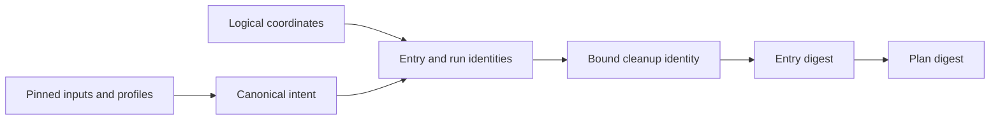

# Experiment compilation and runtime records design

Classification: FM3.
Required records: typed interfaces, integrity invariants, reference cases, and the diagrams below.
Waivers: none.

This design covers issue #1788 at `9777721d13141ecdd9056d83ddbf3d5d0181c289`.
The [preflight](issue-1788-experiments-trials-preflight.md) identifies the existing owners and missing interfaces.
The changed model and exact typed declarations bind the design before source code is written.

## Owners and interfaces

`contract/admission` owns experiment input admission, participant configuration, and cross-artifact checks.
It reuses the published schemas, generated bindings, native fragments, and existing semantic predicates.
Experiment YAML uses its own bounded input policy.
It does not pass through SDL import or key-normalization rules.
Its loader accepts supplied bytes or an explicit `fs.FS`.
It has no ambient filesystem, network, secret-resolution, or process authority.

`processor/trial` owns deterministic compilation, original-input readmission, replacement compilation, scheduling, and entry realization.
Keep the existing declared `Request`, `Compile`, `InstantiateEntry`, `RealizeEntry`, and `PlanBatchSchedule` interfaces.
Add trusted-input readmission and explicit replacement compilation in this same owner.
These operations use independently supplied original inputs.
A candidate plan cannot supply its own trusted authority.

The compiler admits inputs once and builds typed request-local state.
Each pass returns its own diagnostics.
The compiler combines them in the reference order.
Generated DTOs remain transport values; they do not replace admitted handles.

The compiler uses public SDL operations to select and instantiate a family.
It uses the public processor to compile and plan.
It does not copy those owners' rules.

Runtime experiment coordination and record production have one runtime owner.
That owner receives explicit host and store interfaces.
It also receives a clock, bounded call adapter, archive, and evidence reader.
The shared runtime checks operation inputs and authority.

It owns execution, leases, and atomic claims.
Experiment code supplies experiment transitions and record rules.
It does not implement another operation engine, store, worker pool, or authorization system.

The shared runtime packages currently have declarations but no Go implementation.
#1791 adds the shared control plane after this port.
#1792 adds the stores.
`runtime/experiment` owns the experiment transitions and record rules.
Its typed `Host`, `Journal`, and `OwnerCaller` interfaces form the join to the shared runtime.

All three are required injected owners.
There is no default engine or store.
`OwnerCaller` delegates to the shared runtime's bounded call adapter.
It keeps the adapter's lane capacity, retained physical slots, cancellation, and drain rules.
The experiment package does not create a worker pool.

Each foreign host, store, archive, and evidence call crosses this boundary.
The future control-plane composition supplies these three interfaces through narrow forwarding adapters.
It does not copy experiment rules into the control plane.
Tests with supplied host interfaces show how each component works.
They cannot prove a join with an absent shared runtime.

Runtime record types retain every durable start and observed attempt.
They keep execution, capture, cleanup, scientific outcome, and validation facts separate.
Absent measurements remain absent.
The record producer freezes candidates before archive calls and checks exact readback.

The runtime code stays in this checkout.
#1894 moves it to the approved runtime repository.
No source transfer is part of this issue.

## Typed contract additions

The declaration files under `implementations/architecture-api/planned/` specify each exact type and signature.
Keep their existing entry points.
The accepted validator key correction changes only the unreleased field names.

The Sonar findings require small structural changes to this design.
Constructor defaults and binary text paths use private lookup tables.
The tables hold fixed strings and no caller data.
Each lookup still returns fresh mutable values.

Private record types name nested wire shapes and pair parent evidence with its receipts.
Single-method interfaces use the names `ControlContextProvider` and `OwnerCaller`.
Their method sets and required owners stay the same.

| Package | Added interfaces and operations | Purpose |
| --- | --- | --- |
| `contract/admission` | `ParseExperiment`, `LoadExperiment`, `DiscoverExperiments` | Bounded experiment YAML, optional task binding, and contained file discovery. |
| `contract/admission` | `ExperimentProjection` | One owner for model collection defaults and serializer omissions before artifact digests. |
| `contract/admission` | Existing participant settings interfaces and their two realization/check operations | Normalize complete settings through the manifest's exact validator. Keep defaults and explicit overrides distinct. |
| `contract/admission` | `SealTrialPlan`, `TrialPlanProjection`, `TrialEntryOrder` | One owner for model defaults, omissions, entry/plan seals, and source-stable ordering. |
| `contract/admission` | `TrialRunInputs`, `ValidateTrialRun`, `ExperimentEvidenceInputs`, `ValidateExperimentRun`, `TrialStudyInputs`, `ValidateTrialStudy` | Reconcile plans, cleanup, runs, study membership, replacement history, and content-backed evidence. |
| `sdl` | `Select`, `VariationOutcomes` | Delegate recorded selection and finite-domain queries to the native SDL owner. Both return native admitted values. |
| `internal/sdl/authoring` | `Parser.FiniteVariationOutcomes` | Query the existing native domain without a compiler-local SDL model. |
| `processor/trial` | `CompileContext`, `Readmit`, `CompileReplacement`, `ReplacementRequest`, `ReplacementResult`, `RealizationAssignmentKey`, `ControlContextProvider` | Add explicit cancellation, original-input checks, and bounded replacement history. Bind control checks to each selected scenario. |
| `processor/trial` | `PlanBatchScheduleValue` | Preserve input member order for equal coordinate sort keys. The DTO wrapper uses the DTO's serialized order. |
| `runtime/experiment` | `New`, `Coordinator`, `Options`, `Host`, `Journal`, `OwnerCaller`, `Decision`, `DecodeDecision`, `Trial`, `Observation`, `Identity`, `Progress` | Bind experiment progress to the actor, original plan, retained decisions, installed host, and bounded calls. |
| `runtime/experiment` | `RunMetadata`, `RecordSource`, `Accounting`, `RecordBundle`, `EvidenceInputs`, `EvidenceReader`, `Archive`, `RecordOptions` | Keep every started run, immutable versions, protected source facts, evidence reader ownership, and archive readback. |

`Compile` retains its signature and delegates to `CompileContext` with a background context.
The context-aware operation passes cancellation to installed pure hooks.
It does not claim forced cancellation of a hook that ignores its context.

Live runtime calls retain the separate shared adapter boundary.
`ControlContextProvider.ForScenario` receives the concrete selected scenario before its hook is called.
Registry lookup uses the exact `ValidatorID` and `ValidatorVersion` pair.
There is no implementation-name fallback.

`SealTrialPlan` applies schema defaults and the existing contract projection.
It seals entries before the enclosing plan.
The returned value passes complete semantic admission.
Trial-plan semantic and model traversal reuse the validation owner's finite schema-graph work bound multiplied by bounded input bytes.

Entry defaults use separate schema fragments, so large entry sets do not consume
the generic single-value defaults budget or repeat a whole-plan projection per entry.
`TrialEntryOrder` reads retained input member order before it applies the stable coordinate sort.
Recorded allocation order, when present, takes precedence.
`ResolveBindingTarget` uses the native SDL variation index and declaration resolver.
It returns the canonical scalar target, strict value type, and installed SDL owner.

Structural and collection targets remain outside scalar binding admission.
`ExperimentProjection` accepts an admitted document with an exact experiment-family contract ID.
It checks local owner rules and adds the model's collection defaults.
The resulting bytes form a model projection; they grant no new contextual or execution authority.

The contract owner holds the frozen reference models' constructor-factory defaults.
Published schema instances select each native model and its defaults.
Caller field names cannot select a constructor.

Each inserted map is fresh; the implementation caches no caller data.
The existing trial fragment admission also returns its native constructor projection.
It applies defaults and omissions for input references, apparatus, and cleanup authority
before the compiler derives any identity.
This fills defaults that JSON Schema does not publish.
It does not add or change a schema.

Runtime decisions have a sealed native owner.
`DecodeDecision` bounds bytes and rejects unknown shapes before creating a handle.
The journal atomically claims each domain decision by its stable ID.
The shared provider adapter retains that owner's bytes and conflict rules.

It does not define a second decision schema.
The Go store format remains separate from Python-written stores, as issue #1792 requires.
This port keeps decision meaning and identity; it does not add a Python store reader.

The archive receives fresh copies of source, run, and study records.
It writes runs before studies.
Each archive call checks its own readback against the frozen candidate.
An acknowledgement alone does not establish publication.
The producer closes evidence readers on rejection, success, and late completion after timeout.
It preserves a safe failed-validation result when a reader or evidence owner fails.

## Integrity and deterministic behavior

The integrity chain has this direction:

Each digest uses the existing JCS projection and domain separation.
Only the digest's own field is excluded from its projection.
Children do not embed a future enclosing digest.
Apply the contract owner's defaults before hashing.
Omit fields only as that owner specifies.
Use `base/canonjson` and `base/digest`; do not add another canonicalizer.

Governed random draws use the existing internal `base/randstream` owner.
Each address binds a logical coordinate and policy ID.
It also binds the draw purpose and local position.
They do not depend on traversal, worker identity, time, or backend availability.
Failure and realization never resample.
Preserve rejection counts, exhaustion, and Fisher-Yates direction.

Compile one complete plan or return bounded diagnostics.
Refuse the whole plan when any entry fails.
Select failures and combine capture errors in the reference order.
For readmission, compile a new plan from trusted original inputs.

Compare the complete canonical plans.
For replacement, check parent evidence and reusable state.
Check the original policy and bounded lineage history too.
It grants no execution permission and performs no store or archive mutation.

## Data flows and protection boundaries

```mermaid
flowchart LR
    Caller[Caller] -->|Experiment bytes and explicit limits| Admission[Contract admission boundary]
    Sources[Supplied SDL sources] -->|Admitted family| Trial[Pure trial compiler]
    Admission -->|Admitted typed inputs| Trial
    Authority[Pinned task, manifests, envelopes, profiles] -->|Explicit original authority| Trial
    Trial -->|Sealed plan| Plans[(Portable plans)]
    Plans -->|Reconstructed complete plan| Realization[Public SDL and planning owners]
    Realization -->|Admitted execution artifacts| Host[Shared runtime authority boundary]
    Host -->|Atomic claims and observed facts| Decisions[(Runtime decisions and snapshots)]
    Decisions -->|Detached retained facts| Records[Runtime record producer]
    Evidence[Authorized evidence owner] -->|Bounded immutable readers| Records
    Records -->|Frozen candidates| Archive[Configured immutable archive]
    Archive -->|Exact readback| Records
```

The pure path treats locations, commands, and secret references as inert data.
The shared runtime admits effects separately.
Plan identity, schema validity, and integrity seals are not credentials.
Runtime progress, cancellation, results, and export keep actor and scope checks.

| Threat | Control and owner | Verification |
| --- | --- | --- |
| Oversized or ambiguous input | Admission checks bytes, depth, duplicate keys, aliases, types, and exact native handles. | Boundary and forged-handle cases. |
| Combinatorial exhaustion | Trial compilation checks cardinality before expansion and carries aggregate work and byte budgets. | Limit edges, overflow, and replacement-history cases. |
| Changed or self-authorized inputs | Contract joins check exact pins; readmission recompiles independent original authority. | Tampering and resealed-candidate cases. |
| Secret disclosure | Pure code never resolves secrets; safe errors omit source and owner exception text. | Secret markers in refusal and hook-failure cases. |
| Unverified live effects | Shared runtime retains operation authority and bounded owner calls. | Installed-owner and recovery contract cases. |
| False success after interruption | Runtime distinguishes stop acknowledgement, observed cessation, capture, cleanup, and reusable state. | Timeout, cancellation, crash-cut, and late-completion cases. |
| Lost or rewritten record history | Runtime records keep durable starts, exact versions, frozen publication candidates, and readback checks. | Unresolved starts, retry, replacement, version conflict, and lost acknowledgement cases. |
| Evidence resource leakage | Evidence acquisition, validation, and reader closure share one bounded call lifetime. | Rejection, timeout, and late reader closure cases. |

## Verification and governing artifacts

Declare each changed package, import, and exported name in the model before writing code.
Its API records and design hashes must match this design.
Use `archcheck -design` before implementation and the actual architecture check afterward.
The generated architecture view must match the checked model.

Use existing policy, lint, contract, parity, regression, and documentation checks.
No new gate, service, hosting destination, or dependency registry is required.
ADR-123, ADR-124, and the experiment ADRs govern these owners.
No replacement ADR is proposed.

Map each input limit and security check to its Go test.
Map each refusal, recovery path, and defect case too.
Retain the golden corpus and its provenance.
Run real Go operations against the recorded inputs.
Product code never reads expected outputs or invokes Python.
The three experiment examples retain their existing authoring and selection meaning.

Local checks select explicit cases and changed paths.
CI runs the full test, race, and coverage suites.
It also runs mutation, fuzz, and completion suites.
Keep Python code and published schemas unchanged.
Keep the golden expectations and release version unchanged too.

## Sources and document review

- [Effective Go](https://go.dev/doc/effective_go): interfaces, initialization, and error handling; Go 1.27.3 module context.
- [Google Go best practices](https://google.github.io/styleguide/go/best-practices): small interfaces, ownership, and tests; accessed 2026-11-15.
- [RFC 8785](https://www.rfc-editor.org/rfc/rfc8785): canonical JSON and deterministic property ordering; June 2020.
- [Public Go API](issue-1825-public-go-api.md): fixed existing signatures and public consumer ownership.
- [Runtime repository boundary](issue-1891-runtime-repository-boundary.md): retained contracts and compiler; extracted live runtime ownership.
- [Complete run accounting](issue-1630-run-accounting-design.md): durable starts, partial facts, version ownership, and record publication.

This is an explanation of ownership, invariants, threats, and data flows.
Implementation tasks belong in the issue plan.
Review keeps technical terms and normative meaning intact.
The prose uses short declarative sentences.
A clean prose checker does not establish complete STE dictionary conformance.

## Typed API commitments

<!-- go-api implementations/go/contract/admission 71163768113401b0ffa8e0dbd5a7e9cd7a12d4877411bf4329a122aa61607d4c -->
<!-- go-api implementations/go/internal/sdl/authoring e6991ca1212d70d636bcb59f4da299f482ccc7e81903fe61876082a17066ffd0 -->
<!-- go-api implementations/go/sdl ec51c7e22544b4cf42006b37d12dce96f7769b0aca2bd1f939ac56949cd8ca4b -->
<!-- go-api implementations/go/processor/trial cff2870a5253b514e0df3afaae8827898d203f9e75baad26aaa71cb9cf264f31 -->
<!-- go-api implementations/go/runtime/experiment bde07dbad0faf616add22de2b39186f6cc9a97ac05561067b0bfd30d64a54a5c -->

### Archival model construction

`ExperimentModelProjection` accepts acquired JSON for a closed experiment model
or cleanup receipt. It checks the local schema and model rules and applies the
owner defaults and omissions. These bytes grant no contextual authority.
`ValidateTrialRunJSON` checks those local rules and reconciles the run and every
retained receipt with the supplied sealed plan.

The value-based operation uses
the same reconciliation. Neither operation manufactures a context-free
`validation.Value`. The replacement compiler uses these operations to preserve
archival records without asserting task-evidence admission.

The existing model-fragment check also accepts the published root pointer `#`.
It runs the same local schema, integrity and model rules as a nested definition.
It omits contextual rules. Mixed-profile reconstruction uses this check before
trusted contextual admission. A local check cannot grant trial admission.

`SupersedeTrialRunJSON` constructs the immutable status-only archive version.
It preserves the original result and evidence, retains the original version
reference, and removes only assertions bound to that original version. The
replacement compiler and retained-history reconciliation use this single owner.

`ValidateTreatment` checks a typed treatment against the admitted SDL family.
The native parser checks the descriptor model, family digest, canonical target,
owner identity and outcome domain. Structural and collection targets use the
existing native declaration indexes. Compilation and reconstruction both call
this check. Scalar binding resolution keeps its scalar-only contract.

The source-order scanner bounds visits by the already bounded input byte count.
It follows target pointer tokens without building paths for unrelated subtrees.
Depth remains bounded at 64. This permits valid large plans while preserving
source member order for tied coordinate keys.

`ManifestModelProjection` reconstructs the three concrete manifest model families
before trial compilation compares their payload digests. It uses published
schema defaults and the finite native constructor factories. It preserves
supplied collection order and non-null configuration registries. The existing
backend protocol normalizer keeps its separate capability-claim projection.
Local construction grants no execution or contextual authority.

### Shared runtime observation and archival joins

Every `Trial` carries the admitted actor and exact authorization scope.
The host checks this identity at each effect boundary.
Host mutations use the deterministic attempt and phase as their retained shared-runtime key.
They reconcile started or unknown phases before dispatch.
The experiment coordinator does not provide a second phase engine.
`Host.Records` supplies detached operation receipts, phase states, operation references,
and execution snapshots from that shared owner.

Journal starts and observations remain the authority for experiment accounting.
The host cannot replace those records.
`Archive.BuildRun` supplies the original archive owner's scientific run construction
from a detached retained source.
It does not derive scientific success from execution success.
The coordinator validates the candidate against every retained attempt and receipt,
freezes it in the journal, and checks exact archive readback before replacement.

`Host.Admit` returns the shared runtime's exact program commitment after read-only
admission. That owner commits its native execution model, phase plans,
observation owner, and base snapshot. The experiment coordinator validates and
retains the digest. It does not copy the shared engine's private request projection
or treat portable snapshot JSON as the engine's native snapshot.

`CheckTransportTree` extends the existing pre-serialization transport bound to
composite JSON trees with generated record leaves. It uses the existing native
projection and shared value budget. It rejects foreign carriers and invokes no
caller method. `CheckTransport` retains its generated-record-only entry contract.
Runtime record production uses this public boundary. It has no import of private
value tooling and does not keep another transport walker.

### Phase progress and retained observations

`Phase` carries the shared engine's progress separately from observed facts.
Configuration, plan advancement, capture, cleanup, stop and retry preparation
return this carrier. `Host.Observe` remains a separate read-only execution check.
The coordinator can retain verified observations while a phase is pending.
It cannot advance past pending or indeterminate phase work.

Each repeated call reconciles the shared engine's existing deterministic phase.
The journal retains the first observation's exact bytes and time.
A resumed phase cannot rewrite them or create permission to dispatch again.
A completed stop phase still requires positive observed cessation before capture
or cleanup. A failed capture remains separate from cleanup and reuse.

### Independent cancellation and cessation evidence

`Host.Cancel` forwards the shared engine's existing operation-cancellation control.
It is separate from `Host.Stop`, which reconciles the authored trial stop phase.
Cancellation records its durable decision before invoking active operation controls.
It does not acquire the experiment progress lease.
A short lock protects copies of the admitted slot list during child restoration.

The lock is never held across a host call.
The installed shared call adapter keeps its existing control lane and capacity rules.
Cancellation acknowledgement does not prove cessation or release reservations.
An execution observation that claims cessation must include verified evidence for that run.
The installed verifier cannot replace this local evidence-presence check.

### Public terminal results

Terminal results retain the exact observed execution snapshot and the shared
engine's receipts for that attempt. General evidence and cleanup evidence remain
separate through `Observation.Evidence` and `Observation.CleanupEvidence`.
Each collection rejects duplicate evidence identities. Operation receipts remain
unique and bound to the run.

The installed verifier checks the trusted target.
Returned configurations, snapshots, receipts and evidence are detached copies.
The same separation does not remove any evidence from execution accounting.

### Shared run retirement

`Host.Retire` forwards the existing shared engine's durable run-retirement operation.
It runs only after terminal cleanup permits reuse and retry or replacement has
been resolved. Replacement allocation is retained before parent retirement.
`Host.IsRetired` reads that owner's durable state before an entry can advance.

A lost acknowledgement therefore cannot repeat archive or participant work after
restart. Failed cleanup keeps its reservation. Retired runs remain available
through record and result reads. The coordinator adds no retirement store or
second run-state model.

Trial request and terminal-result handoffs reuse the existing portable runtime
value profile through the contract owner's `RealizationValue` admission.
Foreign error inspection remains inside the installed call's physical lifetime.
Native error classification retains its category and code without foreign causes.

### Constructor and compilation byte bounds

Private decisions reconstruct nested experiment records and cleanup results through
existing admission owners. Omitted factory fields receive fresh values before
serialization. Projection does not grant task, evidence, or execution authority.

Compilation keeps the caller's positive plan byte allowance. The default remains
32 MiB. Digest verification reconstructs an already bounded instance with space
for omitted schema defaults. Its private work allowance derives from that
instance's byte count and checks integer overflow.

The final published projection
still obeys the caller's byte ceiling. A source-produced digest checks a plan
above the default ceiling. No published schema or global snapshot cap changes.

Capture diagnostics keep the reference compiler's complete sorted refusal set.
The reference model accepts a positive `max_diagnostics` setting, but the selected
compiler does not truncate that set. The native port preserves this behavior.
The draw limit applies before participant configuration construction.

### Test package selection

The existing Go test matrix lists its package groups explicitly. Its processor
group also selects `./runtime/...` so the experiment runtime tests run in CI.
This extends the existing job and its coverage report. It adds no job or service.
Full tests and fuzz/mutation runs remain CI-only.

### Shared API snapshot fragments

Package snapshots contain the complete reachable typed API. Trial and runtime
surfaces share most of those declarations. The model can refer to common
plaintext fragments and retain the existing admission and SDL snapshot files.

The snapshot loader sorts the merged declarations before exact comparison.
It preserves repeated declarations, which still fail that comparison. Existing
file, count, path, and aggregate byte bounds stay in force. Each package's full
canonical declaration list and design digest remain unchanged. A targeted
loader test checks shared fragments, altered declarations, and duplicates.
