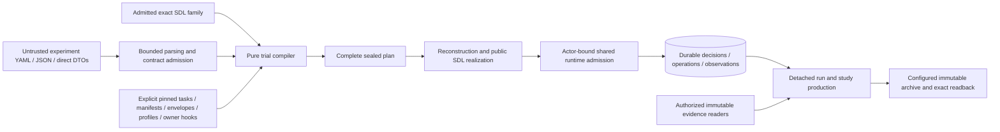

# Experiments and trial compilation architecture preflight

Issue #1788 is the delivery contract; there is no formal requirement payload.
This note records boundaries and design risks. It is not a plan or a parity claim.
The inspected baseline is `9777721d13141ecdd9056d83ddbf3d5d0181c289`.
The issue's original findings describe the older `036d1af96` tree.
In particular, current behavior includes #1630's complete failure accounting.

## Ownership and existing foundations

Apply ADR-055, ADR-064, ADR-065, ADR-068, ADR-074, ADR-084 and ADR-094 together.
Their past scope limits do not exclude current runtime behavior from this port.
The [runtime split](issue-1891-runtime-repository-boundary.md) changes ownership, not behavior.
Contracts and pure trial compilation stay in `rae`.
Live experiment execution and runtime record handling become #1894's mechanical extraction output.
This issue ports that behavior once, without transferring source to another repository.

Paths below are relative to `implementations/go/` unless stated otherwise.

| Concern | Canonical owner and reuse boundary |
| --- | --- |
| Published wire shapes | Root `contracts/schemas/experiment-core/` has ten schemas. Also retain `plans/admitted-trial-plan-v1`, `plans/trial-cleanup-plan-v1` and the published `trial-cleanup-receipt-v1`. `contract/binding` supplies generated transport records and `Field[T]` presence. Do not hand-edit generated types. |
| Schema and semantic checks | `contract/validation` owns offline schema shape/defaults. `contract/admission` owns invariants, native fragments and joins to trusted facts. Reuse `trial_plan.go`, `trial_allocation.go`, `trial_treatments.go`, `cleanup.go`, `experiment_local.go`, `experiment_joins.go`, `study_joins.go`, `factorial.go` and `accounting.go`. |
| Experiment target binding | `admission.ValidateExperimentBindingTargets` uses the SDL resolver and selected manifest registries. `sdl` owns scenario targets; manifests own participant and apparatus targets. `binding_targets.go` already checks canonical target collisions and exact owner/type joins. |
| Participant settings | The planned `admission.RealizeParticipantConfiguration` and selection validator own complete settings and defaults. Their declarations exist. Their Go code does not. Extend this contract owner. Add no compiler-local settings service. |
| Trial compilation and pure realization | Planned public `processor/trial` owns `Compile`, `InstantiateEntry`, `RealizeEntry` and `PlanBatchSchedule`. Reuse public `sdl` phase APIs and implemented `processor`, `processor/planning` and `processor/realization`. No alternate SDL binder, compiler or planner. |
| Shared mechanics | `base/ingress`, `base/canonjson`, `base/digest`, `base/address`, `base/clock`; internal base `value`, `randstream`, `domain`, `graph`, `jsonpointer`, `timestamp`, `secretref` and `urisafety`. Keep each grammar and canonicalization profile distinct. |
| Errors and logs | `base/fault`, `contract/diagnostic`, internal `base/logrecord`, ADR-116 and ADR-066. Logs, audit, evidence, provenance and scientific outcomes have distinct meanings. |
| Live work and records | Planned runtime `runtime/control`, `runtime/provider` and `runtime/execution`, under ADR-104/113. The current Go runtime layer has no code packages. Python `runtime_experiment*`, `runtime_trial_*`, `experiment_records.py`, `runtime_study_records.py` and `runtime_record_*` define the behavior. |

Generated DTOs are wire records.
They do not prove admission or make domain objects immutable.
Keep one owner for each predicate, digest projection, coordinate order and settings rule.
Where compiler construction needs a private admission rule, expose a narrow owner operation or share it inside that owner.
Do not copy the predicate into the compiler or import processor code into contracts.
Use typed request-local state; arbitrary JSON stays at declared wire or owner boundaries.

## Design gaps that must close before code

The [consumer API design](issue-1825-public-go-api.md) and [architecture model](../../implementations/architecture.json) already constrain the public packages.
The existing declarations are necessary, but do not cover the complete issue contract:

- `processor/trial` does not declare trusted-input readmission or explicit replacement compilation. Keep both behaviors from `trial_compiler/readmission.py` and `replacement.py`. Rebuild and check the whole plan. Then compare it with a new plan compiled from trusted original inputs. These gates prove different claims.
- Experiment YAML needs a contract-layer parser/loader and public boundary. It is not SDL parsing. It has no structural-key normalization, imports or cross-file resolution. The contract layer cannot import `internal/sdl/source`. Reuse admitted YAML libraries where appropriate. Keep the experiment policy and its own error mapping. Each new permitted import belongs in the model.
- `admission` declares participant configuration realization and its two owner-hook interfaces. It has no code for them yet. Keep complete-target normalization, exact control-context pins and default/override provenance. A declaration does not supply this code.
- The declared `ConfigurationValidatorKey` names implementation identity. Python selects hooks by registry-owner validator ID/version. Resolve that distinction. Control-context checks bind to the concrete selected scenario. The original family alone is insufficient. Retain the typed equivalent of the existing `for_scenario` behavior. Define context and budget inputs for hooks. Their planned admission signatures take `context.Context`.
- Plan/run/cleanup joins and replacement-aware study checks need contract-owner APIs. So do content-backed evidence checks. Local model rules alone do not deliver every Python helper in `trial_analysis.py`, `trial_replacement_analysis.py` and `experiment_run_evidence_validation.py`.
- The planned runtime control API has experiment admission/progress/results and a run archive hook. It lacks the complete record-bundle/study producer in `experiment_records.py`. It also lacks that source/archive/evidence-reader boundary. Those inputs and versions must remain immutable. Terminal trial results alone cannot represent every durable start. Name the runtime owner and public APIs for those behaviors.
- Live trials need runtime services, atomic stores, bounded owner calls and recovery. Keep their owners aligned with the shared runtime work and #1894. Do not silently defer the issue's records acceptance. Do not build an experiment-only engine to avoid that dependency.
- Distinguish supplied `validation.Value` contract IDs and `admission.Fragment` profiles at each entry. Check native handle origin and reject zero or substituted handles. Go interfaces and field types alone do not prove the expected phase or profile.

Before coding, declare actual packages, imports, exported names and exact typed APIs in the existing model.
Bind their owning designs and API digests; pass `archcheck -design` under ADR-124.
Keep downstream signatures importable through public `rae` packages, including runtime tests.
This preflight changes no API/model commitments and does not approve an undeclared design.
ADR-123 and the existing ADRs suffice; no new architecture decision is needed for these boundaries.

## Gates through the complete data path

| Layer touched | Required protection and incumbent |
| --- | --- |
| Experiment YAML and file input | Keep `experiment_spec.py`'s 64 KiB UTF-8 limit. Accept one mapping document. Refuse aliases and duplicate keys. Require string keys and finite JSON values. Keep scalar/date behavior and safe error codes, including #1563's impossible dates. SDL Core scalars can differ from PyYAML SafeLoader. Bound reads before parsing. A file stat alone cannot bound a changing file. Keep discovery sorted. Do not descend into child directories. |
| JSON and direct native values | Use `base/ingress.Parse` before schema admission, including the 32 MiB admitted-plan ingress limit. Keep duplicate-member, number, root, depth and Unicode controls. Reuse internal `value` bounds before marshaling, copying, hashing or expansion. Check direct DTOs, raw JSON fields, cycles and unsupported values too. |
| Schema, defaults and semantic joins | Use packaged schemas offline and `admission.Validate`. Supply trusted contexts. `CheckPortable`, DTO decoding and schema shape checks make weaker claims. Keep closed unions, unknown-field refusal and strict scalar types. Distinguish missing, null and defaults. Keep unique IDs and cross-artifact joins. Reuse `TrialInputRefs`, `TrialApparatus`, `TrialExecutionAuthority` and other exact fragment profiles. |
| Request settings and budgets | Check positive `Limits` and `MixedCompositionLimits`. Keep their reference defaults. Check coordinate, domain, product, binding, draw, diagnostic, mixed-profile/context and canonical-plan-byte bounds. Check counts before expansion. Prevent integer overflow. Apply total byte/work budgets across supplied records and replacement history. |
| Binding and environment shapes | Keep ADR-094's three explicit planes and owner registries. Distinguish Boolean, integer, number, string and null. Keep literal/secret-reference unions. Reuse SDL `sdl_environment.go` and account/source checks after selection. Keep the exclusions between `value_from`, literal values and `operator_secret` classification. Free-text parameters grant no right to change settings. |
| Secret handling | Use `secretref` only for its logical-reference fields. Compiler hooks receive complete typed settings, not secret providers. Keep secret-reference IDs and sensitivity through normalization. Pure code does not resolve secrets, read ambient environment values or discover credentials. Resolved secrets never enter plan hashes, stream inputs, provenance, errors, fixtures or logs. |
| Host, OS and network | URI/path/command/environment fields remain inert in pure code. Reuse `urisafety` and authorized owner readers; locators grant no right to fetch. No implicit filesystem imports, shell, subprocess, DNS or network calls during compilation/realization. Native effects belong to installed runtime/backend owners. Credentials must not enter process argv, URLs or child output. |
| Authentication and core authorization | Plan IDs, sealed digests and labels are not credentials. Preserve `control_plane_security.py`, transport `_auth.py`, `operation_actor_scope` and runtime `_authorize` behavior at their respective boundaries. Bind actor, target and admitted scopes on progress, cancellation, results and export. Keep route authority and invalid-bearer refusal. Add no new auth route, token format or bypass. |
| Backend and installed owner checks | Keep exact manifest/envelope joins and mutual processor/backend compatibility. Check participant/tool support and capture demands for every selected entry. Runtime also checks installed target/components, operation guarantees and retry preparation. Use existing bounded call adapters and owner-error isolation. A manifest claim cannot prove live support. |
| Error envelopes and logs | Reuse the six `fault` categories and standard error traversal. Fault codes have a restricted hyphenated grammar; dotted compiler diagnostic codes belong to `diagnostic`. Preserve codes, pointers, ordering and surface-specific safe envelopes. Keep library defects distinct from expected input refusals. Foreign owner failures are isolated and logged once without their messages or values. |
| Stores, recovery and archive writes | Shared runtime stores own claims, atomic commits, leases, idempotency and operation recovery. Keep decision IDs and stored formats. The configured archive has separate commits. Freeze exact candidates before external writes. Verify exact readback. Do not claim a transaction across runtime and archive stores. Add no storage service or data destination. |

The log handler bounds and escapes records; it does not make arbitrary supplied text safe.
Do not log specs, settings, seeds, source payloads, prompts, evidence content, secret references or arbitrary provider errors.
Retain authorized portable output without copying it into operational telemetry.
Public error envelopes must not expose wrapped causes or raw parser details.

## Integrity, randomness and selection guardrails

The integrity chain is acyclic:

`pinned intent + logical coordinate + identity profiles -> entry/run IDs -> cleanup identity -> entry digest -> plan digest`.

Exclude only each digest's own field from its defined projection.
Children do not embed the enclosing plan digest before sealing.
Reuse `canonjson.JCS` and `digest`, with the reference's domain separation and exact profile/version pins.
Preserve schema defaults and model serializer omissions before hashing.
These rules cover absent coordinates and empty participant settings.
They also cover optional treatment/allocation/replacement fields and control-context selections.
`admission/trial_plan.go` already encodes many of them.
Plain `json.Marshal`, universal `omitempty`, or the distinct Python-sorted JSON profile cannot substitute for the JCS contract projection.
Use exact number carriers until the owning canonicalization profile applies its rules.

Do not apply a generic snapshot budget blindly to a trial plan.
For example, `value.Plan()` permits 8 MiB of aggregate scalar bytes, while admitted-plan ingress permits 32 MiB of document bytes.
These are different measures and limits.
Choose scope-appropriate settings through the existing bounded-value helper.
Keep reference acceptance and refusal cases. Do not weaken global defaults.
Changing a non-binding limit must not change plan bytes or IDs.

Rebuild and check the whole plan before entry lookup, scheduling or realization.
Recheck caller-mutable DTOs at trust transitions; keep copies behind admitted handles afterward.
A resealed candidate can be internally consistent without proving original intent.
Readmission compiles trusted original inputs again. It compares the complete canonical plan.
Bind exact family, authoring input, task, capture specs, selected manifests, full envelopes and profile contexts.
The published backend manifest's envelope identity alone is insufficient.

Use the published stream profiles and internal `base/randstream` from #1779.
Keep root seed encoding, namespace, semantic address, transform, rejection count and exhaustion behavior exact.
Draw addresses use logical coordinates, policy/point IDs, purpose and local draw coordinates.
They exclude aggregate experiment digests, workers, traversal order, wall time, retries and backend availability.
Existing addresses remain stable when unrelated trials or draws are added.
Keep absent dimensions omitted as the profile requires.
Preserve allocation's Fisher-Yates direction and bounded draws; no modulo reduction or process-global RNG.
No rejection, failure or realization step resamples or selects a fallback.
Finite-domain order is also part of the draw result.
Retain type-tagged canonical scalar ordering and the reference's open/closed integer interval bounds before selecting a domain index.
An unsupported selection/domain kind refuses; a general domain helper does not authorize another executable trial profile.

Compile atomically: return one complete plan or bounded safe diagnostics, never a partial plan or dropped coordinate.
Preserve the reference's deterministic failure choice and capture-diagnostic aggregation across visit orders.
Do not globally sort or deduplicate diagnostic surfaces with different reference rules.
Enforce the compiler's result invariant at its boundary.
Use a checked constructor/private state or an equivalent check.
An exported Go struct alone permits invalid combinations.
Keep factorial effect distinctness after owner normalization, including defaults and structural selections.
Selection intent and SDL family membership remain separate claims.
Backend realizability and scheduling placement also remain distinct.
Realization applies recorded selections and bindings through public SDL admission; it performs no fresh draw or discovery.

Coordinate order belongs to the contract owner and serves both scheduling and receipt checks.
Reuse the semantics in `trial_coordinate_order.py` and Go `trial_allocation.go`/`trial_source_order.go`.
The current canonical sort uses condition and numeric replicate ordinal, not block ID.
Existing admission keeps source-member order for ties.
A Go map cannot recover that order.
Do not silently add a tie-breaker, block dimension or new ordering policy.
Recorded allocation order, when present, is authoritative.
Parallelism defaults to one; an embedded isolation proof supplies a ceiling, not live lease ownership.
Cleanup-resource overlaps still refuse parallel isolation; reference strings alone cannot establish safe concurrent use.

## Runtime records, recovery and extraction

Reuse the current shared engine, operation adapters and decision store.
Check all entries before any settings take effect.
These checks have no effects, even if a later entry fails.
Preserve operation guarantees, the installed 1,000-attempt capacity bound and authored attempt allowance.
Restore deadlines from retained UTC bounds and monotonic remaining time.
Restart or clock adjustment cannot renew an allowance.
Stop acknowledgement is not observed cessation, capture completion or cleanup success.
Unknown effects remain pending reconciliation, without blind redispatch.
Capture precedes cleanup; detach the execution snapshot before teardown.
Check observation kind, run/entry/attempt joins, exact applied settings and content/probes through installed owners.
A settings digest alone cannot prove that settings were applied.
An evidence reference alone cannot prove cessation.
Keep capture, primary result, cleanup and reusable-state dispositions independent.
Cleanup failure keeps reservations even when native resources were deleted.

Replacement is an explicit pure compilation operation, separate from retry and transport recovery.
It verifies original authority, exact parent evidence, cleanup/reusability and bounded lineage history.
Its fresh run ID and ordinal consume the original slot's replacement budget.
Runtime atomically claims the decision and retains child plan plus archival successor before dispatch.
Duplicate notifications, lost acknowledgements, restart, forks and changed policies cannot mint a new budget.

Preserve [complete accounting](issue-1630-run-accounting-design.md), including its supporting `runtime_record_*` modules outside the issue's filename summary:

- Count durable starts, not only terminal results. Keep every started run and every authored attempt. Keep partial facts and unresolved work. Do not invent end times, cleanup receipts, observed apparatus or measurements.
- One trial uses the existing `experiment-run-v1`. A retry has another attempt ID in that run. A replacement has another run ID. Plan, entry, operation, episode and scheduler IDs remain distinct.
- Keep missing/withheld results distinct from zero and scientific failure. Keep stable collision-free missing metric keys and actual denominators. Keep excluded runs and reasons. Evaluation owners supply scientific outcomes. Execution and cleanup status cannot invent them.
- Keep fixed run/study versions and authored study-definition pins. Keep exact evaluation membership and replacement-aware eligibility. This includes an enabled but unused replacement policy. Extra accounting versions cannot borrow changed scientific facts. They cannot replace the canonical scientific original.
- Share retained-version checks across legacy and record-producer archive paths. Freeze detached candidates before I/O; resume uncertain writes with those exact bytes. Runs precede studies, and each supplied archive needs its own delivery/readback.
- Evidence reads, checks and reader closure share one bounded worker lifetime. Close transferred readers on rejection. Close late readers after timeout too. Reader/provider failure keeps records with safe failed-validation dispositions. It grants no effect, retry or reuse authority.

The runtime-owned output includes record assembly, version ownership and archive writes.
It also includes stored decision formats and evidence-reader lifecycle.
It extends beyond `runtime_experiment.py`.
Keep that code with runtime for #1894.
Keep portable contracts and pure validators in `rae`.
Runtime imports released public `rae` APIs. Neither those APIs nor their tests reach runtime internals.

## Extension seams and verification evidence

Use explicit finite limits and versioned profile IDs.
Do not use ambient mutable registries.
A new manifest target or validator version extends its owner registry and typed hooks.
A new authority plane needs contract governance; it is not another string prefix.
Keep injected clock, atomic-store factory, installed trial services, immutable archive and evidence-reader seams.
These permit another backend/store/archive owner without changing canonical plan IDs.
They avoid a second lifecycle workflow.
Do not add a general plugin framework, global cache of caller data or configurable serialization dialect.

Reuse `internal/parity`, `runner-inventory.json`, `admission-inventory.json` and the #1778 corpus provenance.
Current Go runners have schema coverage but no experiment compiler, runtime-record or experiment MCP runner.
Existing schema parity therefore does not prove the issue's compilation or record outcomes.
Exercise real Go operations against recorded inputs; never read expected results from product code or call Python at runtime.
Keep golden expectations and source/digest provenance unchanged.
Include all three `examples/experiments/*.exp.yaml` files through their applicable authoring/selection behavior; descriptive examples do not gain execution semantics.

Map each scoped limit, check, error, recovery path and defect case to a Go test.
Extend existing conformance evidence. Do not duplicate it.
Relevant reference groups include `test_experiment_*`, `test_sce_002_*`, `test_exp_731_trial_realization.py`, `test_random_stream_study_integration.py` and `test_runtime_contracts.py`.
Also cover issue cases #1015, #1396, #1519, #1549, #1563, #1626, #1627, #1628, #1629, #1630 and `test_dsl_118_trial_control_context.py`.
This is a starting inventory, not an exhaustive acceptance crosswalk.
Include tampering, forged handles, owner mutation, allocation ordering, concurrent duplicate decisions, crash cuts, reader closure and no-secret error cases.
Preserve serial/partition/reversed/map-order plan and draw equivalence.
Shared mechanics tests alone cannot replace trial-specific provenance and recovery tests.

Use `.ground-control.yaml`, `.gc/plan-rules.md`, `tools/policy/adr_policy.yaml`, the existing architecture model and ADR-123/122 checks.
Keep `implementations/.golangci.yml`, `implementations/.gremlins.yaml`, module/tool locks, `.pre-commit-config.yaml` and canonical verification workflows.
Local checks select explicit tests or changed-path policy/prose checks.
CI owns full suites, race/coverage, mutation, fuzz, regression and corpus verification through the configured lanes.
Do not fabricate a formal requirement UID for this issue-only contract.

## Non-goals

This preflight ports no issue behavior and changes no architecture/API commitments.
The port changes no Python implementation, published schema, SDL meaning, profile meaning or golden expectation.
It adds no second trial/provenance schema or study service.
It adds no statistics engine, replay guarantee, secret resolver or generic settings patch language.
It adds no HTTP/auth surface, backend chooser, scheduler randomizer, experiment-specific execution engine or independent persistence stack.
The split permits necessary ownership/import/build changes, not a redesign or source transfer.
The common #1804 cutover and external service deployment remain outside this work.
