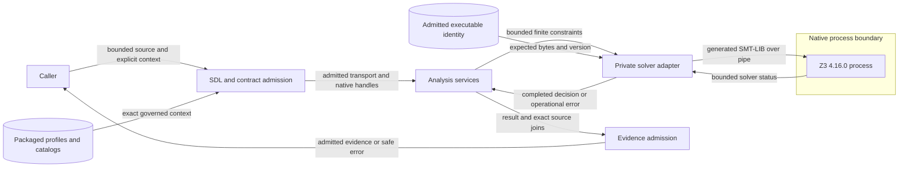
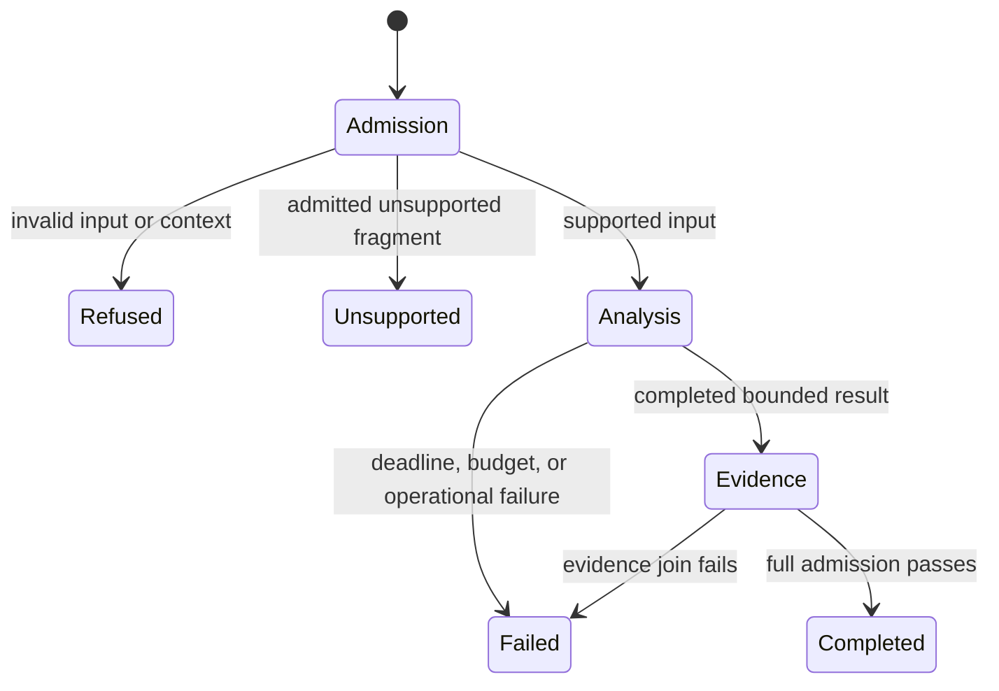

# Processor analysis services

This design covers issue #1789 on the `go-cutover` branch.
Analysis stays in RAE. The services check models and return evidence. They do not run a scenario.
The [preflight](issue-1789-processor-analysis-preflight.md) records the retained behavior and its limits.
The changed declarations and architecture model passed the design check. No product code had changed.

## Owners and interfaces

The public `processor/analysis` package checks inputs and selects the service. It builds evidence and can replay a result.
Its existing `Analyze(Request) (Result, error)` entry point remains available.
`Request.Kind`, `Request.Compilation`, `Request.Options`, `Result.Document`, and `Result.Diagnostics` retain their declared types.
Some services do not take a compilation. New typed inputs carry their data.
Arbitrary options do not become an internal domain model.

| Operation | Input and owner | Output |
| --- | --- | --- |
| Satisfiability | Authored SDL through `sdl.SourceContext`, parse options, and an admitted solver | Admitted satisfiability evidence |
| Exploit path | Original bounded JSON bytes, source name, and native snapshot admission | Admitted exploit-path evidence |
| Opacity analysis | Admitted finite carrier and its exact packaged profile | Admitted finite-carrier evidence |
| Opacity model check | Admitted transition model, exact catalog, and exact profile | Admitted model-check evidence |
| Semantic comparison | Existing `processor/comparison` artifacts, request, profile, and options | Existing comparison result |
| Candidate synthesis | Admitted candidate-synthesis input | Candidate source, admitted scenario, and synthesis record, or complete refusal |
| Authoring comparison | Admitted vector and two bounded path outputs | Independent comparison axes and bound semantic companion result |

Generated `contract/binding` records remain the transport shapes.
`contract/admission` remains the semantic validation owner.
The service can project checked data into small private records. These records supply the algorithms.
It does not create another published schema or duplicate contract predicates.
The existing profile owner supplies exact profile documents through `Documents` and checks their identities.
Contract admission checks their complete rules before analysis projects the bounds and quantification parameters.
This uses the existing full-document interface without expanding the profile identity record.

Each analysis has its own private code. These owners cover finite domains, graph search, opacity, synthesis, and authoring comparison.
The two opacity services share one information-cell calculation.
Exploit search keeps its own monotonic-additive transition semantics.
Semantic comparison delegates to its implemented owner.
Candidate construction and authoring observations reuse public SDL formatting, validation, and rename operations.

## Candidate source rendering

Add `sdl.RenderSource` for an admitted native scenario and caller context. It calls the existing native formatter.
The formatter preserves supplied fields and their order, emits strict YAML, and reads that source again.
This wrapper grants no filesystem or import authority. Candidate synthesis uses it after native semantic admission.
The result then passes native parsing again before the candidate record can claim success.

## Checker version

The model checker retains the published `raes` package identity. Its version follows the repository release version.
A private Go version constant uses the existing Release Please generic updater, beside the Python version file.
The current release is `10.2.0`. No runtime Python call supplies metadata.
The bounded checker keeps its fixed tool protocol version `1.0.0`.

## SDL instantiation profile

The existing native instantiator accepts a profile, but the public wrapper passes an empty value.
Add `sdl.InstantiateWithProfile` beside `sdl.Instantiate`. The new wrapper passes the explicit profile to the same owner.
The existing wrapper keeps its behavior. Analysis uses the new call so the witness records `raes-finite-domain-satisfiability-v1`.
No analysis code edits or reconstructs the native instantiation provenance.

## Z3 execution decision

The adapter uses the official Z3 4.16.0 executable through SMT-LIB 2.
One child process serves one incremental solver session.
The private adapter uses Go's standard `os/exec` package.
It starts no shell, sends generated commands through standard input, and accepts only bounded protocol responses.
Source values never become command arguments.

This differs from the preflight's initial C-API direction.
The inspected Go bindings use finalizers for native context release.
The aclements solver interface also lacks the required logic-specific constructor and assumption-check interface in its inspected source.
The official binding has those solver operations but still relies on finalizers for resource release.
A separate process can be stopped and collected. This also applies when a call is cancelled, times out, or gets a bad response.
Downstream Go builds need no C compiler or native link step.
The cost is process startup and a small private protocol adapter.
Checks must show that completed results match Python. The operation budget stays the same.

The new evidence profile is `raes-z3-finite-domain/v2`.
Its package identity is `raes-go-z3-smtlib`, package version `1.0.0`, and engine version `4.16.0`.
The package version identifies this adapter's protocol, not an external Go module release.
It does not claim use of a C-API Go binding or the Python package.
The Python v1 profile stays unchanged.
The schema checks the identity fields as a group. It rejects a mix of fields from the two profiles.
Configuration digests change with the identity and are recomputed.
Parity checks allow only this identity change. They also check each digest that binds it.

The first qualified platform is `linux-amd64`. It uses the existing Ubuntu 24.04 host profile and architecture configuration.
The upstream archive requires glibc 2.39.
Its executable links the host C/C++ runtime libraries, but does not dynamically link `libz3`.
No support claim extends to an unqualified host.
The artifact route keeps the MIT license. It checks the size and digest of the archive. It also checks the executable digest.
The executable path is explicit. Neither `PATH` lookup nor runtime acquisition selects it.
The adapter checks the exact executable identity and reported engine version before solving.
The caller cannot supply arbitrary solver flags or a replacement digest.

The tooling adapter `tools/z3_tool.py` uses `load_tooling_artifact_selection`, `acquire_locked_bytes`, and `ensure_verified_installation`.
The shared installer gains bounded ZIP materialization beside its existing tar and direct-file materializers.
It reads only exact manifest members and verifies every installed byte before publication.
The installed manifest includes the executable and MIT license.
CI supplies the resulting path to analysis tests explicitly.
Product code has no acquisition path and no Python runtime dependency.
The release and development host retain the admitted C/C++ runtime prerequisites.

Initial executable qualification reported `Z3 version 4.16.0 - 64 bit`.
An incremental QF_LIA probe accepted the required options, tracked assumptions, fixed-value assertions, and remaining-timeout updates.
Its four expected results were `sat`, `unsat`, `sat`, and `sat`.
Tests must also check the deadline and response bounds. They must check cancellation and process cleanup.

The native input inspected for this design is:

| Item | Value |
| --- | --- |
| Release | `z3-4.16.0` |
| Release commit | `ddb49568d3520e99799e364fb22f35fc67d887b1` |
| Archive | `z3-4.16.0-x64-glibc-2.39.zip` |
| Archive bytes | `52375919` |
| Archive SHA-256 | `7288c49a5bd6dbafd7b0b0d1f65956b91672da24b08f09242919af159be3418e` |
| Executable bytes | `34954456` |
| Executable SHA-256 | `e583c4186a45e72411fa2cb2048401eed03f0f8e5f24694676a8f6271a50b765` |

The adapter retains QF_LIA, seed zero, one thread, and all published solver options.
One monotonic 5,000 ms budget covers model validation, construction, all probes, and final selection.
The existing clock owner receives a narrow elapsed-time seam; wall-clock UTC values do not control this budget.
Each probe consumes one check before it starts.
Timeouts and unknown responses are operational failures. They produce no completed evidence.
Witness selection and core reduction stay in Go and preserve canonical order.
The adapter never uses a native model or native core as the published result.

## Data flows and protection

| Threat | Control | Verification |
| --- | --- | --- |
| Parser or graph exhaustion | Retain each existing byte, depth, domain, state, transition, and diagnostic limit | Boundary and one-over-limit cases from the Python tests |
| Forged input or phase | Existing full admission and exact native handles | Foreign handle, embedded handle, and invalid transport cases |
| False source or profile identity | Hash original bytes and join exact catalog/profile revisions | Digest tampering and wrong-revision cases |
| Host command injection | Fixed executable, fixed arguments, inert encoded symbols, and no shell | Metacharacter source and protocol tests |
| Unbounded native work | Whole-operation deadline, bounded pipes, cancellation, termination, and process collection | Controlled-time and child-lifecycle cases |
| Misleading negative result | Keep unsupported, operational failure, finite counterexample, and completed negative result distinct | Outcome exclusivity and replay cases |
| Disclosure in errors or logs | Fixed safe error codes and approved diagnostic projections | Sensitive-input failure cases |
| False candidate equivalence | Preserve source-neutral decisions and separate authoring comparison axes | Refusal, wrong-oracle, and semantic-companion cases |

This adds no network service or data store. It adds no login or runtime authority.
Analysis success grants no permission to provision, execute, or disclose scenario content.

## Checks and evidence

The changed architecture model must pass `archcheck -design` before product implementation.
Each public addition needs a declaration, dependency record, and owning-design API commitment.
The schema exception is limited to the satisfiability solver model and its generated schema.
The current publication format uses per-schema entries under `contracts/schema-publication/entries`.
The old manifest `last_change` instruction in the preflight does not describe this baseline.
The implementation must follow the current publication checker and record the issue's contract change without restoring obsolete hash maintenance.

Existing corpus runners will call the actual services.
Expected results are never available to product code.
The source-case map in `processor/analysis/testdata/source-case-map.json` links scoped boundaries and defects to native tests.
Local checks select explicit tests and changed prose paths.
Full tests, coverage, mutation testing, fuzzing, and corpus recording remain in CI.
Targeted mutation probes and recording selected reference cases can run locally.

## Sources and review

- [Z3 4.16.0 source](https://github.com/Z3Prover/z3/tree/z3-4.16.0): engine, executable, and Go binding behavior.
- [Z3 Go solver implementation](https://raw.githubusercontent.com/Z3Prover/z3/z3-4.16.0/src/api/go/solver.go): assumptions, parameters, interruption, and finalizer ownership.
- [aclements Go solver](https://raw.githubusercontent.com/aclements/go-z3/master/z3/solver.go): candidate interface assessment; not an admitted dependency.
- [Go process API](https://pkg.go.dev/os/exec): explicit process execution, cancellation, and pipe ownership.
- [Google Go best practices](https://google.github.io/styleguide/go/best-practices): small interfaces, explicit errors, and consumer-owned dependencies.

The repository's pinned documentation skill and local style guide govern this explanation.
Technical assertions were compared with the inspected source and release metadata.
Official STE access returned HTTP 403; no full dictionary-conformance claim is made.

## Typed interface commitments

<!-- go-api implementations/go/base/clock 2582eb92f20e5edc6057de2fa7ca965af86a967711c8dcdf24d1c47ad3fcd187 -->
<!-- go-api implementations/go/processor/analysis 98c4a8a2bf5904727561365bb92fc1fafa1c74cdcab5bd086e6f01301cd626bf -->

<!-- go-api implementations/go/sdl 9e371d72e356c611df2d5e18eea579819d326f9f1a7b96bc535d94b351e66e6e -->

## Retained expanded model

`ModelJSON` and its public `ModelBytes` wrapper must project the admitted expanded
model when imports exist. The root source remains available through `JSON` and
`DocumentBytes`. Analysis reads variables and import provenance from this retained
model. This repairs selection of the model within the existing SDL owner; it adds
no parser, import lookup, or public signature.

## Witness phase context

A satisfiability witness can contain authored control-context assets. These are
scenario declarations, not a claim that an authority approved their runtime use.
At the exact witness asset path, the contract owner delegates contextual admission
to its mandatory native witness phase check. The supplied materialization port
must be present and non-nil. The final check re-admits the complete instantiated
scenario and verifies its canonical digest. Standalone control assets retain
all trusted-agreement requirements. No runtime agreement is invented from the
witness declarations.

## Explicit opacity authority and native normalization

`JSONInput.Profile` and `JSONInput.Catalog` accept admitted contract values for
opacity calls. An empty value selects the packaged revision. Supplied values
are re-admitted, bound to the input's exact identity and digest, and checked
against the claim. This preserves callers' explicit finite active, coalition,
and order profiles without adding an ambient registry or trusting editable
profile maps.

Concrete SDL admission applies the native constructor's normalization before
checking its normalized construction schema. This is the existing authoring
order. It preserves architecture aliases such as `AMD64` while recording the
original selected parameter in provenance.

Satisfiability's SDL rules inspect the witness scenario. They must not interpret
the evidence's import-provenance records as authored import declarations.
The contract's source/model/configuration joins remain on the evidence root.

### Structured source refusals

The public SDL parser preserves native source diagnostics through the existing
`diagnostic.Error` interface. A private wrapper retains the original error
chain and copies the source code, stage, pointer and range. Authoring comparison
uses those diagnostics to distinguish a refusal before transformation from a
missing transformation report. It reads advisories through `sdl.Validate`.
Only invalid-input and evidence-integrity failures become invalid path outcomes;
operational and unclassified failures propagate to the caller.

### Opacity transport work bounds

Opacity inputs permit larger finite carriers than the checker can evaluate.
They must reach the documented unsupported outcome after full admission.
The shared validator uses its existing schema-graph work calculation for the
two opacity input contracts and their evidence contracts, as it already does
for admitted trial plans. Default insertion uses the same schema-derived bound
for those contracts. Other contracts keep the existing 100,000-visit default.
Input bytes, output bytes, depth and published array limits remain enforced.
The analyzer still permits at most 4,096 points or states and 65,536 transitions.

### Supplied behavioral catalogs

The profile owner adds `Profiles.CheckBehavioralClaimInCatalog` to apply the
existing claim joins to an exact supplied relation catalog. The existing
packaged-catalog method delegates to this method. Contract admission rechecks
any catalog supplied by a context with `BehavioralCatalog() []byte` before it
projects that catalog into the profile owner's typed record. An absent or empty
catalog keeps packaged authority. The processor passes its explicit catalog
through this context when it re-admits the profile. It still checks the input's
catalog digest. A catalog that removes a relation or forbids its supplied
parameter profile cannot authorize a result through packaged fallback.

<!-- go-api implementations/go/contract/profile 4a7a2f9495d4baede2570cc62a17174c23ab20dfd93386dfee07223007631eaa -->

### Authenticated historical snapshots

`AdmitSnapshotWithContext` owns the reference snapshot compatibility boundary
in the public SDL package. It first bounds the JSON and checks its current
snapshot profile. Migration accepts legacy `vm` nodes and exact empty retired
classification containers. It checks the submitted digest against the original
canonical snapshot or the named historical architecture-default projection.
Only then can the migrated payload pass admission. The SDL owner records the exact VM
substrate constraint, rejects a conflicting constraint, and re-admits the result
as an instantiated scenario. Nonempty retired classifications remain errors.
Strict authored parsing does not gain this compatibility behavior.

Exploit input admission checks the original graph-to-snapshot digest join first.
It uses this SDL operation and then binds both joins to the resulting native
canonical snapshot. Original source-byte identity stays bound to the input.

The solver accepts only executable files with no write permission bits, matching
the existing installer mode of `0500`. It verifies the digest on the open file
and passes that descriptor to the child. Installation uses immutable directories
and atomic replacement; a concurrent pathname replacement cannot change the
selected file. Administrative changes by the same privileged principal remain
outside this file-permission boundary.

## Verification evidence and unresolved compatibility

The test data contains 180 recorded service calls from Python.
It also contains four cases with uncertain semantic results. The recorder
runs six named Python test modules. It records complete evidence documents,
companion artifacts and refusal classes. It excludes solver fault injections
from ordinary cross-language calls; native tests inject those failures directly.
The provenance file records a hash for each source and fixture. Reference tests bind captured checker metadata before applying the current
release version. Other fields remain exact.

The source-case map lists 148 scoped test functions. It links recorded calls to
additional tests of faults and limits. It names existing native owners. It also
names file and historical-release operations that this API does not expose. A recorded call
does not imply that every later assertion in its Python test was reproduced.

Targeted mutation probes removed retained observation memory, the final solver
deadline check and continued search of newly queued states. The corresponding
native tests rejected all three mutations. These probes do not replace the full
mutation suite in CI.

## Breaking correction to Python output

The maintainer authorized the Python serialization fix and a public schema
version bump on 2026-11-21. This supersedes the unresolved choice above.
The satisfiability CLI exposes this JSON outside the module.

Add `scenario-satisfiability-evidence-v2` with profile
`scenario-satisfiability-evidence/v2`. Its witness uses
`raes-satisfiability-witness/v2` and snapshot profile
`raes-sdl-instantiated-snapshot/v3`. Add snapshot contract
`instantiated-scenario-snapshot-v2`. These versions emit public SDL aliases,
including `then`, `else` and `default`, and hash that exact representation.
The Python service and Go service emit the new evidence version. Existing v1
models, schemas and snapshot canonical functions keep their historical meaning.
No silent rewrite upgrades stored evidence or its digest.

Python owns the new snapshot serializer and canonical function in `raes.canonical`.
The evidence model owns the new witness joins in `raes_contracts.satisfiability`.
Go uses its existing native document projection and full admission, with the new
version identities. No exported Go signature changes. Existing invariants apply
to the new schemas, including native witness admission and every digest join.

Tests check schema-valid CLI output, exact aliases, matching serialized bytes
and digests, round trips, refusal of version mixing, and unchanged legacy bytes.
The delivery uses a breaking-change PR title and documents the migration.

Generated bindings add `ScenarioSatisfiabilityEvidenceV2` and
`InstantiatedScenarioSnapshotV2`. Existing binding types remain.

<!-- go-api implementations/go/contract/binding 5054607604136f9c335cbdbd623d06773bf7fbe2034164ebd1ada94c508e0de0 -->

The two schema versions also add generated public Go binding types. Their exact
API records bring the architecture snapshot total above 16 MiB. The checker
raises only its aggregate repository-owned snapshot allowance to 18 MiB.
Its per-file limit, path rules, file count and exact API checks remain enforced.
An inclusive-bound regression checks the new allowance and rejects one more
file after that allowance is consumed. Product input limits do not change.

The new schemas use the generator's existing compact definition layout, as
`materialized-scenario-v1` does. This reduces generated diff size without
changing parsed schema content. A regression compares the parsed schema and
checks the compact layout. Generated-schema and publication checks still apply.

The public `sdl.AdmitSnapshotWithContext` also accepts current snapshot v3.
It checks the v3 hash against the native full document. Legacy VM and retired
classification migration remains limited to v2 input. A v3 label grants no
migration authority. Tests reject a forged digest and retired v3 node kinds.

Independent model-check reference tests verify the recorded configuration hash
before replacing only its release package version with the current Go version.
They then recompute the configuration hash and compare all other fields.
The existing manifest test independently checks that Go names the actual release.
This avoids stale fixture versions when Release Please updates the package.

Authoring comparison measures its 65,536-byte report limit after schema defaults
and JSON normalization, as the Python typed carrier does. Whitespace in the
admitted input does not affect this limit or the report hash. Re-admission keeps
a separate 16 MiB input bound. Tests cover added whitespace, the exact report
limit, and a report one byte above that limit. Public signatures stay the same.

The added-file size check permits at most 750 KiB for the two new generated
schema paths. These self-contained schemas exceed the default 500 KiB limit.
The existing schema versions exceed 1 MiB. All other paths keep the 500 KiB
limit, including files beside these schemas. All other hygiene and schema
generation checks still run. A targeted regression checks both limits and
rejects extension of the exception to similar file names.

The secret scanner permits three exact public source-file checksums only in
the CLI capture provenance file. A regression verifies each checksum against
its source file and checks the exact file scope. Other values, files, and
scanner rules remain checked. Contract selection uses an equivalent Go switch
to avoid a false match on its field-comparison expression.

The analysis API listing uses one bounded external snapshot file. This keeps
the combined architecture model below its existing 4 MiB limit. The listing
contains the same declarations; the exact API and file-size checks still apply.

Both new schemas have checked-in workflow fixtures produced by the Python
service. Tests validate their public field names and the exact snapshot hash.
The tooling pattern tests retain the same explicit unsupported-syntax result
as the previous schema versions. The shared snapshot-budget test checks 18 MiB.

The ZIP installer unit test uses the existing mock lock boundary. The tooling
environment owns portable-lock qualification. The current opacity proof
manifest binds the changed shared installer source; CI replays the proof kernel.
