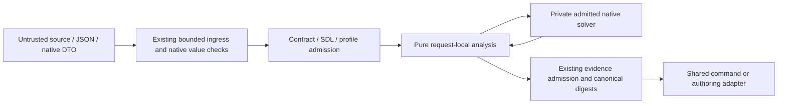

# Processor analysis architecture preflight

Issue #1789 is the delivery contract. It has no formal requirement UID.
The inspected baseline is `e039884f818e5eb7d3a20cc0cdffa3d4723c2735`.
This note records guardrails and open design questions.
It gives no implementation plan or parity claim.

## Existing owners

Analysis and its claims stay in `rae` under the [runtime split](issue-1891-runtime-repository-boundary.md).
Runtime witnesses use versioned public APIs. They cannot change an analysis claim.
The [current architecture](../develop/go-architecture.md), [ADR-123](adrs/adr-123-go-engineering-standards.md), and [ADR-124](adrs/adr-124-go-architecture-model.md) already govern this work.
No new ADR or parallel architecture model is needed for these guardrails.

Paths in this table are relative to `implementations/go/`.

| Concern | Canonical incumbent and boundary |
| --- | --- |
| Analysis entrypoint | Planned public `processor/analysis.Analyze`, `Request`, and `Result`. Keep this interface. Declare missing typed inputs in its owning design. |
| Semantic comparison | Implemented `processor/comparison`: `FromScenario`, `FromDocument`, `FromModule`, `Coordinate`, `BuildImpactScope`, and `Analyze`. Reuse its sealed artifacts and owner projections. Keep bounded work and two-sided scope. |
| Published transport shapes | `contract/binding` generated records. Use `Field[T]` for presence. Root `contracts/schemas/` remains normative. Add no second DTO family or standalone exploit-input schema. |
| Complete contract checks | `contract/admission.Validator.Validate`, `CheckTransport`, and native fragments. Existing rule owners include `satisfiability_model.go`, `satisfiability_witness.go`, and `exploit.go`. They also include `opacity*.go`, `synthesis*.go`, `authoring.go`, and `comparison.go`. |
| Schemas and profiles | `contract/validation`, `contract/profile`, `contract/concept`, and packaged `internal/contract/corpus`. Schema checks alone do not grant full admission. Profiles and catalogs are explicit, pinned local inputs. |
| SDL phases | Public `sdl`, backed by `internal/sdl/source` and `internal/sdl/authoring`. Reuse their parsing, checks, imports, and phase admission. Reuse their formatting, transformations, instantiation, and canonical bytes. Some authoring APIs remain internal. |
| Compiled facts | `processor` owns the single typed model and native compilation admission. Use typed facts when compilation is needed; never decode `RuntimeModel.Document()` between services. |
| Shared mechanics | `base/ingress`, `base/canonjson`, `base/digest`, and `base/address`. Also reuse internal base `value`, `graph`, `jsonpointer`, `domain`, and `softwareversion`. Keep each graph and equality policy distinct. |
| Failures and observation | `base/fault`, `contract/diagnostic`, internal `base/logrecord`, and `log/slog`. Preserve ADR-116 categories and ADR-066's separation of logs, audit, evidence, and provenance. |
| Compatibility evidence | `internal/parity`, `runners.go`, `runner-inventory.json`, and the [corpus design](issue-1778-parity-corpus-design.md). Product services cannot read expected results or invoke Python. |

The existing facade accepts a compilation plus `Options map[string]any`.
That declaration does not supply every service's actual input or admission context.
Satisfiability needs authored finite domains. These precede instantiation and compilation.
Exploit analysis needs its snapshot, graph, bindings, and query.

Opacity needs a carrier or transition model plus its exact profile and catalog.
Synthesis needs pinned assertions and decisions.
Authoring comparison needs a vector and both observed outputs.
Do not create a dummy compilation for these inputs.

Do not use arbitrary option maps as their domain model.
Keep the declared facade. Record its typed additions and owners before code.
Check exact native handles, including embedded handles.
Caller methods cannot replace admission.

Declare changed packages, imports, and exported names in `implementations/architecture.json`.
Record build settings and API commitments there too.
Update its bound design evidence and the current system view as required.
Pass `archcheck -design` on that changed model before implementation.
Checking the unchanged model does not certify the new design.
This preflight does not certify it either.

## Solver boundary and evidence identity

Use a private processor adapter over an existing Go C-API binding.
The required Z3 version is `4.16.0`.
Add no general solver framework.

Keep Z3 out of contract admission and public records.
[aclements/go-z3](https://github.com/aclements/go-z3) is a candidate binding, not an admitted dependency.
Its README requires a C library.
That claim does not qualify an exact binding revision for this issue.
The [Z3 4.16.0 source](https://github.com/Z3Prover/z3/tree/z3-4.16.0) fixes the required engine baseline.

The binding revision and license still need review before code.
Its supported platforms and build/link route also need review.
Check logic selection, assumptions, parameters, and unknown handling.
Check version reads, context lifetime, and bounded interruption too.

If the binding lacks a required operation, record an alternative.
Explain its tradeoffs before code.
Do not copy a binding or add custom FFI without that decision.
A process-based route also needs that decision.

Apply [ADR-106](adrs/adr-106-developer-package-and-artifact-management.md) and the [#1773 admission route](issue-1773-go-toolchain-admission-design.md).
The binding belongs in reviewed `go.mod`/`go.sum` and the architecture layer's external imports.
Native libraries, headers, compilers, and binaries need admitted build inputs.
Record their source and build route.

The artifact lock cannot grant a new artifact class.
It cannot grant a new install action either.
Reuse `implementations/tooling/artifacts.lock.json`, `tools.bootstrap_profile`, and existing artifact policy validators where applicable.
Do not use an ambient system Z3 or a Python wheel's private library.
Do not download at runtime or silently accept another engine version.

Account for cgo in development containers, CI, supported release builds, and downstream consumers.
Record GOOS/GOARCH, compiler and ABI requirements, and header/library pairing.
Record loader search paths and required notices too.
Load only the admitted library.
Matching versions do not prove matching bytes or origins.
Safely refuse missing or mismatched native inputs.

A no-cgo build must not silently omit analysis or substitute another algorithm.
Keep contexts request-local and release native resources on every exit.
Define who owns concurrent calls and cancellation.
Go race checks do not prove C-library safety.
A Go timeout cannot leave a native call running without a bound.
It cannot free a context still in use.

The new closed solver profile identifies the exact Go binding revision and Z3 engine.
Keep `raes-z3-finite-domain/v1`, `z3-solver`, `4.16.0.0`, and `4.16.0` correlated exactly for Python evidence.
Do not widen identity fields independently.
The schema must refuse mixed Python/Go identities.
The only published-schema exception adds a solver profile to `scenario-satisfiability-evidence-v1`.

The Python exception covers its solver model only.
`schema_bundle()` must reproduce that schema. Python execution stays unchanged.
Record the contract change under the current per-schema publication policy and in the delivery record.

The current manifest selects `contracts/schema-publication/entries`; it no longer requires per-change content hashes.
Use existing generators for bindings and packaged corpus.
Keep schema generation, publication checks, and architecture commitments in agreement.

Preserve these output-affecting invariants from Python `satisfiability/_solver.py`:

- `QF_LIA`, seed `0`, one thread, `auto_config=false`, `model=true`, and `unsat_core=true`.
- One 5,000 ms operation deadline, starting before model validation. It includes construction, all probes, and final selection.
- Each probe receives the remaining timeout, rounded up to milliseconds and capped at 5,000. Reject results at or after the deadline.
- The check budget is `1 + max(sum(domain sizes), clause count)`. Consume it before each probe; reuse one incremental session.
- Ordered finite-domain witness selection and sorted-deletion subset-minimal cores. Do not publish Z3's arbitrary model or raw core.
- Type-sensitive scalar equality, unique clause IDs, inert encoded solver names, and explicit empty-domain contradictions.
- `unknown`, deadline exhaustion, and check exhaustion are operational failures without completed evidence. They are neither unsatisfiable nor typed unsupported.

Keep the translation bounds: 128 symbols, 512 clauses, 256 domain members, and 64 diagnostics.
Keep exact variable pointers and supported target normalization.
Keep analysis, solver, witness, snapshot, and canonicalization profile identities distinct.
The diagnosed migration policy stays local to satisfiability.
It must not weaken strict authoring comparison.

`base/clock` owns wall-clock reads. It does not own monotonic watchdogs.
Its UTC conversion discards monotonic information.
Record a narrow elapsed-time/deadline seam in the existing time design.
Tests need to inject elapsed time at that seam.

Do not scatter `time.Now` calls through services.
Do not use SDL simulation time or adjustable UTC time for the watchdog.
Host speed still affects completion.
Check timeout paths with controlled elapsed time.
Check real native solving with separate smoke cases.

## Gates across the data path

| Layer | Required protection and reuse |
| --- | --- |
| Files and parser | Bound reads before decoding. Keep SDL byte, scalar, node, alias, expansion, and import bounds. Exploit input has a 2 MiB cap. Opacity carrier/model files have 8/16 MiB caps. Use `base/ingress` with each surface's JSON policy. Preserve its accepted syntax. |
| Native Go values | Check native values before copying, hashing, or recursion. Use `CheckTransport` or the existing native-value boundary. Refuse cycles, foreign callbacks, invalid Unicode, and non-finite numbers. Bound depth and work. Generated structs do not grant admission. |
| Shape and semantic checks | Run the published schema and existing family predicates. Keep defaults, closed unions, presence, and canonical order. Keep count joins, digest joins, and outcome payload exclusivity. Retain checked handles. Do not copy these predicates into each service. |
| Trusted context | Supply exact profiles, catalogs, native artifacts, and phase owners explicitly. `satisfiability_witness.go` requires the native `MaterializationCompiler` context. Contract code cannot import processor or SDL to recover that context. A caller digest or claimed validation flag grants no authority. |
| Config and environment shapes | Reuse `sdl.ParseOptions.Validate`, `Limits.Validate`, and profile limits. Keep native SDL credential/environment rules. Authored `env`, commands, paths, and locators remain inert data. Add no ambient environment lookup or arbitrary solver flag map. Add no callback dispatch or config registry. Build/link settings belong to admitted host tooling. |
| Secrets and information flow | Keep logical secret references inert. Never resolve operator secrets or read secret files. Preserve source information-flow policies in synthesis records. Hashing and derived evidence do not declassify inputs. Safe diagnostics and opacity counterexamples carry approved projections rather than source bodies or secret-bearing locators. |
| OS and native execution | Only the admitted solver boundary performs native solving. No shell, DNS, backend probe, source-adapter dispatch, or runtime acquisition. The proposed C-API route puts no source in process argv. An alternative process design must bound I/O. It must control the environment and executable identity. It must stop children. Keep source and credentials out of argv, stderr, and temporary artifacts. |
| Authentication and authorization | This issue adds no auth surface. Path IDs, strategy IDs, and scope labels confer no authority. Analysis success does not permit delivery. Runtime retains transport authentication and actor/scope/target policy. It also keeps information-flow checks and result admission. Do not import runtime authorization into pure analysis. An analysis handle grants no bypass. |
| Error envelopes and logs | Use the six `fault` categories and standard `errors.Is`/`errors.As`. Keep diagnostic codes, stages, severity, pointers, counts, and order. Dotted diagnostic codes are not fault codes. Allow only safe solver phase/reason metadata. Do not render native errors, rejected values, source paths, or arbitrary wrapped causes. Log unexpected failures once at the application boundary. |
| Command behavior | Reuse shared authoring command composition. Add no dispatcher. Python `raes_cli/processor.py` fixes JSON and exit behavior. Completed positive/negative results use 0. Typed unsupported uses 2. Expected input/operational failure uses 1. ADR-116 keeps 70 for unexpected CLI failures. It also keeps safe MCP envelopes. |
| State and persistence | These services return values and replay supplied evidence. Add no database, cache of caller data, audit store, lease, queue, worker, or runtime journal. Loading a contained corpus is not runtime persistence. Preserve caller inputs and copy retained projections. |

Operational log escaping cannot make arbitrary payload text safe.
Do not log models, raw diagnostics, assignments, solver programs, source locators, or candidate bytes.
Evidence may contain authored information under its contract.
Operational logs may not copy it.

The existing environment shape owner is `contract/admission/sdl_environment.go`.
The runtime auth references remain `raes_runtime/control_plane_security.py` and `control_plane_api/_auth.py` under the Python package root.
They keep their existing authority; analysis supplies no replacement principal shape or token path.

## Service-specific claims and extension seams

Exploit analysis keeps canonical breadth-first monotonic-additive search.
It keeps exact binding admission and closed query semantics.
Keep the initial-goal case, prerequisite checks, advancing-effect checks, state identity, and witness order.
Keep the 4,096-state, 256-blocked-transition, 512-impossible-transition, and 64-diagnostic evidence caps.

Depth exhaustion remains visible in bounded failure evidence. An invalid path is not a universal impossibility proof.
Do not truncate evidence and claim completion.
Do not merge this search policy into a universal graph engine.

Opacity's shared information-cell key includes initial information, observation, and memory.
It also includes release, coalition fusion, strategy, and order.
Both finite-carrier and model-check services use that same kernel.
They keep their own admission and evidence lanes.
Keep complete secret-obligation counts, lowest-ordinal counterexamples, canonical shortest paths, coverage, and explicit non-claims.

Do not infer coalition opacity from individual opacity.
Do not merge strategies or omit order context.
Vacuity cannot become success.
The model schema admits up to 100,000 states and 200,000 transitions.

The checker supports only 4,096 states and 65,536 transitions, fixed in its evidence schema.
These are different boundaries.
Larger admitted models produce the reference unsupported result.
Do not change the schema or strengthen the claim.
Finite testing, complete finite-model checking, formal proof, runtime enforcement, and source authenticity remain distinct.

Semantic comparison already has its own owner.
Extend it only for demonstrated gaps.
Keep presence, identity, textual, structural, semantic, dependency, provenance, and completeness axes separate.
Request limits cannot exceed the exact admitted profile.

Preserve unknown and incomplete results.
New artifact types extend the owning projection/profile seam.
Add no generic JSON diff or caller-supplied projection callback.

Candidate synthesis uses the exact `concept-nodes/v1` profile coordinate and complete-content digest.
Its source-neutral assertions and decisions remain separate from retrieval adapters and credentials.
Reuse native formatting and ordinary structural/semantic re-entry.
Success does not instantiate, compile, plan, or execute the candidate.

Keep all-or-none refusals and construct contribution owners.
Keep exact bytes, semantic digest, and derivation digest distinct.
No guessed relations, defaults, placeholders, or source-specific dispatch may fill unresolved meaning.
The future seam is a separately admitted immutable transformation profile.
Add no editable global registry or plugin loader.

Authoring comparison follows `specs/conformance/authoring-adapters.md` and its report schema.
Its behavior reference also includes `raes_conformance/authoring_adapters.py` and `_authoring_observations.py`.
Use native SDL validation/rename and `processor/comparison`.
Reuse `authoring.Parser.FormatContext` and `Parser.Transform` through their proper owner.
Declare any missing public seam.

Do not copy internal methods into analysis.
Add no second validation or comparison workflow.
Keep strict rejecting migration, self-contained inputs, fixed parser ceilings, corpus containment, and nonempty case sets.
Preserve the diagnostic semantic multiset, including multiplicity, without inventing a diagnostic DTO.
Recheck source-admission refusals and transformation-report requirements.
A claimed operation is not evidence it ran.

Keep artifact, diagnostic, provenance, and semantic dispositions independent, including the bound semantic companion result.
Two identical wrong outputs cannot pass.
Each observation must match the fixed oracle.
`representation-evidence-missing` alone does not make this profile's semantic axis incomparable.
All byte, diagnostic, report, and case-count limits remain fixed by that versioned profile.

## Evidence and repository gates

The fourteen published schemas in the six issue families already exist with Go bindings and admission rules.
Reuse them; schema acceptance does not establish solver correctness, reachability, equivalence, or full semantic admission.
Replay recomputes source, model, query, configuration, witness, and result joins. Tampering is an evidence-integrity failure.
Use the exact canonicalization profile for each digest, including default and null materialization.
`canonjson.JCS`, sorted Python JSON, raw-byte hashing, and SDL canonicalization are different operations.

The current runner inventory has no satisfiability or exploit-path command runner.
Existing schema and processor parity therefore does not establish analysis coverage.
Register real service runners and required inventory keys through the incumbent harness.
Never hand-edit golden expectations or let product code read them. Corpus recording remains CI-only.

Changing the solver identity also changes `solver_configuration_digest` and any enclosing digest that binds it.
Any parity allowance must name exact identity paths.
Validate both profiles independently. Recompute their dependent digests.
Do not ignore all digests or erase whole solver configurations.

Do not weaken production replay across profiles.
The Python solver-model exception also affects corpus provenance and generated bindings.
Use the existing CI recording route.
Preserve admission's retained reference baselines when refreshing generated corpus material.
Use tooling `cmd/contractgen -check` for bindings, rule specifications, and embedded corpus consistency.

Trace every scoped Python input limit, security check, error, recovery, and defect to a Go test.
Start with the satisfiability/exploit service and CLI tests, opacity issue #961/#962 tests, candidate-synthesis tests, and authoring-adapter tests.
Include the semantic comparison defects under #1210 and relationship/candidate parity under #1339.
Follow behavior and helper dependencies beyond filenames.

Runtime/proof tests do not put their implementation in scope automatically.
Add failure-path coverage for native identity, unknown results, deadline edges, cleanup, concurrency, and schema profile cross-products.
Use controlled time for budget assertions.
Do not make host speed a golden expectation.

Reuse `.ground-control.yaml`, `.gc/plan-rules.md`, `tools/policy/adr_policy.yaml`, and the existing architecture checker.
Keep `implementations/.golangci.yml`, `implementations/.gremlins.yaml`, locks, generators, and `.github/workflows/canonical-verification.yml` authoritative.
Do not invent a formal requirement UID for this requirement-free issue.
Local verification uses explicit cases and changed-path prose/policy checks.

CI owns full test, race, coverage, mutation, fuzz, corpus, and regression gates under their existing scheduling rules.
Regression naming retains ADR-123's merge-base failure rule.
Port parity tests are not automatically new-defect regressions.

## Non-goals

This preflight changes no code, schema, binding, architecture commitment, or accepted ADR.
The implementation does not redesign SDL, alter analysis budgets, broaden theories, change proof claims, or replace existing comparison semantics.
It does not change released Python behavior beyond the explicitly allowed solver-model schema addition.
It adds no runtime execution, source retrieval, new hosting, service, persistence framework, authentication route, or repository extraction.
The #1804 cutover and #1891 extraction retain their existing owners and acceptance boundaries.
