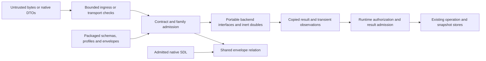

# Backend contracts and test doubles architecture preflight

Issue #1790 is the delivery contract. It has no formal requirement UID.
This note records boundaries and design risks, not an implementation plan or a parity claim.
The inspected baseline is `e039884f818e5eb7d3a20cc0cdffa3d4723c2735`.
The issue's findings describe the older `036d1af96` tree.

## Ownership and existing decisions

Apply [ADR-060](adrs/adr-060-participant-backend-facing-contract-surface.md),
[ADR-070](adrs/adr-070-realization-envelope-semantics.md), and
[ADR-115](adrs/adr-115-concrete-backends-owned-outside-raes.md).
The [runtime split](issue-1891-runtime-repository-boundary.md) controls ownership at the breaking launch.
The [public API design](issue-1825-public-go-api.md#processor-and-backend-operations) already declares the consumer interfaces.
These decisions suffice. This note adds no ADR or contract authority.

Paths below are relative to `implementations/go/` unless stated otherwise.

| Concern | Canonical owner and boundary |
| --- | --- |
| Backend roles | Planned public `backend`, with declarations in `implementations/architecture-api/planned/rae/backend.go.txt`. Keep small role interfaces and optional extensions. Do not create a universal backend interface. |
| Portable doubles | Planned public `backend/stub`. Keep the pure behavior of the Python stubs. Runtime owns target factories. It also owns registration, invocation and fixtures that need live execution. |
| Shared native results | Planned public `contract/runtime`. Its declarations own `ApplyResult` and preparation. They also own participant requests and transient observations. This package carries portable contract data. It is not the live runtime. |
| Published payloads | Root `contracts/schemas/` is normative. Generated `contract/binding` records already cover manifests, profiles and envelopes. They also cover plans, snapshots and operation carriers. Keep one Go type identity. |
| Shape and semantic admission | `contract/validation` owns offline schemas. `contract/admission` owns complete family rules, trusted contexts and native fragments. Generated records alone are not admitted objects. |
| Manifest construction | Reuse `admission.NormalizeBackendManifest`, `backend_capability_models.go`, `manifest_models.go` and `manifest_capability_joins.go`. Do not rebuild Python's internal dataclass-to-v2 adapters. |
| Profiles and packaged data | `contract/profile.Load` and `Documents`, `internal/contract/corpus.Open`, and `internal/contract/packaged` already load checked corpus data. Root `contracts/profiles/backend/` defines each backend profile's contract set. Add no Go lookup table for those sets. |
| Envelope semantics | `admission/envelope.go`, `materialization_offer*.go` and `realization_offer*.go` own carrier checks and bounded relations. `sdl.EnvelopeMembershipDiagnostics` supplies native instantiated SDL and typed presence. Extend these owners. |
| Planning and realization | `processor/planning` takes the full envelope as an input. `processor/realization` owns concern projection and support checks. It also owns prepared-selection checks. `processor.CompiledComponentOptions` and `ScenarioComponentOptions` derive component flags from scenarios. |
| Participant support and relations | Reuse `admission.ParticipantFeatureSupportGaps` and `ParticipantResourceMeasureSupported`. `processor.ParticipantSupport` already checks compiled tool and resource demands. Its action-result, outcome, temporal and history relations stay with processor. Higher-level composition uses these APIs; backend must not copy them or import processor. |
| Shared mechanics | Reuse public `base/ingress`, `base/fault`, `base/clock`, `base/address`, `base/canonjson`, `base/digest`, and internal base `value`, `domain`, `graph`, `jsonpointer`, `secretref`, `urisafety` and `timestamp`. Preserve each helper's grammar and equality profile. |
| Errors and logs | `contract/diagnostic` and internal `base/logrecord` implement ADR-116. ADR-066 keeps logs distinct from evidence, audit and provenance. |

The backend layer uses contract and base layers. It imports neither processor nor live runtime.
Contract packages cannot import backend or SDL packages.
Use narrow owner inputs for facts that lower layers cannot obtain themselves.
Do not add callback registries where an existing typed owner seam already applies.

## Design gaps that must close before code

The current model passes `archcheck -design`.
That result does not approve undeclared packages or prove that planned APIs exist.
Neither `backend`, `backend/stub`, nor `contract/runtime` has an implemented package at this baseline.

- **Portable result dependency:** deliver the declared `contract/runtime` records with this issue. Backend interfaces need them. The consumer map assigns them to #1790. Do not use `runtime/experiment` records or copy result structs into backend. Do not import live runtime to make signatures compile. Keep transient realization observations and materialization submissions. Keep the separate participant action result too.
- **Stub construction inputs:** the declared constructors accept no clock or full envelope. Python stubs accept both. Specify explicit inputs for a fixed test clock and an admitted envelope. Keep the existing constructors and six manifest flags. State how versions are selected. Do not hard-code a Python release. Do not infer apparatus identity from the host toolchain.
- **Complete envelope relation:** current Go code checks carriers and native membership. Open-offer diagnostics do not provide general subsumption. No complete public witness/probe API is declared. Add these operations through the existing relation owner. SDL owns scenario construction and checks. Conformance composes them. Backend must not import SDL. One bounded flattening, closure and domain interpretation must serve every relation.
- **Protocol coverage:** the issue's Python protocol count is historical. Inventory current roles, data-only structural protocols and helper behavior. Record each role's public API and owner after the split. Include inventory, recovery observation, augmentation, inject execution and invocation tools. Include mixed services and trial adapters too. Do not drop a protocol because it is absent from `protocols.py` or the first declaration file.

Declare packages and imports in `implementations/architecture.json` before code.
Declare exported names and typed API commitments there too.
Keep the planned declarations, hashes and [system overview](../develop/go-architecture.md) aligned through the existing architecture tooling.
Pass `archcheck -design` on that completed design before code, as ADR-124 requires.
This preflight changes no model or API commitments.

## Validation and security through the complete path

The final two nodes are consuming boundaries, not new work in this issue.

| Layer touched | Required control and incumbent |
| --- | --- |
| JSON and direct values | Use `ingress.Parse` before schema checks. Keep byte, depth, duplicate-member, Unicode and number bounds. Use `admission.CheckTransport` or `CheckTransportTree` for native carriers. These checks precede marshaling, copying and hashing. Raw JSON leaves also need bounded checks. Do not invoke foreign marshalers or getters during checks. |
| Work budgets | Reuse internal `value` and the existing relation budgets. Bound graph expansion, record recursion, path tokens and numeric work. Bound probes, diagnostics and total output too. Check counts before allocation. Prevent integer overflow. Do not weaken a shared limit to admit one fixture. Keep document bytes distinct from scalar-byte limits. |
| Schema and semantic rules | Use packaged schemas. Use `admission.Validate` where complete admission is required. `CheckPortable` proves only the local portable claim. Supply existing trusted contexts for joins. Missing context must fail closed. Keep `Field[T]`, exact number carriers and defaults. Keep unknown-field refusal. |
| Manifest capability joins | Reuse manifest admission. It checks governed vocabularies, concept scopes, compatibility and declared contracts. Keep cleanup/time family coupling and coordinated-reset requirements. Keep operation-supervision contracts, feature evidence and capture-offer checks. Schema-valid data can still fail capability admission. |
| Profile ID and corpus identity | `backend.LoadProfile` must check the ID grammar before it builds a path. Keep `^[a-z0-9]+(?:-[a-z0-9]+)*$` and the closed profile shape. The payload ID must match the requested ID. Read the existing packaged corpus offline. Reject traversal, absolute paths, swapped IDs and absent profiles. Return copies of cached data. |
| Configuration, environment and secrets | Reuse `manifestConfigurationTargets`, `configurationTargetModel`, `sdl_environment.go` and `sdl_secrets.go`. Keep alias uniqueness and literal/secret-reference unions. Keep value types, sensitivity and control-context restrictions. Keep the `value_from` exclusions and `operator_secret` rules. Pure checks never resolve credentials. They never read ambient environment values. |
| Host and OS exposure | URI, path, script and environment payloads remain inert data. Reuse `urisafety` for its governed locator fields. Portable contracts and stubs need no daemon, network fetch or shell. They need no subprocess or extraction. Never put resolved secrets in process argv, URLs, logs or child-process environments here. |
| Authentication and authorization | These portable interfaces add no authentication route. Native handles, sealed fragments, manifest declarations and digests grant no caller authority. Keep consuming `raes_runtime/control_plane_security.py`, `operation_actor_scope` and transport `_auth.py` checks. Runtime must still bind actor, target/run and authorization scope. It must check installed components too. These checks precede invocation and result publication. |
| Operation contexts and recovery | Reuse `admission/backend_context.go` and `backend_history.go`. Bind responses to the exact request, control, installed capabilities and their digests. Keep budgets and sequence/content consistency. Keep evidence, residual scope and cessation requirements. A cancel acknowledgement does not prove cancellation. Unknown completion requires reconciliation. It does not permit blind redispatch. |
| Error envelopes | Reuse the six `base/fault` categories and `contract/diagnostic`. Dotted domain diagnostic codes differ from fault codes. Fault codes use a restricted hyphenated grammar. Keep stable codes, addresses, order and safe surface projections. Do not expose rejected values, host paths or parser text. Do not expose wrapped causes or native provider details. Keep missing objects, domain refusals and code defects distinct. |
| Logging and observations | Reuse the bounded `logrecord` handler for operational records. Libraries do not configure global logging. The handler escapes text. It does not remove secrets from arbitrary strings. Log foreign failures once using safe category/type metadata. Never treat operational logs as conformance evidence. Declarations do not prove observed delivery. |
| Persistence and ownership | Portable doubles keep only owned in-memory state. Return copies and keep unrelated snapshot domains. Runtime/store owners retain durable claims, CAS, leases and idempotency. They also retain operation ledgers and recovery. Add no second repository, journal, archive destination or transaction mechanism. |

Untrusted DTOs remain mutable even when they use generated types.
Recheck them at trust transitions, then retain owned copies.
Reject foreign fragment implementations through the incumbent exact-owner checks.
For concurrent operations, give each call an independent predecessor and bound workers.

Runtime retains revision-checked merge and publication authority.
Copies must own nested maps, slices and raw JSON too.
Keep resource quantities exact when checking pool totals and parent budgets.
Reuse the existing quantity and profile owners instead of truncating numbers to machine integers.

## Semantics and parity traps

An envelope expression, its full carrier and its manifest identity are different objects.
The manifest's identity does not contain the full expression or configuration.
Keep identity-only manifest planning refusal unless the caller supplies the independently admitted full envelope.
Check envelope ID, contract/schema versions, envelope digest and configuration digest together.
Do not fetch the full declaration from its ID or silently substitute a reference envelope.

Keep the carrier's twelve governed concern disclosures.
Keep their transformation/observation coupling too.
Keep operating-system rows coupled to the operating-system concern.
Use the reference's exact projection and sorted-JSON profile for configuration and envelope digests.

Other commitments use JCS. `canonjson.JCS` and `canonjson.Sorted` are not interchangeable.
Do not hash a raw DTO before applying the owning defaults and serializer omissions.
Set-valued claims have stable order. Evidence and binding sequences retain their defined order.

Membership requires concrete, semantically valid SDL with no unresolved variables.
Projected subtree membership does not prove whole-instance membership.
Keep native field presence and missing/null distinctions.
Keep record field order, token ancestry and indexed paths.
Keep scope precedence, sibling conflicts, open overlays and non-overrideable widening refusal.

Subsumption means requested is a subset of offered. Witness sampling cannot prove this.
Keep governed-reference authority and Boolean/number distinctions.
Keep interval endpoint rules too.
Witnesses and positive/negative probes use ordinary SDL construction, instantiation and validation.
A negative probe must be valid SDL outside the envelope.

A witness proves neither subsumption nor backend honesty.
Witness-policy seeds remain distinct from experiment seeds and random streams.
`base/clock` supplies wall timestamps. `TimeRuntime` governs semantic time.
Neither is the runtime's monotonic execution watchdog.

Keep manifest feature presence, API-407 support strength, realization posture, contextual willingness and observed delivery separate.
Missing strength is not exact support. A method or schema's presence establishes no effective capability.
Capture matching must satisfy all dimensions with one offer.

Do not combine unrelated offers.
Optional interfaces negotiate only the declared role. They do not justify reflection, discovery or default success.

The portable stub is stateful test behavior, not an empty success response:

- Keep create/update/delete/unchanged behavior and dependency lists. Keep changed-address order and unrelated snapshot entries.
- Keep workflow start state, observable steps and result/history defaults. Stop removes only its own domain's state. Do not execute a workflow engine inside the stub.
- Keep evaluator result-contract defaults, score/pass presence and event order. Proposition/assertion operations retain their distinct admitted behavior.
- Keep participant episode IDs, lifecycle history and live-predecessor checks. Keep action-result consistency too. Reuse existing pure contract checks. Do not move live participant controllers into `rae`.
- Keep failure rollback. This includes episode counters and internal state in coordinated reset. A failed native outcome must not commit its proposed snapshot.
- Keep generation fencing before work and completion. Bound concurrent calls and pass cancellation through. Keep deterministic request/result order where applicable.
- Keep transient realization observations until runtime admission. A snapshot projection must not discard them early. It must not turn them into verified persisted evidence.

`stub.DefaultOptions` differs from the zero value and from Python's runtime target factory defaults.
The manifest defaults enable orchestration, evaluation, participant and observation, but disable time and envelope carriage.
`create_stub_target` separately enables time and envelope carriage.
Keep this distinction when runtime composes the Go doubles.
The reference stub does not advertise operation supervision, autonomous execution or `random_value` generation it cannot perform.
Do not infer claims from the list of all published contracts.

## Verification and repository conventions

Use the existing `internal/parity` loader, runners, `runner-inventory.json` and `admission-inventory.json`.
Root `tools/parity_*.py` owns corpus capture and provenance.
The frozen corpus names Python revision `68af9beda9890e7bc94c68f5de82b6942d37ec02`.
It is distinct from this checkout and the issue's review revision.
Do not regenerate expected results from the Go implementation or rewrite frozen provenance to hide a mismatch.

The corpus has manifest, profile, envelope and operation schema cases plus backend-conformance command cases.
Schema cases do not alone exercise stub transitions, relation operations or trusted contextual joins.
The runner inventory does not yet claim `cli conformance backend` implementation.
Keep whole CLI composition with its owning port and runtime split. Reuse portable behavior here.

Map every scoped Python limit and security/error/recovery behavior to a Go test.
Map each defect case too. Existing equivalent tests can supply this coverage.
Name runtime-owned cases. A Python import alone does not put the whole test in this issue.

Important reference groups include `test_backend_manifest*`, `test_backend_profiles`, `test_realization_envelope*`,
`test_stub_backend*`, and issue tests 967, 1276, 1360 and 1678 under `implementations/python/tests/`.
Also trace scoped helper behavior through participant control, resource budgets, time, preparation, capture and invocation-tool tests.
Retain refusal-without-state-change and secret-sentinel cases, not only valid fixture round trips.
Use existing independent reference fixtures in `contract/admission/testdata/`; do not replace those tests with self-consistency checks.

Repository-wide gates remain in `.ground-control.yaml`, `.gc/plan-rules.md`, `implementations/architecture.json` and `.github/workflows/canonical-verification.yml`.
ADR-123, `implementations/.golangci.yml`, `.gremlins.yaml` and the existing tooling module govern Go checks.
Use file-scoped policy, documentation checks and explicit test cases locally.
Full tests, integration, fuzz, mutation, coverage and regression gates remain in CI/CD.

Keep `GOTOOLCHAIN=local` and read-only module resolution.
Add no dependency or tool download for this preflight.
Do not invent a formal requirement UID for this requirement-free issue.
Keep the issue-based workflow route and existing metadata rules.

## Non-goals

This issue changes neither Python nor published schemas, contract IDs, SDL semantics or released command behavior.
It introduces no concrete backend, daemon integration, plugin discovery, transport protocol or consumer adapter.
Go interfaces do not replace the language-neutral published wire contracts with Go-specific interoperability claims.
It does not move repositories, publish modules or authorize data transfers.

It adds no live registry, authorization system, durable store, worker, scheduler or runtime target factory to `rae`.
It adds no parallel schema set, capability catalog, exception hierarchy, relation engine or workflow dispatcher.
Existing public API declarations constrain design; they are not permission to omit missing reference behavior.
