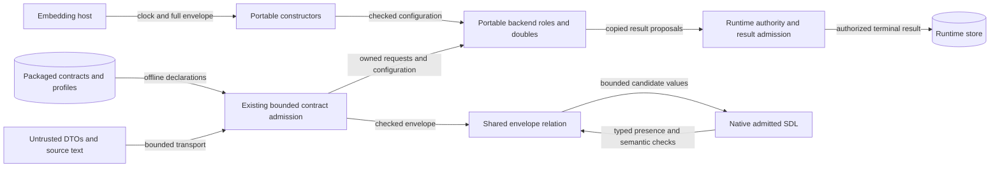
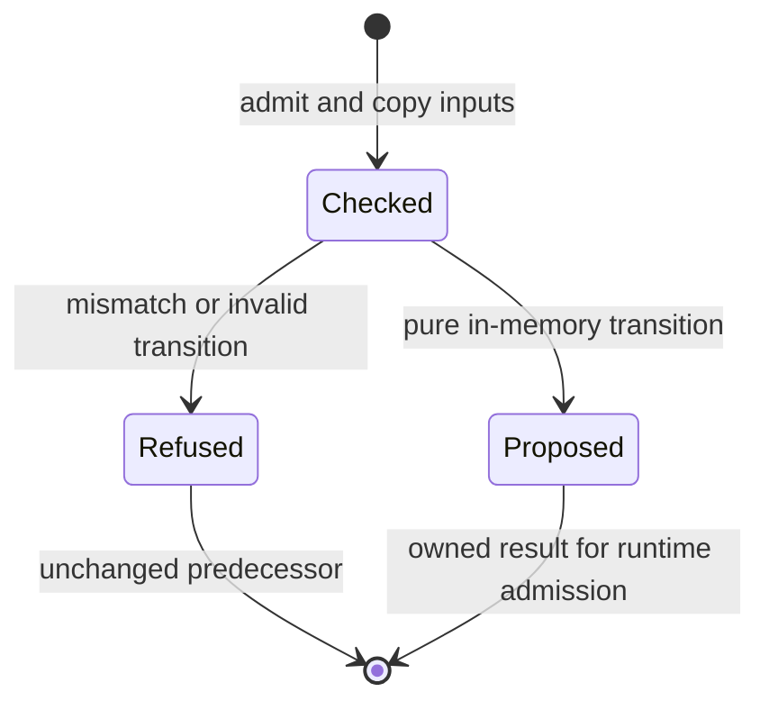

# Portable backend contracts and doubles

This design covers issue #1790 on `go-cutover`.
The user approved additive public API changes on 2026-11-17.
Existing public signatures remain fixed.
Python and published schemas remain unchanged.

## Components

`contract/runtime` owns portable native requests, results, and preparation records.
It has no dependency on the live runtime or a backend.
`backend` owns small role interfaces and profile access.
`backend/stub` owns inert in-memory doubles and their manifest.
Both packages are public and import only contract and base owners.

Generated `contract/binding` values carry published payloads.
Their presence does not prove admission.
Use `contract/admission` for transport bounds and semantic rules.
Use `contract/validation` and packaged data for schemas and defaults.
Use `contract/profile` for packaged profile documents.
Profile IDs must pass the published grammar before any path lookup.
The requested ID must match the payload ID.
Return independent copies of loaded documents.

The existing manifest normalizer supplies canonical backend-manifest-v2 output.
Construct no second Python-style capability object hierarchy.
Keep capability comparisons in the existing admission owner.
Keep declared support, observed support, and authorization separate.

## Native contracts

The planned `contract/runtime` declarations define the shared records.
`PrepareForRequest` binds the exact plan and predecessor digests.
It validates bounded native carriers before copying or hashing them.
It uses the existing canonical JSON and digest owners.
The request digest follows the published runtime plan projection.
A materialization submission is bounded UTF-8 SDL, with its fixed contract ID.
It carries source text, not proof of semantic admission or native delivery.

A participant action request is a sealed owned value.
`BindParticipantAction` checks identities, typed fragments, selection joins, and execution coordinates before sealing it.
It returns copies from `Input`.
Foreign fragment implementations cannot pass through this boundary.
Runtime still checks actor authority and validates native outcomes before publication.

Transient realization observations stay separate from persisted snapshots.
They retain their operation, configuration, envelope, sequence, and observer bindings.
A declaration cannot manufacture verified observation evidence.

## Interfaces and ownership inventory

| Python concern | Go owner and disposition |
| --- | --- |
| Provisioning, preparation, orchestration, evaluation | Existing planned `backend` role interfaces; typed plan and snapshot carriers |
| Participant lifecycle, autonomous actions, shared time, coordinated reset | Existing planned optional backend interfaces; portable requests in `contract/runtime` |
| Operation supervision and inject occurrence opt-in | `backend.OperationProvider`; explicit contract negotiation plus compile-time method checks |
| Participant control v1 and v2 | Existing separate backend interfaces; shared admission retains contextual joins |
| Read-only inventory and recovery observations | Optional backend interfaces; bounded native request/result records in `contract/runtime` |
| Augmentation preparation | Optional backend interface; existing contract admission owns preparation and effect joins |
| Mixed bridge, time coordinator, stage reader | Separate optional backend interfaces using existing published binding records |
| Invocation-tool port and attachment | Portable role interfaces and data only; live grants and attachment lifetime remain runtime-owned |
| Resource-demand, fairness, policy, and capability structural protocols | Reuse admitted contract payloads and existing capability checks; no duplicate interface hierarchy |
| Trial execution adapter, inject resolver, registration, target factories | Runtime-owned composition; keep with runtime and its extraction boundary |
| Capture offers, topology, account features, naming, service materialization | Reuse existing contract admission rules and native processor owners; preserve helper tests in the source-case map |

The implementation records exact API additions in the planned declarations before each affected source change.
The model binds typed API snapshots, imports, and owning documents.
The design check must pass before implementation begins.
Affected documents and commitments change together when a detailed API changes.

## Envelope relations

`contract/admission` remains the owner of bounded envelope interpretation.
Its existing domain, path, scope, closure, and membership code supplies the shared relation.
Extend that owner for general subsumption and witness/probe projections.
Do not add a second relation engine to backend or conformance.
`SDL` construction, instantiation, validation, and native presence remain with `sdl`.
The public SDL seam composes projections into admitted witnesses and probes.

Subsumption checks whether the requested set is contained in the offered set.
It is not a sample test.
Keep exact and finite domains, interval endpoints, governed references, and closed records distinct.
A witness or probe must pass ordinary SDL validation.
A negative probe must lie outside the offered envelope.
Bound path work, domain expansion, output size, and probe counts before allocation.
Witness seeds do not advance experiment random streams.

## Doubles

Default manifest options enable orchestration, evaluation, participants, and observation.
They disable time and envelope carriage.
Keep target-factory defaults separate from manifest defaults.
The manifest reads governed contract sets and existing corpus data.
`ManifestWithVersion` accepts an explicit apparatus version.
`Manifest` uses `0.0.0+unknown`, matching the reference fallback when no installed distribution supplies a version.
It advertises no native operation supervision or random-value generation.

The accepted constructor configuration supplies `base/clock.Clock` and a full envelope.
Existing constructors keep their signatures and default behavior.
Only the provisioner uses the envelope.
The other doubles use the injected wall clock.
No global test clock or hidden envelope lookup is needed.

Provisioning copies create/update payloads and removes deleted entries.
It preserves unrelated snapshot domains and changed-address order.
It refuses a mismatched configured envelope without changing state.
Orchestration and evaluation retain results, histories, startup order, and stop behavior.
They do not run a workflow engine or native effects.
Participant doubles retain episode counters, predecessor checks, action outcomes, and rollback.
Return owned copies so caller mutation cannot change retained state.
Protect retained state during concurrent reads and writes.
Check cancellation before state changes.

## Data flows

Runtime and its store are consuming boundaries.
This issue does not add their implementations.

## Security controls

| Threat | Boundary and control | Verification |
| --- | --- | --- |
| Exhaustion or foreign callbacks | Existing ingress, transport, fragment-owner, and aggregate bounds before copying or hashing | Direct-value, malformed-carrier, foreign-fragment, and limit tests |
| Forged envelope or profile identity | Full carrier admission, content/configuration digests, grammar checks, payload identity join | Swapped identity, traversal, missing full envelope, and refusal tests |
| False native success | Separate declarations, transient observations, and runtime result authority | Stub manifest and observation tests; unchanged-state refusals |
| Mutable alias or stale transition | Owned copies, locked private state, predecessor checks, exact request bindings | Mutation isolation, lifecycle, rollback, and concurrent-read tests |
| Secret or host-data exposure | Inert payloads, safe diagnostics, no environment resolution, network, process, or native resource access | Secret-sentinel and safe-error tests |
| Incorrect cancellation or recovery | Cancellation before mutation; no claim that acknowledgement proves cessation | Cancelled-call and interrupted-effect tests |

This library adds no authentication route, persistent store, service, or deployment.
Runtime retains caller authority, grants, idempotency, and durable publication.
No new credentials or data destination is needed.
The remaining risk is semantic drift from the Python reference.
Independent corpus and defect-case tests address that risk.

## Checks and supporting artifacts

ADR-060, ADR-070, ADR-115, ADR-123, and ADR-124 retain their decisions.
No new ADR is needed.
The architecture model and planned API declarations change with this port.
Existing policy, architecture, lint, parity, and CI gates apply.
No new policy gate or service is introduced.

The source-case inventory maps each current scoped Python check and defect test to Go evidence or its runtime owner.
Existing admission reference fixtures remain independent expected results.
Use explicit test names locally.
Full tests, mutation, fuzz, coverage, and regression suites run in CI.

Sources: [Effective Go](https://go.dev/doc/effective_go), interfaces and initialization;
[Google Go best practices](https://google.github.io/styleguide/go/best-practices), focused doubles and error handling.
These references were read for the Go 1.27.3 module context.
Review keeps this document explanatory, uses short sentences, and preserves normative meaning.
Vale is a style check and does not prove full STE conformance.

## Interface naming

`ParticipantStageResolver` names the version-two staged control role.
`NativeActionInvoker` names the native action role.
`ParticipantControlProviderV2` and `NativeActionExecution` remain exact type aliases.
The aliases preserve the accepted public names and method sets.
The canonical names follow the Go convention for interfaces with one method.

## Implemented boundary details

`NewMaterializationSubmission` admits nonempty UTF-8 text up to 4 MiB.
Portable carrier admission applies byte, depth, member, and scalar limits before encoding.
An aggregate fragment check charges each retained handle, including repeated handles.
It rejects foreign implementations before it calls their methods.
Preparation copies payloads, dependency lists, profile bindings, and diagnostic ranges.

The shared observation selector applies the most specific policy for each purpose.
A narrower policy for one purpose does not suppress a different purpose.
The provisioner retains unrelated disclosures.
It can reuse selected prior substrate evidence for an unchanged operation only when the apparatus and field bindings match.
Stub driver claims cannot create independent native evidence.

Envelope digests use the reference ASCII encoding.
Interval models convert bounds to floats before digest encoding.
The relation owner reports forbidden widening in source order.
Participant history omits typed model defaults and nulls.
It preserves extension dictionaries and required zero values.

Generated snapshot maps carry no insertion order.
The doubles retain entry order established by their operations.
Imported entries use canonical address order.
A Python dictionary's insertion history is not an input of the fixed Go carrier.
Likewise, published plans omit the Python resolver's private resource index.
The doubles derive running state from non-deleted operations and startup order.
These rules apply to native carriers; they do not change a published schema.
Native integer coordinates retain the approved Go interface widths.
Published numeric carriers retain their exact JSON numbers.

The lint configuration makes one narrow exception for the fixed public package name `contract/runtime`.
Other package naming checks remain active.
The typed API model stays within its existing model and snapshot read limits.
Native input limits and model read limits remain unchanged.
Three pre-push review attempts ended after twenty minutes without a verdict.
A one-hour repository timeout was accepted by configuration validation, but did not extend the station deadline.
That ineffective setting was removed.
The attempts supplied no review verdict.
On 2026-11-18, the user authorized publication without another automated review and manual Git/GitHub delivery.
The delivery still runs the commit checks and CI.

The verification record is [issue-1790-backend-verification.md](issue-1790-backend-verification.md).

<!-- go-api implementations/go/backend 9dcaa2f55530b058f06cbfec3c16e0bdd1ed44925a79177cab078fc04e88c019 -->

<!-- go-api implementations/go/backend/stub 132469e022bbc25f648a914864e125c568871b0163d392d935d2f1c80d5b77e4 -->

<!-- go-api implementations/go/contract/runtime f5dff81fbbee0bddd56893f8a82d0d520cb171bf2eb19ec852c91bb495ff7c1c -->
